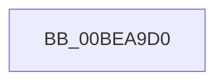

# KiMceLinkage

- RVA: `0x00BEA9D0`–`0x00BEAA4F` (길이 `127` bytes)
- VA: `0x0000000140BEA9D0`
- 실행 섹션: `INITKDBG`
- PDB 이름 있음: `예`; PDB Function 태그: `아니요`
- unwind 정보 RVA: `0x000C2F38`
- 디코드: `34`개 명령, `127/127` bytes 표시
- 미해석 바이트: `0` (있으면 어셈블리에 `.byte`로 보존)

> 이 문서는 커널 이미지의 기계어와 PDB 기호를 분석해 생성했습니다. 4번과 5번은 함수 원형과 자료형을 바이너리 사용 방식에서 추정한 C 해석이며 원본 소스 복구 결과는 아닙니다.

## 1. Dependencies

- 직접 호출 지점: **1**; 고유 호출 대상: **1**
- 직접 호출자로 확인된 함수: **0**
- RIP 상대 이미지 참조: **0**

### Outgoing calls
- `0x00BEAA10` → [KiMceDispatch](KiMceDispatch_function_00BE37B0.md) (function, `0x00BE37B0`)

### Direct callers
- 이 함수 시작 RVA로 연결되는 직접 call은 확인되지 않았습니다. 간접 호출은 완전히 역산할 수 없습니다.

### Static image references
- 디코드된 RIP-relative 메모리 참조가 없습니다.

## 2. Other-region calls and transfers

- 다른 실행 섹션으로 향하는 call: **0**
- 별도 외부 분기/꼬리 이동을 확인하지 못했습니다.

## 3. Assembly (complete function range)

```asm
00BEA9D0  41 53                           push r11
00BEA9D2  41 52                           push r10
00BEA9D4  41 51                           push r9
00BEA9D6  41 50                           push r8
00BEA9D8  51                              push rcx
00BEA9D9  52                              push rdx
00BEA9DA  50                              push rax
00BEA9DB  48 81 EC 80 00 00 00            sub rsp, 0x80
00BEA9E2  0F 29 44 24 20                  movaps xmmword ptr [rsp + 0x20], xmm0
00BEA9E7  0F 29 4C 24 30                  movaps xmmword ptr [rsp + 0x30], xmm1
00BEA9EC  0F 29 54 24 40                  movaps xmmword ptr [rsp + 0x40], xmm2
00BEA9F1  0F 29 5C 24 50                  movaps xmmword ptr [rsp + 0x50], xmm3
00BEA9F6  0F 29 64 24 60                  movaps xmmword ptr [rsp + 0x60], xmm4
00BEA9FB  0F 29 6C 24 70                  movaps xmmword ptr [rsp + 0x70], xmm5
00BEAA00  48 8D 8C 24 C8 00 00 00         lea rcx, [rsp + 0xc8]
00BEAA08  48 8B 94 24 C0 00 00 00         mov rdx, qword ptr [rsp + 0xc0]
00BEAA10  E8 9B 8D FF FF                  call 0x140be37b0
00BEAA15  48 89 84 24 C0 00 00 00         mov qword ptr [rsp + 0xc0], rax
00BEAA1D  0F 28 6C 24 70                  movaps xmm5, xmmword ptr [rsp + 0x70]
00BEAA22  0F 28 64 24 60                  movaps xmm4, xmmword ptr [rsp + 0x60]
00BEAA27  0F 28 5C 24 50                  movaps xmm3, xmmword ptr [rsp + 0x50]
00BEAA2C  0F 28 54 24 40                  movaps xmm2, xmmword ptr [rsp + 0x40]
00BEAA31  0F 28 4C 24 30                  movaps xmm1, xmmword ptr [rsp + 0x30]
00BEAA36  0F 28 44 24 20                  movaps xmm0, xmmword ptr [rsp + 0x20]
00BEAA3B  48 81 C4 80 00 00 00            add rsp, 0x80
00BEAA42  58                              pop rax
00BEAA43  5A                              pop rdx
00BEAA44  59                              pop rcx
00BEAA45  41 58                           pop r8
00BEAA47  41 59                           pop r9
00BEAA49  41 5A                           pop r10
00BEAA4B  41 5B                           pop r11
00BEAA4D  5D                              pop rbp
00BEAA4E  C3                              ret
```

## 4. C-style interpretation (structured pseudocode)

```c
__int64 __fastcall KiMceLinkage(__int64 a1, __int64 a2, __int64 a3, __int64 a4)
{
    __int64 result;
    __int64 v_rsp;
    unsigned __int64 v_stack_m48;
    unsigned __int64 v_stack_m58;
    unsigned __int64 v_stack_m68;
    unsigned __int64 v_stack_m78;
    unsigned __int64 v_stack_m88;
    unsigned __int64 v_stack_m98;
    unsigned __int64 v_stack_p10;
    unsigned __int64 v_stack_p8;

    v_rsp = (v_rsp) - (128);
    v_stack_m98 = v_xmm0;
    v_stack_m88 = v_xmm1;
    v_stack_m78 = v_xmm2;
    v_stack_m68 = v_xmm3;
    v_stack_m58 = v_xmm4;
    v_stack_m48 = v_xmm5;
    result = KiMceDispatch(v_stack_p10, v_stack_p8, a3, a4);
    v_stack_p8 = result;
    v_rsp = (v_rsp) + (128);
    return result;
}
```

## 5. (Beta) C Style

```c
int64_t KiMceLinkage(int64_t Arg1, int64_t Arg2, int64_t Arg3, int64_t Arg4)
{
    int64_t result;
    int64_t local_rsp;
    uint64_t v_stack_m48;
    uint64_t v_stack_m58;
    uint64_t v_stack_m68;
    uint64_t v_stack_m78;
    uint64_t v_stack_m88;
    uint64_t v_stack_m98;
    uint64_t v_stack_p10;
    uint64_t v_stack_p8;

    local_rsp = (local_rsp) - (128);
    v_stack_m98 = v_xmm0;
    v_stack_m88 = v_xmm1;
    v_stack_m78 = v_xmm2;
    v_stack_m68 = v_xmm3;
    v_stack_m58 = v_xmm4;
    v_stack_m48 = v_xmm5;
    result = KiMceDispatch(v_stack_p10, v_stack_p8, Arg3, Arg4);
    v_stack_p8 = result;
    local_rsp = (local_rsp) + (128);
    return result;
}
```

## 6. Execution-region graph

[열기: 2D/3D 그래프와 함수 탐색 컨트롤 패널](../../../control-panel.html?section=initkdbg&rva=0x00BEA9D0&view=graph)

- 2D 그래프는 위에서 아래로 흐르고, 3D 그래프는 빈 공간을 드래그해 회전합니다. Shift+드래그는 이동, 휠은 확대·축소, 함수 노드 선택은 대상 보고서 이동입니다.

### Static fallback


