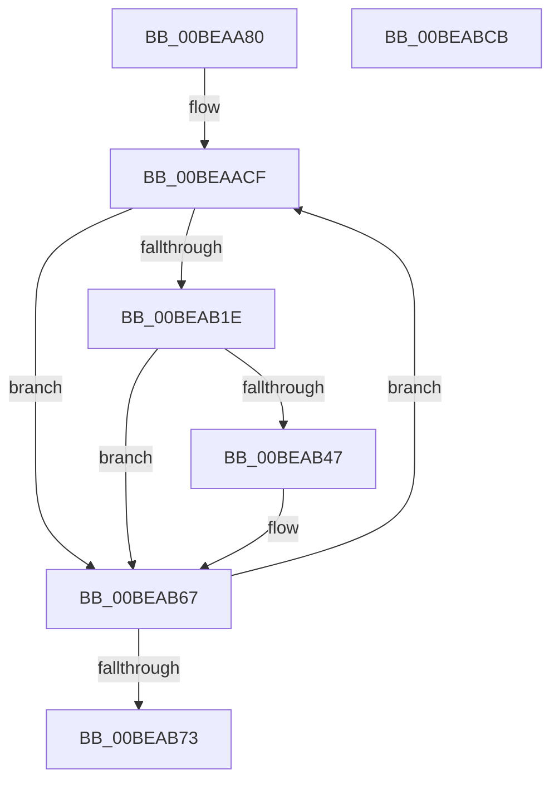

# KiTimerDispatch

- RVA: `0x00BEAA80`–`0x00BEABCC` (길이 `332` bytes)
- VA: `0x0000000140BEAA80`
- 실행 섹션: `INITKDBG`
- PDB 이름 있음: `예`; PDB Function 태그: `아니요`
- unwind 정보 RVA: `0x000C9FF0`
- 디코드: `93`개 명령, `332/332` bytes 표시
- 미해석 바이트: `0` (있으면 어셈블리에 `.byte`로 보존)

> 이 문서는 커널 이미지의 기계어와 PDB 기호를 분석해 생성했습니다. 4번과 5번은 함수 원형과 자료형을 바이너리 사용 방식에서 추정한 C 해석이며 원본 소스 복구 결과는 아닙니다.

## 1. Dependencies

- 직접 호출 지점: **1**; 고유 호출 대상: **1**
- 직접 호출자로 확인된 함수: **0**
- RIP 상대 이미지 참조: **0**

### Outgoing calls
- `0x00BEABB9` → `indirect target` (indirect, 간접 대상)

### Direct callers
- 이 함수 시작 RVA로 연결되는 직접 call은 확인되지 않았습니다. 간접 호출은 완전히 역산할 수 없습니다.

### Static image references
- 디코드된 RIP-relative 메모리 참조가 없습니다.

## 2. Other-region calls and transfers

- 다른 실행 섹션으로 향하는 call: **0**
- 별도 외부 분기/꼬리 이동을 확인하지 못했습니다.

## 3. Assembly (complete function range)

```asm
00BEAA80  48 89 5C 24 18                  mov qword ptr [rsp + 0x18], rbx
00BEAA85  48 9C                           pushfq
00BEAA87  56                              push rsi
00BEAA88  57                              push rdi
00BEAA89  48 83 EC 20                     sub rsp, 0x20
00BEAA8D  4C 8B D2                        mov r10, rdx
00BEAA90  0F AE E8                        lfence
00BEAA93  4C 33 51 40                     xor r10, qword ptr [rcx + 0x40]
00BEAA97  BB 19 00 00 00                  mov ebx, 0x19
00BEAA9C  8B 44 24 30                     mov eax, dword ptr [rsp + 0x30]
00BEAAA0  48 BE 44 20 C5 44 21 B8 20 C5   movabs rsi, 0xc520b82144c52044
00BEAAAA  48 89 44 24 40                  mov qword ptr [rsp + 0x40], rax
00BEAAAF  48 B8 00 00 00 00 00 80 FF FF   movabs rax, 0xffff800000000000
00BEAAB9  4C 0B D0                        or r10, rax
00BEAABC  41 8A CA                        mov cl, r10b
00BEAABF  49 8B FA                        mov rdi, r10
00BEAAC2  80 E1 3F                        and cl, 0x3f
00BEAAC5  48 D3 CF                        ror rdi, cl
00BEAAC8  45 33 DB                        xor r11d, r11d
00BEAACB  4D 8D 4A F8                     lea r9, [r10 - 8]
00BEAACF  49 8D 41 08                     lea rax, [r9 + 8]
00BEAAD3  41 8B CB                        mov ecx, r11d
00BEAAD6  4C 8B 00                        mov r8, qword ptr [rax]
00BEAAD9  4C 8D 08                        lea r9, [rax]
00BEAADC  49 8B C0                        mov rax, r8
00BEAADF  BA C8 00 00 00                  mov edx, 0xc8
00BEAAE4  48 33 C7                        xor rax, rdi
00BEAAE7  41 2B D3                        sub edx, r11d
00BEAAEA  49 03 C2                        add rax, r10
00BEAAED  48 03 C8                        add rcx, rax
00BEAAF0  41 8B C3                        mov eax, r11d
00BEAAF3  49 89 09                        mov qword ptr [r9], rcx
00BEAAF6  48 33 D0                        xor rdx, rax
00BEAAF9  41 8B C8                        mov ecx, r8d
00BEAAFC  41 80 F0 FA                     xor r8b, 0xfa
00BEAB00  F7 D1                           not ecx
00BEAB02  41 80 E0 3F                     and r8b, 0x3f
00BEAB06  83 E1 3F                        and ecx, 0x3f
00BEAB09  48 D3 CA                        ror rdx, cl
00BEAB0C  41 8A C8                        mov cl, r8b
00BEAB0F  48 33 FA                        xor rdi, rdx
00BEAB12  48 D3 C7                        rol rdi, cl
00BEAB15  49 03 FA                        add rdi, r10
00BEAB18  41 83 FB 18                     cmp r11d, 0x18
00BEAB1C  75 49                           jne 0x140beab67
00BEAB1E  48 89 74 24 40                  mov qword ptr [rsp + 0x40], rsi
00BEAB23  48 8B 4C 24 40                  mov rcx, qword ptr [rsp + 0x40]
00BEAB28  48 8B 44 24 40                  mov rax, qword ptr [rsp + 0x40]
00BEAB2D  48 C1 E0 16                     shl rax, 0x16
00BEAB31  48 C1 E9 2A                     shr rcx, 0x2a
00BEAB35  48 0B C1                        or rax, rcx
00BEAB38  48 89 44 24 40                  mov qword ptr [rsp + 0x40], rax
00BEAB3D  48 8B 44 24 40                  mov rax, qword ptr [rsp + 0x40]
00BEAB42  49 3B 02                        cmp rax, qword ptr [r10]
00BEAB45  74 20                           je 0x140beab67
00BEAB47  48 8B 44 24 40                  mov rax, qword ptr [rsp + 0x40]
00BEAB4C  49 33 01                        xor rax, qword ptr [r9]
00BEAB4F  49 33 02                        xor rax, qword ptr [r10]
00BEAB52  49 89 01                        mov qword ptr [r9], rax
00BEAB55  48 8B 44 24 40                  mov rax, qword ptr [rsp + 0x40]
00BEAB5A  49 33 01                        xor rax, qword ptr [r9]
00BEAB5D  41 03 59 04                     add ebx, dword ptr [r9 + 4]
00BEAB61  49 33 02                        xor rax, qword ptr [r10]
00BEAB64  49 89 01                        mov qword ptr [r9], rax
00BEAB67  41 FF C3                        inc r11d
00BEAB6A  44 3B DB                        cmp r11d, ebx
00BEAB6D  0F 82 5C FF FF FF               jb 0x140beaacf
00BEAB73  48 89 74 24 40                  mov qword ptr [rsp + 0x40], rsi
00BEAB78  45 33 C9                        xor r9d, r9d
00BEAB7B  48 8B 54 24 40                  mov rdx, qword ptr [rsp + 0x40]
00BEAB80  45 33 C0                        xor r8d, r8d
00BEAB83  48 8B 44 24 40                  mov rax, qword ptr [rsp + 0x40]
00BEAB88  49 8B CA                        mov rcx, r10
00BEAB8B  48 C1 EA 2A                     shr rdx, 0x2a
00BEAB8F  48 C1 E0 16                     shl rax, 0x16
00BEAB93  48 0B C2                        or rax, rdx
00BEAB96  48 89 44 24 40                  mov qword ptr [rsp + 0x40], rax
00BEAB9B  49 8B C2                        mov rax, r10
00BEAB9E  48 8B 54 24 40                  mov rdx, qword ptr [rsp + 0x40]
00BEABA3  49 33 12                        xor rdx, qword ptr [r10]
00BEABA6  41 C6 42 03 11                  mov byte ptr [r10 + 3], 0x11
00BEABAB  41 C6 42 02 31                  mov byte ptr [r10 + 2], 0x31
00BEABB0  41 C6 42 01 48                  mov byte ptr [r10 + 1], 0x48
00BEABB5  41 C6 02 2E                     mov byte ptr [r10], 0x2e
00BEABB9  FF D0                           call rax
00BEABBB  0F 1F 00                        nop dword ptr [rax]
00BEABBE  48 8B 5C 24 50                  mov rbx, qword ptr [rsp + 0x50]
00BEABC3  48 83 C4 20                     add rsp, 0x20
00BEABC7  5F                              pop rdi
00BEABC8  5E                              pop rsi
00BEABC9  59                              pop rcx
00BEABCA  C3                              ret
00BEABCB  CC                              int3
```

## 4. C-style interpretation (structured pseudocode)

```c
__int64 __fastcall KiTimerDispatch(__int64 a1, __int64 a2)
{
    __int64 result;
    __int64 v_r10;
    __int64 v_r11;
    __int64 v_rbx;
    __int64 v_rdi;
    __int64 v_rsp;
    unsigned int v_stack_m8;
    unsigned __int64 v_stack_p18;
    unsigned __int64 v_stack_p8;

    v_stack_p18 = v_rbx;
    v_rsp = (v_rsp) - (32);
    v_r10 = (a2) ^ (*(unsigned __int64 *)(a1 + 64));
    v_stack_p8 = (unsigned int)(v_stack_m8);
    v_r10 = (v_r10) | ((unsigned int)(v_stack_m8));
    a1 = (unsigned __int8)(((unsigned __int8)(v_r10)) & (63));
    v_r11 = 0;
loc_00BEAACF:
    result = (*(unsigned __int64 *)(v_r10 - 8 + 8)) ^ (v_r10);
    a2 = (unsigned int)((200) - (0));
    result = (result) + (v_r10);
    a1 = (0) + (result);
    *(unsigned __int64 *)(v_r10 - 8 + 8) = a1;
    a2 = (a2) ^ (0);
    a3 = (unsigned __int8)((*(unsigned __int64 *)(v_r10 - 8 + 8)) ^ (250));
    a1 = (unsigned int)(~((unsigned int)((unsigned int)(*(unsigned __int64 *)(v_r10 - 8 + 8)))));
    a3 = (unsigned __int8)((a3) & (63));
    a1 = (unsigned int)((a1) & (63));
    v_rdi = (v_r10) ^ (a2);
    v_rdi = (v_rdi) + (v_r10);
    if (0 != 24) goto loc_00BEAB67;
    v_stack_p8 = v_rsi;
    result = (v_stack_p8) << (22);
    a1 = (v_stack_p8) >> (42);
    result = (result) | (a1);
    v_stack_p8 = result;
    result = v_stack_p8;
    v_rbx = 25;
    if (v_stack_p8 != (*(unsigned __int64 *)(v_r10))) {
        result = v_stack_p8;
        result = (result) ^ (*(unsigned __int64 *)(v_r10 - 8 + 8));
        result = (result) ^ (*(unsigned __int64 *)(v_r10));
        *(unsigned __int64 *)(v_r10 - 8 + 8) = result;
        result = v_stack_p8;
        result = (result) ^ (*(unsigned __int64 *)(v_r10 - 8 + 8));
        v_rbx = (unsigned int)((25) + (*(unsigned int *)(v_r10 - 8 + 8 + 4)));
        result = (result) ^ (*(unsigned __int64 *)(v_r10));
        *(unsigned __int64 *)(v_r10 - 8 + 8) = result;
    }
    v_r11 = (unsigned int)((v_r11) + 1);
    if (((unsigned int)(v_r11)) < ((unsigned int)(v_rbx))) goto loc_00BEAACF;
    v_stack_p8 = v_rsi;
    a4 = 0;
    a3 = 0;
    a2 = (v_stack_p8) >> (42);
    result = (v_stack_p8) << (22);
    result = (result) | (a2);
    v_stack_p8 = result;
    a2 = (v_stack_p8) ^ (*(unsigned __int64 *)(v_r10));
    *(unsigned __int8 *)(v_r10 + 3) = 17;
    *(unsigned __int8 *)(v_r10 + 2) = 49;
    *(unsigned __int8 *)(v_r10 + 1) = 72;
    *(unsigned __int8 *)(v_r10) = 46;
    result = kernel_indirect_call(v_r10, a2, a3, a4);
    v_rsp = (v_rsp) + (32);
    return result;
}
```

## 5. (Beta) C Style

```c
int64_t KiTimerDispatch(void *Arg1, void *Arg2)
{
    uint8_t *arg1 = (uint8_t *)Arg1;
    uint8_t *arg2 = (uint8_t *)Arg2;

    int64_t result;
    int64_t local_r10;
    int64_t local_r11;
    int64_t local_rbx;
    int64_t local_rdi;
    int64_t local_rsp;
    uint32_t v_stack_m8;
    uint64_t v_stack_p18;
    uint64_t v_stack_p8;

    v_stack_p18 = local_rbx;
    local_rsp = (local_rsp) - (32);
    local_r10 = (Arg2) ^ (*(uint64_t *)(arg1 + 0x40));
    v_stack_p8 = (uint32_t)(v_stack_m8);
    local_r10 = (local_r10) | ((uint32_t)(v_stack_m8));
    Arg1 = (uint8_t)(((uint8_t)(local_r10)) & (63));
    local_r11 = 0;
loc_00BEAACF:
    result = (*(uint64_t *)(local_r10 - 0x8 + 0x8)) ^ (local_r10);
    Arg2 = (uint32_t)((200) - (0));
    result = (result) + (local_r10);
    Arg1 = (0) + (result);
    *(void **)(local_r10 - 0x8 + 0x8) = Arg1;
    Arg2 = (Arg2) ^ (0);
    a3 = (uint8_t)((*(uint64_t *)(local_r10 - 0x8 + 0x8)) ^ (250));
    Arg1 = (uint32_t)(~((uint32_t)((uint32_t)(*(uint64_t *)(local_r10 - 0x8 + 0x8)))));
    a3 = (uint8_t)((a3) & (63));
    Arg1 = (uint32_t)((Arg1) & (63));
    local_rdi = (local_r10) ^ (Arg2);
    local_rdi = (local_rdi) + (local_r10);
    if (0 != 24) goto loc_00BEAB67;
    v_stack_p8 = local_rsi;
    result = (v_stack_p8) << (22);
    Arg1 = (v_stack_p8) >> (42);
    result = (result) | (Arg1);
    v_stack_p8 = result;
    result = v_stack_p8;
    local_rbx = 25;
    if (v_stack_p8 != (*(uint64_t *)(local_r10))) {
        result = v_stack_p8;
        result = (result) ^ (*(uint64_t *)(local_r10 - 0x8 + 0x8));
        result = (result) ^ (*(uint64_t *)(local_r10));
        *(uint64_t *)(local_r10 - 0x8 + 0x8) = result;
        result = v_stack_p8;
        result = (result) ^ (*(uint64_t *)(local_r10 - 0x8 + 0x8));
        local_rbx = (uint32_t)((25) + (*(uint32_t *)(local_r10 - 0x8 + 0x8 + 0x4)));
        result = (result) ^ (*(uint64_t *)(local_r10));
        *(uint64_t *)(local_r10 - 0x8 + 0x8) = result;
    }
    local_r11 = (uint32_t)((local_r11) + 1);
    if (((uint32_t)(local_r11)) < ((uint32_t)(local_rbx))) goto loc_00BEAACF;
    v_stack_p8 = local_rsi;
    a4 = 0;
    a3 = 0;
    Arg2 = (v_stack_p8) >> (42);
    result = (v_stack_p8) << (22);
    result = (result) | (Arg2);
    v_stack_p8 = result;
    Arg2 = (v_stack_p8) ^ (*(uint64_t *)(local_r10));
    *(uint8_t *)(local_r10 + 0x3) = 17;
    *(uint8_t *)(local_r10 + 0x2) = 49;
    *(uint8_t *)(local_r10 + 0x1) = 72;
    *(uint8_t *)(local_r10) = 46;
    result = kernel_indirect_call(local_r10, Arg2, a3, a4);
    local_rsp = (local_rsp) + (32);
    return result;
}
```

### 관측된 메모리 오프셋

구조체 형식이 확인되지 않은 접근은 인자 기준의 오프셋으로만 기록했습니다.

| 기준 인자 | 오프셋 표현 | 폭 (bit) | 접근 |
|---|---:|---:|---|
| `Arg1` | `+ 0x40` | `64` | `R` |
| `Arg2` | `- 0x8` | `64` | `R` |
| `Arg2` | `+ 0x0` | `8` | `W` |
| `Arg2` | `+ 0x0` | `64` | `R` |
| `Arg2` | `+ 0x0` | `64` | `W` |
| `Arg2` | `+ 0x1` | `8` | `W` |
| `Arg2` | `+ 0x2` | `8` | `W` |
| `Arg2` | `+ 0x3` | `8` | `W` |
| `Arg2` | `+ 0x4` | `32` | `R` |
| `Arg2` | `+ 0x8` | `64` | `R` |

## 6. Execution-region graph

[열기: 2D/3D 그래프와 함수 탐색 컨트롤 패널](../../../control-panel.html?section=initkdbg&rva=0x00BEAA80&view=graph)

- 2D 그래프는 위에서 아래로 흐르고, 3D 그래프는 빈 공간을 드래그해 회전합니다. Shift+드래그는 이동, 휠은 확대·축소, 함수 노드 선택은 대상 보고서 이동입니다.

### Static fallback


