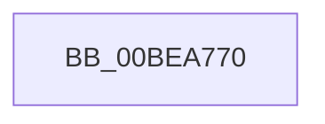

# RtlLookupFunctionEntryEx

- RVA: `0x00BEA770`–`0x00BEA7A8` (길이 `56` bytes)
- VA: `0x0000000140BEA770`
- 실행 섹션: `INITKDBG`
- PDB 이름 있음: `예`; PDB Function 태그: `아니요`
- unwind 정보 RVA: `0x000C2F24`
- 디코드: `12`개 명령, `56/56` bytes 표시
- 미해석 바이트: `0` (있으면 어셈블리에 `.byte`로 보존)

> 이 문서는 커널 이미지의 기계어와 PDB 기호를 분석해 생성했습니다. 4번과 5번은 함수 원형과 자료형을 바이너리 사용 방식에서 추정한 C 해석이며 원본 소스 복구 결과는 아닙니다.

## 1. Dependencies

- 직접 호출 지점: **1**; 고유 호출 대상: **1**
- 직접 호출자로 확인된 함수: **0**
- RIP 상대 이미지 참조: **0**

### Outgoing calls
- `0x00BEA78C` → `indirect target` (indirect, 간접 대상)

### Direct callers
- 이 함수 시작 RVA로 연결되는 직접 call은 확인되지 않았습니다. 간접 호출은 완전히 역산할 수 없습니다.

### Static image references
- 디코드된 RIP-relative 메모리 참조가 없습니다.

## 2. Other-region calls and transfers

- 다른 실행 섹션으로 향하는 call: **0**
- 별도 외부 분기/꼬리 이동을 확인하지 못했습니다.

## 3. Assembly (complete function range)

```asm
00BEA770  2E 48 31 11                     xor qword ptr cs:[rcx], rdx
00BEA774  48 31 51 08                     xor qword ptr [rcx + 8], rdx
00BEA778  48 8D 91 00 F0 FF FF            lea rdx, [rcx - 0x1000]
00BEA77F  8B 82 08 08 00 00               mov eax, dword ptr [rdx + 0x808]
00BEA785  48 03 C2                        add rax, rdx
00BEA788  48 83 EC 28                     sub rsp, 0x28
00BEA78C  FF D0                           call rax
00BEA78E  48 83 C4 28                     add rsp, 0x28
00BEA792  4C 8B 80 20 01 00 00            mov r8, qword ptr [rax + 0x120]
00BEA799  48 8D 88 B8 07 00 00            lea rcx, [rax + 0x7b8]
00BEA7A0  BA 01 00 00 00                  mov edx, 1
00BEA7A5  41 FF E0                        jmp r8
```

## 4. C-style interpretation (structured pseudocode)

```c
__int64 __fastcall RtlLookupFunctionEntryEx(__int64 a1, __int64 a2)
{
    __int64 result;
    __int64 v_rsp;

    result = ((unsigned int)(*(unsigned int *)(a1 - 4096 + 2056))) + (a1 - 4096);
    v_rsp = (v_rsp) - (40);
    result = kernel_indirect_call(a1, a1 - 4096, a3, a4);
    v_rsp = (v_rsp) + (40);
}
```

## 5. (Beta) C Style

```c
int64_t RtlLookupFunctionEntryEx(void *Arg1, int64_t Arg2)
{
    uint8_t *arg1 = (uint8_t *)Arg1;

    int64_t result;
    int64_t local_rsp;

    result = ((uint32_t)(*(uint32_t *)(arg1 - 0x1000 + 0x808))) + (Arg1 - 4096);
    local_rsp = (local_rsp) - (40);
    result = kernel_indirect_call(Arg1, Arg1 - 4096, a3, a4);
    local_rsp = (local_rsp) + (40);
}
```

### 관측된 메모리 오프셋

구조체 형식이 확인되지 않은 접근은 인자 기준의 오프셋으로만 기록했습니다.

| 기준 인자 | 오프셋 표현 | 폭 (bit) | 접근 |
|---|---:|---:|---|
| `Arg1` | `- 0x1000` | `64` | `R` |
| `Arg1` | `+ 0x0` | `64` | `R/W` |
| `Arg1` | `+ 0x8` | `64` | `R/W` |
| `Arg1` | `+ 0x808` | `32` | `R` |

## 6. Execution-region graph

[열기: 2D/3D 그래프와 함수 탐색 컨트롤 패널](../../../control-panel.html?section=initkdbg&rva=0x00BEA770&view=graph)

- 2D 그래프는 위에서 아래로 흐르고, 3D 그래프는 빈 공간을 드래그해 회전합니다. Shift+드래그는 이동, 휠은 확대·축소, 함수 노드 선택은 대상 보고서 이동입니다.

### Static fallback


