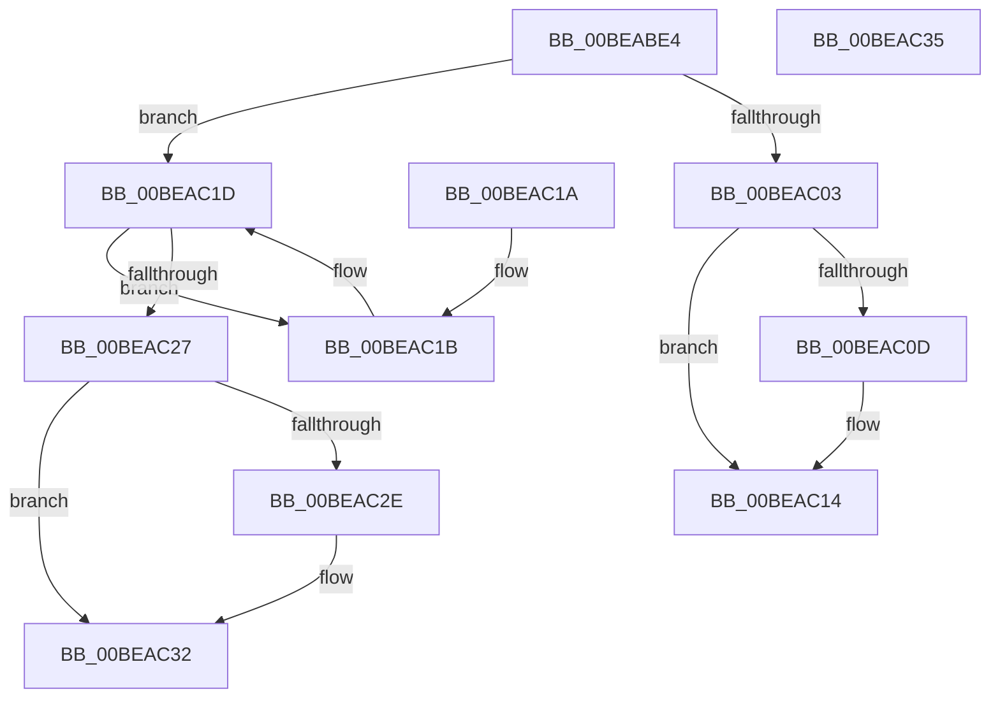

# RtlMinimalBarrier

- RVA: `0x00BEABE4`–`0x00BEAC36` (길이 `82` bytes)
- VA: `0x0000000140BEABE4`
- 실행 섹션: `INITKDBG`
- PDB 이름 있음: `예`; PDB Function 태그: `아니요`
- unwind 정보 RVA: `0x000DB714`
- 디코드: `29`개 명령, `82/82` bytes 표시
- 미해석 바이트: `0` (있으면 어셈블리에 `.byte`로 보존)

> 이 문서는 커널 이미지의 기계어와 PDB 기호를 분석해 생성했습니다. 4번과 5번은 함수 원형과 자료형을 바이너리 사용 방식에서 추정한 C 해석이며 원본 소스 복구 결과는 아닙니다.

## 1. Dependencies

- 직접 호출 지점: **0**; 고유 호출 대상: **0**
- 직접 호출자로 확인된 함수: **1**
- RIP 상대 이미지 참조: **0**

### Outgoing calls
- 직접 디코드된 call 명령이 없습니다.

### Direct callers
- [sub_00BE9DF0](Unknown_function_00BE9DF0.md) at `0x00BE9F45`
- [sub_00BE9DF0](Unknown_function_00BE9DF0.md) at `0x00BEA037`
- [sub_00BE9DF0](Unknown_function_00BE9DF0.md) at `0x00BEA19A`
- [sub_00BE9DF0](Unknown_function_00BE9DF0.md) at `0x00BEA20C`
- [sub_00BE9DF0](Unknown_function_00BE9DF0.md) at `0x00BEA222`
- [sub_00BE9DF0](Unknown_function_00BE9DF0.md) at `0x00BEA3DC`
- [sub_00BE9DF0](Unknown_function_00BE9DF0.md) at `0x00BEA433`
- [sub_00BE9DF0](Unknown_function_00BE9DF0.md) at `0x00BEA51F`

### Static image references
- 디코드된 RIP-relative 메모리 참조가 없습니다.

## 2. Other-region calls and transfers

- 다른 실행 섹션으로 향하는 call: **0**
- 별도 외부 분기/꼬리 이동을 확인하지 못했습니다.

## 3. Assembly (complete function range)

```asm
00BEABE4  83 C8 FF                        or eax, 0xffffffff
00BEABE7  F0 0F C1 01                     lock xadd dword ptr [rcx], eax
00BEABEB  FF C8                           dec eax
00BEABED  41 B9 00 00 00 80               mov r9d, 0x80000000
00BEABF3  44 8B C0                        mov r8d, eax
00BEABF6  41 F7 D0                        not r8d
00BEABF9  45 23 C1                        and r8d, r9d
00BEABFC  A9 FF FF FF 7F                  test eax, 0x7fffffff
00BEAC01  75 1A                           jne 0x140beac1d
00BEAC03  44 0B 41 04                     or r8d, dword ptr [rcx + 4]
00BEAC07  0F BA E2 10                     bt edx, 0x10
00BEAC0B  73 07                           jae 0x140beac14
00BEAC0D  C7 41 04 01 00 00 00            mov dword ptr [rcx + 4], 1
00BEAC14  44 87 01                        xchg dword ptr [rcx], r8d
00BEAC17  B0 01                           mov al, 1
00BEAC19  C3                              ret
00BEAC1A  CC                              int3
00BEAC1B  F3 90                           pause
00BEAC1D  8B 01                           mov eax, dword ptr [rcx]
00BEAC1F  41 23 C1                        and eax, r9d
00BEAC22  41 3B C0                        cmp eax, r8d
00BEAC25  75 F4                           jne 0x140beac1b
00BEAC27  90                              nop
00BEAC28  0F BA E2 10                     bt edx, 0x10
00BEAC2C  73 04                           jae 0x140beac32
00BEAC2E  F0 FF 41 04                     lock inc dword ptr [rcx + 4]
00BEAC32  32 C0                           xor al, al
00BEAC34  C3                              ret
00BEAC35  CC                              int3
```

## 4. C-style interpretation (structured pseudocode)

```c
__int64 __fastcall RtlMinimalBarrier(__int64 a1, int a2)
{
    __int64 result;

    result = (unsigned int)((result) | (0xFFFFFFFFULL));
    result = (unsigned int)((result) - 1);
    a3 = (unsigned int)(~((unsigned int)((unsigned int)(result))));
    a3 = (unsigned int)((a3) & ((unsigned int)((unsigned int)(0x80000000ULL))));
    if ((((unsigned int)(result)) & (0x7FFFFFFFULL)) != 0) goto loc_00BEAC1D;
    a3 = (unsigned int)((a3) | (*(unsigned int *)(a1 + 4)));
    if (!(condition_is_above_or_equal)) {
        *(unsigned int *)(a1 + 4) = 1;
    }
    return 1;
loc_00BEAC1B:
loc_00BEAC1D:
    result = (unsigned int)(((unsigned int)(*(unsigned int *)(a1))) & ((unsigned int)((unsigned int)(0x80000000ULL))));
    if (((unsigned int)(result)) != ((unsigned int)(a3))) goto loc_00BEAC1B;
    if (((unsigned int)(result)) < ((unsigned int)(a3))) {
    }
    result = 0;
    return result;
}
```

## 5. (Beta) C Style

```c
int64_t RtlMinimalBarrier(void *Arg1, int32_t Arg2)
{
    uint8_t *arg1 = (uint8_t *)Arg1;

    int64_t result;

    result = (uint32_t)((result) | (0xFFFFFFFFULL));
    result = (uint32_t)((result) - 1);
    a3 = (uint32_t)(~((uint32_t)((uint32_t)(result))));
    a3 = (uint32_t)((a3) & ((uint32_t)((uint32_t)(0x80000000ULL))));
    if ((((uint32_t)(result)) & (0x7FFFFFFFULL)) != 0) goto loc_00BEAC1D;
    a3 = (uint32_t)((a3) | (*(uint32_t *)(arg1 + 0x4)));
    if (!(condition_is_above_or_equal)) {
        *(uint32_t *)(arg1 + 0x4) = 1;
    }
    return 1;
loc_00BEAC1B:
loc_00BEAC1D:
    result = (uint32_t)(((uint32_t)(*(uint32_t *)(arg1))) & ((uint32_t)((uint32_t)(0x80000000ULL))));
    if (((uint32_t)(result)) != ((uint32_t)(a3))) goto loc_00BEAC1B;
    if (((uint32_t)(result)) < ((uint32_t)(a3))) {
    }
    result = 0;
    return result;
}
```

### 관측된 메모리 오프셋

구조체 형식이 확인되지 않은 접근은 인자 기준의 오프셋으로만 기록했습니다.

| 기준 인자 | 오프셋 표현 | 폭 (bit) | 접근 |
|---|---:|---:|---|
| `Arg1` | `+ 0x0` | `32` | `R` |
| `Arg1` | `+ 0x0` | `32` | `R/W` |
| `Arg1` | `+ 0x4` | `32` | `R` |
| `Arg1` | `+ 0x4` | `32` | `R/W` |
| `Arg1` | `+ 0x4` | `32` | `W` |

## 6. Execution-region graph

[열기: 2D/3D 그래프와 함수 탐색 컨트롤 패널](../../../control-panel.html?section=initkdbg&rva=0x00BEABE4&view=graph)

- 2D 그래프는 위에서 아래로 흐르고, 3D 그래프는 빈 공간을 드래그해 회전합니다. Shift+드래그는 이동, 휠은 확대·축소, 함수 노드 선택은 대상 보고서 이동입니다.

### Static fallback


