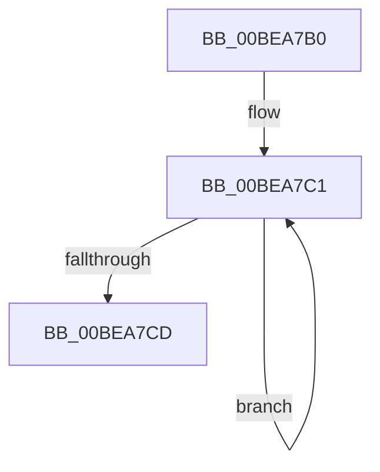

# SdbpCheckDll

- RVA: `0x00BEA7B0`–`0x00BEA7EC` (길이 `60` bytes)
- VA: `0x0000000140BEA7B0`
- 실행 섹션: `INITKDBG`
- PDB 이름 있음: `예`; PDB Function 태그: `아니요`
- unwind 정보 RVA: `0x000C2F28`
- 디코드: `19`개 명령, `60/60` bytes 표시
- 미해석 바이트: `0` (있으면 어셈블리에 `.byte`로 보존)

> 이 문서는 커널 이미지의 기계어와 PDB 기호를 분석해 생성했습니다. 4번과 5번은 함수 원형과 자료형을 바이너리 사용 방식에서 추정한 C 해석이며 원본 소스 복구 결과는 아닙니다.

## 1. Dependencies

- 직접 호출 지점: **0**; 고유 호출 대상: **0**
- 직접 호출자로 확인된 함수: **5**
- RIP 상대 이미지 참조: **0**

### Outgoing calls
- 직접 디코드된 call 명령이 없습니다.

### Direct callers
- [KiSwInterruptDispatch](../../text/50/KiSwInterruptDispatch_function_0050A5C0.md) at `0x0050BD78`
- [sub_0050C0E0](../../text/50/Unknown_function_0050C0E0.md) at `0x0051ABC9`
- [FsRtlMdlReadCompleteDevEx](../BD/FsRtlMdlReadCompleteDevEx_function_00BD1010.md) at `0x00BE37A1`
- [sub_00BE8DF0](Unknown_function_00BE8DF0.md) at `0x00BE9DE0`
- [sub_00BF16D0](../../init/BF/Unknown_function_00BF16D0.md) at `0x00C18C81`

### Static image references
- 디코드된 RIP-relative 메모리 참조가 없습니다.

## 2. Other-region calls and transfers

- 다른 실행 섹션으로 향하는 call: **0**
- 별도 외부 분기/꼬리 이동을 확인하지 못했습니다.

## 3. Assembly (complete function range)

```asm
00BEA7B0  48 8B 74 24 30                  mov rsi, qword ptr [rsp + 0x30]
00BEA7B5  48 8B 7C 24 28                  mov rdi, qword ptr [rsp + 0x28]
00BEA7BA  4C 8B 54 24 38                  mov r10, qword ptr [rsp + 0x38]
00BEA7BF  33 C0                           xor eax, eax
00BEA7C1  49 89 02                        mov qword ptr [r10], rax
00BEA7C4  49 83 EA 08                     sub r10, 8
00BEA7C8  4C 3B D4                        cmp r10, rsp
00BEA7CB  73 F4                           jae 0x140bea7c1
00BEA7CD  48 89 7C 24 28                  mov qword ptr [rsp + 0x28], rdi
00BEA7D2  8B D8                           mov ebx, eax
00BEA7D4  8B F8                           mov edi, eax
00BEA7D6  8B E8                           mov ebp, eax
00BEA7D8  4C 8B D0                        mov r10, rax
00BEA7DB  4C 8B D8                        mov r11, rax
00BEA7DE  4C 8B E0                        mov r12, rax
00BEA7E1  4C 8B E8                        mov r13, rax
00BEA7E4  4C 8B F0                        mov r14, rax
00BEA7E7  4C 8B F8                        mov r15, rax
00BEA7EA  FF E6                           jmp rsi
```

## 4. C-style interpretation (structured pseudocode)

```c
__int64 __fastcall SdbpCheckDll(__int64 a1, __int64 a2, __int64 a3, __int64 a4, __int64 a5, __int64 a6, __int64 a7)
{
    __int64 result;
    __int64 v_r10;
    unsigned __int64 v_stack_p28;

    result = 0;
loc_00BEA7C1:
    *(unsigned __int64 *)(a7) = 0;
    v_r10 = (a7) - (8);
    if (v_r10 >= v_rsp) goto loc_00BEA7C1;
    v_stack_p28 = a5;
}
```

## 5. (Beta) C Style

```c
int64_t SdbpCheckDll(int64_t Arg1, int64_t Arg2, int64_t Arg3, int64_t Arg4, int64_t Arg5, int64_t Arg6, int64_t Arg7)
{
    int64_t result;
    int64_t local_r10;
    uint64_t v_stack_p28;

    result = 0;
loc_00BEA7C1:
    *(uint64_t *)(Arg7) = 0;
    local_r10 = (Arg7) - (8);
    if (local_r10 >= local_rsp) goto loc_00BEA7C1;
    v_stack_p28 = Arg5;
}
```

## 6. Execution-region graph

[열기: 2D/3D 그래프와 함수 탐색 컨트롤 패널](../../../control-panel.html?section=initkdbg&rva=0x00BEA7B0&view=graph)

- 2D 그래프는 위에서 아래로 흐르고, 3D 그래프는 빈 공간을 드래그해 회전합니다. Shift+드래그는 이동, 휠은 확대·축소, 함수 노드 선택은 대상 보고서 이동입니다.

### Static fallback


