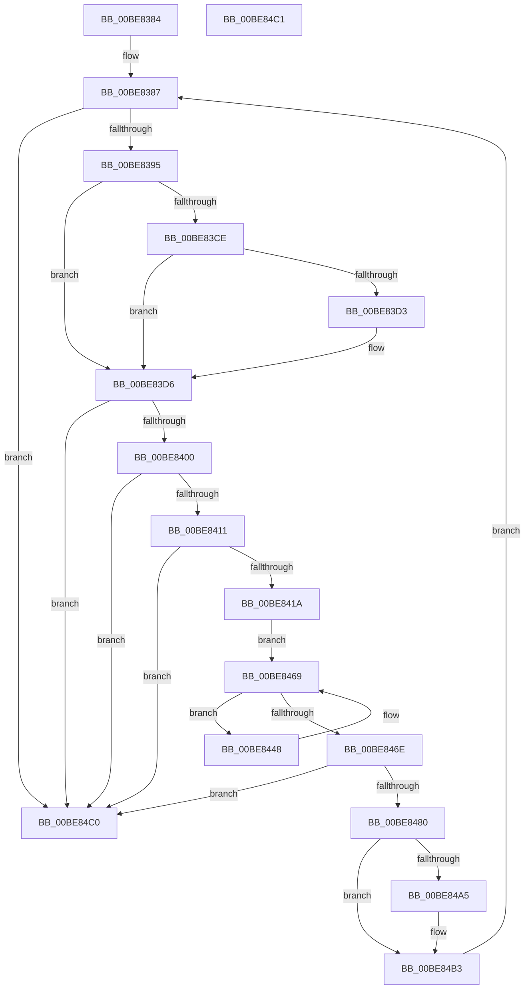

# sub_00BE8384

- RVA: `0x00BE8384`–`0x00BE84C2` (길이 `318` bytes)
- VA: `0x0000000140BE8384`
- 실행 섹션: `INITKDBG`
- PDB 이름 있음: `아니요`; PDB Function 태그: `아니요`
- unwind 정보 RVA: `0x000DB714`
- 디코드: `67`개 명령, `318/318` bytes 표시
- 미해석 바이트: `0` (있으면 어셈블리에 `.byte`로 보존)

> 이 문서는 커널 이미지의 기계어와 PDB 기호를 분석해 생성했습니다. 4번과 5번은 함수 원형과 자료형을 바이너리 사용 방식에서 추정한 C 해석이며 원본 소스 복구 결과는 아닙니다.

## 1. Dependencies

- 직접 호출 지점: **0**; 고유 호출 대상: **0**
- 직접 호출자로 확인된 함수: **12**
- RIP 상대 이미지 참조: **0**

### Outgoing calls
- 직접 디코드된 call 명령이 없습니다.

### Direct callers
- [KiSwInterruptDispatch](../../text/50/KiSwInterruptDispatch_function_0050A5C0.md) at `0x0050A95D`
- [KiSwInterruptDispatch](../../text/50/KiSwInterruptDispatch_function_0050A5C0.md) at `0x0050AE1A`
- [KiSwInterruptDispatch](../../text/50/KiSwInterruptDispatch_function_0050A5C0.md) at `0x0050AFF4`
- [KiSwInterruptDispatch](../../text/50/KiSwInterruptDispatch_function_0050A5C0.md) at `0x0050B125`
- [KiSwInterruptDispatch](../../text/50/KiSwInterruptDispatch_function_0050A5C0.md) at `0x0050B48C`
- [KiSwInterruptDispatch](../../text/50/KiSwInterruptDispatch_function_0050A5C0.md) at `0x0050B5B9`
- [sub_0050C0E0](../../text/50/Unknown_function_0050C0E0.md) at `0x0050CD68`
- [sub_0050C0E0](../../text/50/Unknown_function_0050C0E0.md) at `0x0050CFDF`
- [sub_0050C0E0](../../text/50/Unknown_function_0050C0E0.md) at `0x0050D3EE`
- [sub_0050C0E0](../../text/50/Unknown_function_0050C0E0.md) at `0x0050D54F`
- [sub_0050C0E0](../../text/50/Unknown_function_0050C0E0.md) at `0x0050D686`
- [sub_0050C0E0](../../text/50/Unknown_function_0050C0E0.md) at `0x0050DAD2`
- [sub_0050C0E0](../../text/50/Unknown_function_0050C0E0.md) at `0x0050DB4F`
- [sub_0050C0E0](../../text/50/Unknown_function_0050C0E0.md) at `0x0050DD32`
- [sub_0050C0E0](../../text/50/Unknown_function_0050C0E0.md) at `0x0050E041`
- [sub_0050C0E0](../../text/50/Unknown_function_0050C0E0.md) at `0x0050E2AD`
- [sub_0050C0E0](../../text/50/Unknown_function_0050C0E0.md) at `0x0050E516`
- [sub_0050C0E0](../../text/50/Unknown_function_0050C0E0.md) at `0x0050E6C2`
- [sub_0050C0E0](../../text/50/Unknown_function_0050C0E0.md) at `0x0050EA74`
- [sub_0050C0E0](../../text/50/Unknown_function_0050C0E0.md) at `0x0050EBFD`
- [sub_0050C0E0](../../text/50/Unknown_function_0050C0E0.md) at `0x0050ED44`
- [sub_0050C0E0](../../text/50/Unknown_function_0050C0E0.md) at `0x0050F288`
- [sub_0050C0E0](../../text/50/Unknown_function_0050C0E0.md) at `0x0050F305`
- [sub_0050C0E0](../../text/50/Unknown_function_0050C0E0.md) at `0x0050F8A8`
- [sub_0050C0E0](../../text/50/Unknown_function_0050C0E0.md) at `0x0050FAA8`
- [sub_0050C0E0](../../text/50/Unknown_function_0050C0E0.md) at `0x0050FEAD`
- [sub_0050C0E0](../../text/50/Unknown_function_0050C0E0.md) at `0x00510294`
- [sub_0050C0E0](../../text/50/Unknown_function_0050C0E0.md) at `0x005105DA`
- [sub_0050C0E0](../../text/50/Unknown_function_0050C0E0.md) at `0x00510AC7`
- [sub_0050C0E0](../../text/50/Unknown_function_0050C0E0.md) at `0x00510DBE`
- [sub_0050C0E0](../../text/50/Unknown_function_0050C0E0.md) at `0x00511010`
- [sub_0050C0E0](../../text/50/Unknown_function_0050C0E0.md) at `0x005111DF`
- [sub_0050C0E0](../../text/50/Unknown_function_0050C0E0.md) at `0x00511718`
- [sub_0050C0E0](../../text/50/Unknown_function_0050C0E0.md) at `0x005123D6`
- [sub_0050C0E0](../../text/50/Unknown_function_0050C0E0.md) at `0x0051252F`
- [sub_0050C0E0](../../text/50/Unknown_function_0050C0E0.md) at `0x0051304C`
- [sub_0050C0E0](../../text/50/Unknown_function_0050C0E0.md) at `0x00513699`
- [sub_0050C0E0](../../text/50/Unknown_function_0050C0E0.md) at `0x005138AF`
- [sub_0050C0E0](../../text/50/Unknown_function_0050C0E0.md) at `0x00513AC7`
- [sub_0050C0E0](../../text/50/Unknown_function_0050C0E0.md) at `0x0051413D`
- [sub_0050C0E0](../../text/50/Unknown_function_0050C0E0.md) at `0x00514528`
- [sub_0050C0E0](../../text/50/Unknown_function_0050C0E0.md) at `0x00514BBF`
- [sub_0050C0E0](../../text/50/Unknown_function_0050C0E0.md) at `0x00514DA4`
- [sub_0050C0E0](../../text/50/Unknown_function_0050C0E0.md) at `0x00514EDD`
- [sub_0050C0E0](../../text/50/Unknown_function_0050C0E0.md) at `0x00515480`
- [sub_0050C0E0](../../text/50/Unknown_function_0050C0E0.md) at `0x005154FD`
- [sub_0050C0E0](../../text/50/Unknown_function_0050C0E0.md) at `0x0051591F`
- [sub_0050C0E0](../../text/50/Unknown_function_0050C0E0.md) at `0x00515A73`
- [sub_0050C0E0](../../text/50/Unknown_function_0050C0E0.md) at `0x00515BCB`
- [sub_0050C0E0](../../text/50/Unknown_function_0050C0E0.md) at `0x00515D00`
- [sub_0050C0E0](../../text/50/Unknown_function_0050C0E0.md) at `0x00515F25`
- [sub_0050C0E0](../../text/50/Unknown_function_0050C0E0.md) at `0x005160F0`
- [sub_0050C0E0](../../text/50/Unknown_function_0050C0E0.md) at `0x00516244`
- [sub_0050C0E0](../../text/50/Unknown_function_0050C0E0.md) at `0x0051639C`
- [sub_0050C0E0](../../text/50/Unknown_function_0050C0E0.md) at `0x005164D1`
- [sub_0050C0E0](../../text/50/Unknown_function_0050C0E0.md) at `0x005166F6`
- [sub_0050C0E0](../../text/50/Unknown_function_0050C0E0.md) at `0x0051691B`
- [sub_0050C0E0](../../text/50/Unknown_function_0050C0E0.md) at `0x00516A6B`
- [sub_0050C0E0](../../text/50/Unknown_function_0050C0E0.md) at `0x00516BBF`
- [sub_0050C0E0](../../text/50/Unknown_function_0050C0E0.md) at `0x00516CF5`
- [sub_0050C0E0](../../text/50/Unknown_function_0050C0E0.md) at `0x00516F13`
- [sub_0050C0E0](../../text/50/Unknown_function_0050C0E0.md) at `0x005173F7`
- [sub_0050C0E0](../../text/50/Unknown_function_0050C0E0.md) at `0x00517587`
- [sub_0050C0E0](../../text/50/Unknown_function_0050C0E0.md) at `0x00517A4E`
- [sub_0050C0E0](../../text/50/Unknown_function_0050C0E0.md) at `0x005181A0`
- [sub_0050C0E0](../../text/50/Unknown_function_0050C0E0.md) at `0x00518572`
- [sub_0050C0E0](../../text/50/Unknown_function_0050C0E0.md) at `0x00518D88`
- [sub_0050C0E0](../../text/50/Unknown_function_0050C0E0.md) at `0x00519109`
- [sub_0050C0E0](../../text/50/Unknown_function_0050C0E0.md) at `0x005195AA`
- [sub_0050C0E0](../../text/50/Unknown_function_0050C0E0.md) at `0x00519ABC`
- [sub_0050C0E0](../../text/50/Unknown_function_0050C0E0.md) at `0x00519D35`
- [sub_0050C0E0](../../text/50/Unknown_function_0050C0E0.md) at `0x00519F3C`
- [sub_0050C0E0](../../text/50/Unknown_function_0050C0E0.md) at `0x0051A084`
- [sub_0051B034](../../text/51/Unknown_function_0051B034.md) at `0x0051B40A`
- [sub_0051B034](../../text/51/Unknown_function_0051B034.md) at `0x0051B720`
- [sub_0051B034](../../text/51/Unknown_function_0051B034.md) at `0x0051BB07`
- [sub_0051B034](../../text/51/Unknown_function_0051B034.md) at `0x0051BD34`
- [sub_0051B034](../../text/51/Unknown_function_0051B034.md) at `0x0051BFDF`
- [sub_0051B034](../../text/51/Unknown_function_0051B034.md) at `0x0051C10E`
- [sub_0051C138](../../text/51/Unknown_function_0051C138.md) at `0x0051C46B`
- [sub_0051C138](../../text/51/Unknown_function_0051C138.md) at `0x0051C6AE`
- [FsRtlMdlReadCompleteDevEx](../BD/FsRtlMdlReadCompleteDevEx_function_00BD1010.md) at `0x00BD14AB`
- [FsRtlMdlReadCompleteDevEx](../BD/FsRtlMdlReadCompleteDevEx_function_00BD1010.md) at `0x00BD1993`
- [FsRtlMdlReadCompleteDevEx](../BD/FsRtlMdlReadCompleteDevEx_function_00BD1010.md) at `0x00BD1C19`
- [FsRtlMdlReadCompleteDevEx](../BD/FsRtlMdlReadCompleteDevEx_function_00BD1010.md) at `0x00BD21F9`
- [FsRtlMdlReadCompleteDevEx](../BD/FsRtlMdlReadCompleteDevEx_function_00BD1010.md) at `0x00BD2D9B`
- [FsRtlMdlReadCompleteDevEx](../BD/FsRtlMdlReadCompleteDevEx_function_00BD1010.md) at `0x00BD2F89`
- [FsRtlMdlReadCompleteDevEx](../BD/FsRtlMdlReadCompleteDevEx_function_00BD1010.md) at `0x00BD3379`
- [FsRtlMdlReadCompleteDevEx](../BD/FsRtlMdlReadCompleteDevEx_function_00BD1010.md) at `0x00BD351F`
- [FsRtlMdlReadCompleteDevEx](../BD/FsRtlMdlReadCompleteDevEx_function_00BD1010.md) at `0x00BD3661`
- [FsRtlMdlReadCompleteDevEx](../BD/FsRtlMdlReadCompleteDevEx_function_00BD1010.md) at `0x00BD3AC3`
- [FsRtlMdlReadCompleteDevEx](../BD/FsRtlMdlReadCompleteDevEx_function_00BD1010.md) at `0x00BD3B40`
- [FsRtlMdlReadCompleteDevEx](../BD/FsRtlMdlReadCompleteDevEx_function_00BD1010.md) at `0x00BD3D3F`
- [FsRtlMdlReadCompleteDevEx](../BD/FsRtlMdlReadCompleteDevEx_function_00BD1010.md) at `0x00BD4066`
- [FsRtlMdlReadCompleteDevEx](../BD/FsRtlMdlReadCompleteDevEx_function_00BD1010.md) at `0x00BD42CB`
- [FsRtlMdlReadCompleteDevEx](../BD/FsRtlMdlReadCompleteDevEx_function_00BD1010.md) at `0x00BD4539`
- [FsRtlMdlReadCompleteDevEx](../BD/FsRtlMdlReadCompleteDevEx_function_00BD1010.md) at `0x00BD46F5`
- [FsRtlMdlReadCompleteDevEx](../BD/FsRtlMdlReadCompleteDevEx_function_00BD1010.md) at `0x00BD4AB4`
- [FsRtlMdlReadCompleteDevEx](../BD/FsRtlMdlReadCompleteDevEx_function_00BD1010.md) at `0x00BD4C42`
- [FsRtlMdlReadCompleteDevEx](../BD/FsRtlMdlReadCompleteDevEx_function_00BD1010.md) at `0x00BD4D8C`
- [FsRtlMdlReadCompleteDevEx](../BD/FsRtlMdlReadCompleteDevEx_function_00BD1010.md) at `0x00BD5132`
- [FsRtlMdlReadCompleteDevEx](../BD/FsRtlMdlReadCompleteDevEx_function_00BD1010.md) at `0x00BD535F`
- [FsRtlMdlReadCompleteDevEx](../BD/FsRtlMdlReadCompleteDevEx_function_00BD1010.md) at `0x00BD5E7B`
- [FsRtlMdlReadCompleteDevEx](../BD/FsRtlMdlReadCompleteDevEx_function_00BD1010.md) at `0x00BD6277`
- [FsRtlMdlReadCompleteDevEx](../BD/FsRtlMdlReadCompleteDevEx_function_00BD1010.md) at `0x00BD65DB`
- [FsRtlMdlReadCompleteDevEx](../BD/FsRtlMdlReadCompleteDevEx_function_00BD1010.md) at `0x00BD6AE0`
- [FsRtlMdlReadCompleteDevEx](../BD/FsRtlMdlReadCompleteDevEx_function_00BD1010.md) at `0x00BD6DDA`
- [FsRtlMdlReadCompleteDevEx](../BD/FsRtlMdlReadCompleteDevEx_function_00BD1010.md) at `0x00BD7045`
- [FsRtlMdlReadCompleteDevEx](../BD/FsRtlMdlReadCompleteDevEx_function_00BD1010.md) at `0x00BD7221`
- [FsRtlMdlReadCompleteDevEx](../BD/FsRtlMdlReadCompleteDevEx_function_00BD1010.md) at `0x00BD7775`
- [FsRtlMdlReadCompleteDevEx](../BD/FsRtlMdlReadCompleteDevEx_function_00BD1010.md) at `0x00BD8481`
- [FsRtlMdlReadCompleteDevEx](../BD/FsRtlMdlReadCompleteDevEx_function_00BD1010.md) at `0x00BD85D8`
- [FsRtlMdlReadCompleteDevEx](../BD/FsRtlMdlReadCompleteDevEx_function_00BD1010.md) at `0x00BD90C8`
- [FsRtlMdlReadCompleteDevEx](../BD/FsRtlMdlReadCompleteDevEx_function_00BD1010.md) at `0x00BD976C`
- [FsRtlMdlReadCompleteDevEx](../BD/FsRtlMdlReadCompleteDevEx_function_00BD1010.md) at `0x00BD9971`
- [FsRtlMdlReadCompleteDevEx](../BD/FsRtlMdlReadCompleteDevEx_function_00BD1010.md) at `0x00BD9B94`
- [FsRtlMdlReadCompleteDevEx](../BD/FsRtlMdlReadCompleteDevEx_function_00BD1010.md) at `0x00BD9DBC`
- [FsRtlMdlReadCompleteDevEx](../BD/FsRtlMdlReadCompleteDevEx_function_00BD1010.md) at `0x00BDA26D`
- [FsRtlMdlReadCompleteDevEx](../BD/FsRtlMdlReadCompleteDevEx_function_00BD1010.md) at `0x00BDA5F3`
- [FsRtlMdlReadCompleteDevEx](../BD/FsRtlMdlReadCompleteDevEx_function_00BD1010.md) at `0x00BDAD09`
- [FsRtlMdlReadCompleteDevEx](../BD/FsRtlMdlReadCompleteDevEx_function_00BD1010.md) at `0x00BDAEF1`
- [FsRtlMdlReadCompleteDevEx](../BD/FsRtlMdlReadCompleteDevEx_function_00BD1010.md) at `0x00BDB023`
- [FsRtlMdlReadCompleteDevEx](../BD/FsRtlMdlReadCompleteDevEx_function_00BD1010.md) at `0x00BDB4D1`
- [FsRtlMdlReadCompleteDevEx](../BD/FsRtlMdlReadCompleteDevEx_function_00BD1010.md) at `0x00BDB663`
- [FsRtlMdlReadCompleteDevEx](../BD/FsRtlMdlReadCompleteDevEx_function_00BD1010.md) at `0x00BDBAA4`
- [FsRtlMdlReadCompleteDevEx](../BD/FsRtlMdlReadCompleteDevEx_function_00BD1010.md) at `0x00BDBBF5`
- [FsRtlMdlReadCompleteDevEx](../BD/FsRtlMdlReadCompleteDevEx_function_00BD1010.md) at `0x00BDBD54`
- [FsRtlMdlReadCompleteDevEx](../BD/FsRtlMdlReadCompleteDevEx_function_00BD1010.md) at `0x00BDBE8D`
- [FsRtlMdlReadCompleteDevEx](../BD/FsRtlMdlReadCompleteDevEx_function_00BD1010.md) at `0x00BDC0B7`
- [FsRtlMdlReadCompleteDevEx](../BD/FsRtlMdlReadCompleteDevEx_function_00BD1010.md) at `0x00BDC288`
- [FsRtlMdlReadCompleteDevEx](../BD/FsRtlMdlReadCompleteDevEx_function_00BD1010.md) at `0x00BDC3D9`
- [FsRtlMdlReadCompleteDevEx](../BD/FsRtlMdlReadCompleteDevEx_function_00BD1010.md) at `0x00BDC531`
- [FsRtlMdlReadCompleteDevEx](../BD/FsRtlMdlReadCompleteDevEx_function_00BD1010.md) at `0x00BDC66A`
- [FsRtlMdlReadCompleteDevEx](../BD/FsRtlMdlReadCompleteDevEx_function_00BD1010.md) at `0x00BDC894`
- [FsRtlMdlReadCompleteDevEx](../BD/FsRtlMdlReadCompleteDevEx_function_00BD1010.md) at `0x00BDCABF`
- [FsRtlMdlReadCompleteDevEx](../BD/FsRtlMdlReadCompleteDevEx_function_00BD1010.md) at `0x00BDCC0C`
- [FsRtlMdlReadCompleteDevEx](../BD/FsRtlMdlReadCompleteDevEx_function_00BD1010.md) at `0x00BDCD64`
- [FsRtlMdlReadCompleteDevEx](../BD/FsRtlMdlReadCompleteDevEx_function_00BD1010.md) at `0x00BDCE97`
- [FsRtlMdlReadCompleteDevEx](../BD/FsRtlMdlReadCompleteDevEx_function_00BD1010.md) at `0x00BDD0BF`
- [FsRtlMdlReadCompleteDevEx](../BD/FsRtlMdlReadCompleteDevEx_function_00BD1010.md) at `0x00BDD5E2`
- [FsRtlMdlReadCompleteDevEx](../BD/FsRtlMdlReadCompleteDevEx_function_00BD1010.md) at `0x00BDD77A`
- [FsRtlMdlReadCompleteDevEx](../BD/FsRtlMdlReadCompleteDevEx_function_00BD1010.md) at `0x00BDDC3D`
- [FsRtlMdlReadCompleteDevEx](../BD/FsRtlMdlReadCompleteDevEx_function_00BD1010.md) at `0x00BDE380`
- [FsRtlMdlReadCompleteDevEx](../BD/FsRtlMdlReadCompleteDevEx_function_00BD1010.md) at `0x00BDE707`
- [FsRtlMdlReadCompleteDevEx](../BD/FsRtlMdlReadCompleteDevEx_function_00BD1010.md) at `0x00BDEE6E`
- [FsRtlMdlReadCompleteDevEx](../BD/FsRtlMdlReadCompleteDevEx_function_00BD1010.md) at `0x00BDF358`
- [FsRtlMdlReadCompleteDevEx](../BD/FsRtlMdlReadCompleteDevEx_function_00BD1010.md) at `0x00BDF807`
- [FsRtlMdlReadCompleteDevEx](../BD/FsRtlMdlReadCompleteDevEx_function_00BD1010.md) at `0x00BDFD1B`
- [FsRtlMdlReadCompleteDevEx](../BD/FsRtlMdlReadCompleteDevEx_function_00BD1010.md) at `0x00BDFF9D`
- [FsRtlMdlReadCompleteDevEx](../BD/FsRtlMdlReadCompleteDevEx_function_00BD1010.md) at `0x00BE01A7`
- [FsRtlMdlReadCompleteDevEx](../BD/FsRtlMdlReadCompleteDevEx_function_00BD1010.md) at `0x00BE030C`
- [FsRtlMdlReadCompleteDevEx](../BD/FsRtlMdlReadCompleteDevEx_function_00BD1010.md) at `0x00BE0983`
- [FsRtlMdlReadCompleteDevEx](../BD/FsRtlMdlReadCompleteDevEx_function_00BD1010.md) at `0x00BE0ACD`
- [FsRtlMdlReadCompleteDevEx](../BD/FsRtlMdlReadCompleteDevEx_function_00BD1010.md) at `0x00BE0D2C`
- [FsRtlMdlReadCompleteDevEx](../BD/FsRtlMdlReadCompleteDevEx_function_00BD1010.md) at `0x00BE1123`
- [FsRtlMdlReadCompleteDevEx](../BD/FsRtlMdlReadCompleteDevEx_function_00BD1010.md) at `0x00BE2BA4`
- [FsRtlMdlReadCompleteDevEx](../BD/FsRtlMdlReadCompleteDevEx_function_00BD1010.md) at `0x00BE2D54`
- [sub_00BE3A04](Unknown_function_00BE3A04.md) at `0x00BE4262`
- [sub_00BE3A04](Unknown_function_00BE3A04.md) at `0x00BE4C2C`
- [sub_00BE3A04](Unknown_function_00BE3A04.md) at `0x00BE4E6A`
- [sub_00BE3A04](Unknown_function_00BE3A04.md) at `0x00BE4FC1`
- [sub_00BE3A04](Unknown_function_00BE3A04.md) at `0x00BE5AB7`
- [sub_00BE60B0](Unknown_function_00BE60B0.md) at `0x00BE6DF6`
- [sub_00BE60B0](Unknown_function_00BE60B0.md) at `0x00BE777C`
- [sub_00BE8DF0](Unknown_function_00BE8DF0.md) at `0x00BE9110`
- [sub_00BE8DF0](Unknown_function_00BE8DF0.md) at `0x00BE95C2`
- [sub_00BE9DF0](Unknown_function_00BE9DF0.md) at `0x00BE9F31`
- [sub_00BEA550](Unknown_function_00BEA550.md) at `0x00BEA66D`
- [sub_00BEFF8C](../../init/BE/Unknown_function_00BEFF8C.md) at `0x00BF123A`
- [sub_00BF16D0](../../init/BF/Unknown_function_00BF16D0.md) at `0x00BF9A59`
- [sub_00BF16D0](../../init/BF/Unknown_function_00BF16D0.md) at `0x00BFA815`
- [sub_00BF16D0](../../init/BF/Unknown_function_00BF16D0.md) at `0x00BFAC38`
- [sub_00BF16D0](../../init/BF/Unknown_function_00BF16D0.md) at `0x00BFAEAF`
- [sub_00BF16D0](../../init/BF/Unknown_function_00BF16D0.md) at `0x00BFB180`
- [sub_00BF16D0](../../init/BF/Unknown_function_00BF16D0.md) at `0x00BFB599`
- [sub_00BF16D0](../../init/BF/Unknown_function_00BF16D0.md) at `0x00BFC5EA`
- [sub_00BF16D0](../../init/BF/Unknown_function_00BF16D0.md) at `0x00BFDEB6`
- [sub_00BF16D0](../../init/BF/Unknown_function_00BF16D0.md) at `0x00BFE2CF`
- [sub_00BF16D0](../../init/BF/Unknown_function_00BF16D0.md) at `0x00BFE548`
- [sub_00BF16D0](../../init/BF/Unknown_function_00BF16D0.md) at `0x00BFFAB4`
- [sub_00BF16D0](../../init/BF/Unknown_function_00BF16D0.md) at `0x00C0030C`
- [sub_00BF16D0](../../init/BF/Unknown_function_00BF16D0.md) at `0x00C013F4`
- [sub_00BF16D0](../../init/BF/Unknown_function_00BF16D0.md) at `0x00C01775`
- [sub_00BF16D0](../../init/BF/Unknown_function_00BF16D0.md) at `0x00C01991`
- [sub_00BF16D0](../../init/BF/Unknown_function_00BF16D0.md) at `0x00C02C44`
- [sub_00BF16D0](../../init/BF/Unknown_function_00BF16D0.md) at `0x00C10BAB`
- [sub_00BF16D0](../../init/BF/Unknown_function_00BF16D0.md) at `0x00C114BD`
- [sub_00BF16D0](../../init/BF/Unknown_function_00BF16D0.md) at `0x00C11FFE`
- [sub_00BF16D0](../../init/BF/Unknown_function_00BF16D0.md) at `0x00C122D4`
- [sub_00BF16D0](../../init/BF/Unknown_function_00BF16D0.md) at `0x00C1247B`
- [sub_00BF16D0](../../init/BF/Unknown_function_00BF16D0.md) at `0x00C13191`
- [sub_00BF16D0](../../init/BF/Unknown_function_00BF16D0.md) at `0x00C1383F`
- [sub_00BF16D0](../../init/BF/Unknown_function_00BF16D0.md) at `0x00C14D0E`
- [sub_00BF16D0](../../init/BF/Unknown_function_00BF16D0.md) at `0x00C1764D`
- [sub_00BF16D0](../../init/BF/Unknown_function_00BF16D0.md) at `0x00C17812`

### Static image references
- 디코드된 RIP-relative 메모리 참조가 없습니다.

## 2. Other-region calls and transfers

- 다른 실행 섹션으로 향하는 call: **0**
- 별도 외부 분기/꼬리 이동을 확인하지 못했습니다.

## 3. Assembly (complete function range)

```asm
00BE8384  4C 8B D1                        mov r10, rcx
00BE8387  41 83 BA 18 09 00 00 00         cmp dword ptr [r10 + 0x918], 0
00BE838F  0F 85 2B 01 00 00               jne 0x140be84c0
00BE8395  48 B8 E8 B4 C8 91 58 3F A0 A3   movabs rax, 0xa3a03f5891c8b4e8
00BE839F  48 B9 15 34 45 E4 DE 4B B7 B3   movabs rcx, 0xb3b74bdee4453415
00BE83A9  49 03 C2                        add rax, r10
00BE83AC  48 03 CA                        add rcx, rdx
00BE83AF  49 89 82 20 09 00 00            mov qword ptr [r10 + 0x920], rax
00BE83B6  48 8B C2                        mov rax, rdx
00BE83B9  48 F7 D8                        neg rax
00BE83BC  48 1B C0                        sbb rax, rax
00BE83BF  48 23 C1                        and rax, rcx
00BE83C2  49 89 82 28 09 00 00            mov qword ptr [r10 + 0x928], rax
00BE83C9  48 85 D2                        test rdx, rdx
00BE83CC  74 08                           je 0x140be83d6
00BE83CE  4D 85 C9                        test r9, r9
00BE83D1  75 03                           jne 0x140be83d6
00BE83D3  4C 63 0A                        movsxd r9, dword ptr [rdx]
00BE83D6  4D 89 8A 30 09 00 00            mov qword ptr [r10 + 0x930], r9
00BE83DD  41 8B 8A D8 09 00 00            mov ecx, dword ptr [r10 + 0x9d8]
00BE83E4  4D 89 82 38 09 00 00            mov qword ptr [r10 + 0x938], r8
00BE83EB  41 C7 82 18 09 00 00 01 00 00 00  mov dword ptr [r10 + 0x918], 1
00BE83F6  0F BA E1 1D                     bt ecx, 0x1d
00BE83FA  0F 82 C0 00 00 00               jb 0x140be84c0
00BE8400  41 F7 82 DC 09 00 00 00 00 20 00  test dword ptr [r10 + 0x9dc], 0x200000
00BE840B  0F 84 AF 00 00 00               je 0x140be84c0
00BE8411  F6 C1 01                        test cl, 1
00BE8414  0F 84 A6 00 00 00               je 0x140be84c0
00BE841A  41 8B 8A 74 0A 00 00            mov ecx, dword ptr [r10 + 0xa74]
00BE8421  41 8B 82 04 08 00 00            mov eax, dword ptr [r10 + 0x804]
00BE8428  4D 8B 9A 38 08 00 00            mov r11, qword ptr [r10 + 0x838]
00BE842F  2B C1                           sub eax, ecx
00BE8431  4D 8B 82 78 0A 00 00            mov r8, qword ptr [r10 + 0xa78]
00BE8438  4A 8D 14 11                     lea rdx, [rcx + r10]
00BE843C  8B C8                           mov ecx, eax
00BE843E  48 C1 E9 03                     shr rcx, 3
00BE8442  4C 8D 0C CA                     lea r9, [rdx + rcx*8]
00BE8446  EB 21                           jmp 0x140be8469
00BE8448  4C 31 02                        xor qword ptr [rdx], r8
00BE844B  48 8B 02                        mov rax, qword ptr [rdx]
00BE844E  41 0F B6 C8                     movzx ecx, r8b
00BE8452  49 33 C3                        xor rax, r11
00BE8455  83 E1 3F                        and ecx, 0x3f
00BE8458  49 D3 C8                        ror r8, cl
00BE845B  4C 03 C0                        add r8, rax
00BE845E  49 81 F0 FA 0E 00 00            xor r8, 0xefa
00BE8465  48 83 C2 08                     add rdx, 8
00BE8469  49 3B D1                        cmp rdx, r9
00BE846C  75 DA                           jne 0x140be8448
00BE846E  41 0F BA B2 DC 09 00 00 15      btr dword ptr [r10 + 0x9dc], 0x15
00BE8477  4D 3B 82 80 0A 00 00            cmp r8, qword ptr [r10 + 0xa80]
00BE847E  74 40                           je 0x140be84c0
00BE8480  41 8B 8A 04 08 00 00            mov ecx, dword ptr [r10 + 0x804]
00BE8487  49 8B 82 88 05 00 00            mov rax, qword ptr [r10 + 0x588]
00BE848E  4C 89 10                        mov qword ptr [rax], r10
00BE8491  89 48 10                        mov dword ptr [rax + 0x10], ecx
00BE8494  41 83 BA 18 09 00 00 00         cmp dword ptr [r10 + 0x918], 0
00BE849C  49 8B 8A 80 0A 00 00            mov rcx, qword ptr [r10 + 0xa80]
00BE84A3  75 0E                           jne 0x140be84b3
00BE84A5  49 8B 82 88 05 00 00            mov rax, qword ptr [r10 + 0x588]
00BE84AC  49 33 C8                        xor rcx, r8
00BE84AF  48 89 48 18                     mov qword ptr [rax + 0x18], rcx
00BE84B3  33 D2                           xor edx, edx
00BE84B5  41 B9 00 01 00 00               mov r9d, 0x100
00BE84BB  E9 C7 FE FF FF                  jmp 0x140be8387
00BE84C0  C3                              ret
00BE84C1  CC                              int3
```

## 4. C-style interpretation (structured pseudocode)

```c
__int64 __fastcall sub_00BE8384(__int64 a1, __int64 a2, __int64 a3, __int64 a4)
{
    __int64 result;

loc_00BE8387:
    if ((*(unsigned int *)(a1 + 2328)) != 0) goto loc_00BE84C0;
    result = (result) + (a1);
    a1 = (a1) + (a2);
    *(unsigned __int64 *)(a1 + 2336) = result;
    result = -(a2);
    result = (result) & (a1);
    *(unsigned __int64 *)(a1 + 2344) = result;
    if (a2 == 0) goto loc_00BE83D6;
    if (a4 == 0) {
        a4 = (int)(*(unsigned int *)(a2));
    }
    *(unsigned __int64 *)(a1 + 2352) = a4;
    *(unsigned __int64 *)(a1 + 2360) = a3;
    *(unsigned int *)(a1 + 2328) = 1;
    if (condition_is_below) goto loc_00BE84C0;
    if (((*(unsigned int *)(a1 + 2524)) & (0x200000ULL)) == 0) goto loc_00BE84C0;
    if ((((unsigned __int8)((unsigned int)(*(unsigned int *)(a1 + 2520)))) & (1)) == 0) goto loc_00BE84C0;
    result = (unsigned int)(((unsigned int)(*(unsigned int *)(a1 + 2052))) - ((unsigned int)((unsigned int)(*(unsigned int *)(a1 + 2676)))));
    a1 = ((unsigned int)((unsigned int)(result))) >> (3);
    goto loc_00BE8469;
loc_00BE8448:
    result = (*(unsigned __int64 *)((unsigned int)(*(unsigned int *)(a1 + 2676)) + a1 * 1)) ^ (*(unsigned __int64 *)(a1 + 2104));
    a1 = (unsigned int)(((unsigned __int8)(*(unsigned __int64 *)(a1 + 2680))) & (63));
    a3 = (*(unsigned __int64 *)(a1 + 2680)) + (result);
    a3 = (a3) ^ (0xEFAULL);
    a2 = ((unsigned int)(*(unsigned int *)(a1 + 2676)) + a1 * 1) + (8);
loc_00BE8469:
    if (a2 != ((unsigned int)(*(unsigned int *)(a1 + 2676)) + a1 * 1 + a1 * 8)) goto loc_00BE8448;
    if (a3 == (*(unsigned __int64 *)(a1 + 2688))) goto loc_00BE84C0;
    *(unsigned __int64 *)(*(unsigned __int64 *)(a1 + 1416)) = a1;
    *(unsigned int *)(*(unsigned __int64 *)(a1 + 1416) + 16) = (unsigned int)((unsigned int)(*(unsigned int *)(a1 + 2052)));
    result = *(unsigned __int64 *)(a1 + 1416);
    if ((*(unsigned int *)(a1 + 2328)) == 0) {
        result = *(unsigned __int64 *)(a1 + 1416);
        a1 = (*(unsigned __int64 *)(a1 + 2688)) ^ (a3);
        *(unsigned __int64 *)(result + 24) = a1;
    }
    a2 = 0;
    goto loc_00BE8387;
loc_00BE84C0:
    return result;
}
```

## 5. (Beta) C Style

```c
int64_t sub_00BE8384(void *Arg1, int64_t Arg2, int64_t Arg3, int64_t Arg4)
{
    uint8_t *arg1 = (uint8_t *)Arg1;

    int64_t result;

loc_00BE8387:
    if ((*(uint32_t *)(arg1 + 0x918)) != 0) goto loc_00BE84C0;
    result = (result) + (Arg1);
    Arg1 = (Arg1) + (Arg2);
    *(uint64_t *)(arg1 + 0x920) = result;
    result = -(Arg2);
    result = (result) & (Arg1);
    *(uint64_t *)(arg1 + 0x928) = result;
    if (Arg2 == 0) goto loc_00BE83D6;
    if (Arg4 == 0) {
        Arg4 = (int32_t)(*(uint32_t *)(Arg2));
    }
    *(uint64_t *)(arg1 + 0x930) = Arg4;
    *(uint64_t *)(arg1 + 0x938) = Arg3;
    *(uint32_t *)(arg1 + 0x918) = 1;
    if (condition_is_below) goto loc_00BE84C0;
    if (((*(uint32_t *)(arg1 + 0x9DC)) & (0x200000ULL)) == 0) goto loc_00BE84C0;
    if ((((uint8_t)((uint32_t)(*(uint32_t *)(arg1 + 0x9D8)))) & (1)) == 0) goto loc_00BE84C0;
    result = (uint32_t)(((uint32_t)(*(uint32_t *)(arg1 + 0x804))) - ((uint32_t)((uint32_t)(*(uint32_t *)(arg1 + 0xA74)))));
    Arg1 = ((uint32_t)((uint32_t)(result))) >> (3);
    goto loc_00BE8469;
loc_00BE8448:
    result = (*(uint64_t *)((uint32_t)(*(uint32_t *)(arg1 + 0xA74)) + arg1 * 1)) ^ (*(uint64_t *)(arg1 + 0x838));
    Arg1 = (uint32_t)(((uint8_t)(*(uint64_t *)(arg1 + 0xA78))) & (63));
    Arg3 = (*(uint64_t *)(arg1 + 0xA78)) + (result);
    Arg3 = (Arg3) ^ (0xEFAULL);
    Arg2 = ((uint32_t)(*(uint32_t *)(arg1 + 0xA74)) + Arg1 * 1) + (8);
loc_00BE8469:
    if (Arg2 != ((uint32_t)(*(uint32_t *)(arg1 + 0xA74)) + Arg1 * 1 + Arg1 * 8)) goto loc_00BE8448;
    if (Arg3 == (*(uint64_t *)(arg1 + 0xA80))) goto loc_00BE84C0;
    *(void **)(*(uint64_t *)(arg1 + 0x588)) = Arg1;
    *(uint32_t *)(*(uint64_t *)(arg1 + 0x588) + 0x10) = (uint32_t)((uint32_t)(*(uint32_t *)(arg1 + 0x804)));
    result = *(uint64_t *)(arg1 + 0x588);
    if ((*(uint32_t *)(arg1 + 0x918)) == 0) {
        result = *(uint64_t *)(arg1 + 0x588);
        Arg1 = (*(uint64_t *)(arg1 + 0xA80)) ^ (Arg3);
        *(void **)(result + 0x18) = Arg1;
    }
    Arg2 = 0;
    goto loc_00BE8387;
loc_00BE84C0:
    return result;
}
```

### 관측된 메모리 오프셋

구조체 형식이 확인되지 않은 접근은 인자 기준의 오프셋으로만 기록했습니다.

| 기준 인자 | 오프셋 표현 | 폭 (bit) | 접근 |
|---|---:|---:|---|
| `Arg1` | `+ 0x588` | `64` | `R` |
| `Arg1` | `+ 0x804` | `32` | `R` |
| `Arg1` | `+ 0x838` | `64` | `R` |
| `Arg1` | `+ 0x918` | `32` | `R` |
| `Arg1` | `+ 0x918` | `32` | `W` |
| `Arg1` | `+ 0x920` | `64` | `W` |
| `Arg1` | `+ 0x928` | `64` | `W` |
| `Arg1` | `+ 0x930` | `64` | `W` |
| `Arg1` | `+ 0x938` | `64` | `W` |
| `Arg1` | `+ 0x9D8` | `32` | `R` |
| `Arg1` | `+ 0x9DC` | `32` | `R` |
| `Arg1` | `+ 0x9DC` | `32` | `R/W` |
| `Arg1` | `+ 0xA74` | `32` | `R` |
| `Arg1` | `+ 0xA78` | `64` | `R` |
| `Arg1` | `+ 0xA80` | `64` | `R` |

## 6. Execution-region graph

[열기: 2D/3D 그래프와 함수 탐색 컨트롤 패널](../../../control-panel.html?section=initkdbg&rva=0x00BE8384&view=graph)

- 2D 그래프는 위에서 아래로 흐르고, 3D 그래프는 빈 공간을 드래그해 회전합니다. Shift+드래그는 이동, 휠은 확대·축소, 함수 노드 선택은 대상 보고서 이동입니다.

### Static fallback


