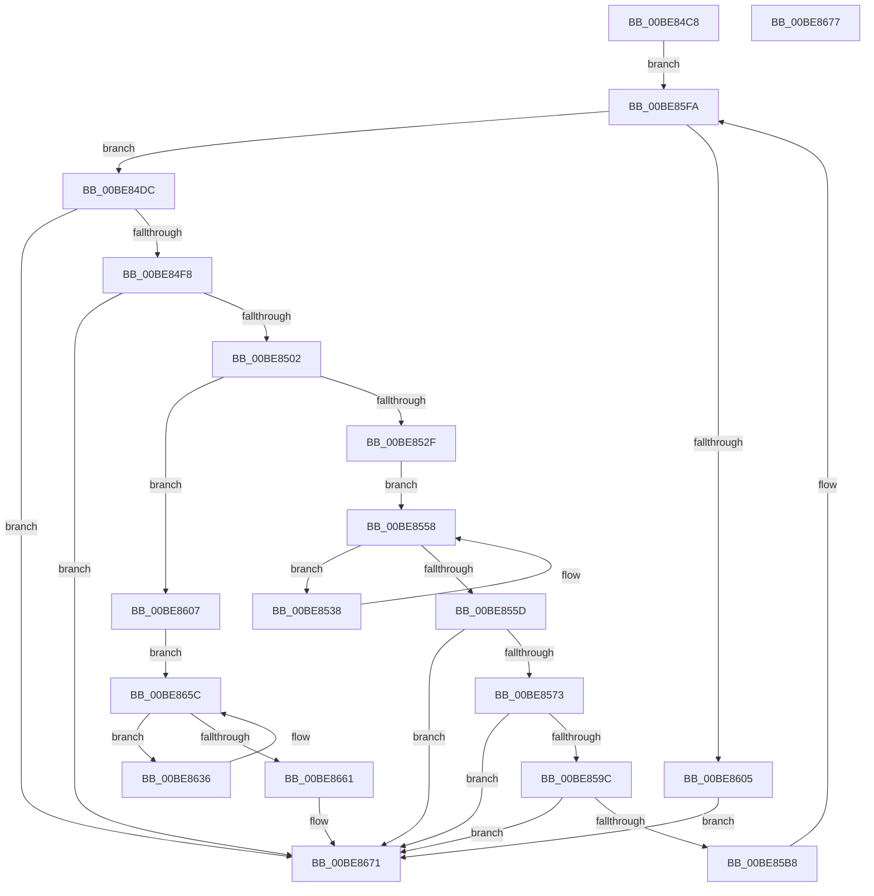

# sub_00BE84C8

- RVA: `0x00BE84C8`–`0x00BE8678` (길이 `432` bytes)
- VA: `0x0000000140BE84C8`
- 실행 섹션: `INITKDBG`
- PDB 이름 있음: `아니요`; PDB Function 태그: `아니요`
- unwind 정보 RVA: `0x00071750`
- 디코드: `94`개 명령, `432/432` bytes 표시
- 미해석 바이트: `0` (있으면 어셈블리에 `.byte`로 보존)

> 이 문서는 커널 이미지의 기계어와 PDB 기호를 분석해 생성했습니다. 4번과 5번은 함수 원형과 자료형을 바이너리 사용 방식에서 추정한 C 해석이며 원본 소스 복구 결과는 아닙니다.

## 1. Dependencies

- 직접 호출 지점: **0**; 고유 호출 대상: **0**
- 직접 호출자로 확인된 함수: **1**
- RIP 상대 이미지 참조: **0**

### Outgoing calls
- 직접 디코드된 call 명령이 없습니다.

### Direct callers
- [FsRtlMdlReadCompleteDevEx](../BD/FsRtlMdlReadCompleteDevEx_function_00BD1010.md) at `0x00BD1D28`

### Static image references
- 디코드된 RIP-relative 메모리 참조가 없습니다.

## 2. Other-region calls and transfers

- 다른 실행 섹션으로 향하는 call: **0**
- 별도 외부 분기/꼬리 이동을 확인하지 못했습니다.

## 3. Assembly (complete function range)

```asm
00BE84C8  48 89 5C 24 08                  mov qword ptr [rsp + 8], rbx
00BE84CD  44 8B 81 D8 09 00 00            mov r8d, dword ptr [rcx + 0x9d8]
00BE84D4  4C 8B C9                        mov r9, rcx
00BE84D7  E9 1E 01 00 00                  jmp 0x140be85fa
00BE84DC  41 8B 89 DC 09 00 00            mov ecx, dword ptr [r9 + 0x9dc]
00BE84E3  33 C0                           xor eax, eax
00BE84E5  C1 E9 15                        shr ecx, 0x15
00BE84E8  83 E1 01                        and ecx, 1
00BE84EB  85 D2                           test edx, edx
00BE84ED  0F 95 C0                        setne al
00BE84F0  3B C1                           cmp eax, ecx
00BE84F2  0F 84 79 01 00 00               je 0x140be8671
00BE84F8  41 F6 C0 01                     test r8b, 1
00BE84FC  0F 84 6F 01 00 00               je 0x140be8671
00BE8502  41 8B 89 74 0A 00 00            mov ecx, dword ptr [r9 + 0xa74]
00BE8509  41 8B 81 04 08 00 00            mov eax, dword ptr [r9 + 0x804]
00BE8510  49 8B 99 38 08 00 00            mov rbx, qword ptr [r9 + 0x838]
00BE8517  2B C1                           sub eax, ecx
00BE8519  4D 8D 14 09                     lea r10, [r9 + rcx]
00BE851D  8B C8                           mov ecx, eax
00BE851F  48 C1 E9 03                     shr rcx, 3
00BE8523  4D 8D 1C CA                     lea r11, [r10 + rcx*8]
00BE8527  85 D2                           test edx, edx
00BE8529  0F 85 D8 00 00 00               jne 0x140be8607
00BE852F  49 8B 91 78 0A 00 00            mov rdx, qword ptr [r9 + 0xa78]
00BE8536  EB 20                           jmp 0x140be8558
00BE8538  49 31 12                        xor qword ptr [r10], rdx
00BE853B  49 8B 02                        mov rax, qword ptr [r10]
00BE853E  0F B6 CA                        movzx ecx, dl
00BE8541  48 33 C3                        xor rax, rbx
00BE8544  83 E1 3F                        and ecx, 0x3f
00BE8547  48 D3 CA                        ror rdx, cl
00BE854A  48 03 D0                        add rdx, rax
00BE854D  48 81 F2 FA 0E 00 00            xor rdx, 0xefa
00BE8554  49 83 C2 08                     add r10, 8
00BE8558  4D 3B D3                        cmp r10, r11
00BE855B  75 DB                           jne 0x140be8538
00BE855D  41 0F BA B1 DC 09 00 00 15      btr dword ptr [r9 + 0x9dc], 0x15
00BE8566  49 3B 91 80 0A 00 00            cmp rdx, qword ptr [r9 + 0xa80]
00BE856D  0F 84 FE 00 00 00               je 0x140be8671
00BE8573  41 8B 89 04 08 00 00            mov ecx, dword ptr [r9 + 0x804]
00BE857A  49 8B 81 88 05 00 00            mov rax, qword ptr [r9 + 0x588]
00BE8581  4C 89 08                        mov qword ptr [rax], r9
00BE8584  89 48 10                        mov dword ptr [rax + 0x10], ecx
00BE8587  41 83 B9 18 09 00 00 00         cmp dword ptr [r9 + 0x918], 0
00BE858F  49 8B 89 80 0A 00 00            mov rcx, qword ptr [r9 + 0xa80]
00BE8596  0F 85 D5 00 00 00               jne 0x140be8671
00BE859C  49 8B 81 88 05 00 00            mov rax, qword ptr [r9 + 0x588]
00BE85A3  48 33 CA                        xor rcx, rdx
00BE85A6  48 89 48 18                     mov qword ptr [rax + 0x18], rcx
00BE85AA  41 83 B9 18 09 00 00 00         cmp dword ptr [r9 + 0x918], 0
00BE85B2  0F 85 B9 00 00 00               jne 0x140be8671
00BE85B8  49 83 A1 28 09 00 00 00         and qword ptr [r9 + 0x928], 0
00BE85C0  48 B8 E8 B4 C8 91 58 3F A0 A3   movabs rax, 0xa3a03f5891c8b4e8
00BE85CA  49 03 C1                        add rax, r9
00BE85CD  49 89 91 38 09 00 00            mov qword ptr [r9 + 0x938], rdx
00BE85D4  49 89 81 20 09 00 00            mov qword ptr [r9 + 0x920], rax
00BE85DB  33 D2                           xor edx, edx
00BE85DD  49 C7 81 30 09 00 00 00 01 00 00  mov qword ptr [r9 + 0x930], 0x100
00BE85E8  41 C7 81 18 09 00 00 01 00 00 00  mov dword ptr [r9 + 0x918], 1
00BE85F3  45 8B 81 D8 09 00 00            mov r8d, dword ptr [r9 + 0x9d8]
00BE85FA  41 0F BA E0 1D                  bt r8d, 0x1d
00BE85FF  0F 83 D7 FE FF FF               jae 0x140be84dc
00BE8605  EB 6A                           jmp 0x140be8671
00BE8607  0F 31                           rdtsc
00BE8609  48 C1 E2 20                     shl rdx, 0x20
00BE860D  48 0B C2                        or rax, rdx
00BE8610  48 8B C8                        mov rcx, rax
00BE8613  48 8B D0                        mov rdx, rax
00BE8616  48 C1 C9 03                     ror rcx, 3
00BE861A  48 B8 01 20 00 04 80 00 10 70   movabs rax, 0x7010008004002001
00BE8624  48 33 D1                        xor rdx, rcx
00BE8627  48 F7 E2                        mul rdx
00BE862A  48 33 D0                        xor rdx, rax
00BE862D  49 89 91 78 0A 00 00            mov qword ptr [r9 + 0xa78], rdx
00BE8634  EB 26                           jmp 0x140be865c
00BE8636  4D 8B 02                        mov r8, qword ptr [r10]
00BE8639  0F B6 CA                        movzx ecx, dl
00BE863C  49 8B C0                        mov rax, r8
00BE863F  48 33 C2                        xor rax, rdx
00BE8642  83 E1 3F                        and ecx, 0x3f
00BE8645  48 D3 CA                        ror rdx, cl
00BE8648  4C 33 C3                        xor r8, rbx
00BE864B  49 03 D0                        add rdx, r8
00BE864E  49 89 02                        mov qword ptr [r10], rax
00BE8651  48 81 F2 FA 0E 00 00            xor rdx, 0xefa
00BE8658  49 83 C2 08                     add r10, 8
00BE865C  4D 3B D3                        cmp r10, r11
00BE865F  75 D5                           jne 0x140be8636
00BE8661  41 0F BA A9 DC 09 00 00 15      bts dword ptr [r9 + 0x9dc], 0x15
00BE866A  49 89 91 80 0A 00 00            mov qword ptr [r9 + 0xa80], rdx
00BE8671  48 8B 5C 24 08                  mov rbx, qword ptr [rsp + 8]
00BE8676  C3                              ret
00BE8677  CC                              int3
```

## 4. C-style interpretation (structured pseudocode)

```c
__int64 __fastcall sub_00BE84C8(__int64 a1, int a2)
{
    __int64 result;
    __int64 v_r10;
    unsigned __int64 v_stack_p8;

    v_stack_p8 = v_rbx;
    goto loc_00BE85FA;
loc_00BE84DC:
    result = 0;
    a1 = (unsigned int)(((unsigned int)(*(unsigned int *)(a1 + 2524))) >> (21));
    a1 = (unsigned int)((a1) & (1));
    result = (a2 != 0) ? 1 : 0;
    if (((unsigned int)(result)) == ((unsigned int)(a1))) goto loc_00BE8671;
    if ((((unsigned __int8)((unsigned int)(*(unsigned int *)(a1 + 2520)))) & (1)) == 0) goto loc_00BE8671;
    result = (unsigned int)(((unsigned int)(*(unsigned int *)(a1 + 2052))) - ((unsigned int)((unsigned int)(*(unsigned int *)(a1 + 2676)))));
    a1 = ((unsigned int)((unsigned int)(result))) >> (3);
    if (a2 != 0) goto loc_00BE8607;
    goto loc_00BE8558;
loc_00BE8538:
    result = (*(unsigned __int64 *)(a1 + (unsigned int)(*(unsigned int *)(a1 + 2676)) * 1)) ^ (*(unsigned __int64 *)(a1 + 2104));
    a1 = (unsigned int)(((unsigned __int8)(*(unsigned __int64 *)(a1 + 2680))) & (63));
    a2 = (*(unsigned __int64 *)(a1 + 2680)) + (result);
    a2 = (a2) ^ (0xEFAULL);
    v_r10 = (a1 + (unsigned int)(*(unsigned int *)(a1 + 2676)) * 1) + (8);
loc_00BE8558:
    if (v_r10 != (a1 + (unsigned int)(*(unsigned int *)(a1 + 2676)) * 1 + a1 * 8)) goto loc_00BE8538;
    if (a2 == (*(unsigned __int64 *)(a1 + 2688))) goto loc_00BE8671;
    *(unsigned __int64 *)(*(unsigned __int64 *)(a1 + 1416)) = a1;
    *(unsigned int *)(*(unsigned __int64 *)(a1 + 1416) + 16) = (unsigned int)((unsigned int)(*(unsigned int *)(a1 + 2052)));
    if ((*(unsigned int *)(a1 + 2328)) != 0) goto loc_00BE8671;
    a1 = (*(unsigned __int64 *)(a1 + 2688)) ^ (a2);
    *(unsigned __int64 *)(*(unsigned __int64 *)(a1 + 1416) + 24) = a1;
    if ((*(unsigned int *)(a1 + 2328)) != 0) goto loc_00BE8671;
    result = (*(unsigned __int64 *)(a1 + 1416)) + (a1);
    *(unsigned __int64 *)(a1 + 2360) = a2;
    *(unsigned __int64 *)(a1 + 2336) = result;
    a2 = 0;
    *(unsigned __int64 *)(a1 + 2352) = 256;
    *(unsigned int *)(a1 + 2328) = 1;
loc_00BE85FA:
    if (condition_is_above_or_equal) goto loc_00BE84DC;
    goto loc_00BE8671;
loc_00BE8607:
    a2 = (a2) << (32);
    result = (result) | (a2);
    a2 = (result) ^ (result);
    a2 = (a2) ^ (result);
    *(unsigned __int64 *)(a1 + 2680) = a2;
    goto loc_00BE865C;
loc_00BE8636:
    result = (*(unsigned __int64 *)(v_r10)) ^ (a2);
    a1 = (unsigned int)(((unsigned __int8)(a2)) & (63));
    a3 = (*(unsigned __int64 *)(v_r10)) ^ (*(unsigned __int64 *)(a1 + 2104));
    a2 = (a2) + (a3);
    *(unsigned __int64 *)(v_r10) = result;
    a2 = (a2) ^ (0xEFAULL);
    v_r10 = (v_r10) + (8);
loc_00BE865C:
    if (v_r10 != (a1 + (unsigned int)(*(unsigned int *)(a1 + 2676)) * 1 + a1 * 8)) goto loc_00BE8636;
    *(unsigned __int64 *)(a1 + 2688) = a2;
loc_00BE8671:
    return result;
}
```

## 5. (Beta) C Style

```c
int64_t sub_00BE84C8(void *Arg1, int32_t Arg2)
{
    uint8_t *arg1 = (uint8_t *)Arg1;

    int64_t result;
    int64_t local_r10;
    uint64_t v_stack_p8;

    v_stack_p8 = local_rbx;
    goto loc_00BE85FA;
loc_00BE84DC:
    result = 0;
    Arg1 = (uint32_t)(((uint32_t)(*(uint32_t *)(arg1 + 0x9DC))) >> (21));
    Arg1 = (uint32_t)((Arg1) & (1));
    result = (Arg2 != 0) ? 1 : 0;
    if (((uint32_t)(result)) == ((uint32_t)(Arg1))) goto loc_00BE8671;
    if ((((uint8_t)((uint32_t)(*(uint32_t *)(arg1 + 0x9D8)))) & (1)) == 0) goto loc_00BE8671;
    result = (uint32_t)(((uint32_t)(*(uint32_t *)(arg1 + 0x804))) - ((uint32_t)((uint32_t)(*(uint32_t *)(arg1 + 0xA74)))));
    Arg1 = ((uint32_t)((uint32_t)(result))) >> (3);
    if (Arg2 != 0) goto loc_00BE8607;
    goto loc_00BE8558;
loc_00BE8538:
    result = (*(uint64_t *)(arg1 + (uint32_t)(*(uint32_t *)(arg1 + 0xA74)) * 1)) ^ (*(uint64_t *)(arg1 + 0x838));
    Arg1 = (uint32_t)(((uint8_t)(*(uint64_t *)(arg1 + 0xA78))) & (63));
    Arg2 = (*(uint64_t *)(arg1 + 0xA78)) + (result);
    Arg2 = (Arg2) ^ (0xEFAULL);
    local_r10 = (Arg1 + (uint32_t)(*(uint32_t *)(arg1 + 0xA74)) * 1) + (8);
loc_00BE8558:
    if (local_r10 != (Arg1 + (uint32_t)(*(uint32_t *)(arg1 + 0xA74)) * 1 + Arg1 * 8)) goto loc_00BE8538;
    if (Arg2 == (*(uint64_t *)(arg1 + 0xA80))) goto loc_00BE8671;
    *(void **)(*(uint64_t *)(arg1 + 0x588)) = Arg1;
    *(uint32_t *)(*(uint64_t *)(arg1 + 0x588) + 0x10) = (uint32_t)((uint32_t)(*(uint32_t *)(arg1 + 0x804)));
    if ((*(uint32_t *)(arg1 + 0x918)) != 0) goto loc_00BE8671;
    Arg1 = (*(uint64_t *)(arg1 + 0xA80)) ^ (Arg2);
    *(void **)(*(uint64_t *)(arg1 + 0x588) + 0x18) = Arg1;
    if ((*(uint32_t *)(arg1 + 0x918)) != 0) goto loc_00BE8671;
    result = (*(uint64_t *)(arg1 + 0x588)) + (Arg1);
    *(uint64_t *)(arg1 + 0x938) = Arg2;
    *(uint64_t *)(arg1 + 0x920) = result;
    Arg2 = 0;
    *(uint64_t *)(arg1 + 0x930) = 256;
    *(uint32_t *)(arg1 + 0x918) = 1;
loc_00BE85FA:
    if (condition_is_above_or_equal) goto loc_00BE84DC;
    goto loc_00BE8671;
loc_00BE8607:
    Arg2 = (Arg2) << (32);
    result = (result) | (Arg2);
    Arg2 = (result) ^ (result);
    Arg2 = (Arg2) ^ (result);
    *(uint64_t *)(arg1 + 0xA78) = Arg2;
    goto loc_00BE865C;
loc_00BE8636:
    result = (*(uint64_t *)(local_r10)) ^ (Arg2);
    Arg1 = (uint32_t)(((uint8_t)(Arg2)) & (63));
    a3 = (*(uint64_t *)(local_r10)) ^ (*(uint64_t *)(arg1 + 0x838));
    Arg2 = (Arg2) + (a3);
    *(uint64_t *)(local_r10) = result;
    Arg2 = (Arg2) ^ (0xEFAULL);
    local_r10 = (local_r10) + (8);
loc_00BE865C:
    if (local_r10 != (Arg1 + (uint32_t)(*(uint32_t *)(arg1 + 0xA74)) * 1 + Arg1 * 8)) goto loc_00BE8636;
    *(uint64_t *)(arg1 + 0xA80) = Arg2;
loc_00BE8671:
    return result;
}
```

### 관측된 메모리 오프셋

구조체 형식이 확인되지 않은 접근은 인자 기준의 오프셋으로만 기록했습니다.

| 기준 인자 | 오프셋 표현 | 폭 (bit) | 접근 |
|---|---:|---:|---|
| `Arg1` | `+ 0x0 + rcx*1` | `64` | `R` |
| `Arg1` | `+ 0x0 + rcx*8` | `64` | `R` |
| `Arg1` | `+ 0x588` | `64` | `R` |
| `Arg1` | `+ 0x804` | `32` | `R` |
| `Arg1` | `+ 0x838` | `64` | `R` |
| `Arg1` | `+ 0x918` | `32` | `R` |
| `Arg1` | `+ 0x918` | `32` | `W` |
| `Arg1` | `+ 0x920` | `64` | `W` |
| `Arg1` | `+ 0x928` | `64` | `R/W` |
| `Arg1` | `+ 0x930` | `64` | `W` |
| `Arg1` | `+ 0x938` | `64` | `W` |
| `Arg1` | `+ 0x9D8` | `32` | `R` |
| `Arg1` | `+ 0x9DC` | `32` | `R` |
| `Arg1` | `+ 0x9DC` | `32` | `R/W` |
| `Arg1` | `+ 0xA74` | `32` | `R` |
| `Arg1` | `+ 0xA78` | `64` | `R` |
| `Arg1` | `+ 0xA78` | `64` | `W` |
| `Arg1` | `+ 0xA80` | `64` | `R` |
| `Arg1` | `+ 0xA80` | `64` | `W` |

## 6. Execution-region graph

[열기: 2D/3D 그래프와 함수 탐색 컨트롤 패널](../../../control-panel.html?section=initkdbg&rva=0x00BE84C8&view=graph)

- 2D 그래프는 위에서 아래로 흐르고, 3D 그래프는 빈 공간을 드래그해 회전합니다. Shift+드래그는 이동, 휠은 확대·축소, 함수 노드 선택은 대상 보고서 이동입니다.

### Static fallback


