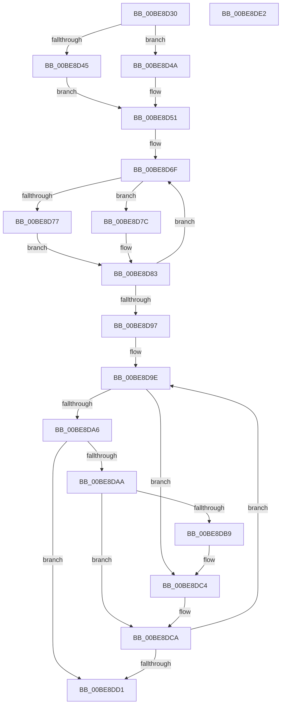

# sub_00BE8D30

- RVA: `0x00BE8D30`–`0x00BE8DE3` (길이 `179` bytes)
- VA: `0x0000000140BE8D30`
- 실행 섹션: `INITKDBG`
- PDB 이름 있음: `아니요`; PDB Function 태그: `아니요`
- unwind 정보 RVA: `0x0005CF00`
- 디코드: `55`개 명령, `179/179` bytes 표시
- 미해석 바이트: `0` (있으면 어셈블리에 `.byte`로 보존)

> 이 문서는 커널 이미지의 기계어와 PDB 기호를 분석해 생성했습니다. 4번과 5번은 함수 원형과 자료형을 바이너리 사용 방식에서 추정한 C 해석이며 원본 소스 복구 결과는 아닙니다.

## 1. Dependencies

- 직접 호출 지점: **0**; 고유 호출 대상: **0**
- 직접 호출자로 확인된 함수: **4**
- RIP 상대 이미지 참조: **1**

### Outgoing calls
- 직접 디코드된 call 명령이 없습니다.

### Direct callers
- [sub_0050C0E0](../../text/50/Unknown_function_0050C0E0.md) at `0x00511A98`
- [FsRtlMdlReadCompleteDevEx](../BD/FsRtlMdlReadCompleteDevEx_function_00BD1010.md) at `0x00BD7B04`
- [sub_00BE3A04](Unknown_function_00BE3A04.md) at `0x00BE3F18`
- [sub_00BE3A04](Unknown_function_00BE3A04.md) at `0x00BE4560`
- [sub_00BF16D0](../../init/BF/Unknown_function_00BF16D0.md) at `0x00BF965D`
- [sub_00BF16D0](../../init/BF/Unknown_function_00BF16D0.md) at `0x00BF9E50`
- [sub_00BF16D0](../../init/BF/Unknown_function_00BF16D0.md) at `0x00BFCFAF`
- [sub_00BF16D0](../../init/BF/Unknown_function_00BF16D0.md) at `0x00BFD5A2`
- [sub_00BF16D0](../../init/BF/Unknown_function_00BF16D0.md) at `0x00C00BBE`
- [sub_00BF16D0](../../init/BF/Unknown_function_00BF16D0.md) at `0x00C11856`

### Static image references
- `0x00BE8D4A` → RVA `0x00FC54C8` (`ALMOSTRO`; read)

## 2. Other-region calls and transfers

- 다른 실행 섹션으로 향하는 call: **0**
- 별도 외부 분기/꼬리 이동을 확인하지 못했습니다.

## 3. Assembly (complete function range)

```asm
00BE8D30  40 53                           push rbx
00BE8D32  48 83 EC 20                     sub rsp, 0x20
00BE8D36  45 33 C0                        xor r8d, r8d
00BE8D39  48 8D 81 D8 05 00 00            lea rax, [rcx + 0x5d8]
00BE8D40  48 85 C9                        test rcx, rcx
00BE8D43  74 05                           je 0x140be8d4a
00BE8D45  4C 8B 08                        mov r9, qword ptr [rax]
00BE8D48  EB 07                           jmp 0x140be8d51
00BE8D4A  4C 8B 0D 77 C7 3D 00            mov r9, qword ptr [rip + 0x3dc777]
00BE8D51  48 C1 EA 09                     shr rdx, 9
00BE8D55  4C 8D 14 24                     lea r10, [rsp]
00BE8D59  48 BB F8 FF FF FF 7F 00 00 00   movabs rbx, 0x7ffffffff8
00BE8D63  41 BB 04 00 00 00               mov r11d, 4
00BE8D69  48 23 D3                        and rdx, rbx
00BE8D6C  49 03 D1                        add rdx, r9
00BE8D6F  49 89 12                        mov qword ptr [r10], rdx
00BE8D72  48 85 C9                        test rcx, rcx
00BE8D75  74 05                           je 0x140be8d7c
00BE8D77  4C 8B 08                        mov r9, qword ptr [rax]
00BE8D7A  EB 07                           jmp 0x140be8d83
00BE8D7C  4C 8B 0D 45 C7 3D 00            mov r9, qword ptr [rip + 0x3dc745]
00BE8D83  48 C1 EA 09                     shr rdx, 9
00BE8D87  49 83 C2 08                     add r10, 8
00BE8D8B  48 23 D3                        and rdx, rbx
00BE8D8E  49 03 D1                        add rdx, r9
00BE8D91  49 83 EB 01                     sub r11, 1
00BE8D95  75 D8                           jne 0x140be8d6f
00BE8D97  45 8B D0                        mov r10d, r8d
00BE8D9A  41 8D 53 03                     lea edx, [r11 + 3]
00BE8D9E  44 8B CA                        mov r9d, edx
00BE8DA1  45 85 D2                        test r10d, r10d
00BE8DA4  75 1E                           jne 0x140be8dc4
00BE8DA6  85 D2                           test edx, edx
00BE8DA8  74 27                           je 0x140be8dd1
00BE8DAA  8B C2                           mov eax, edx
00BE8DAC  48 8B 0C C4                     mov rcx, qword ptr [rsp + rax*8]
00BE8DB0  8B 01                           mov eax, dword ptr [rcx]
00BE8DB2  C0 E8 07                        shr al, 7
00BE8DB5  A8 01                           test al, 1
00BE8DB7  74 11                           je 0x140be8dca
00BE8DB9  FF CA                           dec edx
00BE8DBB  41 BA 01 00 00 00               mov r10d, 1
00BE8DC1  44 8B CA                        mov r9d, edx
00BE8DC4  8B CA                           mov ecx, edx
00BE8DC6  4C 89 04 CC                     mov qword ptr [rsp + rcx*8], r8
00BE8DCA  FF CA                           dec edx
00BE8DCC  45 85 C9                        test r9d, r9d
00BE8DCF  75 CD                           jne 0x140be8d9e
00BE8DD1  4C 39 04 24                     cmp qword ptr [rsp], r8
00BE8DD5  41 0F 94 C0                     sete r8b
00BE8DD9  41 8B C0                        mov eax, r8d
00BE8DDC  48 83 C4 20                     add rsp, 0x20
00BE8DE0  5B                              pop rbx
00BE8DE1  C3                              ret
00BE8DE2  CC                              int3
```

## 4. C-style interpretation (structured pseudocode)

```c
__int64 __fastcall sub_00BE8D30(__int64 a1, __int64 a2, int a3)
{
    __int64 result;
    __int64 v_r10;
    __int64 v_r11;
    __int64 v_rsp;
    unsigned __int64 v_stack_m28;

    v_rsp = (v_rsp) - (32);
    a3 = 0;
    if (a1 == 0) goto loc_00BE8D4A;
    goto loc_00BE8D51;
loc_00BE8D4A:
loc_00BE8D51:
    a2 = (a2) >> (9);
    a2 = (a2) & (v_rbx);
    a2 = (a2) + (*(unsigned __int64 *)(v_rip + 4048759));
loc_00BE8D6F:
    *(unsigned __int64 *)(v_stack_m28) = a2;
    if (a1 == 0) goto loc_00BE8D7C;
    goto loc_00BE8D83;
loc_00BE8D7C:
loc_00BE8D83:
    a2 = (a2) >> (9);
    v_r10 = (v_stack_m28) + (8);
    a2 = (a2) & (v_rbx);
    a2 = (a2) + (*(unsigned __int64 *)(v_rip + 4048709));
    v_r11 = (4) - (1);
    if (condition_is_not_equal) goto loc_00BE8D6F;
loc_00BE8D9E:
    if (0 != 0) goto loc_00BE8DC4;
    if ((unsigned int)(v_r11 + 3) == 0) goto loc_00BE8DD1;
    result = (unsigned __int8)(((unsigned int)(*(unsigned int *)(*(unsigned __int64 *)(v_rsp + (unsigned int)((unsigned int)(v_r11 + 3)) * 8)))) >> (7));
    if ((((unsigned __int8)(result)) & (1)) == 0) goto loc_00BE8DCA;
    a2 = (unsigned int)((v_r11 + 3) - 1);
loc_00BE8DC4:
    *(unsigned __int64 *)(v_rsp + (unsigned int)((unsigned int)(a2)) * 8) = 0;
loc_00BE8DCA:
    a2 = (unsigned int)((a2) - 1);
    if ((unsigned int)((unsigned int)((unsigned int)(a2))) != 0) goto loc_00BE8D9E;
loc_00BE8DD1:
    a3 = (v_stack_m28 == 0) ? 1 : 0;
    v_rsp = (v_rsp) + (32);
    return (unsigned int)(a3);
}
```

## 5. (Beta) C Style

```c
int64_t sub_00BE8D30(void *Arg1, int64_t Arg2, int32_t Arg3)
{
    uint8_t *arg1 = (uint8_t *)Arg1;

    int64_t result;
    int64_t local_r10;
    int64_t local_r11;
    int64_t local_rsp;
    uint64_t v_stack_m28;

    local_rsp = (local_rsp) - (32);
    Arg3 = 0;
    if (Arg1 == NULL) goto loc_00BE8D4A;
    goto loc_00BE8D51;
loc_00BE8D4A:
loc_00BE8D51:
    Arg2 = (Arg2) >> (9);
    Arg2 = (Arg2) & (local_rbx);
    Arg2 = (Arg2) + (*(uint64_t *)(v_rip + 0x3DC777));
loc_00BE8D6F:
    *(uint64_t *)(v_stack_m28) = Arg2;
    if (Arg1 == NULL) goto loc_00BE8D7C;
    goto loc_00BE8D83;
loc_00BE8D7C:
loc_00BE8D83:
    Arg2 = (Arg2) >> (9);
    local_r10 = (v_stack_m28) + (8);
    Arg2 = (Arg2) & (local_rbx);
    Arg2 = (Arg2) + (*(uint64_t *)(v_rip + 0x3DC745));
    local_r11 = (4) - (1);
    if (condition_is_not_equal) goto loc_00BE8D6F;
loc_00BE8D9E:
    if (0 != 0) goto loc_00BE8DC4;
    if ((uint32_t)(local_r11 + 3) == 0) goto loc_00BE8DD1;
    result = (uint8_t)(((uint32_t)(*(uint32_t *)(*(uint64_t *)(local_rsp + (uint32_t)((uint32_t)(local_r11 + 0x3)) * 8)))) >> (7));
    if ((((uint8_t)(result)) & (1)) == 0) goto loc_00BE8DCA;
    Arg2 = (uint32_t)((local_r11 + 3) - 1);
loc_00BE8DC4:
    *(uint64_t *)(local_rsp + (uint32_t)((uint32_t)(Arg2)) * 8) = 0;
loc_00BE8DCA:
    Arg2 = (uint32_t)((Arg2) - 1);
    if ((uint32_t)((uint32_t)((uint32_t)(Arg2))) != 0) goto loc_00BE8D9E;
loc_00BE8DD1:
    Arg3 = (v_stack_m28 == 0) ? 1 : 0;
    local_rsp = (local_rsp) + (32);
    return (uint32_t)(Arg3);
}
```

### 관측된 메모리 오프셋

구조체 형식이 확인되지 않은 접근은 인자 기준의 오프셋으로만 기록했습니다.

| 기준 인자 | 오프셋 표현 | 폭 (bit) | 접근 |
|---|---:|---:|---|
| `Arg1` | `+ 0x0` | `64` | `R` |
| `Arg1` | `+ 0x5D8` | `64` | `R` |

## 6. Execution-region graph

[열기: 2D/3D 그래프와 함수 탐색 컨트롤 패널](../../../control-panel.html?section=initkdbg&rva=0x00BE8D30&view=graph)

- 2D 그래프는 위에서 아래로 흐르고, 3D 그래프는 빈 공간을 드래그해 회전합니다. Shift+드래그는 이동, 휠은 확대·축소, 함수 노드 선택은 대상 보고서 이동입니다.

### Static fallback


