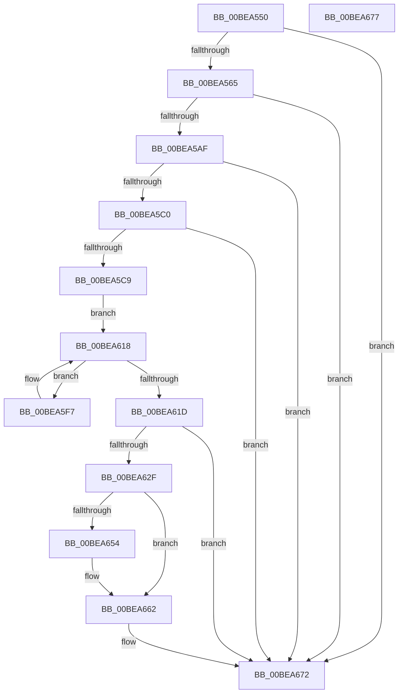

# sub_00BEA550

- RVA: `0x00BEA550`–`0x00BEA678` (길이 `296` bytes)
- VA: `0x0000000140BEA550`
- 실행 섹션: `INITKDBG`
- PDB 이름 있음: `아니요`; PDB Function 태그: `아니요`
- unwind 정보 RVA: `0x0005C788`
- 디코드: `59`개 명령, `296/296` bytes 표시
- 미해석 바이트: `0` (있으면 어셈블리에 `.byte`로 보존)

> 이 문서는 커널 이미지의 기계어와 PDB 기호를 분석해 생성했습니다. 4번과 5번은 함수 원형과 자료형을 바이너리 사용 방식에서 추정한 C 해석이며 원본 소스 복구 결과는 아닙니다.

## 1. Dependencies

- 직접 호출 지점: **1**; 고유 호출 대상: **1**
- 직접 호출자로 확인된 함수: **0**
- RIP 상대 이미지 참조: **0**

### Outgoing calls
- `0x00BEA66D` → [sub_00BE8384](Unknown_function_00BE8384.md) (function, `0x00BE8384`)

### Direct callers
- 이 함수 시작 RVA로 연결되는 직접 call은 확인되지 않았습니다. 간접 호출은 완전히 역산할 수 없습니다.

### Static image references
- 디코드된 RIP-relative 메모리 참조가 없습니다.

## 2. Other-region calls and transfers

- 다른 실행 섹션으로 향하는 call: **0**
- 별도 외부 분기/꼬리 이동을 확인하지 못했습니다.

## 3. Assembly (complete function range)

```asm
00BEA550  48 83 EC 28                     sub rsp, 0x28
00BEA554  41 83 B8 18 09 00 00 00         cmp dword ptr [r8 + 0x918], 0
00BEA55C  4D 8B D0                        mov r10, r8
00BEA55F  0F 85 0D 01 00 00               jne 0x140bea672
00BEA565  49 83 A0 28 09 00 00 00         and qword ptr [r8 + 0x928], 0
00BEA56D  48 B8 E8 B4 C8 91 58 3F A0 A3   movabs rax, 0xa3a03f5891c8b4e8
00BEA577  49 03 C0                        add rax, r8
00BEA57A  49 89 88 38 09 00 00            mov qword ptr [r8 + 0x938], rcx
00BEA581  41 8B 88 D8 09 00 00            mov ecx, dword ptr [r8 + 0x9d8]
00BEA588  49 89 80 20 09 00 00            mov qword ptr [r8 + 0x920], rax
00BEA58F  49 C7 80 30 09 00 00 10 01 00 00  mov qword ptr [r8 + 0x930], 0x110
00BEA59A  41 C7 80 18 09 00 00 01 00 00 00  mov dword ptr [r8 + 0x918], 1
00BEA5A5  0F BA E1 1D                     bt ecx, 0x1d
00BEA5A9  0F 82 C3 00 00 00               jb 0x140bea672
00BEA5AF  41 F7 80 DC 09 00 00 00 00 20 00  test dword ptr [r8 + 0x9dc], 0x200000
00BEA5BA  0F 84 B2 00 00 00               je 0x140bea672
00BEA5C0  F6 C1 01                        test cl, 1
00BEA5C3  0F 84 A9 00 00 00               je 0x140bea672
00BEA5C9  41 8B 88 74 0A 00 00            mov ecx, dword ptr [r8 + 0xa74]
00BEA5D0  41 8B 80 04 08 00 00            mov eax, dword ptr [r8 + 0x804]
00BEA5D7  4D 8B 98 38 08 00 00            mov r11, qword ptr [r8 + 0x838]
00BEA5DE  2B C1                           sub eax, ecx
00BEA5E0  4A 8D 14 01                     lea rdx, [rcx + r8]
00BEA5E4  4D 8B 80 78 0A 00 00            mov r8, qword ptr [r8 + 0xa78]
00BEA5EB  8B C8                           mov ecx, eax
00BEA5ED  48 C1 E9 03                     shr rcx, 3
00BEA5F1  4C 8D 0C CA                     lea r9, [rdx + rcx*8]
00BEA5F5  EB 21                           jmp 0x140bea618
00BEA5F7  4C 31 02                        xor qword ptr [rdx], r8
00BEA5FA  48 8B 02                        mov rax, qword ptr [rdx]
00BEA5FD  41 0F B6 C8                     movzx ecx, r8b
00BEA601  49 33 C3                        xor rax, r11
00BEA604  83 E1 3F                        and ecx, 0x3f
00BEA607  49 D3 C8                        ror r8, cl
00BEA60A  4C 03 C0                        add r8, rax
00BEA60D  49 81 F0 FA 0E 00 00            xor r8, 0xefa
00BEA614  48 83 C2 08                     add rdx, 8
00BEA618  49 3B D1                        cmp rdx, r9
00BEA61B  75 DA                           jne 0x140bea5f7
00BEA61D  41 0F BA B2 DC 09 00 00 15      btr dword ptr [r10 + 0x9dc], 0x15
00BEA626  4D 3B 82 80 0A 00 00            cmp r8, qword ptr [r10 + 0xa80]
00BEA62D  74 43                           je 0x140bea672
00BEA62F  41 8B 8A 04 08 00 00            mov ecx, dword ptr [r10 + 0x804]
00BEA636  49 8B 82 88 05 00 00            mov rax, qword ptr [r10 + 0x588]
00BEA63D  4C 89 10                        mov qword ptr [rax], r10
00BEA640  89 48 10                        mov dword ptr [rax + 0x10], ecx
00BEA643  41 83 BA 18 09 00 00 00         cmp dword ptr [r10 + 0x918], 0
00BEA64B  49 8B 8A 80 0A 00 00            mov rcx, qword ptr [r10 + 0xa80]
00BEA652  75 0E                           jne 0x140bea662
00BEA654  49 8B 82 88 05 00 00            mov rax, qword ptr [r10 + 0x588]
00BEA65B  49 33 C8                        xor rcx, r8
00BEA65E  48 89 48 18                     mov qword ptr [rax + 0x18], rcx
00BEA662  33 D2                           xor edx, edx
00BEA664  41 B9 00 01 00 00               mov r9d, 0x100
00BEA66A  49 8B CA                        mov rcx, r10
00BEA66D  E8 12 DD FF FF                  call 0x140be8384
00BEA672  48 83 C4 28                     add rsp, 0x28
00BEA676  C3                              ret
00BEA677  CC                              int3
```

## 4. C-style interpretation (structured pseudocode)

```c
__int64 __fastcall sub_00BEA550(__int64 a1, __int64 a2, __int64 a3)
{
    __int64 result;
    __int64 v_rsp;

    v_rsp = (v_rsp) - (40);
    if ((*(unsigned int *)(a3 + 2328)) != 0) goto loc_00BEA672;
    result = (result) + (a3);
    *(unsigned __int64 *)(a3 + 2360) = a1;
    *(unsigned __int64 *)(a3 + 2336) = result;
    *(unsigned __int64 *)(a3 + 2352) = 272;
    *(unsigned int *)(a3 + 2328) = 1;
    if (condition_is_below) goto loc_00BEA672;
    if (((*(unsigned int *)(a3 + 2524)) & (0x200000ULL)) == 0) goto loc_00BEA672;
    if ((((unsigned __int8)((unsigned int)(*(unsigned int *)(a3 + 2520)))) & (1)) == 0) goto loc_00BEA672;
    result = (unsigned int)(((unsigned int)(*(unsigned int *)(a3 + 2052))) - ((unsigned int)((unsigned int)(*(unsigned int *)(a3 + 2676)))));
    a1 = ((unsigned int)((unsigned int)(result))) >> (3);
    goto loc_00BEA618;
loc_00BEA5F7:
    result = (*(unsigned __int64 *)((unsigned int)(*(unsigned int *)(a3 + 2676)) + a3 * 1)) ^ (*(unsigned __int64 *)(a3 + 2104));
    a1 = (unsigned int)(((unsigned __int8)(*(unsigned __int64 *)(a3 + 2680))) & (63));
    a3 = (*(unsigned __int64 *)(a3 + 2680)) + (result);
    a3 = (a3) ^ (0xEFAULL);
    a2 = ((unsigned int)(*(unsigned int *)(a3 + 2676)) + a3 * 1) + (8);
loc_00BEA618:
    if (a2 != ((unsigned int)(*(unsigned int *)(a3 + 2676)) + a3 * 1 + a1 * 8)) goto loc_00BEA5F7;
    if (a3 == (*(unsigned __int64 *)(a3 + 2688))) goto loc_00BEA672;
    *(unsigned __int64 *)(*(unsigned __int64 *)(a3 + 1416)) = a3;
    *(unsigned int *)(*(unsigned __int64 *)(a3 + 1416) + 16) = (unsigned int)((unsigned int)(*(unsigned int *)(a3 + 2052)));
    result = *(unsigned __int64 *)(a3 + 1416);
    if ((*(unsigned int *)(a3 + 2328)) == 0) {
        result = *(unsigned __int64 *)(a3 + 1416);
        a1 = (*(unsigned __int64 *)(a3 + 2688)) ^ (a3);
        *(unsigned __int64 *)(result + 24) = a1;
    }
    a2 = 0;
    result = sub_00BE8384(a3, a2, a3, 256);
loc_00BEA672:
    v_rsp = (v_rsp) + (40);
    return result;
}
```

## 5. (Beta) C Style

```c
int64_t sub_00BEA550(int64_t Arg1, int64_t Arg2, void *Arg3)
{
    uint8_t *arg3 = (uint8_t *)Arg3;

    int64_t result;
    int64_t local_rsp;

    local_rsp = (local_rsp) - (40);
    if ((*(uint32_t *)(arg3 + 0x918)) != 0) goto loc_00BEA672;
    result = (result) + (Arg3);
    *(uint64_t *)(arg3 + 0x938) = Arg1;
    *(uint64_t *)(arg3 + 0x920) = result;
    *(uint64_t *)(arg3 + 0x930) = 272;
    *(uint32_t *)(arg3 + 0x918) = 1;
    if (condition_is_below) goto loc_00BEA672;
    if (((*(uint32_t *)(arg3 + 0x9DC)) & (0x200000ULL)) == 0) goto loc_00BEA672;
    if ((((uint8_t)((uint32_t)(*(uint32_t *)(arg3 + 0x9D8)))) & (1)) == 0) goto loc_00BEA672;
    result = (uint32_t)(((uint32_t)(*(uint32_t *)(arg3 + 0x804))) - ((uint32_t)((uint32_t)(*(uint32_t *)(arg3 + 0xA74)))));
    Arg1 = ((uint32_t)((uint32_t)(result))) >> (3);
    goto loc_00BEA618;
loc_00BEA5F7:
    result = (*(uint64_t *)((uint32_t)(*(uint32_t *)(arg3 + 0xA74)) + arg3 * 1)) ^ (*(uint64_t *)(arg3 + 0x838));
    Arg1 = (uint32_t)(((uint8_t)(*(uint64_t *)(arg3 + 0xA78))) & (63));
    Arg3 = (*(uint64_t *)(arg3 + 0xA78)) + (result);
    Arg3 = (Arg3) ^ (0xEFAULL);
    Arg2 = ((uint32_t)(*(uint32_t *)(arg3 + 0xA74)) + Arg3 * 1) + (8);
loc_00BEA618:
    if (Arg2 != ((uint32_t)(*(uint32_t *)(arg3 + 0xA74)) + Arg3 * 1 + Arg1 * 8)) goto loc_00BEA5F7;
    if (Arg3 == (*(uint64_t *)(arg3 + 0xA80))) goto loc_00BEA672;
    *(void **)(*(uint64_t *)(arg3 + 0x588)) = Arg3;
    *(uint32_t *)(*(uint64_t *)(arg3 + 0x588) + 0x10) = (uint32_t)((uint32_t)(*(uint32_t *)(arg3 + 0x804)));
    result = *(uint64_t *)(arg3 + 0x588);
    if ((*(uint32_t *)(arg3 + 0x918)) == 0) {
        result = *(uint64_t *)(arg3 + 0x588);
        Arg1 = (*(uint64_t *)(arg3 + 0xA80)) ^ (Arg3);
        *(uint64_t *)(result + 0x18) = Arg1;
    }
    Arg2 = 0;
    result = sub_00BE8384(Arg3, Arg2, Arg3, 256);
loc_00BEA672:
    local_rsp = (local_rsp) + (40);
    return result;
}
```

### 관측된 메모리 오프셋

구조체 형식이 확인되지 않은 접근은 인자 기준의 오프셋으로만 기록했습니다.

| 기준 인자 | 오프셋 표현 | 폭 (bit) | 접근 |
|---|---:|---:|---|
| `Arg3` | `+ 0x588` | `64` | `R` |
| `Arg3` | `+ 0x804` | `32` | `R` |
| `Arg3` | `+ 0x838` | `64` | `R` |
| `Arg3` | `+ 0x918` | `32` | `R` |
| `Arg3` | `+ 0x918` | `32` | `W` |
| `Arg3` | `+ 0x920` | `64` | `W` |
| `Arg3` | `+ 0x928` | `64` | `R/W` |
| `Arg3` | `+ 0x930` | `64` | `W` |
| `Arg3` | `+ 0x938` | `64` | `W` |
| `Arg3` | `+ 0x9D8` | `32` | `R` |
| `Arg3` | `+ 0x9DC` | `32` | `R` |
| `Arg3` | `+ 0x9DC` | `32` | `R/W` |
| `Arg3` | `+ 0xA74` | `32` | `R` |
| `Arg3` | `+ 0xA78` | `64` | `R` |
| `Arg3` | `+ 0xA80` | `64` | `R` |

## 6. Execution-region graph

[열기: 2D/3D 그래프와 함수 탐색 컨트롤 패널](../../../control-panel.html?section=initkdbg&rva=0x00BEA550&view=graph)

- 2D 그래프는 위에서 아래로 흐르고, 3D 그래프는 빈 공간을 드래그해 회전합니다. Shift+드래그는 이동, 휠은 확대·축소, 함수 노드 선택은 대상 보고서 이동입니다.

### Static fallback


