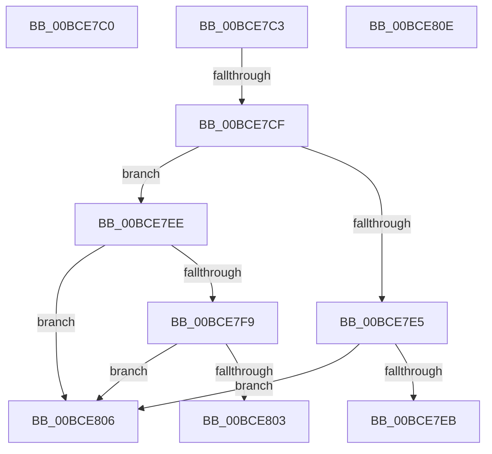

# KscpCfgDispatchUserCallTargetEsNoSmep

- RVA: `0x00BCE7C0`–`0x00BCE811` (길이 `81` bytes)
- VA: `0x0000000140BCE7C0`
- 실행 섹션: `KSCP`
- PDB 이름 있음: `예`; PDB Function 태그: `아니요`
- unwind 정보 RVA: `0x000C2148`
- 디코드: `30`개 명령, `81/81` bytes 표시
- 미해석 바이트: `0` (있으면 어셈블리에 `.byte`로 보존)

> 이 문서는 커널 이미지의 기계어와 PDB 기호를 분석해 생성했습니다. 4번과 5번은 함수 원형과 자료형을 바이너리 사용 방식에서 추정한 C 해석이며 원본 소스 복구 결과는 아닙니다.

## 1. Dependencies

- 직접 호출 지점: **0**; 고유 호출 대상: **0**
- 직접 호출자로 확인된 함수: **0**
- RIP 상대 이미지 참조: **0**

### Outgoing calls
- 직접 디코드된 call 명령이 없습니다.

### Direct callers
- 이 함수 시작 RVA로 연결되는 직접 call은 확인되지 않았습니다. 간접 호출은 완전히 역산할 수 없습니다.

### Static image references
- 디코드된 RIP-relative 메모리 참조가 없습니다.

## 2. Other-region calls and transfers

- 다른 실행 섹션으로 향하는 call: **0**
- call이 아닌 외부 분기/꼬리 이동: **2**
  - `0x00BCE7CD` → [KscpCfgHandleInvalidCallTarget](KscpCfgHandleInvalidCallTarget_function_00BCE820.md) (`tail-transfer`)
  - `0x00BCE80C` → [KscpCfgHandleInvalidCallTarget](KscpCfgHandleInvalidCallTarget_function_00BCE820.md) (`tail-transfer`)

## 3. Assembly (complete function range)

```asm
00BCE7C0  48 FF E0                        jmp rax
00BCE7C3  CC                              int3
00BCE7C4  CC                              int3
00BCE7C5  CC                              int3
00BCE7C6  CC                              int3
00BCE7C7  CC                              int3
00BCE7C8  CC                              int3
00BCE7C9  CC                              int3
00BCE7CA  48 85 C0                        test rax, rax
00BCE7CD  7D 51                           jge 0x140bce820
00BCE7CF  4C 8B D0                        mov r10, rax
00BCE7D2  49 C1 EA 09                     shr r10, 9
00BCE7D6  4F 8B 1C D3                     mov r11, qword ptr [r11 + r10*8]
00BCE7DA  4C 8B D0                        mov r10, rax
00BCE7DD  49 C1 EA 03                     shr r10, 3
00BCE7E1  A8 0F                           test al, 0xf
00BCE7E3  75 09                           jne 0x140bce7ee
00BCE7E5  4D 0F A3 D3                     bt r11, r10
00BCE7E9  73 1B                           jae 0x140bce806
00BCE7EB  48 FF E0                        jmp rax
00BCE7EE  49 0F BA F2 00                  btr r10, 0
00BCE7F3  4D 0F A3 D3                     bt r11, r10
00BCE7F7  73 0D                           jae 0x140bce806
00BCE7F9  49 83 CA 01                     or r10, 1
00BCE7FD  4D 0F A3 D3                     bt r11, r10
00BCE801  73 03                           jae 0x140bce806
00BCE803  48 FF E0                        jmp rax
00BCE806  41 BA 01 00 00 00               mov r10d, 1
00BCE80C  EB 12                           jmp 0x140bce820
00BCE80E  48 FF E0                        jmp rax
```

## 4. C-style interpretation (structured pseudocode)

```c
void __fastcall KscpCfgDispatchUserCallTargetEsNoSmep(void)
{
}
```

## 5. (Beta) C Style

```c
void KscpCfgDispatchUserCallTargetEsNoSmep(void)
{
}
```

## 6. Execution-region graph

[열기: 2D/3D 그래프와 함수 탐색 컨트롤 패널](../../../control-panel.html?section=kscp&rva=0x00BCE7C0&view=graph)

- 2D 그래프는 위에서 아래로 흐르고, 3D 그래프는 빈 공간을 드래그해 회전합니다. Shift+드래그는 이동, 휠은 확대·축소, 함수 노드 선택은 대상 보고서 이동입니다.

### Static fallback


