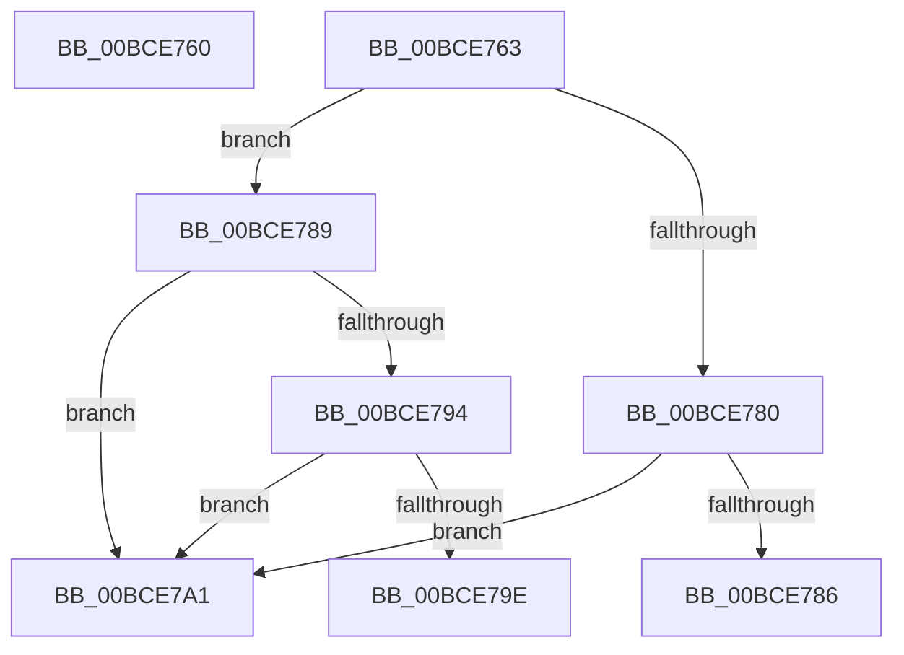

# KscpCfgDispatchUserCallTargetEsSmep

- RVA: `0x00BCE760`–`0x00BCE7AC` (길이 `76` bytes)
- VA: `0x0000000140BCE760`
- 실행 섹션: `KSCP`
- PDB 이름 있음: `예`; PDB Function 태그: `아니요`
- unwind 정보 RVA: `0x000C213C`
- 디코드: `27`개 명령, `76/76` bytes 표시
- 미해석 바이트: `0` (있으면 어셈블리에 `.byte`로 보존)

> 이 문서는 커널 이미지의 기계어와 PDB 기호를 분석해 생성했습니다. 4번과 5번은 함수 원형과 자료형을 바이너리 사용 방식에서 추정한 C 해석이며 원본 소스 복구 결과는 아닙니다.

## 1. Dependencies

- 직접 호출 지점: **0**; 고유 호출 대상: **0**
- 직접 호출자로 확인된 함수: **0**
- RIP 상대 이미지 참조: **0**

### Outgoing calls
- 직접 디코드된 call 명령이 없습니다.

### Direct callers
- 이 함수 시작 RVA로 연결되는 직접 call은 확인되지 않았습니다. 간접 호출은 완전히 역산할 수 없습니다.

### Static image references
- 디코드된 RIP-relative 메모리 참조가 없습니다.

## 2. Other-region calls and transfers

- 다른 실행 섹션으로 향하는 call: **0**
- call이 아닌 외부 분기/꼬리 이동: **1**
  - `0x00BCE7A7` → [KscpCfgHandleInvalidCallTarget](KscpCfgHandleInvalidCallTarget_function_00BCE820.md) (`tail-transfer`)

## 3. Assembly (complete function range)

```asm
00BCE760  48 FF E0                        jmp rax
00BCE763  CC                              int3
00BCE764  CC                              int3
00BCE765  CC                              int3
00BCE766  CC                              int3
00BCE767  CC                              int3
00BCE768  CC                              int3
00BCE769  CC                              int3
00BCE76A  4C 8B D0                        mov r10, rax
00BCE76D  49 C1 EA 09                     shr r10, 9
00BCE771  4F 8B 1C D3                     mov r11, qword ptr [r11 + r10*8]
00BCE775  4C 8B D0                        mov r10, rax
00BCE778  49 C1 EA 03                     shr r10, 3
00BCE77C  A8 0F                           test al, 0xf
00BCE77E  75 09                           jne 0x140bce789
00BCE780  4D 0F A3 D3                     bt r11, r10
00BCE784  73 1B                           jae 0x140bce7a1
00BCE786  48 FF E0                        jmp rax
00BCE789  49 0F BA F2 00                  btr r10, 0
00BCE78E  4D 0F A3 D3                     bt r11, r10
00BCE792  73 0D                           jae 0x140bce7a1
00BCE794  49 83 CA 01                     or r10, 1
00BCE798  4D 0F A3 D3                     bt r11, r10
00BCE79C  73 03                           jae 0x140bce7a1
00BCE79E  48 FF E0                        jmp rax
00BCE7A1  41 BA 01 00 00 00               mov r10d, 1
00BCE7A7  E9 74 00 00 00                  jmp 0x140bce820
```

## 4. C-style interpretation (structured pseudocode)

```c
void __fastcall KscpCfgDispatchUserCallTargetEsSmep(void)
{
}
```

## 5. (Beta) C Style

```c
void KscpCfgDispatchUserCallTargetEsSmep(void)
{
}
```

## 6. Execution-region graph

[열기: 2D/3D 그래프와 함수 탐색 컨트롤 패널](../../../control-panel.html?section=kscp&rva=0x00BCE760&view=graph)

- 2D 그래프는 위에서 아래로 흐르고, 3D 그래프는 빈 공간을 드래그해 회전합니다. Shift+드래그는 이동, 휠은 확대·축소, 함수 노드 선택은 대상 보고서 이동입니다.

### Static fallback


