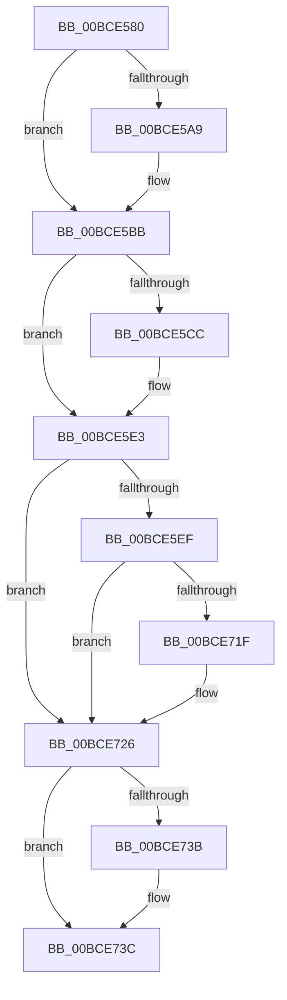

# _guard_retpoline_exit

- RVA: `0x00BCE580`–`0x00BCE74F` (길이 `463` bytes)
- VA: `0x0000000140BCE580`
- 실행 섹션: `KSCP`
- PDB 이름 있음: `예`; PDB Function 태그: `아니요`
- unwind 정보 RVA: `0x000C2130`
- 디코드: `102`개 명령, `463/463` bytes 표시
- 미해석 바이트: `0` (있으면 어셈블리에 `.byte`로 보존)

> 이 문서는 커널 이미지의 기계어와 PDB 기호를 분석해 생성했습니다. 4번과 5번은 함수 원형과 자료형을 바이너리 사용 방식에서 추정한 C 해석이며 원본 소스 복구 결과는 아닙니다.

## 1. Dependencies

- 직접 호출 지점: **32**; 고유 호출 대상: **32**
- 직접 호출자로 확인된 함수: **4**
- RIP 상대 이미지 참조: **0**

### Outgoing calls
- `0x00BCE5EF` → [_guard_retpoline_exit + 0x182](_guard_retpoline_exit_function_00BCE580.md) (inside-function, `0x00BCE702`)
- `0x00BCE5F8` → [_guard_retpoline_exit + 0x18B](_guard_retpoline_exit_function_00BCE580.md) (inside-function, `0x00BCE70B`)
- `0x00BCE601` → [_guard_retpoline_exit + 0x74](_guard_retpoline_exit_function_00BCE580.md) (inside-function, `0x00BCE5F4`)
- `0x00BCE60A` → [_guard_retpoline_exit + 0x7D](_guard_retpoline_exit_function_00BCE580.md) (inside-function, `0x00BCE5FD`)
- `0x00BCE613` → [_guard_retpoline_exit + 0x86](_guard_retpoline_exit_function_00BCE580.md) (inside-function, `0x00BCE606`)
- `0x00BCE61C` → [_guard_retpoline_exit + 0x8F](_guard_retpoline_exit_function_00BCE580.md) (inside-function, `0x00BCE60F`)
- `0x00BCE625` → [_guard_retpoline_exit + 0x98](_guard_retpoline_exit_function_00BCE580.md) (inside-function, `0x00BCE618`)
- `0x00BCE62E` → [_guard_retpoline_exit + 0xA1](_guard_retpoline_exit_function_00BCE580.md) (inside-function, `0x00BCE621`)
- `0x00BCE637` → [_guard_retpoline_exit + 0xAA](_guard_retpoline_exit_function_00BCE580.md) (inside-function, `0x00BCE62A`)
- `0x00BCE640` → [_guard_retpoline_exit + 0xB3](_guard_retpoline_exit_function_00BCE580.md) (inside-function, `0x00BCE633`)
- `0x00BCE649` → [_guard_retpoline_exit + 0xBC](_guard_retpoline_exit_function_00BCE580.md) (inside-function, `0x00BCE63C`)
- `0x00BCE652` → [_guard_retpoline_exit + 0xC5](_guard_retpoline_exit_function_00BCE580.md) (inside-function, `0x00BCE645`)
- `0x00BCE65B` → [_guard_retpoline_exit + 0xCE](_guard_retpoline_exit_function_00BCE580.md) (inside-function, `0x00BCE64E`)
- `0x00BCE664` → [_guard_retpoline_exit + 0xD7](_guard_retpoline_exit_function_00BCE580.md) (inside-function, `0x00BCE657`)
- `0x00BCE66D` → [_guard_retpoline_exit + 0xE0](_guard_retpoline_exit_function_00BCE580.md) (inside-function, `0x00BCE660`)
- `0x00BCE676` → [_guard_retpoline_exit + 0xE9](_guard_retpoline_exit_function_00BCE580.md) (inside-function, `0x00BCE669`)
- `0x00BCE67F` → [_guard_retpoline_exit + 0xF2](_guard_retpoline_exit_function_00BCE580.md) (inside-function, `0x00BCE672`)
- `0x00BCE688` → [_guard_retpoline_exit + 0xFB](_guard_retpoline_exit_function_00BCE580.md) (inside-function, `0x00BCE67B`)
- `0x00BCE691` → [_guard_retpoline_exit + 0x104](_guard_retpoline_exit_function_00BCE580.md) (inside-function, `0x00BCE684`)
- `0x00BCE69A` → [_guard_retpoline_exit + 0x10D](_guard_retpoline_exit_function_00BCE580.md) (inside-function, `0x00BCE68D`)
- `0x00BCE6A3` → [_guard_retpoline_exit + 0x116](_guard_retpoline_exit_function_00BCE580.md) (inside-function, `0x00BCE696`)
- `0x00BCE6AC` → [_guard_retpoline_exit + 0x11F](_guard_retpoline_exit_function_00BCE580.md) (inside-function, `0x00BCE69F`)
- `0x00BCE6B5` → [_guard_retpoline_exit + 0x128](_guard_retpoline_exit_function_00BCE580.md) (inside-function, `0x00BCE6A8`)
- `0x00BCE6BE` → [_guard_retpoline_exit + 0x131](_guard_retpoline_exit_function_00BCE580.md) (inside-function, `0x00BCE6B1`)
- `0x00BCE6C7` → [_guard_retpoline_exit + 0x13A](_guard_retpoline_exit_function_00BCE580.md) (inside-function, `0x00BCE6BA`)
- `0x00BCE6D0` → [_guard_retpoline_exit + 0x143](_guard_retpoline_exit_function_00BCE580.md) (inside-function, `0x00BCE6C3`)
- `0x00BCE6D9` → [_guard_retpoline_exit + 0x14C](_guard_retpoline_exit_function_00BCE580.md) (inside-function, `0x00BCE6CC`)
- `0x00BCE6E2` → [_guard_retpoline_exit + 0x155](_guard_retpoline_exit_function_00BCE580.md) (inside-function, `0x00BCE6D5`)
- `0x00BCE6EB` → [_guard_retpoline_exit + 0x15E](_guard_retpoline_exit_function_00BCE580.md) (inside-function, `0x00BCE6DE`)
- `0x00BCE6F4` → [_guard_retpoline_exit + 0x167](_guard_retpoline_exit_function_00BCE580.md) (inside-function, `0x00BCE6E7`)
- `0x00BCE6FD` → [_guard_retpoline_exit + 0x170](_guard_retpoline_exit_function_00BCE580.md) (inside-function, `0x00BCE6F0`)
- `0x00BCE706` → [_guard_retpoline_exit + 0x179](_guard_retpoline_exit_function_00BCE580.md) (inside-function, `0x00BCE6F9`)

### Direct callers
- [KeExitRetpoline](../../text/46/KeExitRetpoline_function_00468E7C.md) at `0x00468EB0`
- [_guard_retpoline_exit_indirect_rax](_guard_retpoline_exit_indirect_rax_function_00BCE3A0.md) at `0x00BCE3A4`
- [_guard_retpoline_import_r10](_guard_retpoline_import_r10_function_00BCE420.md) at `0x00BCE46F`
- [_guard_retpoline_exit](_guard_retpoline_exit_function_00BCE580.md) at `0x00BCE5EF`
- [_guard_retpoline_exit](_guard_retpoline_exit_function_00BCE580.md) at `0x00BCE5F8`
- [_guard_retpoline_exit](_guard_retpoline_exit_function_00BCE580.md) at `0x00BCE601`
- [_guard_retpoline_exit](_guard_retpoline_exit_function_00BCE580.md) at `0x00BCE60A`
- [_guard_retpoline_exit](_guard_retpoline_exit_function_00BCE580.md) at `0x00BCE613`
- [_guard_retpoline_exit](_guard_retpoline_exit_function_00BCE580.md) at `0x00BCE61C`
- [_guard_retpoline_exit](_guard_retpoline_exit_function_00BCE580.md) at `0x00BCE625`
- [_guard_retpoline_exit](_guard_retpoline_exit_function_00BCE580.md) at `0x00BCE62E`
- [_guard_retpoline_exit](_guard_retpoline_exit_function_00BCE580.md) at `0x00BCE637`
- [_guard_retpoline_exit](_guard_retpoline_exit_function_00BCE580.md) at `0x00BCE640`
- [_guard_retpoline_exit](_guard_retpoline_exit_function_00BCE580.md) at `0x00BCE649`
- [_guard_retpoline_exit](_guard_retpoline_exit_function_00BCE580.md) at `0x00BCE652`
- [_guard_retpoline_exit](_guard_retpoline_exit_function_00BCE580.md) at `0x00BCE65B`
- [_guard_retpoline_exit](_guard_retpoline_exit_function_00BCE580.md) at `0x00BCE664`
- [_guard_retpoline_exit](_guard_retpoline_exit_function_00BCE580.md) at `0x00BCE66D`
- [_guard_retpoline_exit](_guard_retpoline_exit_function_00BCE580.md) at `0x00BCE676`
- [_guard_retpoline_exit](_guard_retpoline_exit_function_00BCE580.md) at `0x00BCE67F`
- [_guard_retpoline_exit](_guard_retpoline_exit_function_00BCE580.md) at `0x00BCE688`
- [_guard_retpoline_exit](_guard_retpoline_exit_function_00BCE580.md) at `0x00BCE691`
- [_guard_retpoline_exit](_guard_retpoline_exit_function_00BCE580.md) at `0x00BCE69A`
- [_guard_retpoline_exit](_guard_retpoline_exit_function_00BCE580.md) at `0x00BCE6A3`
- [_guard_retpoline_exit](_guard_retpoline_exit_function_00BCE580.md) at `0x00BCE6AC`
- [_guard_retpoline_exit](_guard_retpoline_exit_function_00BCE580.md) at `0x00BCE6B5`
- [_guard_retpoline_exit](_guard_retpoline_exit_function_00BCE580.md) at `0x00BCE6BE`
- [_guard_retpoline_exit](_guard_retpoline_exit_function_00BCE580.md) at `0x00BCE6C7`
- [_guard_retpoline_exit](_guard_retpoline_exit_function_00BCE580.md) at `0x00BCE6D0`
- [_guard_retpoline_exit](_guard_retpoline_exit_function_00BCE580.md) at `0x00BCE6D9`
- [_guard_retpoline_exit](_guard_retpoline_exit_function_00BCE580.md) at `0x00BCE6E2`
- [_guard_retpoline_exit](_guard_retpoline_exit_function_00BCE580.md) at `0x00BCE6EB`
- [_guard_retpoline_exit](_guard_retpoline_exit_function_00BCE580.md) at `0x00BCE6F4`
- [_guard_retpoline_exit](_guard_retpoline_exit_function_00BCE580.md) at `0x00BCE6FD`
- [_guard_retpoline_exit](_guard_retpoline_exit_function_00BCE580.md) at `0x00BCE706`

### Static image references
- 디코드된 RIP-relative 메모리 참조가 없습니다.

## 2. Other-region calls and transfers

- 다른 실행 섹션으로 향하는 call: **0**
- 별도 외부 분기/꼬리 이동을 확인하지 못했습니다.

## 3. Assembly (complete function range)

```asm
00BCE580  48 9C                           pushfq
00BCE582  48 83 EC 18                     sub rsp, 0x18
00BCE586  48 89 04 24                     mov qword ptr [rsp], rax
00BCE58A  48 89 4C 24 08                  mov qword ptr [rsp + 8], rcx
00BCE58F  48 89 54 24 10                  mov qword ptr [rsp + 0x10], rdx
00BCE594  FA                              cli
00BCE595  65 0F B7 04 25 64 08 00 00      movzx eax, word ptr gs:[0x864]
00BCE59E  66 65 39 04 25 66 08 00 00      cmp word ptr gs:[0x866], ax
00BCE5A7  74 12                           je 0x140bce5bb
00BCE5A9  66 65 89 04 25 66 08 00 00      mov word ptr gs:[0x866], ax
00BCE5B2  B9 48 00 00 00                  mov ecx, 0x48
00BCE5B7  33 D2                           xor edx, edx
00BCE5B9  0F 30                           wrmsr
00BCE5BB  65 0F B6 14 25 5A 08 00 00      movzx edx, byte ptr gs:[0x85a]
00BCE5C4  F7 C2 10 00 00 00               test edx, 0x10
00BCE5CA  74 17                           je 0x140bce5e3
00BCE5CC  B8 01 00 00 00                  mov eax, 1
00BCE5D1  33 D2                           xor edx, edx
00BCE5D3  B9 49 00 00 00                  mov ecx, 0x49
00BCE5D8  0F 30                           wrmsr
00BCE5DA  65 0F B6 14 25 5A 08 00 00      movzx edx, byte ptr gs:[0x85a]
00BCE5E3  F7 C2 40 00 00 00               test edx, 0x40
00BCE5E9  0F 84 37 01 00 00               je 0x140bce726
00BCE5EF  E8 0E 01 00 00                  call 0x140bce702
00BCE5F4  48 83 C4 08                     add rsp, 8
00BCE5F8  E8 0E 01 00 00                  call 0x140bce70b
00BCE5FD  48 83 C4 08                     add rsp, 8
00BCE601  E8 EE FF FF FF                  call 0x140bce5f4
00BCE606  48 83 C4 08                     add rsp, 8
00BCE60A  E8 EE FF FF FF                  call 0x140bce5fd
00BCE60F  48 83 C4 08                     add rsp, 8
00BCE613  E8 EE FF FF FF                  call 0x140bce606
00BCE618  48 83 C4 08                     add rsp, 8
00BCE61C  E8 EE FF FF FF                  call 0x140bce60f
00BCE621  48 83 C4 08                     add rsp, 8
00BCE625  E8 EE FF FF FF                  call 0x140bce618
00BCE62A  48 83 C4 08                     add rsp, 8
00BCE62E  E8 EE FF FF FF                  call 0x140bce621
00BCE633  48 83 C4 08                     add rsp, 8
00BCE637  E8 EE FF FF FF                  call 0x140bce62a
00BCE63C  48 83 C4 08                     add rsp, 8
00BCE640  E8 EE FF FF FF                  call 0x140bce633
00BCE645  48 83 C4 08                     add rsp, 8
00BCE649  E8 EE FF FF FF                  call 0x140bce63c
00BCE64E  48 83 C4 08                     add rsp, 8
00BCE652  E8 EE FF FF FF                  call 0x140bce645
00BCE657  48 83 C4 08                     add rsp, 8
00BCE65B  E8 EE FF FF FF                  call 0x140bce64e
00BCE660  48 83 C4 08                     add rsp, 8
00BCE664  E8 EE FF FF FF                  call 0x140bce657
00BCE669  48 83 C4 08                     add rsp, 8
00BCE66D  E8 EE FF FF FF                  call 0x140bce660
00BCE672  48 83 C4 08                     add rsp, 8
00BCE676  E8 EE FF FF FF                  call 0x140bce669
00BCE67B  48 83 C4 08                     add rsp, 8
00BCE67F  E8 EE FF FF FF                  call 0x140bce672
00BCE684  48 83 C4 08                     add rsp, 8
00BCE688  E8 EE FF FF FF                  call 0x140bce67b
00BCE68D  48 83 C4 08                     add rsp, 8
00BCE691  E8 EE FF FF FF                  call 0x140bce684
00BCE696  48 83 C4 08                     add rsp, 8
00BCE69A  E8 EE FF FF FF                  call 0x140bce68d
00BCE69F  48 83 C4 08                     add rsp, 8
00BCE6A3  E8 EE FF FF FF                  call 0x140bce696
00BCE6A8  48 83 C4 08                     add rsp, 8
00BCE6AC  E8 EE FF FF FF                  call 0x140bce69f
00BCE6B1  48 83 C4 08                     add rsp, 8
00BCE6B5  E8 EE FF FF FF                  call 0x140bce6a8
00BCE6BA  48 83 C4 08                     add rsp, 8
00BCE6BE  E8 EE FF FF FF                  call 0x140bce6b1
00BCE6C3  48 83 C4 08                     add rsp, 8
00BCE6C7  E8 EE FF FF FF                  call 0x140bce6ba
00BCE6CC  48 83 C4 08                     add rsp, 8
00BCE6D0  E8 EE FF FF FF                  call 0x140bce6c3
00BCE6D5  48 83 C4 08                     add rsp, 8
00BCE6D9  E8 EE FF FF FF                  call 0x140bce6cc
00BCE6DE  48 83 C4 08                     add rsp, 8
00BCE6E2  E8 EE FF FF FF                  call 0x140bce6d5
00BCE6E7  48 83 C4 08                     add rsp, 8
00BCE6EB  E8 EE FF FF FF                  call 0x140bce6de
00BCE6F0  48 83 C4 08                     add rsp, 8
00BCE6F4  E8 EE FF FF FF                  call 0x140bce6e7
00BCE6F9  48 83 C4 08                     add rsp, 8
00BCE6FD  E8 EE FF FF FF                  call 0x140bce6f0
00BCE702  48 83 C4 08                     add rsp, 8
00BCE706  E8 EE FF FF FF                  call 0x140bce6f9
00BCE70B  48 83 C4 08                     add rsp, 8
00BCE70F  B8 DA DA 00 00                  mov eax, 0xdada
00BCE714  65 F6 04 25 5C 08 00 00 08      test byte ptr gs:[0x85c], 8
00BCE71D  74 07                           je 0x140bce726
00BCE71F  B0 20                           mov al, 0x20
00BCE721  F3 48 0F AE E8                  incsspq rax
00BCE726  0F AE E8                        lfence
00BCE729  65 80 0C 25 5E 08 00 00 02      or byte ptr gs:[0x85e], 2
00BCE732  48 0F BA 64 24 18 09            bt qword ptr [rsp + 0x18], 9
00BCE739  73 01                           jae 0x140bce73c
00BCE73B  FB                              sti
00BCE73C  48 8B 04 24                     mov rax, qword ptr [rsp]
00BCE740  48 8B 4C 24 08                  mov rcx, qword ptr [rsp + 8]
00BCE745  48 8B 54 24 10                  mov rdx, qword ptr [rsp + 0x10]
00BCE74A  48 83 C4 20                     add rsp, 0x20
00BCE74E  C3                              ret
```

## 4. C-style interpretation (structured pseudocode)

```c
__int64 __fastcall _guard_retpoline_exit(__int64 a1, __int64 a2)
{
    __int64 result;
    __int64 v_rsp;
    unsigned __int64 v_stack_m10;
    unsigned __int64 v_stack_m18;
    unsigned __int64 v_stack_m20;
    unsigned __int64 v_stack_pE0;
    unsigned __int64 v_stack_pE8;
    unsigned __int64 v_stack_pF0;
    unsigned __int64 v_stack_pF8;

    v_rsp = (v_rsp) - (24);
    v_stack_m20 = result;
    v_stack_m18 = a1;
    v_stack_m10 = a2;
    if ((*(unsigned __int16 *)(gs_base + (0 + 2150))) != ((unsigned __int16)(*(unsigned __int16 *)(gs_base + (0 + 2148))))) {
        *(unsigned __int16 *)(gs_base + (0 + 2150)) = (unsigned __int16)(*(unsigned __int16 *)(gs_base + (0 + 2148)));
        a1 = 72;
        a2 = 0;
    }
    result = *(unsigned __int16 *)(gs_base + (0 + 2148));
    if ((((unsigned int)(*(unsigned __int8 *)(gs_base + (0 + 2138)))) & (16)) != 0) {
        result = 1;
        a2 = 0;
        a1 = 73;
        a2 = *(unsigned __int8 *)(gs_base + (0 + 2138));
    }
    if ((((unsigned int)(a2)) & (64)) == 0) goto loc_00BCE726;
    result = _guard_retpoline_exit___0x182(a1, a2, a3, a4);
    v_rsp = (v_rsp) + (8);
    result = _guard_retpoline_exit___0x18B(a1, a2, a3, a4);
    v_rsp = (v_rsp) + (8);
    result = _guard_retpoline_exit___0x74(a1, a2, a3, a4);
    v_rsp = (v_rsp) + (8);
    result = _guard_retpoline_exit___0x7D(a1, a2, a3, a4);
    v_rsp = (v_rsp) + (8);
    result = _guard_retpoline_exit___0x86(a1, a2, a3, a4);
    v_rsp = (v_rsp) + (8);
    result = _guard_retpoline_exit___0x8F(a1, a2, a3, a4);
    v_rsp = (v_rsp) + (8);
    result = _guard_retpoline_exit___0x98(a1, a2, a3, a4);
    v_rsp = (v_rsp) + (8);
    result = _guard_retpoline_exit___0xA1(a1, a2, a3, a4);
    v_rsp = (v_rsp) + (8);
    result = _guard_retpoline_exit___0xAA(a1, a2, a3, a4);
    v_rsp = (v_rsp) + (8);
    result = _guard_retpoline_exit___0xB3(a1, a2, a3, a4);
    v_rsp = (v_rsp) + (8);
    result = _guard_retpoline_exit___0xBC(a1, a2, a3, a4);
    v_rsp = (v_rsp) + (8);
    result = _guard_retpoline_exit___0xC5(a1, a2, a3, a4);
    v_rsp = (v_rsp) + (8);
    result = _guard_retpoline_exit___0xCE(a1, a2, a3, a4);
    v_rsp = (v_rsp) + (8);
    result = _guard_retpoline_exit___0xD7(a1, a2, a3, a4);
    v_rsp = (v_rsp) + (8);
    result = _guard_retpoline_exit___0xE0(a1, a2, a3, a4);
    v_rsp = (v_rsp) + (8);
    result = _guard_retpoline_exit___0xE9(a1, a2, a3, a4);
    v_rsp = (v_rsp) + (8);
    result = _guard_retpoline_exit___0xF2(a1, a2, a3, a4);
    v_rsp = (v_rsp) + (8);
    result = _guard_retpoline_exit___0xFB(a1, a2, a3, a4);
    v_rsp = (v_rsp) + (8);
    result = _guard_retpoline_exit___0x104(a1, a2, a3, a4);
    v_rsp = (v_rsp) + (8);
    result = _guard_retpoline_exit___0x10D(a1, a2, a3, a4);
    v_rsp = (v_rsp) + (8);
    result = _guard_retpoline_exit___0x116(a1, a2, a3, a4);
    v_rsp = (v_rsp) + (8);
    result = _guard_retpoline_exit___0x11F(a1, a2, a3, a4);
    v_rsp = (v_rsp) + (8);
    result = _guard_retpoline_exit___0x128(a1, a2, a3, a4);
    v_rsp = (v_rsp) + (8);
    result = _guard_retpoline_exit___0x131(a1, a2, a3, a4);
    v_rsp = (v_rsp) + (8);
    result = _guard_retpoline_exit___0x13A(a1, a2, a3, a4);
    v_rsp = (v_rsp) + (8);
    result = _guard_retpoline_exit___0x143(a1, a2, a3, a4);
    v_rsp = (v_rsp) + (8);
    result = _guard_retpoline_exit___0x14C(a1, a2, a3, a4);
    v_rsp = (v_rsp) + (8);
    result = _guard_retpoline_exit___0x155(a1, a2, a3, a4);
    v_rsp = (v_rsp) + (8);
    result = _guard_retpoline_exit___0x15E(a1, a2, a3, a4);
    v_rsp = (v_rsp) + (8);
    result = _guard_retpoline_exit___0x167(a1, a2, a3, a4);
    v_rsp = (v_rsp) + (8);
    result = _guard_retpoline_exit___0x170(a1, a2, a3, a4);
    v_rsp = (v_rsp) + (8);
    result = _guard_retpoline_exit___0x179(a1, a2, a3, a4);
    v_rsp = (v_rsp) + (8);
    result = (unsigned int)(0xDADAULL);
    if (((*(unsigned __int8 *)(gs_base + (0 + 2140))) & (8)) != 0) {
        result = 32;
    }
    if (!(condition_is_above_or_equal)) {
    }
    v_rsp = (v_rsp) + (32);
    return v_stack_pE0;
}
```

## 5. (Beta) C Style

```c
int64_t _guard_retpoline_exit(int64_t Arg1, int64_t Arg2)
{
    int64_t result;
    int64_t local_rsp;
    uint64_t v_stack_m10;
    uint64_t v_stack_m18;
    uint64_t v_stack_m20;
    uint64_t v_stack_pE0;
    uint64_t v_stack_pE8;
    uint64_t v_stack_pF0;
    uint64_t v_stack_pF8;

    local_rsp = (local_rsp) - (24);
    v_stack_m20 = result;
    v_stack_m18 = Arg1;
    v_stack_m10 = Arg2;
    if ((*(uint16_t *)(gs_base + (0 + 0x866))) != ((uint16_t)(*(uint16_t *)(gs_base + (0 + 0x864))))) {
        *(uint16_t *)(gs_base + (0 + 0x866)) = (uint16_t)(*(uint16_t *)(gs_base + (0 + 0x864)));
        Arg1 = 72;
        Arg2 = 0;
    }
    result = *(uint16_t *)(gs_base + (0 + 0x864));
    if ((((uint32_t)(*(uint8_t *)(gs_base + (0 + 0x85A)))) & (16)) != 0) {
        result = 1;
        Arg2 = 0;
        Arg1 = 73;
        Arg2 = *(uint8_t *)(gs_base + (0 + 0x85A));
    }
    if ((((uint32_t)(Arg2)) & (64)) == 0) goto loc_00BCE726;
    result = _guard_retpoline_exit___0x182(Arg1, Arg2, a3, a4);
    local_rsp = (local_rsp) + (8);
    result = _guard_retpoline_exit___0x18B(Arg1, Arg2, a3, a4);
    local_rsp = (local_rsp) + (8);
    result = _guard_retpoline_exit___0x74(Arg1, Arg2, a3, a4);
    local_rsp = (local_rsp) + (8);
    result = _guard_retpoline_exit___0x7D(Arg1, Arg2, a3, a4);
    local_rsp = (local_rsp) + (8);
    result = _guard_retpoline_exit___0x86(Arg1, Arg2, a3, a4);
    local_rsp = (local_rsp) + (8);
    result = _guard_retpoline_exit___0x8F(Arg1, Arg2, a3, a4);
    local_rsp = (local_rsp) + (8);
    result = _guard_retpoline_exit___0x98(Arg1, Arg2, a3, a4);
    local_rsp = (local_rsp) + (8);
    result = _guard_retpoline_exit___0xA1(Arg1, Arg2, a3, a4);
    local_rsp = (local_rsp) + (8);
    result = _guard_retpoline_exit___0xAA(Arg1, Arg2, a3, a4);
    local_rsp = (local_rsp) + (8);
    result = _guard_retpoline_exit___0xB3(Arg1, Arg2, a3, a4);
    local_rsp = (local_rsp) + (8);
    result = _guard_retpoline_exit___0xBC(Arg1, Arg2, a3, a4);
    local_rsp = (local_rsp) + (8);
    result = _guard_retpoline_exit___0xC5(Arg1, Arg2, a3, a4);
    local_rsp = (local_rsp) + (8);
    result = _guard_retpoline_exit___0xCE(Arg1, Arg2, a3, a4);
    local_rsp = (local_rsp) + (8);
    result = _guard_retpoline_exit___0xD7(Arg1, Arg2, a3, a4);
    local_rsp = (local_rsp) + (8);
    result = _guard_retpoline_exit___0xE0(Arg1, Arg2, a3, a4);
    local_rsp = (local_rsp) + (8);
    result = _guard_retpoline_exit___0xE9(Arg1, Arg2, a3, a4);
    local_rsp = (local_rsp) + (8);
    result = _guard_retpoline_exit___0xF2(Arg1, Arg2, a3, a4);
    local_rsp = (local_rsp) + (8);
    result = _guard_retpoline_exit___0xFB(Arg1, Arg2, a3, a4);
    local_rsp = (local_rsp) + (8);
    result = _guard_retpoline_exit___0x104(Arg1, Arg2, a3, a4);
    local_rsp = (local_rsp) + (8);
    result = _guard_retpoline_exit___0x10D(Arg1, Arg2, a3, a4);
    local_rsp = (local_rsp) + (8);
    result = _guard_retpoline_exit___0x116(Arg1, Arg2, a3, a4);
    local_rsp = (local_rsp) + (8);
    result = _guard_retpoline_exit___0x11F(Arg1, Arg2, a3, a4);
    local_rsp = (local_rsp) + (8);
    result = _guard_retpoline_exit___0x128(Arg1, Arg2, a3, a4);
    local_rsp = (local_rsp) + (8);
    result = _guard_retpoline_exit___0x131(Arg1, Arg2, a3, a4);
    local_rsp = (local_rsp) + (8);
    result = _guard_retpoline_exit___0x13A(Arg1, Arg2, a3, a4);
    local_rsp = (local_rsp) + (8);
    result = _guard_retpoline_exit___0x143(Arg1, Arg2, a3, a4);
    local_rsp = (local_rsp) + (8);
    result = _guard_retpoline_exit___0x14C(Arg1, Arg2, a3, a4);
    local_rsp = (local_rsp) + (8);
    result = _guard_retpoline_exit___0x155(Arg1, Arg2, a3, a4);
    local_rsp = (local_rsp) + (8);
    result = _guard_retpoline_exit___0x15E(Arg1, Arg2, a3, a4);
    local_rsp = (local_rsp) + (8);
    result = _guard_retpoline_exit___0x167(Arg1, Arg2, a3, a4);
    local_rsp = (local_rsp) + (8);
    result = _guard_retpoline_exit___0x170(Arg1, Arg2, a3, a4);
    local_rsp = (local_rsp) + (8);
    result = _guard_retpoline_exit___0x179(Arg1, Arg2, a3, a4);
    local_rsp = (local_rsp) + (8);
    result = (uint32_t)(0xDADAULL);
    if (((*(uint8_t *)(gs_base + (0 + 0x85C))) & (8)) != 0) {
        result = 32;
    }
    if (!(condition_is_above_or_equal)) {
    }
    local_rsp = (local_rsp) + (32);
    return v_stack_pE0;
}
```

## 6. Execution-region graph

[열기: 2D/3D 그래프와 함수 탐색 컨트롤 패널](../../../control-panel.html?section=kscp&rva=0x00BCE580&view=graph)

- 2D 그래프는 위에서 아래로 흐르고, 3D 그래프는 빈 공간을 드래그해 회전합니다. Shift+드래그는 이동, 휠은 확대·축소, 함수 노드 선택은 대상 보고서 이동입니다.

### Static fallback


