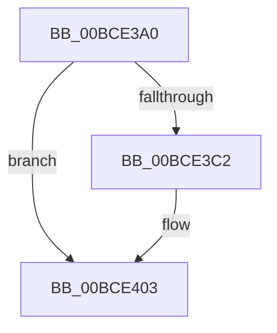

# _guard_retpoline_exit_indirect_rax

- RVA: `0x00BCE3A0`–`0x00BCE40A` (길이 `106` bytes)
- VA: `0x0000000140BCE3A0`
- 실행 섹션: `KSCP`
- PDB 이름 있음: `예`; PDB Function 태그: `아니요`
- unwind 정보 RVA: `0x000C20FC`
- 디코드: `22`개 명령, `106/106` bytes 표시
- 미해석 바이트: `0` (있으면 어셈블리에 `.byte`로 보존)

> 이 문서는 커널 이미지의 기계어와 PDB 기호를 분석해 생성했습니다. 4번과 5번은 함수 원형과 자료형을 바이너리 사용 방식에서 추정한 C 해석이며 원본 소스 복구 결과는 아닙니다.

## 1. Dependencies

- 직접 호출 지점: **2**; 고유 호출 대상: **2**
- 직접 호출자로 확인된 함수: **0**
- RIP 상대 이미지 참조: **0**

### Outgoing calls
- `0x00BCE3A4` → [_guard_retpoline_exit](_guard_retpoline_exit_function_00BCE580.md) (function, `0x00BCE580`)
- `0x00BCE3E8` → `indirect target` (indirect, 간접 대상)

### Direct callers
- 이 함수 시작 RVA로 연결되는 직접 call은 확인되지 않았습니다. 간접 호출은 완전히 역산할 수 없습니다.

### Static image references
- 디코드된 RIP-relative 메모리 참조가 없습니다.

## 2. Other-region calls and transfers

- 다른 실행 섹션으로 향하는 call: **0**
- 별도 외부 분기/꼬리 이동을 확인하지 못했습니다.

## 3. Assembly (complete function range)

```asm
00BCE3A0  48 83 EC 48                     sub rsp, 0x48
00BCE3A4  E8 D7 01 00 00                  call 0x140bce580
00BCE3A9  0F AE E8                        lfence
00BCE3AC  49 BA 14 6B FC 40 01 00 00 00   movabs r10, 0x140fc6b14
00BCE3B6  45 8B 12                        mov r10d, dword ptr [r10]
00BCE3B9  41 F7 C2 02 00 00 00            test r10d, 2
00BCE3C0  74 41                           je 0x140bce403
00BCE3C2  48 89 44 24 20                  mov qword ptr [rsp + 0x20], rax
00BCE3C7  48 89 4C 24 28                  mov qword ptr [rsp + 0x28], rcx
00BCE3CC  48 89 54 24 30                  mov qword ptr [rsp + 0x30], rdx
00BCE3D1  4C 89 44 24 38                  mov qword ptr [rsp + 0x38], r8
00BCE3D6  4C 89 4C 24 40                  mov qword ptr [rsp + 0x40], r9
00BCE3DB  48 8B C8                        mov rcx, rax
00BCE3DE  48 B8 00 00 65 40 01 00 00 00   movabs rax, 0x140650000
00BCE3E8  FF D0                           call rax
00BCE3EA  48 8B 44 24 20                  mov rax, qword ptr [rsp + 0x20]
00BCE3EF  48 8B 4C 24 28                  mov rcx, qword ptr [rsp + 0x28]
00BCE3F4  48 8B 54 24 30                  mov rdx, qword ptr [rsp + 0x30]
00BCE3F9  4C 8B 44 24 38                  mov r8, qword ptr [rsp + 0x38]
00BCE3FE  4C 8B 4C 24 40                  mov r9, qword ptr [rsp + 0x40]
00BCE403  48 83 C4 48                     add rsp, 0x48
00BCE407  48 FF E0                        jmp rax
```

## 4. C-style interpretation (structured pseudocode)

```c
__int64 __fastcall _guard_retpoline_exit_indirect_rax(__int64 a1, __int64 a2, __int64 a3, __int64 a4)
{
    __int64 result;
    __int64 v_rsp;
    unsigned __int64 v_stack_m10;
    unsigned __int64 v_stack_m18;
    unsigned __int64 v_stack_m20;
    unsigned __int64 v_stack_m28;
    unsigned __int64 v_stack_m8;

    v_rsp = (v_rsp) - (72);
    result = _guard_retpoline_exit(a1, a2, a3, a4);
    if ((((unsigned int)((unsigned int)(*(unsigned int *)(v_r10)))) & (2)) != 0) {
        v_stack_m28 = result;
        v_stack_m20 = a1;
        v_stack_m18 = a2;
        v_stack_m10 = a3;
        v_stack_m8 = a4;
        a1 = result;
        result = kernel_indirect_call(a1, a2, a3, a4);
        result = v_stack_m28;
        a1 = v_stack_m20;
        a2 = v_stack_m18;
        a3 = v_stack_m10;
        a4 = v_stack_m8;
    }
    v_rsp = (v_rsp) + (72);
}
```

## 5. (Beta) C Style

```c
int64_t _guard_retpoline_exit_indirect_rax(int64_t Arg1, int64_t Arg2, int64_t Arg3, int64_t Arg4)
{
    int64_t result;
    int64_t local_rsp;
    uint64_t v_stack_m10;
    uint64_t v_stack_m18;
    uint64_t v_stack_m20;
    uint64_t v_stack_m28;
    uint64_t v_stack_m8;

    local_rsp = (local_rsp) - (72);
    result = _guard_retpoline_exit(Arg1, Arg2, Arg3, Arg4);
    if ((((uint32_t)((uint32_t)(*(uint32_t *)(local_r10)))) & (2)) != 0) {
        v_stack_m28 = result;
        v_stack_m20 = Arg1;
        v_stack_m18 = Arg2;
        v_stack_m10 = Arg3;
        v_stack_m8 = Arg4;
        Arg1 = result;
        result = kernel_indirect_call(Arg1, Arg2, Arg3, Arg4);
        result = v_stack_m28;
        Arg1 = v_stack_m20;
        Arg2 = v_stack_m18;
        Arg3 = v_stack_m10;
        Arg4 = v_stack_m8;
    }
    local_rsp = (local_rsp) + (72);
}
```

## 6. Execution-region graph

[열기: 2D/3D 그래프와 함수 탐색 컨트롤 패널](../../../control-panel.html?section=kscp&rva=0x00BCE3A0&view=graph)

- 2D 그래프는 위에서 아래로 흐르고, 3D 그래프는 빈 공간을 드래그해 회전합니다. Shift+드래그는 이동, 휠은 확대·축소, 함수 노드 선택은 대상 보고서 이동입니다.

### Static fallback


