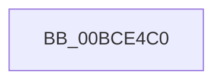

# _guard_retpoline_import_r10_do_retpoline

- RVA: `0x00BCE4C0`–`0x00BCE4E5` (길이 `37` bytes)
- VA: `0x0000000140BCE4C0`
- 실행 섹션: `KSCP`
- PDB 이름 있음: `예`; PDB Function 태그: `아니요`
- unwind 정보 RVA: `0x000C211C`
- 디코드: `6`개 명령, `37/37` bytes 표시
- 미해석 바이트: `0` (있으면 어셈블리에 `.byte`로 보존)

> 이 문서는 커널 이미지의 기계어와 PDB 기호를 분석해 생성했습니다. 4번과 5번은 함수 원형과 자료형을 바이너리 사용 방식에서 추정한 C 해석이며 원본 소스 복구 결과는 아닙니다.

## 1. Dependencies

- 직접 호출 지점: **1**; 고유 호출 대상: **1**
- 직접 호출자로 확인된 함수: **1**
- RIP 상대 이미지 참조: **0**

### Outgoing calls
- `0x00BCE4C0` → [_guard_retpoline_import_r10_do_retpoline + 0x20](_guard_retpoline_import_r10_do_retpoline_function_00BCE4C0.md) (inside-function, `0x00BCE4E0`)

### Direct callers
- [_guard_retpoline_import_r10_do_retpoline](_guard_retpoline_import_r10_do_retpoline_function_00BCE4C0.md) at `0x00BCE4C0`

### Static image references
- 디코드된 RIP-relative 메모리 참조가 없습니다.

## 2. Other-region calls and transfers

- 다른 실행 섹션으로 향하는 call: **0**
- 별도 외부 분기/꼬리 이동을 확인하지 못했습니다.

## 3. Assembly (complete function range)

```asm
00BCE4C0  E8 1B 00 00 00                  call 0x140bce4e0
00BCE4C5  CC                              int3
00BCE4C6  66 66 66 66 66 66 66 0F 1F 84 00 00 00 00 00  nop word ptr [rax + rax]
00BCE4D5  66 66 66 0F 1F 84 00 00 00 00 00  nop word ptr [rax + rax]
00BCE4E0  4C 89 14 24                     mov qword ptr [rsp], r10
00BCE4E4  C3                              ret
```

## 4. C-style interpretation (structured pseudocode)

```c
__int64 __fastcall _guard_retpoline_import_r10_do_retpoline(void)
{
    __int64 result;
    unsigned __int64 v_stack_p0;

    result = _guard_retpoline_import_r10_do_retpoline___0x20(a1, a2, a3, a4);
    v_stack_p0 = v_r10;
    return result;
}
```

## 5. (Beta) C Style

```c
void _guard_retpoline_import_r10_do_retpoline(void)
{
    int64_t result;
    uint64_t v_stack_p0;

    result = _guard_retpoline_import_r10_do_retpoline___0x20(a1, a2, a3, a4);
    v_stack_p0 = local_r10;
    return result;
}
```

## 6. Execution-region graph

[열기: 2D/3D 그래프와 함수 탐색 컨트롤 패널](../../../control-panel.html?section=kscp&rva=0x00BCE4C0&view=graph)

- 2D 그래프는 위에서 아래로 흐르고, 3D 그래프는 빈 공간을 드래그해 회전합니다. Shift+드래그는 이동, 휠은 확대·축소, 함수 노드 선택은 대상 보고서 이동입니다.

### Static fallback


