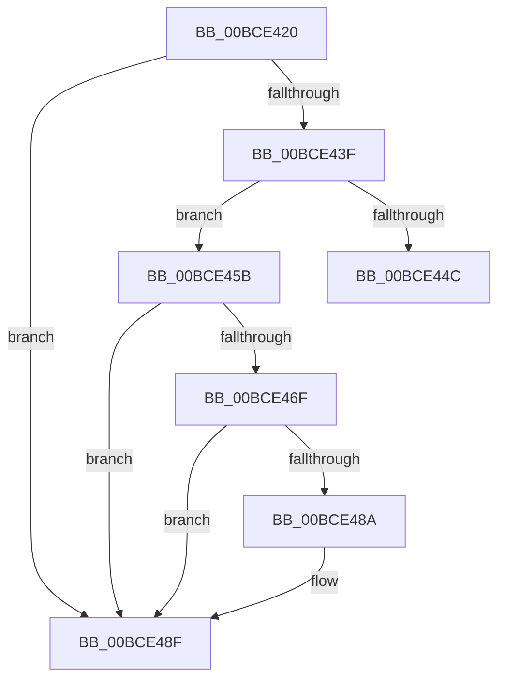

# _guard_retpoline_import_r10

- RVA: `0x00BCE420`–`0x00BCE4A2` (길이 `130` bytes)
- VA: `0x0000000140BCE420`
- 실행 섹션: `KSCP`
- PDB 이름 있음: `예`; PDB Function 태그: `아니요`
- unwind 정보 RVA: `0x000C2104`
- 디코드: `29`개 명령, `130/130` bytes 표시
- 미해석 바이트: `0` (있으면 어셈블리에 `.byte`로 보존)

> 이 문서는 커널 이미지의 기계어와 PDB 기호를 분석해 생성했습니다. 4번과 5번은 함수 원형과 자료형을 바이너리 사용 방식에서 추정한 C 해석이며 원본 소스 복구 결과는 아닙니다.

## 1. Dependencies

- 직접 호출 지점: **2**; 고유 호출 대상: **2**
- 직접 호출자로 확인된 함수: **0**
- RIP 상대 이미지 참조: **0**

### Outgoing calls
- `0x00BCE46F` → [_guard_retpoline_exit](_guard_retpoline_exit_function_00BCE580.md) (function, `0x00BCE580`)
- `0x00BCE48A` → [_guard_retpoline_import_r10_log_event](_guard_retpoline_import_r10_log_event_function_00BCE500.md) (function, `0x00BCE500`)

### Direct callers
- 이 함수 시작 RVA로 연결되는 직접 call은 확인되지 않았습니다. 간접 호출은 완전히 역산할 수 없습니다.

### Static image references
- 디코드된 RIP-relative 메모리 참조가 없습니다.

## 2. Other-region calls and transfers

- 다른 실행 섹션으로 향하는 call: **0**
- call이 아닌 외부 분기/꼬리 이동: **1**
  - `0x00BCE459` → [_guard_retpoline_import_r10_do_retpoline](_guard_retpoline_import_r10_do_retpoline_function_00BCE4C0.md) (`tail-transfer`)

## 3. Assembly (complete function range)

```asm
00BCE420  48 83 EC 18                     sub rsp, 0x18
00BCE424  48 89 04 24                     mov qword ptr [rsp], rax
00BCE428  4C 89 5C 24 08                  mov qword ptr [rsp + 8], r11
00BCE42D  49 BB 98 73 FC 40 01 00 00 00   movabs r11, 0x140fc7398
00BCE437  4D 8B 1B                        mov r11, qword ptr [r11]
00BCE43A  4D 85 DB                        test r11, r11
00BCE43D  74 50                           je 0x140bce48f
00BCE43F  49 8B C2                        mov rax, r10
00BCE442  48 C1 E8 10                     shr rax, 0x10
00BCE446  49 0F A3 03                     bt qword ptr [r11], rax
00BCE44A  73 0F                           jae 0x140bce45b
00BCE44C  48 8B 04 24                     mov rax, qword ptr [rsp]
00BCE450  4C 8B 5C 24 08                  mov r11, qword ptr [rsp + 8]
00BCE455  48 83 C4 18                     add rsp, 0x18
00BCE459  EB 65                           jmp 0x140bce4c0
00BCE45B  65 80 0C 25 5E 08 00 00 01      or byte ptr gs:[0x85e], 1
00BCE464  65 F6 04 25 5E 08 00 00 02      test byte ptr gs:[0x85e], 2
00BCE46D  75 20                           jne 0x140bce48f
00BCE46F  E8 0C 01 00 00                  call 0x140bce580
00BCE474  49 BB 14 6B FC 40 01 00 00 00   movabs r11, 0x140fc6b14
00BCE47E  45 8B 1B                        mov r11d, dword ptr [r11]
00BCE481  41 F7 C3 02 00 00 00            test r11d, 2
00BCE488  74 05                           je 0x140bce48f
00BCE48A  E8 71 00 00 00                  call 0x140bce500
00BCE48F  0F AE E8                        lfence
00BCE492  48 8B 04 24                     mov rax, qword ptr [rsp]
00BCE496  4C 8B 5C 24 08                  mov r11, qword ptr [rsp + 8]
00BCE49B  48 83 C4 18                     add rsp, 0x18
00BCE49F  49 FF E2                        jmp r10
```

## 4. C-style interpretation (structured pseudocode)

```c
__int64 __fastcall _guard_retpoline_import_r10(void)
{
    __int64 result;
    __int64 v_rsp;
    unsigned __int64 v_stack_m10;
    unsigned __int64 v_stack_m18;
    unsigned __int64 v_stack_p0;
    unsigned __int64 v_stack_p8;

    v_rsp = (v_rsp) - (24);
    v_stack_m18 = result;
    v_stack_m10 = v_r11;
    if (*(unsigned __int64 *)(v_r11) == 0) goto loc_00BCE48F;
    result = (v_r10) >> (16);
    if (condition_is_above_or_equal) goto loc_00BCE45B;
    v_rsp = (v_rsp) + (24);
loc_00BCE45B:
    if (((*(unsigned __int8 *)(gs_base + (0 + 2142))) & (2)) != 0) goto loc_00BCE48F;
    result = _guard_retpoline_exit(a1, a2, a3, a4);
    if ((((unsigned int)((unsigned int)(*(unsigned int *)(v_stack_m10)))) & (2)) != 0) {
        result = _guard_retpoline_import_r10_log_event(a1, a2, a3, a4);
    }
    v_rsp = (v_rsp) + (24);
}
```

## 5. (Beta) C Style

```c
void _guard_retpoline_import_r10(void)
{
    int64_t result;
    int64_t local_rsp;
    uint64_t v_stack_m10;
    uint64_t v_stack_m18;
    uint64_t v_stack_p0;
    uint64_t v_stack_p8;

    local_rsp = (local_rsp) - (24);
    v_stack_m18 = result;
    v_stack_m10 = local_r11;
    if (*(uint64_t *)(local_r11) == 0) goto loc_00BCE48F;
    result = (local_r10) >> (16);
    if (condition_is_above_or_equal) goto loc_00BCE45B;
    local_rsp = (local_rsp) + (24);
loc_00BCE45B:
    if (((*(uint8_t *)(gs_base + (0 + 0x85E))) & (2)) != 0) goto loc_00BCE48F;
    result = _guard_retpoline_exit(a1, a2, a3, a4);
    if ((((uint32_t)((uint32_t)(*(uint32_t *)(v_stack_m10)))) & (2)) != 0) {
        result = _guard_retpoline_import_r10_log_event(a1, a2, a3, a4);
    }
    local_rsp = (local_rsp) + (24);
}
```

## 6. Execution-region graph

[열기: 2D/3D 그래프와 함수 탐색 컨트롤 패널](../../../control-panel.html?section=kscp&rva=0x00BCE420&view=graph)

- 2D 그래프는 위에서 아래로 흐르고, 3D 그래프는 빈 공간을 드래그해 회전합니다. Shift+드래그는 이동, 휠은 확대·축소, 함수 노드 선택은 대상 보고서 이동입니다.

### Static fallback


