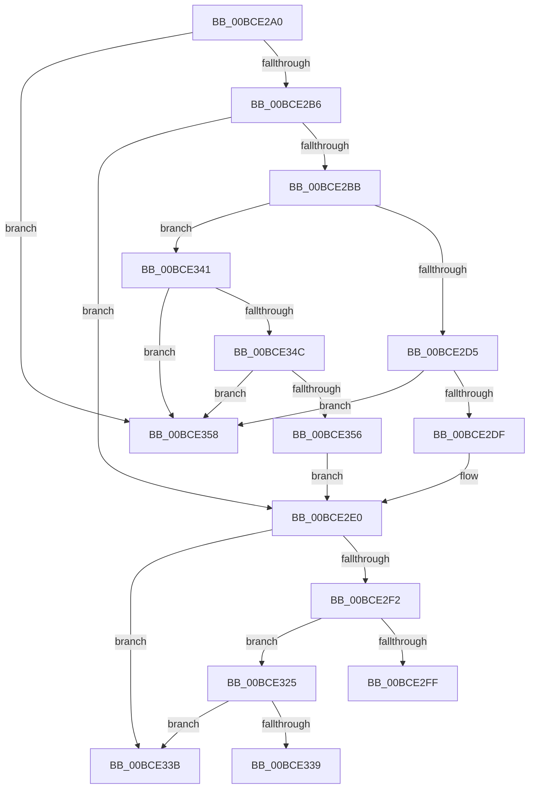

# _guard_retpoline_indirect_cfg_rax

- RVA: `0x00BCE2A0`–`0x00BCE385` (길이 `229` bytes)
- VA: `0x0000000140BCE2A0`
- 실행 섹션: `KSCP`
- PDB 이름 있음: `예`; PDB Function 태그: `아니요`
- unwind 정보 RVA: `0x000C20EC`
- 디코드: `51`개 명령, `229/229` bytes 표시
- 미해석 바이트: `0` (있으면 어셈블리에 `.byte`로 보존)

> 이 문서는 커널 이미지의 기계어와 PDB 기호를 분석해 생성했습니다. 4번과 5번은 함수 원형과 자료형을 바이너리 사용 방식에서 추정한 C 해석이며 원본 소스 복구 결과는 아닙니다.

## 1. Dependencies

- 직접 호출 지점: **2**; 고유 호출 대상: **2**
- 직접 호출자로 확인된 함수: **1**
- RIP 상대 이미지 참조: **0**

### Outgoing calls
- `0x00BCE2FF` → [_guard_retpoline_indirect_cfg_rax + 0x80](_guard_retpoline_indirect_cfg_rax_function_00BCE2A0.md) (inside-function, `0x00BCE320`)
- `0x00BCE365` → [_guard_retpoline_indirect_cfg_rax + 0xE0](_guard_retpoline_indirect_cfg_rax_function_00BCE2A0.md) (inside-function, `0x00BCE380`)

### Direct callers
- [_guard_retpoline_indirect_cfg_rax](_guard_retpoline_indirect_cfg_rax_function_00BCE2A0.md) at `0x00BCE2FF`
- [_guard_retpoline_indirect_cfg_rax](_guard_retpoline_indirect_cfg_rax_function_00BCE2A0.md) at `0x00BCE365`

### Static image references
- 디코드된 RIP-relative 메모리 참조가 없습니다.

## 2. Other-region calls and transfers

- 다른 실행 섹션으로 향하는 call: **0**
- call이 아닌 외부 분기/꼬리 이동: **1**
  - `0x00BCE339` → [_guard_retpoline_exit_indirect_rax](_guard_retpoline_exit_indirect_rax_function_00BCE3A0.md) (`tail-transfer`)

## 3. Assembly (complete function range)

```asm
00BCE2A0  49 BB B8 18 20 41 01 00 00 00   movabs r11, 0x1412018b8
00BCE2AA  4D 8B 1B                        mov r11, qword ptr [r11]
00BCE2AD  48 85 C0                        test rax, rax
00BCE2B0  0F 8D A2 00 00 00               jge 0x140bce358
00BCE2B6  4D 85 DB                        test r11, r11
00BCE2B9  74 25                           je 0x140bce2e0
00BCE2BB  4C 8B D0                        mov r10, rax
00BCE2BE  49 C1 EA 09                     shr r10, 9
00BCE2C2  4F 8B 1C D3                     mov r11, qword ptr [r11 + r10*8]
00BCE2C6  4C 8B D0                        mov r10, rax
00BCE2C9  49 C1 EA 03                     shr r10, 3
00BCE2CD  A8 0F                           test al, 0xf
00BCE2CF  0F 85 6C 00 00 00               jne 0x140bce341
00BCE2D5  4D 0F A3 D3                     bt r11, r10
00BCE2D9  0F 83 79 00 00 00               jae 0x140bce358
00BCE2DF  90                              nop
00BCE2E0  49 BB 98 73 FC 40 01 00 00 00   movabs r11, 0x140fc7398
00BCE2EA  4D 8B 1B                        mov r11, qword ptr [r11]
00BCE2ED  4D 85 DB                        test r11, r11
00BCE2F0  74 49                           je 0x140bce33b
00BCE2F2  4C 8B D0                        mov r10, rax
00BCE2F5  49 C1 EA 10                     shr r10, 0x10
00BCE2F9  4D 0F A3 13                     bt qword ptr [r11], r10
00BCE2FD  73 26                           jae 0x140bce325
00BCE2FF  E8 1C 00 00 00                  call 0x140bce320
00BCE304  CC                              int3
00BCE305  66 66 66 66 66 66 66 0F 1F 84 00 00 00 00 00  nop word ptr [rax + rax]
00BCE314  66 66 66 66 0F 1F 84 00 00 00 00 00  nop word ptr [rax + rax]
00BCE320  48 89 04 24                     mov qword ptr [rsp], rax
00BCE324  C3                              ret
00BCE325  65 80 0C 25 5E 08 00 00 01      or byte ptr gs:[0x85e], 1
00BCE32E  65 F6 04 25 5E 08 00 00 02      test byte ptr gs:[0x85e], 2
00BCE337  75 02                           jne 0x140bce33b
00BCE339  EB 65                           jmp 0x140bce3a0
00BCE33B  0F AE E8                        lfence
00BCE33E  48 FF E0                        jmp rax
00BCE341  49 0F BA F2 00                  btr r10, 0
00BCE346  4D 0F A3 D3                     bt r11, r10
00BCE34A  73 0C                           jae 0x140bce358
00BCE34C  49 83 CA 01                     or r10, 1
00BCE350  4D 0F A3 D3                     bt r11, r10
00BCE354  73 02                           jae 0x140bce358
00BCE356  EB 88                           jmp 0x140bce2e0
00BCE358  48 8B C8                        mov rcx, rax
00BCE35B  48 B8 20 AA 6B 40 01 00 00 00   movabs rax, 0x1406baa20
00BCE365  E8 16 00 00 00                  call 0x140bce380
00BCE36A  CC                              int3
00BCE36B  66 66 66 66 66 66 66 0F 1F 84 00 00 00 00 00  nop word ptr [rax + rax]
00BCE37A  66 0F 1F 44 00 00               nop word ptr [rax + rax]
00BCE380  48 89 04 24                     mov qword ptr [rsp], rax
00BCE384  C3                              ret
```

## 4. C-style interpretation (structured pseudocode)

```c
__int64 __fastcall _guard_retpoline_indirect_cfg_rax(void)
{
    __int64 result;
    __int64 v_r10;
    unsigned __int64 v_stack_p0;

    if (condition_is_greater_or_equal) goto loc_00BCE358;
    if (*(unsigned __int64 *)(v_r11) == 0) goto loc_00BCE2E0;
    v_r10 = (result) >> (9);
    v_r10 = (result) >> (3);
    if ((((unsigned __int8)(result)) & (15)) != 0) goto loc_00BCE341;
    if (condition_is_above_or_equal) goto loc_00BCE358;
loc_00BCE2E0:
    if (*(unsigned __int64 *)(*(unsigned __int64 *)(*(unsigned __int64 *)(v_r11) + v_r10 * 8)) == 0) goto loc_00BCE33B;
    v_r10 = (result) >> (16);
    if (condition_is_above_or_equal) goto loc_00BCE325;
    result = _guard_retpoline_indirect_cfg_rax___0x80(a1, a2, a3, a4);
    v_stack_p0 = result;
    return result;
loc_00BCE325:
    if (((*(unsigned __int8 *)(gs_base + (0 + 2142))) & (2)) != 0) goto loc_00BCE33B;
loc_00BCE33B:
loc_00BCE341:
    if (condition_is_above_or_equal) goto loc_00BCE358;
    v_r10 = (v_r10) | (1);
    if (condition_is_above_or_equal) goto loc_00BCE358;
    goto loc_00BCE2E0;
loc_00BCE358:
    result = _guard_retpoline_indirect_cfg_rax___0xE0(result, a2, a3, a4);
    v_stack_p0 = result;
    return result;
}
```

## 5. (Beta) C Style

```c
void _guard_retpoline_indirect_cfg_rax(void)
{
    int64_t result;
    int64_t local_r10;
    uint64_t v_stack_p0;

    if (condition_is_greater_or_equal) goto loc_00BCE358;
    if (*(uint64_t *)(local_r11) == 0) goto loc_00BCE2E0;
    local_r10 = (result) >> (9);
    local_r10 = (result) >> (3);
    if ((((uint8_t)(result)) & (15)) != 0) goto loc_00BCE341;
    if (condition_is_above_or_equal) goto loc_00BCE358;
loc_00BCE2E0:
    if (*(uint64_t *)(*(uint64_t *)(*(uint64_t *)(local_r11) + local_r10 * 8)) == 0) goto loc_00BCE33B;
    local_r10 = (result) >> (16);
    if (condition_is_above_or_equal) goto loc_00BCE325;
    result = _guard_retpoline_indirect_cfg_rax___0x80(a1, a2, a3, a4);
    v_stack_p0 = result;
    return result;
loc_00BCE325:
    if (((*(uint8_t *)(gs_base + (0 + 0x85E))) & (2)) != 0) goto loc_00BCE33B;
loc_00BCE33B:
loc_00BCE341:
    if (condition_is_above_or_equal) goto loc_00BCE358;
    local_r10 = (local_r10) | (1);
    if (condition_is_above_or_equal) goto loc_00BCE358;
    goto loc_00BCE2E0;
loc_00BCE358:
    result = _guard_retpoline_indirect_cfg_rax___0xE0(result, a2, a3, a4);
    v_stack_p0 = result;
    return result;
}
```

## 6. Execution-region graph

[열기: 2D/3D 그래프와 함수 탐색 컨트롤 패널](../../../control-panel.html?section=kscp&rva=0x00BCE2A0&view=graph)

- 2D 그래프는 위에서 아래로 흐르고, 3D 그래프는 빈 공간을 드래그해 회전합니다. Shift+드래그는 이동, 휠은 확대·축소, 함수 노드 선택은 대상 보고서 이동입니다.

### Static fallback


