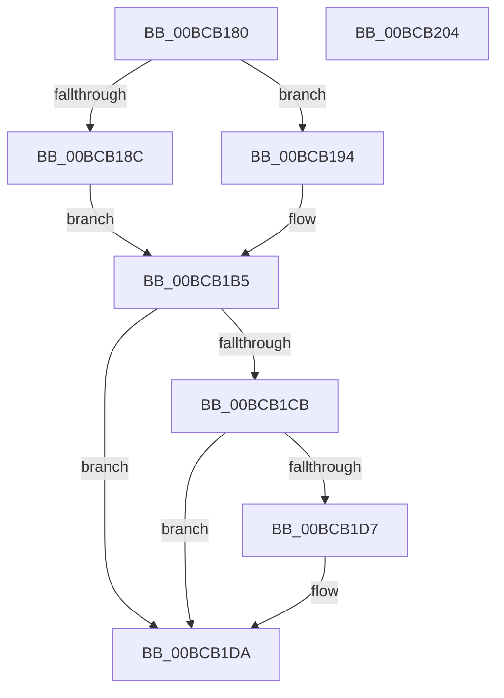

# KiDebugTrapOrFaultShadow

- RVA: `0x00BCB180`–`0x00BCB205` (길이 `133` bytes)
- VA: `0x0000000140BCB180`
- 실행 섹션: `KVASCODE`
- PDB 이름 있음: `예`; PDB Function 태그: `아니요`
- unwind 정보 RVA: `0x000C180C`
- 디코드: `38`개 명령, `133/133` bytes 표시
- 미해석 바이트: `0` (있으면 어셈블리에 `.byte`로 보존)

> 이 문서는 커널 이미지의 기계어와 PDB 기호를 분석해 생성했습니다. 4번과 5번은 함수 원형과 자료형을 바이너리 사용 방식에서 추정한 C 해석이며 원본 소스 복구 결과는 아닙니다.

## 1. Dependencies

- 직접 호출 지점: **0**; 고유 호출 대상: **0**
- 직접 호출자로 확인된 함수: **0**
- RIP 상대 이미지 참조: **0**

### Outgoing calls
- 직접 디코드된 call 명령이 없습니다.

### Direct callers
- 이 함수 시작 RVA로 연결되는 직접 call은 확인되지 않았습니다. 간접 호출은 완전히 역산할 수 없습니다.

### Static image references
- 디코드된 RIP-relative 메모리 참조가 없습니다.

## 2. Other-region calls and transfers

- 다른 실행 섹션으로 향하는 call: **0**
- call이 아닌 외부 분기/꼬리 이동: **1**
  - `0x00BCB1FF` → [KiDebugTrapOrFault](../../text/6B/KiDebugTrapOrFault_function_006BCD80.md) (`tail-transfer`)

## 3. Assembly (complete function range)

```asm
00BCB180  41 50                           push r8
00BCB182  51                              push rcx
00BCB183  50                              push rax
00BCB184  52                              push rdx
00BCB185  F6 44 24 28 01                  test byte ptr [rsp + 0x28], 1
00BCB18A  74 08                           je 0x140bcb194
00BCB18C  0F 01 F8                        swapgs
00BCB18F  0F AE E8                        lfence
00BCB192  EB 21                           jmp 0x140bcb1b5
00BCB194  B9 01 01 00 C0                  mov ecx, 0xc0000101
00BCB199  0F 32                           rdmsr
00BCB19B  89 44 24 58                     mov dword ptr [rsp + 0x58], eax
00BCB19F  89 54 24 5C                     mov dword ptr [rsp + 0x5c], edx
00BCB1A3  48 8B 54 24 48                  mov rdx, qword ptr [rsp + 0x48]
00BCB1A8  8B C2                           mov eax, edx
00BCB1AA  48 C1 EA 20                     shr rdx, 0x20
00BCB1AE  B9 01 01 00 C0                  mov ecx, 0xc0000101
00BCB1B3  0F 30                           wrmsr
00BCB1B5  0F 20 D8                        mov rax, cr3
00BCB1B8  65 48 8B 14 25 00 B0 00 00      mov rdx, qword ptr gs:[0xb000]
00BCB1C1  48 89 44 24 60                  mov qword ptr [rsp + 0x60], rax
00BCB1C6  48 3B C2                        cmp rax, rdx
00BCB1C9  74 0F                           je 0x140bcb1da
00BCB1CB  65 0F BA 24 25 18 B0 00 00 01   bt dword ptr gs:[0xb018], 1
00BCB1D5  72 03                           jb 0x140bcb1da
00BCB1D7  0F 22 DA                        mov cr3, rdx
00BCB1DA  48 8D 4C 24 48                  lea rcx, [rsp + 0x48]
00BCB1DF  48 8B 64 24 50                  mov rsp, qword ptr [rsp + 0x50]
00BCB1E4  FF 71 F8                        push qword ptr [rcx - 8]
00BCB1E7  FF 71 F0                        push qword ptr [rcx - 0x10]
00BCB1EA  FF 71 E8                        push qword ptr [rcx - 0x18]
00BCB1ED  FF 71 E0                        push qword ptr [rcx - 0x20]
00BCB1F0  FF 71 D8                        push qword ptr [rcx - 0x28]
00BCB1F3  48 8B 51 B8                     mov rdx, qword ptr [rcx - 0x48]
00BCB1F7  48 8B 41 C0                     mov rax, qword ptr [rcx - 0x40]
00BCB1FB  48 8B 49 C8                     mov rcx, qword ptr [rcx - 0x38]
00BCB1FF  E9 7C 1B AF FF                  jmp 0x1406bcd80
00BCB204  C3                              ret
```

## 4. C-style interpretation (structured pseudocode)

```c
__int64 __fastcall KiDebugTrapOrFaultShadow(__int64 a1, __int64 a2, __int64 a3, __int64 a4, __int64 a5, __int64 a6)
{
    __int64 v_cr3;
    unsigned int v_stack_p38;
    unsigned int v_stack_p3C;
    unsigned __int64 v_stack_p40;
    unsigned __int8 v_stack_p8;

    if (((v_stack_p8) & (1)) == 0) goto loc_00BCB194;
    goto loc_00BCB1B5;
loc_00BCB194:
    v_stack_p38 = (unsigned int)(result);
    v_stack_p3C = (unsigned int)(a2);
    a2 = (a5) >> (32);
loc_00BCB1B5:
    v_stack_p40 = v_cr3;
    if (v_cr3 == (*(unsigned __int64 *)(gs_base + (0 + 45056)))) goto loc_00BCB1DA;
    if (v_cr3 >= (*(unsigned __int64 *)(gs_base + (0 + 45056)))) {
        v_cr3 = *(unsigned __int64 *)(gs_base + (0 + 45056));
    }
}
```

## 5. (Beta) C Style

```c
int64_t KiDebugTrapOrFaultShadow(int64_t Arg1, int64_t Arg2, int64_t Arg3, int64_t Arg4, int64_t Arg5, int64_t Arg6)
{
    int64_t v_cr3;
    uint32_t v_stack_p38;
    uint32_t v_stack_p3C;
    uint64_t v_stack_p40;
    uint8_t v_stack_p8;

    if (((v_stack_p8) & (1)) == 0) goto loc_00BCB194;
    goto loc_00BCB1B5;
loc_00BCB194:
    v_stack_p38 = (uint32_t)(result);
    v_stack_p3C = (uint32_t)(Arg2);
    Arg2 = (Arg5) >> (32);
loc_00BCB1B5:
    v_stack_p40 = v_cr3;
    if (v_cr3 == (*(uint64_t *)(gs_base + (0 + 0xB000)))) goto loc_00BCB1DA;
    if (v_cr3 >= (*(uint64_t *)(gs_base + (0 + 0xB000)))) {
        v_cr3 = *(uint64_t *)(gs_base + (0 + 0xB000));
    }
}
```

## 6. Execution-region graph

[열기: 2D/3D 그래프와 함수 탐색 컨트롤 패널](../../../control-panel.html?section=kvascode&rva=0x00BCB180&view=graph)

- 2D 그래프는 위에서 아래로 흐르고, 3D 그래프는 빈 공간을 드래그해 회전합니다. Shift+드래그는 이동, 휠은 확대·축소, 함수 노드 선택은 대상 보고서 이동입니다.

### Static fallback


