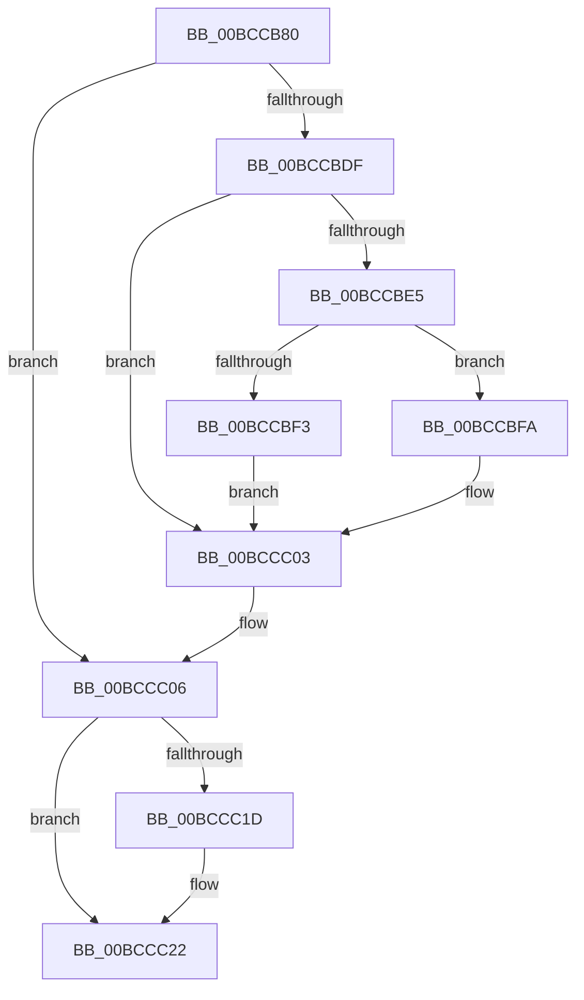

# KiKernelExit

- RVA: `0x00BCCB80`–`0x00BCCC28` (길이 `168` bytes)
- VA: `0x0000000140BCCB80`
- 실행 섹션: `KVASCODE`
- PDB 이름 있음: `예`; PDB Function 태그: `아니요`
- unwind 정보 RVA: `0x000C19D4`
- 디코드: `34`개 명령, `168/168` bytes 표시
- 미해석 바이트: `0` (있으면 어셈블리에 `.byte`로 보존)

> 이 문서는 커널 이미지의 기계어와 PDB 기호를 분석해 생성했습니다. 4번과 5번은 함수 원형과 자료형을 바이너리 사용 방식에서 추정한 C 해석이며 원본 소스 복구 결과는 아닙니다.

## 1. Dependencies

- 직접 호출 지점: **0**; 고유 호출 대상: **0**
- 직접 호출자로 확인된 함수: **0**
- RIP 상대 이미지 참조: **0**

### Outgoing calls
- 직접 디코드된 call 명령이 없습니다.

### Direct callers
- 이 함수 시작 RVA로 연결되는 직접 call은 확인되지 않았습니다. 간접 호출은 완전히 역산할 수 없습니다.

### Static image references
- 디코드된 RIP-relative 메모리 참조가 없습니다.

## 2. Other-region calls and transfers

- 다른 실행 섹션으로 향하는 call: **0**
- 별도 외부 분기/꼬리 이동을 확인하지 못했습니다.

## 3. Assembly (complete function range)

```asm
00BCCB80  50                              push rax
00BCCB81  52                              push rdx
00BCCB82  48 8D 44 24 38                  lea rax, [rsp + 0x38]
00BCCB87  65 48 8B 14 25 38 00 00 00      mov rdx, qword ptr gs:[0x38]
00BCCB90  48 8D A2 00 42 00 00            lea rsp, [rdx + 0x4200]
00BCCB97  65 48 8B 14 25 88 01 00 00      mov rdx, qword ptr gs:[0x188]
00BCCBA0  48 8B 92 20 02 00 00            mov rdx, qword ptr [rdx + 0x220]
00BCCBA7  48 8B 92 58 01 00 00            mov rdx, qword ptr [rdx + 0x158]
00BCCBAE  FF 70 F8                        push qword ptr [rax - 8]
00BCCBB1  FF 70 F0                        push qword ptr [rax - 0x10]
00BCCBB4  FF 70 E8                        push qword ptr [rax - 0x18]
00BCCBB7  FF 70 E0                        push qword ptr [rax - 0x20]
00BCCBBA  FF 70 D8                        push qword ptr [rax - 0x28]
00BCCBBD  65 48 89 24 25 10 B0 00 00      mov qword ptr gs:[0xb010], rsp
00BCCBC6  48 8B E2                        mov rsp, rdx
00BCCBC9  48 8B 50 C8                     mov rdx, qword ptr [rax - 0x38]
00BCCBCD  48 8B 40 D0                     mov rax, qword ptr [rax - 0x30]
00BCCBD1  65 F7 04 25 18 B0 00 00 02 00 00 00  test dword ptr gs:[0xb018], 2
00BCCBDD  75 27                           jne 0x140bccc06
00BCCBDF  0F BA E4 00                     bt esp, 0
00BCCBE3  73 1E                           jae 0x140bccc03
00BCCBE5  65 F7 04 25 18 B0 00 00 01 00 00 00  test dword ptr gs:[0xb018], 1
00BCCBF1  75 07                           jne 0x140bccbfa
00BCCBF3  48 0F BA EC 3F                  bts rsp, 0x3f
00BCCBF8  EB 09                           jmp 0x140bccc03
00BCCBFA  65 83 24 25 18 B0 00 00 FE      and dword ptr gs:[0xb018], 0xfffffffe
00BCCC03  0F 22 DC                        mov cr3, rsp
00BCCC06  65 48 8B 24 25 10 B0 00 00      mov rsp, qword ptr gs:[0xb010]
00BCCC0F  65 F7 04 25 18 B0 00 00 02 00 00 00  test dword ptr gs:[0xb018], 2
00BCCC1B  75 05                           jne 0x140bccc22
00BCCC1D  0F 00 6C 24 20                  verw word ptr [rsp + 0x20]
00BCCC22  0F 01 F8                        swapgs
00BCCC25  48 CF                           iretq
00BCCC27  C3                              ret
```

## 4. C-style interpretation (structured pseudocode)

```c
__int64 __fastcall KiKernelExit(__int64 a1, __int64 a2, __int64 a3, __int64 a4, __int64 a5)
{
    unsigned __int16 v_stack_m18;

    *(unsigned __int64 *)(gs_base + (0 + 45072)) = *(unsigned __int64 *)(gs_base + (0 + 56)) + 16896;
    if (((*(unsigned int *)(gs_base + (0 + 45080))) & (2)) != 0) goto loc_00BCCC06;
    if (condition_is_above_or_equal) goto loc_00BCCC03;
    if (((*(unsigned int *)(gs_base + (0 + 45080))) & (1)) != 0) goto loc_00BCCBFA;
    goto loc_00BCCC03;
loc_00BCCBFA:
loc_00BCCC03:
loc_00BCCC06:
    if (((*(unsigned int *)(gs_base + (0 + 45080))) & (2)) == 0) {
    }
    return *(unsigned __int64 *)(a5 - 48);
}
```

## 5. (Beta) C Style

```c
int64_t KiKernelExit(int64_t Arg1, int64_t Arg2, int64_t Arg3, int64_t Arg4, int64_t Arg5)
{
    uint16_t v_stack_m18;

    *(uint64_t *)(gs_base + (0 + 0xB010)) = *(uint64_t *)(gs_base + (0 + 0x38)) + 16896;
    if (((*(uint32_t *)(gs_base + (0 + 0xB018))) & (2)) != 0) goto loc_00BCCC06;
    if (condition_is_above_or_equal) goto loc_00BCCC03;
    if (((*(uint32_t *)(gs_base + (0 + 0xB018))) & (1)) != 0) goto loc_00BCCBFA;
    goto loc_00BCCC03;
loc_00BCCBFA:
loc_00BCCC03:
loc_00BCCC06:
    if (((*(uint32_t *)(gs_base + (0 + 0xB018))) & (2)) == 0) {
    }
    return *(uint64_t *)(Arg5 - 0x30);
}
```

## 6. Execution-region graph

[열기: 2D/3D 그래프와 함수 탐색 컨트롤 패널](../../../control-panel.html?section=kvascode&rva=0x00BCCB80&view=graph)

- 2D 그래프는 위에서 아래로 흐르고, 3D 그래프는 빈 공간을 드래그해 회전합니다. Shift+드래그는 이동, 휠은 확대·축소, 함수 노드 선택은 대상 보고서 이동입니다.

### Static fallback


