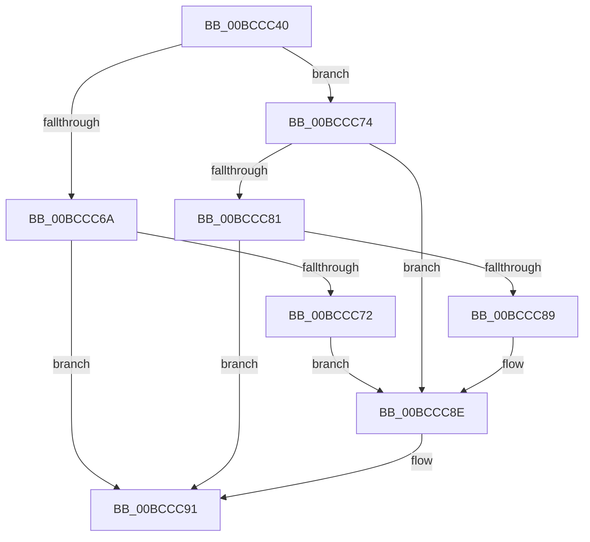

# KiKernelIstExit

- RVA: `0x00BCCC40`–`0x00BCCCB7` (길이 `119` bytes)
- VA: `0x0000000140BCCC40`
- 실행 섹션: `KVASCODE`
- PDB 이름 있음: `예`; PDB Function 태그: `아니요`
- unwind 정보 RVA: `0x000C19E0`
- 디코드: `40`개 명령, `119/119` bytes 표시
- 미해석 바이트: `0` (있으면 어셈블리에 `.byte`로 보존)

> 이 문서는 커널 이미지의 기계어와 PDB 기호를 분석해 생성했습니다. 4번과 5번은 함수 원형과 자료형을 바이너리 사용 방식에서 추정한 C 해석이며 원본 소스 복구 결과는 아닙니다.

## 1. Dependencies

- 직접 호출 지점: **0**; 고유 호출 대상: **0**
- 직접 호출자로 확인된 함수: **0**
- RIP 상대 이미지 참조: **0**

### Outgoing calls
- 직접 디코드된 call 명령이 없습니다.

### Direct callers
- 이 함수 시작 RVA로 연결되는 직접 call은 확인되지 않았습니다. 간접 호출은 완전히 역산할 수 없습니다.

### Static image references
- 디코드된 RIP-relative 메모리 참조가 없습니다.

## 2. Other-region calls and transfers

- 다른 실행 섹션으로 향하는 call: **0**
- 별도 외부 분기/꼬리 이동을 확인하지 못했습니다.

## 3. Assembly (complete function range)

```asm
00BCCC40  50                              push rax
00BCCC41  48 8D 44 24 30                  lea rax, [rsp + 0x30]
00BCCC46  48 8B 64 24 30                  mov rsp, qword ptr [rsp + 0x30]
00BCCC4B  FF 70 F8                        push qword ptr [rax - 8]
00BCCC4E  FF 70 F0                        push qword ptr [rax - 0x10]
00BCCC51  FF 70 E8                        push qword ptr [rax - 0x18]
00BCCC54  FF 70 E0                        push qword ptr [rax - 0x20]
00BCCC57  FF 70 D8                        push qword ptr [rax - 0x28]
00BCCC5A  FF 70 D0                        push qword ptr [rax - 0x30]
00BCCC5D  52                              push rdx
00BCCC5E  51                              push rcx
00BCCC5F  48 8B 54 24 58                  mov rdx, qword ptr [rsp + 0x58]
00BCCC64  0F BA E2 00                     bt edx, 0
00BCCC68  72 0A                           jb 0x140bccc74
00BCCC6A  0F 20 D8                        mov rax, cr3
00BCCC6D  48 3B C2                        cmp rax, rdx
00BCCC70  74 1F                           je 0x140bccc91
00BCCC72  EB 1A                           jmp 0x140bccc8e
00BCCC74  F0 65 0F BA 34 25 18 B0 00 00 00  lock btr dword ptr gs:[0xb018], 0
00BCCC7F  72 0D                           jb 0x140bccc8e
00BCCC81  0F 20 D8                        mov rax, cr3
00BCCC84  48 3B C2                        cmp rax, rdx
00BCCC87  74 08                           je 0x140bccc91
00BCCC89  48 0F BA EA 3F                  bts rdx, 0x3f
00BCCC8E  0F 22 DA                        mov cr3, rdx
00BCCC91  8B 44 24 50                     mov eax, dword ptr [rsp + 0x50]
00BCCC95  8B 54 24 54                     mov edx, dword ptr [rsp + 0x54]
00BCCC99  B9 01 01 00 C0                  mov ecx, 0xc0000101
00BCCC9E  0F 30                           wrmsr
00BCCCA0  59                              pop rcx
00BCCCA1  5A                              pop rdx
00BCCCA2  58                              pop rax
00BCCCA3  6A 00                           push 0
00BCCCA5  6A 00                           push 0
00BCCCA7  6A 00                           push 0
00BCCCA9  6A 00                           push 0
00BCCCAB  48 83 C4 20                     add rsp, 0x20
00BCCCAF  0F 00 6C 24 20                  verw word ptr [rsp + 0x20]
00BCCCB4  48 CF                           iretq
00BCCCB6  C3                              ret
```

## 4. C-style interpretation (structured pseudocode)

```c
__int64 __fastcall KiKernelIstExit(__int64 a1, __int64 a2, __int64 a3, __int64 a4, __int64 a5)
{
    __int64 v_rsp;
    unsigned __int16 v_stack_m10;
    unsigned __int64 v_stack_p10;
    unsigned int v_stack_p8;
    unsigned int v_stack_pC;

    if (condition_is_below) goto loc_00BCCC74;
    if (v_cr3 == v_stack_p10) goto loc_00BCCC91;
    goto loc_00BCCC8E;
loc_00BCCC74:
    if (v_cr3 < v_stack_p10) goto loc_00BCCC8E;
    if (v_cr3 == v_stack_p10) goto loc_00BCCC91;
loc_00BCCC8E:
loc_00BCCC91:
    v_rsp = (a5) + (32);
    return (unsigned int)(v_stack_p8);
}
```

## 5. (Beta) C Style

```c
int64_t KiKernelIstExit(int64_t Arg1, int64_t Arg2, int64_t Arg3, int64_t Arg4, void *Arg5)
{
    uint8_t *arg5 = (uint8_t *)Arg5;

    int64_t local_rsp;
    uint16_t v_stack_m10;
    uint64_t v_stack_p10;
    uint32_t v_stack_p8;
    uint32_t v_stack_pC;

    if (condition_is_below) goto loc_00BCCC74;
    if (v_cr3 == v_stack_p10) goto loc_00BCCC91;
    goto loc_00BCCC8E;
loc_00BCCC74:
    if (v_cr3 < v_stack_p10) goto loc_00BCCC8E;
    if (v_cr3 == v_stack_p10) goto loc_00BCCC91;
loc_00BCCC8E:
loc_00BCCC91:
    local_rsp = (Arg5) + (32);
    return (uint32_t)(v_stack_p8);
}
```

### 관측된 메모리 오프셋

구조체 형식이 확인되지 않은 접근은 인자 기준의 오프셋으로만 기록했습니다.

| 기준 인자 | 오프셋 표현 | 폭 (bit) | 접근 |
|---|---:|---:|---|
| `Arg5` | `+ 0x20` | `16` | `R` |
| `Arg5` | `+ 0x50` | `32` | `R` |
| `Arg5` | `+ 0x54` | `32` | `R` |
| `Arg5` | `+ 0x58` | `64` | `R` |

## 6. Execution-region graph

[열기: 2D/3D 그래프와 함수 탐색 컨트롤 패널](../../../control-panel.html?section=kvascode&rva=0x00BCCC40&view=graph)

- 2D 그래프는 위에서 아래로 흐르고, 3D 그래프는 빈 공간을 드래그해 회전합니다. Shift+드래그는 이동, 휠은 확대·축소, 함수 노드 선택은 대상 보고서 이동입니다.

### Static fallback


