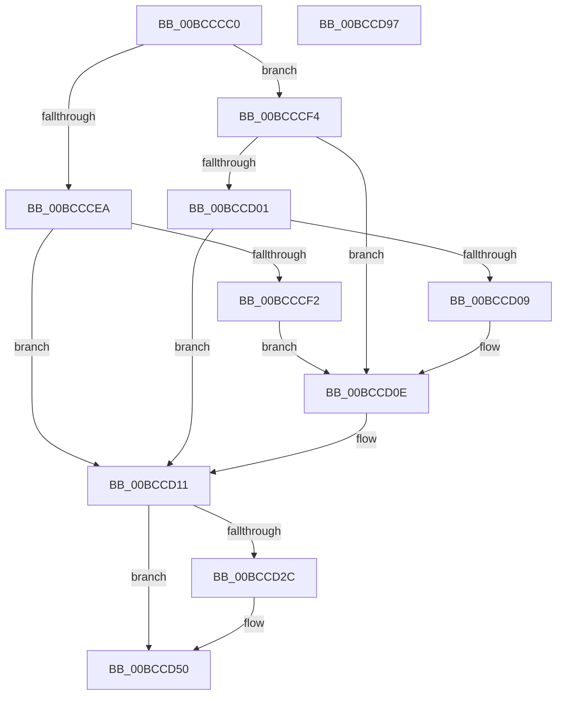

# KiKernelIstMceExit

- RVA: `0x00BCCCC0`–`0x00BCCD98` (길이 `216` bytes)
- VA: `0x0000000140BCCCC0`
- 실행 섹션: `KVASCODE`
- PDB 이름 있음: `예`; PDB Function 태그: `아니요`
- unwind 정보 RVA: `0x000C19EC`
- 디코드: `82`개 명령, `216/216` bytes 표시
- 미해석 바이트: `0` (있으면 어셈블리에 `.byte`로 보존)

> 이 문서는 커널 이미지의 기계어와 PDB 기호를 분석해 생성했습니다. 4번과 5번은 함수 원형과 자료형을 바이너리 사용 방식에서 추정한 C 해석이며 원본 소스 복구 결과는 아닙니다.

## 1. Dependencies

- 직접 호출 지점: **0**; 고유 호출 대상: **0**
- 직접 호출자로 확인된 함수: **0**
- RIP 상대 이미지 참조: **0**

### Outgoing calls
- 직접 디코드된 call 명령이 없습니다.

### Direct callers
- 이 함수 시작 RVA로 연결되는 직접 call은 확인되지 않았습니다. 간접 호출은 완전히 역산할 수 없습니다.

### Static image references
- 디코드된 RIP-relative 메모리 참조가 없습니다.

## 2. Other-region calls and transfers

- 다른 실행 섹션으로 향하는 call: **0**
- 별도 외부 분기/꼬리 이동을 확인하지 못했습니다.

## 3. Assembly (complete function range)

```asm
00BCCCC0  50                              push rax
00BCCCC1  48 8D 44 24 30                  lea rax, [rsp + 0x30]
00BCCCC6  48 8B 64 24 30                  mov rsp, qword ptr [rsp + 0x30]
00BCCCCB  FF 70 F8                        push qword ptr [rax - 8]
00BCCCCE  FF 70 F0                        push qword ptr [rax - 0x10]
00BCCCD1  FF 70 E8                        push qword ptr [rax - 0x18]
00BCCCD4  FF 70 E0                        push qword ptr [rax - 0x20]
00BCCCD7  FF 70 D8                        push qword ptr [rax - 0x28]
00BCCCDA  FF 70 D0                        push qword ptr [rax - 0x30]
00BCCCDD  52                              push rdx
00BCCCDE  51                              push rcx
00BCCCDF  48 8B 54 24 58                  mov rdx, qword ptr [rsp + 0x58]
00BCCCE4  0F BA E2 00                     bt edx, 0
00BCCCE8  72 0A                           jb 0x140bcccf4
00BCCCEA  0F 20 D8                        mov rax, cr3
00BCCCED  48 3B C2                        cmp rax, rdx
00BCCCF0  74 1F                           je 0x140bccd11
00BCCCF2  EB 1A                           jmp 0x140bccd0e
00BCCCF4  F0 65 0F BA 34 25 18 B0 00 00 00  lock btr dword ptr gs:[0xb018], 0
00BCCCFF  72 0D                           jb 0x140bccd0e
00BCCD01  0F 20 D8                        mov rax, cr3
00BCCD04  48 3B C2                        cmp rax, rdx
00BCCD07  74 08                           je 0x140bccd11
00BCCD09  48 0F BA EA 3F                  bts rdx, 0x3f
00BCCD0E  0F 22 DA                        mov cr3, rdx
00BCCD11  8B 44 24 50                     mov eax, dword ptr [rsp + 0x50]
00BCCD15  8B 54 24 54                     mov edx, dword ptr [rsp + 0x54]
00BCCD19  B9 01 01 00 C0                  mov ecx, 0xc0000101
00BCCD1E  0F 30                           wrmsr
00BCCD20  59                              pop rcx
00BCCD21  5A                              pop rdx
00BCCD22  58                              pop rax
00BCCD23  66 F7 44 24 20 04 00            test word ptr [rsp + 0x20], 4
00BCCD2A  75 24                           jne 0x140bccd50
00BCCD2C  50                              push rax
00BCCD2D  51                              push rcx
00BCCD2E  52                              push rdx
00BCCD2F  33 C0                           xor eax, eax
00BCCD31  33 D2                           xor edx, edx
00BCCD33  B9 7A 01 00 00                  mov ecx, 0x17a
00BCCD38  0F 30                           wrmsr
00BCCD3A  5A                              pop rdx
00BCCD3B  59                              pop rcx
00BCCD3C  58                              pop rax
00BCCD3D  6A 00                           push 0
00BCCD3F  6A 00                           push 0
00BCCD41  6A 00                           push 0
00BCCD43  6A 00                           push 0
00BCCD45  48 83 C4 20                     add rsp, 0x20
00BCCD49  0F 00 6C 24 20                  verw word ptr [rsp + 0x20]
00BCCD4E  48 CF                           iretq
00BCCD50  50                              push rax
00BCCD51  FF 74 24 18                     push qword ptr [rsp + 0x18]
00BCCD55  9D                              popfq
00BCCD56  48 8B C4                        mov rax, rsp
00BCCD59  6A 00                           push 0
00BCCD5B  6A 00                           push 0
00BCCD5D  6A 00                           push 0
00BCCD5F  6A 00                           push 0
00BCCD61  48 83 C4 20                     add rsp, 0x20
00BCCD65  48 8B 64 24 20                  mov rsp, qword ptr [rsp + 0x20]
00BCCD6A  FF 70 10                        push qword ptr [rax + 0x10]
00BCCD6D  FF 70 08                        push qword ptr [rax + 8]
00BCCD70  48 8B 00                        mov rax, qword ptr [rax]
00BCCD73  50                              push rax
00BCCD74  51                              push rcx
00BCCD75  52                              push rdx
00BCCD76  33 C0                           xor eax, eax
00BCCD78  33 D2                           xor edx, edx
00BCCD7A  B9 7A 01 00 00                  mov ecx, 0x17a
00BCCD7F  0F 30                           wrmsr
00BCCD81  5A                              pop rdx
00BCCD82  59                              pop rcx
00BCCD83  58                              pop rax
00BCCD84  6A 00                           push 0
00BCCD86  6A 00                           push 0
00BCCD88  6A 00                           push 0
00BCCD8A  6A 00                           push 0
00BCCD8C  48 83 C4 20                     add rsp, 0x20
00BCCD90  0F 00 6C 24 08                  verw word ptr [rsp + 8]
00BCCD95  48 CB                           retfq
00BCCD97  C3                              ret
```

## 4. C-style interpretation (structured pseudocode)

```c
__int64 __fastcall KiKernelIstMceExit(__int64 a1, __int64 a2, __int64 a3, __int64 a4, __int64 a5)
{
    __int64 result;
    __int64 v_rsp;
    unsigned __int16 v_stack_m10;
    unsigned __int64 v_stack_m18;
    unsigned __int64 v_stack_m20;
    unsigned __int16 v_stack_m40;
    unsigned __int64 v_stack_p10;
    unsigned int v_stack_p8;
    unsigned int v_stack_pC;

    if (condition_is_below) goto loc_00BCCCF4;
    if (v_cr3 == v_stack_p10) goto loc_00BCCD11;
    goto loc_00BCCD0E;
loc_00BCCCF4:
    if (v_cr3 < v_stack_p10) goto loc_00BCCD0E;
    if (v_cr3 == v_stack_p10) goto loc_00BCCD11;
loc_00BCCD0E:
loc_00BCCD11:
    result = (unsigned int)(v_stack_p8);
    v_rsp = a5;
    if (((v_stack_m10) & (4)) == 0) {
        result = 0;
        a2 = 0;
        a1 = 378;
        v_rsp = (a5) + (32);
    }
    v_rsp = (v_rsp) + (32);
    result = 0;
    a2 = 0;
    v_rsp = (v_stack_m18) + (32);
    return result;
}
```

## 5. (Beta) C Style

```c
int64_t KiKernelIstMceExit(int64_t Arg1, int64_t Arg2, int64_t Arg3, int64_t Arg4, void *Arg5)
{
    uint8_t *arg5 = (uint8_t *)Arg5;

    int64_t result;
    int64_t local_rsp;
    uint16_t v_stack_m10;
    uint64_t v_stack_m18;
    uint64_t v_stack_m20;
    uint16_t v_stack_m40;
    uint64_t v_stack_p10;
    uint32_t v_stack_p8;
    uint32_t v_stack_pC;

    if (condition_is_below) goto loc_00BCCCF4;
    if (v_cr3 == v_stack_p10) goto loc_00BCCD11;
    goto loc_00BCCD0E;
loc_00BCCCF4:
    if (v_cr3 < v_stack_p10) goto loc_00BCCD0E;
    if (v_cr3 == v_stack_p10) goto loc_00BCCD11;
loc_00BCCD0E:
loc_00BCCD11:
    result = (uint32_t)(v_stack_p8);
    local_rsp = Arg5;
    if (((v_stack_m10) & (4)) == 0) {
        result = 0;
        Arg2 = 0;
        Arg1 = 378;
        local_rsp = (Arg5) + (32);
    }
    local_rsp = (local_rsp) + (32);
    result = 0;
    Arg2 = 0;
    local_rsp = (v_stack_m18) + (32);
    return result;
}
```

### 관측된 메모리 오프셋

구조체 형식이 확인되지 않은 접근은 인자 기준의 오프셋으로만 기록했습니다.

| 기준 인자 | 오프셋 표현 | 폭 (bit) | 접근 |
|---|---:|---:|---|
| `Arg5` | `+ 0x0` | `64` | `R` |
| `Arg5` | `+ 0x8` | `64` | `R` |
| `Arg5` | `+ 0x10` | `64` | `R` |
| `Arg5` | `+ 0x18` | `64` | `R` |
| `Arg5` | `+ 0x20` | `16` | `R` |
| `Arg5` | `+ 0x20` | `64` | `R` |
| `Arg5` | `+ 0x50` | `32` | `R` |
| `Arg5` | `+ 0x54` | `32` | `R` |
| `Arg5` | `+ 0x58` | `64` | `R` |

## 6. Execution-region graph

[열기: 2D/3D 그래프와 함수 탐색 컨트롤 패널](../../../control-panel.html?section=kvascode&rva=0x00BCCCC0&view=graph)

- 2D 그래프는 위에서 아래로 흐르고, 3D 그래프는 빈 공간을 드래그해 회전합니다. Shift+드래그는 이동, 휠은 확대·축소, 함수 노드 선택은 대상 보고서 이동입니다.

### Static fallback


