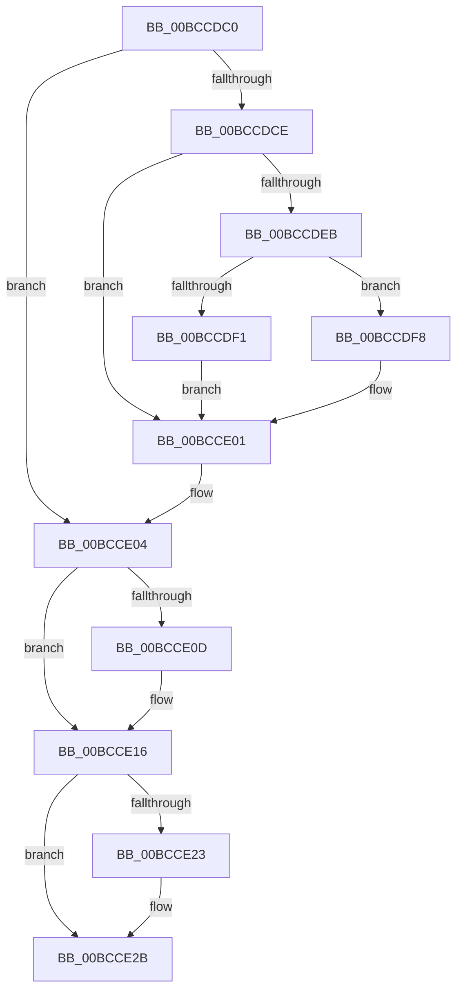

# KiKernelSysretExit

- RVA: `0x00BCCDC0`–`0x00BCCE35` (길이 `117` bytes)
- VA: `0x0000000140BCCDC0`
- 실행 섹션: `KVASCODE`
- PDB 이름 있음: `예`; PDB Function 태그: `아니요`
- unwind 정보 RVA: `0x000C19FC`
- 디코드: `28`개 명령, `117/117` bytes 표시
- 미해석 바이트: `0` (있으면 어셈블리에 `.byte`로 보존)

> 이 문서는 커널 이미지의 기계어와 PDB 기호를 분석해 생성했습니다. 4번과 5번은 함수 원형과 자료형을 바이너리 사용 방식에서 추정한 C 해석이며 원본 소스 복구 결과는 아닙니다.

## 1. Dependencies

- 직접 호출 지점: **0**; 고유 호출 대상: **0**
- 직접 호출자로 확인된 함수: **0**
- RIP 상대 이미지 참조: **0**

### Outgoing calls
- 직접 디코드된 call 명령이 없습니다.

### Direct callers
- 이 함수 시작 RVA로 연결되는 직접 call은 확인되지 않았습니다. 간접 호출은 완전히 역산할 수 없습니다.

### Static image references
- 디코드된 RIP-relative 메모리 참조가 없습니다.

## 2. Other-region calls and transfers

- 다른 실행 섹션으로 향하는 call: **0**
- 별도 외부 분기/꼬리 이동을 확인하지 못했습니다.

## 3. Assembly (complete function range)

```asm
00BCCDC0  65 8B 24 25 18 B0 00 00         mov esp, dword ptr gs:[0xb018]
00BCCDC8  0F BA E4 01                     bt esp, 1
00BCCDCC  72 36                           jb 0x140bcce04
00BCCDCE  65 48 8B 2C 25 88 01 00 00      mov rbp, qword ptr gs:[0x188]
00BCCDD7  48 8B AD 20 02 00 00            mov rbp, qword ptr [rbp + 0x220]
00BCCDDE  48 8B AD 58 01 00 00            mov rbp, qword ptr [rbp + 0x158]
00BCCDE5  0F BA E5 00                     bt ebp, 0
00BCCDE9  73 16                           jae 0x140bcce01
00BCCDEB  0F BA E4 00                     bt esp, 0
00BCCDEF  72 07                           jb 0x140bccdf8
00BCCDF1  48 0F BA ED 3F                  bts rbp, 0x3f
00BCCDF6  EB 09                           jmp 0x140bcce01
00BCCDF8  65 83 24 25 18 B0 00 00 FE      and dword ptr gs:[0xb018], 0xfffffffe
00BCCE01  0F 22 DD                        mov cr3, rbp
00BCCE04  49 8B E9                        mov rbp, r9
00BCCE07  0F BA E4 01                     bt esp, 1
00BCCE0B  72 09                           jb 0x140bcce16
00BCCE0D  65 0F 00 2C 25 2A B0 00 00      verw word ptr gs:[0xb02a]
00BCCE16  48 33 E4                        xor rsp, rsp
00BCCE19  F3 48 0F 1E CC                  rdsspq rsp
00BCCE1E  48 85 E4                        test rsp, rsp
00BCCE21  74 08                           je 0x140bcce2b
00BCCE23  F3 0F AE 34 24                  clrssbsy dword ptr [rsp]
00BCCE28  48 33 E4                        xor rsp, rsp
00BCCE2B  49 8B E0                        mov rsp, r8
00BCCE2E  0F 01 F8                        swapgs
00BCCE31  48 0F 07                        sysretq
00BCCE34  C3                              ret
```

## 4. C-style interpretation (structured pseudocode)

```c
void __fastcall KiKernelSysretExit(__int64 a1, __int64 a2, __int64 a3, __int64 a4)
{
    __int64 v_rsp;
    unsigned int v_stack_p0;

    if (condition_is_below) goto loc_00BCCE04;
    if (condition_is_above_or_equal) goto loc_00BCCE01;
    if (condition_is_below) goto loc_00BCCDF8;
    goto loc_00BCCE01;
loc_00BCCDF8:
loc_00BCCE01:
loc_00BCCE04:
    if (!(condition_is_below)) {
    }
    v_rsp = 0;
    if (0 != 0) {
        v_rsp = 0;
    }
    return;
}
```

## 5. (Beta) C Style

```c
void KiKernelSysretExit(int64_t Arg1, int64_t Arg2, int64_t Arg3, int64_t Arg4)
{
    int64_t local_rsp;
    uint32_t v_stack_p0;

    if (condition_is_below) goto loc_00BCCE04;
    if (condition_is_above_or_equal) goto loc_00BCCE01;
    if (condition_is_below) goto loc_00BCCDF8;
    goto loc_00BCCE01;
loc_00BCCDF8:
loc_00BCCE01:
loc_00BCCE04:
    if (!(condition_is_below)) {
    }
    local_rsp = 0;
    if (0 != 0) {
        local_rsp = 0;
    }
    return;
}
```

## 6. Execution-region graph

[열기: 2D/3D 그래프와 함수 탐색 컨트롤 패널](../../../control-panel.html?section=kvascode&rva=0x00BCCDC0&view=graph)

- 2D 그래프는 위에서 아래로 흐르고, 3D 그래프는 빈 공간을 드래그해 회전합니다. Shift+드래그는 이동, 휠은 확대·축소, 함수 노드 선택은 대상 보고서 이동입니다.

### Static fallback


