# KiSystemCall32Shadow

- RVA: `0x00BCCE40`–`0x00BCD1C4` (길이 `900` bytes)
- VA: `0x0000000140BCCE40`
- 실행 섹션: `KVASCODE`
- PDB 이름 있음: `예`; PDB Function 태그: `아니요`
- unwind 정보 RVA: `0x000C1A04`
- 디코드: `194`개 명령, `900/900` bytes 표시
- 미해석 바이트: `0` (있으면 어셈블리에 `.byte`로 보존)

> 이 문서는 커널 이미지의 기계어와 PDB 기호를 분석해 생성했습니다. 4번과 5번은 함수 원형과 자료형을 바이너리 사용 방식에서 추정한 C 해석이며 원본 소스 복구 결과는 아닙니다.

## 1. Dependencies

- 직접 호출 지점: **36**; 고유 호출 대상: **36**
- 직접 호출자로 확인된 함수: **1**
- RIP 상대 이미지 참조: **3**

### Outgoing calls
- `0x00BCCFC6` → [KiSystemCall32Shadow + 0x299](KiSystemCall32Shadow_function_00BCCE40.md) (inside-function, `0x00BCD0D9`)
- `0x00BCCFCF` → [KiSystemCall32Shadow + 0x2A2](KiSystemCall32Shadow_function_00BCCE40.md) (inside-function, `0x00BCD0E2`)
- `0x00BCCFD8` → [KiSystemCall32Shadow + 0x18B](KiSystemCall32Shadow_function_00BCCE40.md) (inside-function, `0x00BCCFCB`)
- `0x00BCCFE1` → [KiSystemCall32Shadow + 0x194](KiSystemCall32Shadow_function_00BCCE40.md) (inside-function, `0x00BCCFD4`)
- `0x00BCCFEA` → [KiSystemCall32Shadow + 0x19D](KiSystemCall32Shadow_function_00BCCE40.md) (inside-function, `0x00BCCFDD`)
- `0x00BCCFF3` → [KiSystemCall32Shadow + 0x1A6](KiSystemCall32Shadow_function_00BCCE40.md) (inside-function, `0x00BCCFE6`)
- `0x00BCCFFC` → [KiSystemCall32Shadow + 0x1AF](KiSystemCall32Shadow_function_00BCCE40.md) (inside-function, `0x00BCCFEF`)
- `0x00BCD005` → [KiSystemCall32Shadow + 0x1B8](KiSystemCall32Shadow_function_00BCCE40.md) (inside-function, `0x00BCCFF8`)
- `0x00BCD00E` → [KiSystemCall32Shadow + 0x1C1](KiSystemCall32Shadow_function_00BCCE40.md) (inside-function, `0x00BCD001`)
- `0x00BCD017` → [KiSystemCall32Shadow + 0x1CA](KiSystemCall32Shadow_function_00BCCE40.md) (inside-function, `0x00BCD00A`)
- `0x00BCD020` → [KiSystemCall32Shadow + 0x1D3](KiSystemCall32Shadow_function_00BCCE40.md) (inside-function, `0x00BCD013`)
- `0x00BCD029` → [KiSystemCall32Shadow + 0x1DC](KiSystemCall32Shadow_function_00BCCE40.md) (inside-function, `0x00BCD01C`)
- `0x00BCD032` → [KiSystemCall32Shadow + 0x1E5](KiSystemCall32Shadow_function_00BCCE40.md) (inside-function, `0x00BCD025`)
- `0x00BCD03B` → [KiSystemCall32Shadow + 0x1EE](KiSystemCall32Shadow_function_00BCCE40.md) (inside-function, `0x00BCD02E`)
- `0x00BCD044` → [KiSystemCall32Shadow + 0x1F7](KiSystemCall32Shadow_function_00BCCE40.md) (inside-function, `0x00BCD037`)
- `0x00BCD04D` → [KiSystemCall32Shadow + 0x200](KiSystemCall32Shadow_function_00BCCE40.md) (inside-function, `0x00BCD040`)
- `0x00BCD056` → [KiSystemCall32Shadow + 0x209](KiSystemCall32Shadow_function_00BCCE40.md) (inside-function, `0x00BCD049`)
- `0x00BCD05F` → [KiSystemCall32Shadow + 0x212](KiSystemCall32Shadow_function_00BCCE40.md) (inside-function, `0x00BCD052`)
- `0x00BCD068` → [KiSystemCall32Shadow + 0x21B](KiSystemCall32Shadow_function_00BCCE40.md) (inside-function, `0x00BCD05B`)
- `0x00BCD071` → [KiSystemCall32Shadow + 0x224](KiSystemCall32Shadow_function_00BCCE40.md) (inside-function, `0x00BCD064`)
- `0x00BCD07A` → [KiSystemCall32Shadow + 0x22D](KiSystemCall32Shadow_function_00BCCE40.md) (inside-function, `0x00BCD06D`)
- `0x00BCD083` → [KiSystemCall32Shadow + 0x236](KiSystemCall32Shadow_function_00BCCE40.md) (inside-function, `0x00BCD076`)
- `0x00BCD08C` → [KiSystemCall32Shadow + 0x23F](KiSystemCall32Shadow_function_00BCCE40.md) (inside-function, `0x00BCD07F`)
- `0x00BCD095` → [KiSystemCall32Shadow + 0x248](KiSystemCall32Shadow_function_00BCCE40.md) (inside-function, `0x00BCD088`)
- `0x00BCD09E` → [KiSystemCall32Shadow + 0x251](KiSystemCall32Shadow_function_00BCCE40.md) (inside-function, `0x00BCD091`)
- `0x00BCD0A7` → [KiSystemCall32Shadow + 0x25A](KiSystemCall32Shadow_function_00BCCE40.md) (inside-function, `0x00BCD09A`)
- `0x00BCD0B0` → [KiSystemCall32Shadow + 0x263](KiSystemCall32Shadow_function_00BCCE40.md) (inside-function, `0x00BCD0A3`)
- `0x00BCD0B9` → [KiSystemCall32Shadow + 0x26C](KiSystemCall32Shadow_function_00BCCE40.md) (inside-function, `0x00BCD0AC`)
- `0x00BCD0C2` → [KiSystemCall32Shadow + 0x275](KiSystemCall32Shadow_function_00BCCE40.md) (inside-function, `0x00BCD0B5`)
- `0x00BCD0CB` → [KiSystemCall32Shadow + 0x27E](KiSystemCall32Shadow_function_00BCCE40.md) (inside-function, `0x00BCD0BE`)
- `0x00BCD0D4` → [KiSystemCall32Shadow + 0x287](KiSystemCall32Shadow_function_00BCCE40.md) (inside-function, `0x00BCD0C7`)
- `0x00BCD0DD` → [KiSystemCall32Shadow + 0x290](KiSystemCall32Shadow_function_00BCCE40.md) (inside-function, `0x00BCD0D0`)
- `0x00BCD108` → [KiFlushBhbDuringTrapEntryOrExit](../../text/6C/KiFlushBhbDuringTrapEntryOrExit_function_006C6340.md) (function, `0x006C6340`)
- `0x00BCD151` → [KiSaveDebugRegisterState](../../text/4F/KiSaveDebugRegisterState_function_004FD960.md) (function, `0x004FD960`)
- `0x00BCD185` → [KiSynchronizeUserIsolationDomainExit](../../text/41/KiSynchronizeUserIsolationDomainExit_function_0041BFA0.md) (function, `0x0041BFA0`)
- `0x00BCD1BD` → [KiExceptionDispatch](../../text/6C/KiExceptionDispatch_function_006C5900.md) (function, `0x006C5900`)

### Direct callers
- [KiSystemCall32Shadow](KiSystemCall32Shadow_function_00BCCE40.md) at `0x00BCCFC6`
- [KiSystemCall32Shadow](KiSystemCall32Shadow_function_00BCCE40.md) at `0x00BCCFCF`
- [KiSystemCall32Shadow](KiSystemCall32Shadow_function_00BCCE40.md) at `0x00BCCFD8`
- [KiSystemCall32Shadow](KiSystemCall32Shadow_function_00BCCE40.md) at `0x00BCCFE1`
- [KiSystemCall32Shadow](KiSystemCall32Shadow_function_00BCCE40.md) at `0x00BCCFEA`
- [KiSystemCall32Shadow](KiSystemCall32Shadow_function_00BCCE40.md) at `0x00BCCFF3`
- [KiSystemCall32Shadow](KiSystemCall32Shadow_function_00BCCE40.md) at `0x00BCCFFC`
- [KiSystemCall32Shadow](KiSystemCall32Shadow_function_00BCCE40.md) at `0x00BCD005`
- [KiSystemCall32Shadow](KiSystemCall32Shadow_function_00BCCE40.md) at `0x00BCD00E`
- [KiSystemCall32Shadow](KiSystemCall32Shadow_function_00BCCE40.md) at `0x00BCD017`
- [KiSystemCall32Shadow](KiSystemCall32Shadow_function_00BCCE40.md) at `0x00BCD020`
- [KiSystemCall32Shadow](KiSystemCall32Shadow_function_00BCCE40.md) at `0x00BCD029`
- [KiSystemCall32Shadow](KiSystemCall32Shadow_function_00BCCE40.md) at `0x00BCD032`
- [KiSystemCall32Shadow](KiSystemCall32Shadow_function_00BCCE40.md) at `0x00BCD03B`
- [KiSystemCall32Shadow](KiSystemCall32Shadow_function_00BCCE40.md) at `0x00BCD044`
- [KiSystemCall32Shadow](KiSystemCall32Shadow_function_00BCCE40.md) at `0x00BCD04D`
- [KiSystemCall32Shadow](KiSystemCall32Shadow_function_00BCCE40.md) at `0x00BCD056`
- [KiSystemCall32Shadow](KiSystemCall32Shadow_function_00BCCE40.md) at `0x00BCD05F`
- [KiSystemCall32Shadow](KiSystemCall32Shadow_function_00BCCE40.md) at `0x00BCD068`
- [KiSystemCall32Shadow](KiSystemCall32Shadow_function_00BCCE40.md) at `0x00BCD071`
- [KiSystemCall32Shadow](KiSystemCall32Shadow_function_00BCCE40.md) at `0x00BCD07A`
- [KiSystemCall32Shadow](KiSystemCall32Shadow_function_00BCCE40.md) at `0x00BCD083`
- [KiSystemCall32Shadow](KiSystemCall32Shadow_function_00BCCE40.md) at `0x00BCD08C`
- [KiSystemCall32Shadow](KiSystemCall32Shadow_function_00BCCE40.md) at `0x00BCD095`
- [KiSystemCall32Shadow](KiSystemCall32Shadow_function_00BCCE40.md) at `0x00BCD09E`
- [KiSystemCall32Shadow](KiSystemCall32Shadow_function_00BCCE40.md) at `0x00BCD0A7`
- [KiSystemCall32Shadow](KiSystemCall32Shadow_function_00BCCE40.md) at `0x00BCD0B0`
- [KiSystemCall32Shadow](KiSystemCall32Shadow_function_00BCCE40.md) at `0x00BCD0B9`
- [KiSystemCall32Shadow](KiSystemCall32Shadow_function_00BCCE40.md) at `0x00BCD0C2`
- [KiSystemCall32Shadow](KiSystemCall32Shadow_function_00BCCE40.md) at `0x00BCD0CB`
- [KiSystemCall32Shadow](KiSystemCall32Shadow_function_00BCCE40.md) at `0x00BCD0D4`
- [KiSystemCall32Shadow](KiSystemCall32Shadow_function_00BCCE40.md) at `0x00BCD0DD`

### Static image references
- `0x00BCCEE5` → RVA `0x01201840` (`CFGRO`; read)
- `0x00BCD119` → RVA `0x00FC7264` (`ALMOSTRO`; read)
- `0x00BCD18A` → RVA `0x00FC6BF0` (`ALMOSTRO`; read)

## 2. Other-region calls and transfers

- 다른 실행 섹션으로 향하는 call: **4**
  - `0x00BCD108` → [KiFlushBhbDuringTrapEntryOrExit](../../text/6C/KiFlushBhbDuringTrapEntryOrExit_function_006C6340.md) (`KVASCODE` → `.text`)
  - `0x00BCD151` → [KiSaveDebugRegisterState](../../text/4F/KiSaveDebugRegisterState_function_004FD960.md) (`KVASCODE` → `.text`)
  - `0x00BCD185` → [KiSynchronizeUserIsolationDomainExit](../../text/41/KiSynchronizeUserIsolationDomainExit_function_0041BFA0.md) (`KVASCODE` → `.text`)
  - `0x00BCD1BD` → [KiExceptionDispatch](../../text/6C/KiExceptionDispatch_function_006C5900.md) (`KVASCODE` → `.text`)
- 별도 외부 분기/꼬리 이동을 확인하지 못했습니다.

## 3. Assembly (complete function range)

```asm
00BCCE40  0F 01 F8                        swapgs
00BCCE43  65 48 89 24 25 10 B0 00 00      mov qword ptr gs:[0xb010], rsp
00BCCE4C  65 48 8B 24 25 00 B0 00 00      mov rsp, qword ptr gs:[0xb000]
00BCCE55  0F 22 DC                        mov cr3, rsp
00BCCE58  65 48 8B 24 25 08 B0 00 00      mov rsp, qword ptr gs:[0xb008]
00BCCE61  6A 2B                           push 0x2b
00BCCE63  65 FF 34 25 10 B0 00 00         push qword ptr gs:[0xb010]
00BCCE6B  41 53                           push r11
00BCCE6D  6A 23                           push 0x23
00BCCE6F  51                              push rcx
00BCCE70  48 83 EC 08                     sub rsp, 8
00BCCE74  55                              push rbp
00BCCE75  48 81 EC 58 01 00 00            sub rsp, 0x158
00BCCE7C  48 8D AC 24 80 00 00 00         lea rbp, [rsp + 0x80]
00BCCE84  C6 45 AB 01                     mov byte ptr [rbp - 0x55], 1
00BCCE88  48 89 45 B0                     mov qword ptr [rbp - 0x50], rax
00BCCE8C  48 89 4D B8                     mov qword ptr [rbp - 0x48], rcx
00BCCE90  48 89 55 C0                     mov qword ptr [rbp - 0x40], rdx
00BCCE94  4C 89 45 C8                     mov qword ptr [rbp - 0x38], r8
00BCCE98  4C 89 4D D0                     mov qword ptr [rbp - 0x30], r9
00BCCE9C  4C 89 55 D8                     mov qword ptr [rbp - 0x28], r10
00BCCEA0  4C 89 5D E0                     mov qword ptr [rbp - 0x20], r11
00BCCEA4  F6 85 F0 00 00 00 01            test byte ptr [rbp + 0xf0], 1
00BCCEAB  75 38                           jne 0x140bccee5
00BCCEAD  33 D2                           xor edx, edx
00BCCEAF  F3 48 0F 1E CA                  rdsspq rdx
00BCCEB4  48 89 55 58                     mov qword ptr [rbp + 0x58], rdx
00BCCEB8  0F AE E8                        lfence
00BCCEBB  65 F6 04 25 58 08 00 00 01      test byte ptr gs:[0x858], 1
00BCCEC4  75 08                           jne 0x140bccece
00BCCEC6  0F AE E8                        lfence
00BCCEC9  E9 88 02 00 00                  jmp 0x140bcd156
00BCCECE  65 0F B7 04 25 66 08 00 00      movzx eax, word ptr gs:[0x866]
00BCCED7  B9 48 00 00 00                  mov ecx, 0x48
00BCCEDC  33 D2                           xor edx, edx
00BCCEDE  0F 30                           wrmsr
00BCCEE0  E9 71 02 00 00                  jmp 0x140bcd156
00BCCEE5  F6 05 54 49 63 00 01            test byte ptr [rip + 0x634954], 1
00BCCEEC  75 03                           jne 0x140bccef1
00BCCEEE  0F 01 F8                        swapgs
00BCCEF1  0F AE E8                        lfence
00BCCEF4  65 48 8B 0C 25 28 9D 00 00      mov rcx, qword ptr gs:[0x9d28]
00BCCEFD  48 85 C9                        test rcx, rcx
00BCCF00  74 1F                           je 0x140bccf21
00BCCF02  F3 48 0F 1E CA                  rdsspq rdx
00BCCF07  65 4C 8B 14 25 20 9D 00 00      mov r10, qword ptr gs:[0x9d20]
00BCCF10  49 83 C2 08                     add r10, 8
00BCCF14  49 3B D2                        cmp rdx, r10
00BCCF17  75 08                           jne 0x140bccf21
00BCCF19  F3 0F 01 29                     rstorssp dword ptr [rcx]
00BCCF1D  F3 0F 01 EA                     saveprevssp
00BCCF21  65 4C 8B 14 25 88 01 00 00      mov r10, qword ptr gs:[0x188]
00BCCF2A  65 48 8B 0C 25 88 01 00 00      mov rcx, qword ptr gs:[0x188]
00BCCF33  48 8B 89 20 02 00 00            mov rcx, qword ptr [rcx + 0x220]
00BCCF3A  48 8B 89 60 07 00 00            mov rcx, qword ptr [rcx + 0x760]
00BCCF41  65 48 89 0C 25 50 08 00 00      mov qword ptr gs:[0x850], rcx
00BCCF4A  66 65 8B 0C 25 62 08 00 00      mov cx, word ptr gs:[0x862]
00BCCF53  66 65 89 0C 25 64 08 00 00      mov word ptr gs:[0x864], cx
00BCCF5C  65 8A 0C 25 58 08 00 00         mov cl, byte ptr gs:[0x858]
00BCCF64  65 88 0C 25 5A 08 00 00         mov byte ptr gs:[0x85a], cl
00BCCF6C  65 0F B7 04 25 68 08 00 00      movzx eax, word ptr gs:[0x868]
00BCCF75  66 65 39 04 25 66 08 00 00      cmp word ptr gs:[0x866], ax
00BCCF7E  74 12                           je 0x140bccf92
00BCCF80  66 65 89 04 25 66 08 00 00      mov word ptr gs:[0x866], ax
00BCCF89  B9 48 00 00 00                  mov ecx, 0x48
00BCCF8E  33 D2                           xor edx, edx
00BCCF90  0F 30                           wrmsr
00BCCF92  65 0F B6 14 25 58 08 00 00      movzx edx, byte ptr gs:[0x858]
00BCCF9B  F7 C2 08 00 00 00               test edx, 8
00BCCFA1  74 17                           je 0x140bccfba
00BCCFA3  B8 01 00 00 00                  mov eax, 1
00BCCFA8  33 D2                           xor edx, edx
00BCCFAA  B9 49 00 00 00                  mov ecx, 0x49
00BCCFAF  0F 30                           wrmsr
00BCCFB1  65 0F B6 14 25 58 08 00 00      movzx edx, byte ptr gs:[0x858]
00BCCFBA  F7 C2 02 00 00 00               test edx, 2
00BCCFC0  0F 84 37 01 00 00               je 0x140bcd0fd
00BCCFC6  E8 0E 01 00 00                  call 0x140bcd0d9
00BCCFCB  48 83 C4 08                     add rsp, 8
00BCCFCF  E8 0E 01 00 00                  call 0x140bcd0e2
00BCCFD4  48 83 C4 08                     add rsp, 8
00BCCFD8  E8 EE FF FF FF                  call 0x140bccfcb
00BCCFDD  48 83 C4 08                     add rsp, 8
00BCCFE1  E8 EE FF FF FF                  call 0x140bccfd4
00BCCFE6  48 83 C4 08                     add rsp, 8
00BCCFEA  E8 EE FF FF FF                  call 0x140bccfdd
00BCCFEF  48 83 C4 08                     add rsp, 8
00BCCFF3  E8 EE FF FF FF                  call 0x140bccfe6
00BCCFF8  48 83 C4 08                     add rsp, 8
00BCCFFC  E8 EE FF FF FF                  call 0x140bccfef
00BCD001  48 83 C4 08                     add rsp, 8
00BCD005  E8 EE FF FF FF                  call 0x140bccff8
00BCD00A  48 83 C4 08                     add rsp, 8
00BCD00E  E8 EE FF FF FF                  call 0x140bcd001
00BCD013  48 83 C4 08                     add rsp, 8
00BCD017  E8 EE FF FF FF                  call 0x140bcd00a
00BCD01C  48 83 C4 08                     add rsp, 8
00BCD020  E8 EE FF FF FF                  call 0x140bcd013
00BCD025  48 83 C4 08                     add rsp, 8
00BCD029  E8 EE FF FF FF                  call 0x140bcd01c
00BCD02E  48 83 C4 08                     add rsp, 8
00BCD032  E8 EE FF FF FF                  call 0x140bcd025
00BCD037  48 83 C4 08                     add rsp, 8
00BCD03B  E8 EE FF FF FF                  call 0x140bcd02e
00BCD040  48 83 C4 08                     add rsp, 8
00BCD044  E8 EE FF FF FF                  call 0x140bcd037
00BCD049  48 83 C4 08                     add rsp, 8
00BCD04D  E8 EE FF FF FF                  call 0x140bcd040
00BCD052  48 83 C4 08                     add rsp, 8
00BCD056  E8 EE FF FF FF                  call 0x140bcd049
00BCD05B  48 83 C4 08                     add rsp, 8
00BCD05F  E8 EE FF FF FF                  call 0x140bcd052
00BCD064  48 83 C4 08                     add rsp, 8
00BCD068  E8 EE FF FF FF                  call 0x140bcd05b
00BCD06D  48 83 C4 08                     add rsp, 8
00BCD071  E8 EE FF FF FF                  call 0x140bcd064
00BCD076  48 83 C4 08                     add rsp, 8
00BCD07A  E8 EE FF FF FF                  call 0x140bcd06d
00BCD07F  48 83 C4 08                     add rsp, 8
00BCD083  E8 EE FF FF FF                  call 0x140bcd076
00BCD088  48 83 C4 08                     add rsp, 8
00BCD08C  E8 EE FF FF FF                  call 0x140bcd07f
00BCD091  48 83 C4 08                     add rsp, 8
00BCD095  E8 EE FF FF FF                  call 0x140bcd088
00BCD09A  48 83 C4 08                     add rsp, 8
00BCD09E  E8 EE FF FF FF                  call 0x140bcd091
00BCD0A3  48 83 C4 08                     add rsp, 8
00BCD0A7  E8 EE FF FF FF                  call 0x140bcd09a
00BCD0AC  48 83 C4 08                     add rsp, 8
00BCD0B0  E8 EE FF FF FF                  call 0x140bcd0a3
00BCD0B5  48 83 C4 08                     add rsp, 8
00BCD0B9  E8 EE FF FF FF                  call 0x140bcd0ac
00BCD0BE  48 83 C4 08                     add rsp, 8
00BCD0C2  E8 EE FF FF FF                  call 0x140bcd0b5
00BCD0C7  48 83 C4 08                     add rsp, 8
00BCD0CB  E8 EE FF FF FF                  call 0x140bcd0be
00BCD0D0  48 83 C4 08                     add rsp, 8
00BCD0D4  E8 EE FF FF FF                  call 0x140bcd0c7
00BCD0D9  48 83 C4 08                     add rsp, 8
00BCD0DD  E8 EE FF FF FF                  call 0x140bcd0d0
00BCD0E2  48 83 C4 08                     add rsp, 8
00BCD0E6  B8 DA DA 00 00                  mov eax, 0xdada
00BCD0EB  65 F6 04 25 5C 08 00 00 08      test byte ptr gs:[0x85c], 8
00BCD0F4  74 07                           je 0x140bcd0fd
00BCD0F6  B0 20                           mov al, 0x20
00BCD0F8  F3 48 0F AE E8                  incsspq rax
00BCD0FD  F7 C2 80 00 00 00               test edx, 0x80
00BCD103  74 08                           je 0x140bcd10d
00BCD105  0F AE E8                        lfence
00BCD108  E8 33 92 AF FF                  call 0x1406c6340
00BCD10D  0F AE E8                        lfence
00BCD110  65 C6 04 25 5E 08 00 00 00      mov byte ptr gs:[0x85e], 0
00BCD119  83 3D 44 A1 3F 00 00            cmp dword ptr [rip + 0x3fa144], 0
00BCD120  74 1F                           je 0x140bcd141
00BCD122  B9 A7 06 00 00                  mov ecx, 0x6a7
00BCD127  0F 32                           rdmsr
00BCD129  83 FA 00                        cmp edx, 0
00BCD12C  74 13                           je 0x140bcd141
00BCD12E  8B CA                           mov ecx, edx
00BCD130  23 15 2E A1 3F 00               and edx, dword ptr [rip + 0x3fa12e]
00BCD136  3B D1                           cmp edx, ecx
00BCD138  74 07                           je 0x140bcd141
00BCD13A  B9 A7 06 00 00                  mov ecx, 0x6a7
00BCD13F  0F 30                           wrmsr
00BCD141  41 F6 42 03 03                  test byte ptr [r10 + 3], 3
00BCD146  66 C7 85 80 00 00 00 00 00      mov word ptr [rbp + 0x80], 0
00BCD14F  74 05                           je 0x140bcd156
00BCD151  E8 0A 08 93 FF                  call 0x1404fd960
00BCD156  FC                              cld
00BCD157  0F AE 5D AC                     stmxcsr dword ptr [rbp - 0x54]
00BCD15B  65 0F AE 14 25 80 01 00 00      ldmxcsr dword ptr gs:[0x180]
00BCD164  0F 29 45 F0                     movaps xmmword ptr [rbp - 0x10], xmm0
00BCD168  0F 29 4D 00                     movaps xmmword ptr [rbp], xmm1
00BCD16C  0F 29 55 10                     movaps xmmword ptr [rbp + 0x10], xmm2
00BCD170  0F 29 5D 20                     movaps xmmword ptr [rbp + 0x20], xmm3
00BCD174  0F 29 65 30                     movaps xmmword ptr [rbp + 0x30], xmm4
00BCD178  0F 29 6D 40                     movaps xmmword ptr [rbp + 0x40], xmm5
00BCD17C  F6 85 F0 00 00 00 01            test byte ptr [rbp + 0xf0], 1
00BCD183  74 05                           je 0x140bcd18a
00BCD185  E8 16 EE 84 FF                  call 0x14041bfa0
00BCD18A  F6 05 5F 9A 3F 00 FF            test byte ptr [rip + 0x3f9a5f], 0xff
00BCD191  74 0C                           je 0x140bcd19f
00BCD193  F6 85 F0 00 00 00 01            test byte ptr [rbp + 0xf0], 1
00BCD19A  74 03                           je 0x140bcd19f
00BCD19C  0F 01 CB                        stac
00BCD19F  48 83 AD E8 00 00 00 02         sub qword ptr [rbp + 0xe8], 2
00BCD1A7  83 A5 EC 00 00 00 00            and dword ptr [rbp + 0xec], 0
00BCD1AE  FB                              sti
00BCD1AF  B9 1D 00 00 C0                  mov ecx, 0xc000001d
00BCD1B4  33 D2                           xor edx, edx
00BCD1B6  4C 8B 85 E8 00 00 00            mov r8, qword ptr [rbp + 0xe8]
00BCD1BD  E8 3E 87 AF FF                  call 0x1406c5900
00BCD1C2  90                              nop
00BCD1C3  C3                              ret
```

## 4. C-style interpretation (structured pseudocode)

```c
__int64 __fastcall KiSystemCall32Shadow(__int64 a1, __int64 a2, __int64 a3, __int64 a4)
{
    __int64 result;
    __int64 v_r10;
    __int64 v_rsp;
    unsigned __int64 v_stack_m100;
    unsigned __int64 v_stack_m110;
    unsigned __int64 v_stack_m120;
    unsigned __int64 v_stack_m130;
    unsigned __int64 v_stack_m138;
    unsigned __int64 v_stack_m140;
    unsigned __int64 v_stack_m148;
    unsigned __int64 v_stack_m150;
    unsigned __int64 v_stack_m158;
    unsigned __int64 v_stack_m160;
    unsigned int v_stack_m164;
    unsigned __int8 v_stack_m165;
    unsigned __int8 v_stack_m20;
    unsigned int v_stack_m24;
    unsigned __int64 v_stack_m28;
    unsigned __int16 v_stack_m90;
    unsigned __int64 v_stack_mB8;
    unsigned __int64 v_stack_mD0;
    unsigned __int64 v_stack_mE0;
    unsigned __int64 v_stack_mF0;

    *(unsigned __int64 *)(gs_base + (0 + 45072)) = v_rsp;
    v_rsp = (*(unsigned __int64 *)(gs_base + (0 + 45064))) - (8);
    v_rsp = (v_rsp) - (344);
    v_stack_m165 = 1;
    v_stack_m160 = result;
    v_stack_m158 = a1;
    v_stack_m150 = a2;
    v_stack_m148 = a3;
    v_stack_m140 = a4;
    v_stack_m138 = v_r10;
    v_stack_m130 = v_r11;
    if (((v_stack_m20) & (1)) != 0) goto loc_00BCCEE5;
    a2 = 0;
    v_stack_mB8 = 0;
    if (((*(unsigned __int8 *)(gs_base + (0 + 2136))) & (1)) != 0) goto loc_00BCCECE;
    goto loc_00BCD156;
loc_00BCCECE:
    a2 = 0;
    goto loc_00BCD156;
loc_00BCCEE5:
    if (((*(unsigned __int8 *)(v_rip + 6506836)) & (1)) == 0) {
    }
    if (*(unsigned __int64 *)(gs_base + (0 + 40232)) == 0) goto loc_00BCCF21;
    v_r10 = (*(unsigned __int64 *)(gs_base + (0 + 40224))) + (8);
    if (0 == v_r10) {
    }
    *(unsigned __int64 *)(gs_base + (0 + 2128)) = *(unsigned __int64 *)(*(unsigned __int64 *)(*(unsigned __int64 *)(gs_base + (0 + 392)) + 544) + 1888);
    *(unsigned __int16 *)(gs_base + (0 + 2148)) = (unsigned __int16)(*(unsigned __int16 *)(gs_base + (0 + 2146)));
    *(unsigned __int8 *)(gs_base + (0 + 2138)) = (unsigned __int8)(*(unsigned __int8 *)(gs_base + (0 + 2136)));
    if ((*(unsigned __int16 *)(gs_base + (0 + 2150))) != ((unsigned __int16)(*(unsigned __int16 *)(gs_base + (0 + 2152))))) {
        *(unsigned __int16 *)(gs_base + (0 + 2150)) = (unsigned __int16)(*(unsigned __int16 *)(gs_base + (0 + 2152)));
        a1 = 72;
        a2 = 0;
    }
    result = *(unsigned __int16 *)(gs_base + (0 + 2152));
    if ((((unsigned int)(*(unsigned __int8 *)(gs_base + (0 + 2136)))) & (8)) != 0) {
        result = 1;
        a2 = 0;
        a1 = 73;
        a2 = *(unsigned __int8 *)(gs_base + (0 + 2136));
    }
    if ((((unsigned int)(a2)) & (2)) == 0) goto loc_00BCD0FD;
    result = KiSystemCall32Shadow___0x299(a1, a2, a3, a4);
    v_rsp = (v_rsp) + (8);
    result = KiSystemCall32Shadow___0x2A2(a1, a2, a3, a4);
    v_rsp = (v_rsp) + (8);
    result = KiSystemCall32Shadow___0x18B(a1, a2, a3, a4);
    v_rsp = (v_rsp) + (8);
    result = KiSystemCall32Shadow___0x194(a1, a2, a3, a4);
    v_rsp = (v_rsp) + (8);
    result = KiSystemCall32Shadow___0x19D(a1, a2, a3, a4);
    v_rsp = (v_rsp) + (8);
    result = KiSystemCall32Shadow___0x1A6(a1, a2, a3, a4);
    v_rsp = (v_rsp) + (8);
    result = KiSystemCall32Shadow___0x1AF(a1, a2, a3, a4);
    v_rsp = (v_rsp) + (8);
    result = KiSystemCall32Shadow___0x1B8(a1, a2, a3, a4);
    v_rsp = (v_rsp) + (8);
    result = KiSystemCall32Shadow___0x1C1(a1, a2, a3, a4);
    v_rsp = (v_rsp) + (8);
    result = KiSystemCall32Shadow___0x1CA(a1, a2, a3, a4);
    v_rsp = (v_rsp) + (8);
    result = KiSystemCall32Shadow___0x1D3(a1, a2, a3, a4);
    v_rsp = (v_rsp) + (8);
    result = KiSystemCall32Shadow___0x1DC(a1, a2, a3, a4);
    v_rsp = (v_rsp) + (8);
    result = KiSystemCall32Shadow___0x1E5(a1, a2, a3, a4);
    v_rsp = (v_rsp) + (8);
    result = KiSystemCall32Shadow___0x1EE(a1, a2, a3, a4);
    v_rsp = (v_rsp) + (8);
    result = KiSystemCall32Shadow___0x1F7(a1, a2, a3, a4);
    v_rsp = (v_rsp) + (8);
    result = KiSystemCall32Shadow___0x200(a1, a2, a3, a4);
    v_rsp = (v_rsp) + (8);
    result = KiSystemCall32Shadow___0x209(a1, a2, a3, a4);
    v_rsp = (v_rsp) + (8);
    result = KiSystemCall32Shadow___0x212(a1, a2, a3, a4);
    v_rsp = (v_rsp) + (8);
    result = KiSystemCall32Shadow___0x21B(a1, a2, a3, a4);
    v_rsp = (v_rsp) + (8);
    result = KiSystemCall32Shadow___0x224(a1, a2, a3, a4);
    v_rsp = (v_rsp) + (8);
    result = KiSystemCall32Shadow___0x22D(a1, a2, a3, a4);
    v_rsp = (v_rsp) + (8);
    result = KiSystemCall32Shadow___0x236(a1, a2, a3, a4);
    v_rsp = (v_rsp) + (8);
    result = KiSystemCall32Shadow___0x23F(a1, a2, a3, a4);
    v_rsp = (v_rsp) + (8);
    result = KiSystemCall32Shadow___0x248(a1, a2, a3, a4);
    v_rsp = (v_rsp) + (8);
    result = KiSystemCall32Shadow___0x251(a1, a2, a3, a4);
    v_rsp = (v_rsp) + (8);
    result = KiSystemCall32Shadow___0x25A(a1, a2, a3, a4);
    v_rsp = (v_rsp) + (8);
    result = KiSystemCall32Shadow___0x263(a1, a2, a3, a4);
    v_rsp = (v_rsp) + (8);
    result = KiSystemCall32Shadow___0x26C(a1, a2, a3, a4);
    v_rsp = (v_rsp) + (8);
    result = KiSystemCall32Shadow___0x275(a1, a2, a3, a4);
    v_rsp = (v_rsp) + (8);
    result = KiSystemCall32Shadow___0x27E(a1, a2, a3, a4);
    v_rsp = (v_rsp) + (8);
    result = KiSystemCall32Shadow___0x287(a1, a2, a3, a4);
    v_rsp = (v_rsp) + (8);
    result = KiSystemCall32Shadow___0x290(a1, a2, a3, a4);
    v_rsp = (v_rsp) + (8);
    result = (unsigned int)(0xDADAULL);
    if (((*(unsigned __int8 *)(gs_base + (0 + 2140))) & (8)) != 0) {
        result = 32;
    }
    if ((((unsigned int)(a2)) & (128)) != 0) {
        result = KiFlushBhbDuringTrapEntryOrExit(a1, a2, a3, a4);
    }
    *(unsigned __int8 *)(gs_base + (0 + 2142)) = 0;
    if ((*(unsigned int *)(v_rip + 4170052)) == 0) goto loc_00BCD141;
    if (((unsigned int)(a2)) == 0) goto loc_00BCD141;
    a2 = (unsigned int)((a2) & (*(unsigned int *)(v_rip + 4170030)));
    if (((unsigned int)(a2)) != ((unsigned int)((unsigned int)((unsigned int)(a2))))) {
        a1 = 0x6A7ULL;
    }
    v_stack_m90 = 0;
    if (((*(unsigned __int8 *)(*(unsigned __int64 *)(gs_base + (0 + 392)) + 3)) & (3)) != 0) {
        result = KiSaveDebugRegisterState(a1, a2, a3, a4);
    }
    v_stack_m120 = v_xmm0;
    v_stack_m110 = v_xmm1;
    v_stack_m100 = v_xmm2;
    v_stack_mF0 = v_xmm3;
    v_stack_mE0 = v_xmm4;
    v_stack_mD0 = v_xmm5;
    if (((v_stack_m20) & (1)) != 0) {
        result = KiSynchronizeUserIsolationDomainExit(a1, a2, a3, a4);
    }
    if (((*(unsigned __int8 *)(v_rip + 4168287)) & (255)) == 0) goto loc_00BCD19F;
    if (((v_stack_m20) & (1)) != 0) {
    }
    a2 = 0;
    result = KiExceptionDispatch((unsigned int)(0xC000001DULL), a2, v_stack_m28, a4);
    return result;
}
```

## 5. (Beta) C Style

```c
int64_t KiSystemCall32Shadow(int64_t Arg1, int64_t Arg2, int64_t Arg3, int64_t Arg4)
{
    int64_t result;
    int64_t local_r10;
    int64_t local_rsp;
    uint64_t v_stack_m100;
    uint64_t v_stack_m110;
    uint64_t v_stack_m120;
    uint64_t v_stack_m130;
    uint64_t v_stack_m138;
    uint64_t v_stack_m140;
    uint64_t v_stack_m148;
    uint64_t v_stack_m150;
    uint64_t v_stack_m158;
    uint64_t v_stack_m160;
    uint32_t v_stack_m164;
    uint8_t v_stack_m165;
    uint8_t v_stack_m20;
    uint32_t v_stack_m24;
    uint64_t v_stack_m28;
    uint16_t v_stack_m90;
    uint64_t v_stack_mB8;
    uint64_t v_stack_mD0;
    uint64_t v_stack_mE0;
    uint64_t v_stack_mF0;

    *(uint64_t *)(gs_base + (0 + 0xB010)) = local_rsp;
    local_rsp = (*(uint64_t *)(gs_base + (0 + 0xB008))) - (8);
    local_rsp = (local_rsp) - (344);
    v_stack_m165 = 1;
    v_stack_m160 = result;
    v_stack_m158 = Arg1;
    v_stack_m150 = Arg2;
    v_stack_m148 = Arg3;
    v_stack_m140 = Arg4;
    v_stack_m138 = local_r10;
    v_stack_m130 = local_r11;
    if (((v_stack_m20) & (1)) != 0) goto loc_00BCCEE5;
    Arg2 = 0;
    v_stack_mB8 = 0;
    if (((*(uint8_t *)(gs_base + (0 + 0x858))) & (1)) != 0) goto loc_00BCCECE;
    goto loc_00BCD156;
loc_00BCCECE:
    Arg2 = 0;
    goto loc_00BCD156;
loc_00BCCEE5:
    if (((*(uint8_t *)(v_rip + 0x634954)) & (1)) == 0) {
    }
    if (*(uint64_t *)(gs_base + (0 + 0x9D28)) == 0) goto loc_00BCCF21;
    local_r10 = (*(uint64_t *)(gs_base + (0 + 0x9D20))) + (8);
    if (0 == local_r10) {
    }
    *(uint64_t *)(gs_base + (0 + 0x850)) = *(uint64_t *)(*(uint64_t *)(*(uint64_t *)(gs_base + (0 + 0x188)) + 0x220) + 0x760);
    *(uint16_t *)(gs_base + (0 + 0x864)) = (uint16_t)(*(uint16_t *)(gs_base + (0 + 0x862)));
    *(uint8_t *)(gs_base + (0 + 0x85A)) = (uint8_t)(*(uint8_t *)(gs_base + (0 + 0x858)));
    if ((*(uint16_t *)(gs_base + (0 + 0x866))) != ((uint16_t)(*(uint16_t *)(gs_base + (0 + 0x868))))) {
        *(uint16_t *)(gs_base + (0 + 0x866)) = (uint16_t)(*(uint16_t *)(gs_base + (0 + 0x868)));
        Arg1 = 72;
        Arg2 = 0;
    }
    result = *(uint16_t *)(gs_base + (0 + 0x868));
    if ((((uint32_t)(*(uint8_t *)(gs_base + (0 + 0x858)))) & (8)) != 0) {
        result = 1;
        Arg2 = 0;
        Arg1 = 73;
        Arg2 = *(uint8_t *)(gs_base + (0 + 0x858));
    }
    if ((((uint32_t)(Arg2)) & (2)) == 0) goto loc_00BCD0FD;
    result = KiSystemCall32Shadow___0x299(Arg1, Arg2, Arg3, Arg4);
    local_rsp = (local_rsp) + (8);
    result = KiSystemCall32Shadow___0x2A2(Arg1, Arg2, Arg3, Arg4);
    local_rsp = (local_rsp) + (8);
    result = KiSystemCall32Shadow___0x18B(Arg1, Arg2, Arg3, Arg4);
    local_rsp = (local_rsp) + (8);
    result = KiSystemCall32Shadow___0x194(Arg1, Arg2, Arg3, Arg4);
    local_rsp = (local_rsp) + (8);
    result = KiSystemCall32Shadow___0x19D(Arg1, Arg2, Arg3, Arg4);
    local_rsp = (local_rsp) + (8);
    result = KiSystemCall32Shadow___0x1A6(Arg1, Arg2, Arg3, Arg4);
    local_rsp = (local_rsp) + (8);
    result = KiSystemCall32Shadow___0x1AF(Arg1, Arg2, Arg3, Arg4);
    local_rsp = (local_rsp) + (8);
    result = KiSystemCall32Shadow___0x1B8(Arg1, Arg2, Arg3, Arg4);
    local_rsp = (local_rsp) + (8);
    result = KiSystemCall32Shadow___0x1C1(Arg1, Arg2, Arg3, Arg4);
    local_rsp = (local_rsp) + (8);
    result = KiSystemCall32Shadow___0x1CA(Arg1, Arg2, Arg3, Arg4);
    local_rsp = (local_rsp) + (8);
    result = KiSystemCall32Shadow___0x1D3(Arg1, Arg2, Arg3, Arg4);
    local_rsp = (local_rsp) + (8);
    result = KiSystemCall32Shadow___0x1DC(Arg1, Arg2, Arg3, Arg4);
    local_rsp = (local_rsp) + (8);
    result = KiSystemCall32Shadow___0x1E5(Arg1, Arg2, Arg3, Arg4);
    local_rsp = (local_rsp) + (8);
    result = KiSystemCall32Shadow___0x1EE(Arg1, Arg2, Arg3, Arg4);
    local_rsp = (local_rsp) + (8);
    result = KiSystemCall32Shadow___0x1F7(Arg1, Arg2, Arg3, Arg4);
    local_rsp = (local_rsp) + (8);
    result = KiSystemCall32Shadow___0x200(Arg1, Arg2, Arg3, Arg4);
    local_rsp = (local_rsp) + (8);
    result = KiSystemCall32Shadow___0x209(Arg1, Arg2, Arg3, Arg4);
    local_rsp = (local_rsp) + (8);
    result = KiSystemCall32Shadow___0x212(Arg1, Arg2, Arg3, Arg4);
    local_rsp = (local_rsp) + (8);
    result = KiSystemCall32Shadow___0x21B(Arg1, Arg2, Arg3, Arg4);
    local_rsp = (local_rsp) + (8);
    result = KiSystemCall32Shadow___0x224(Arg1, Arg2, Arg3, Arg4);
    local_rsp = (local_rsp) + (8);
    result = KiSystemCall32Shadow___0x22D(Arg1, Arg2, Arg3, Arg4);
    local_rsp = (local_rsp) + (8);
    result = KiSystemCall32Shadow___0x236(Arg1, Arg2, Arg3, Arg4);
    local_rsp = (local_rsp) + (8);
    result = KiSystemCall32Shadow___0x23F(Arg1, Arg2, Arg3, Arg4);
    local_rsp = (local_rsp) + (8);
    result = KiSystemCall32Shadow___0x248(Arg1, Arg2, Arg3, Arg4);
    local_rsp = (local_rsp) + (8);
    result = KiSystemCall32Shadow___0x251(Arg1, Arg2, Arg3, Arg4);
    local_rsp = (local_rsp) + (8);
    result = KiSystemCall32Shadow___0x25A(Arg1, Arg2, Arg3, Arg4);
    local_rsp = (local_rsp) + (8);
    result = KiSystemCall32Shadow___0x263(Arg1, Arg2, Arg3, Arg4);
    local_rsp = (local_rsp) + (8);
    result = KiSystemCall32Shadow___0x26C(Arg1, Arg2, Arg3, Arg4);
    local_rsp = (local_rsp) + (8);
    result = KiSystemCall32Shadow___0x275(Arg1, Arg2, Arg3, Arg4);
    local_rsp = (local_rsp) + (8);
    result = KiSystemCall32Shadow___0x27E(Arg1, Arg2, Arg3, Arg4);
    local_rsp = (local_rsp) + (8);
    result = KiSystemCall32Shadow___0x287(Arg1, Arg2, Arg3, Arg4);
    local_rsp = (local_rsp) + (8);
    result = KiSystemCall32Shadow___0x290(Arg1, Arg2, Arg3, Arg4);
    local_rsp = (local_rsp) + (8);
    result = (uint32_t)(0xDADAULL);
    if (((*(uint8_t *)(gs_base + (0 + 0x85C))) & (8)) != 0) {
        result = 32;
    }
    if ((((uint32_t)(Arg2)) & (128)) != 0) {
        result = KiFlushBhbDuringTrapEntryOrExit(Arg1, Arg2, Arg3, Arg4);
    }
    *(uint8_t *)(gs_base + (0 + 0x85E)) = 0;
    if ((*(uint32_t *)(v_rip + 0x3FA144)) == 0) goto loc_00BCD141;
    if (((uint32_t)(Arg2)) == 0) goto loc_00BCD141;
    Arg2 = (uint32_t)((Arg2) & (*(uint32_t *)(v_rip + 0x3FA12E)));
    if (((uint32_t)(Arg2)) != ((uint32_t)((uint32_t)((uint32_t)(Arg2))))) {
        Arg1 = 0x6A7ULL;
    }
    v_stack_m90 = 0;
    if (((*(uint8_t *)(*(uint64_t *)(gs_base + (0 + 0x188)) + 0x3)) & (3)) != 0) {
        result = KiSaveDebugRegisterState(Arg1, Arg2, Arg3, Arg4);
    }
    v_stack_m120 = v_xmm0;
    v_stack_m110 = v_xmm1;
    v_stack_m100 = v_xmm2;
    v_stack_mF0 = v_xmm3;
    v_stack_mE0 = v_xmm4;
    v_stack_mD0 = v_xmm5;
    if (((v_stack_m20) & (1)) != 0) {
        result = KiSynchronizeUserIsolationDomainExit(Arg1, Arg2, Arg3, Arg4);
    }
    if (((*(uint8_t *)(v_rip + 0x3F9A5F)) & (255)) == 0) goto loc_00BCD19F;
    if (((v_stack_m20) & (1)) != 0) {
    }
    Arg2 = 0;
    result = KiExceptionDispatch((uint32_t)(0xC000001DULL), Arg2, v_stack_m28, Arg4);
    return result;
}
```

## 6. Execution-region graph

[열기: 2D/3D 그래프와 함수 탐색 컨트롤 패널](../../../control-panel.html?section=kvascode&rva=0x00BCCE40&view=graph)

- 2D 그래프는 위에서 아래로 흐르고, 3D 그래프는 빈 공간을 드래그해 회전합니다. Shift+드래그는 이동, 휠은 확대·축소, 함수 노드 선택은 대상 보고서 이동입니다.

### Static fallback

```mermaid
flowchart TD
  bb_00BCCE40[BB_00BCCE40]
  bb_00BCCEAD[BB_00BCCEAD]
  bb_00BCCEC6[BB_00BCCEC6]
  bb_00BCCECE[BB_00BCCECE]
  bb_00BCCEE5[BB_00BCCEE5]
  bb_00BCCEEE[BB_00BCCEEE]
  bb_00BCCEF1[BB_00BCCEF1]
  bb_00BCCF02[BB_00BCCF02]
  bb_00BCCF19[BB_00BCCF19]
  bb_00BCCF21[BB_00BCCF21]
  bb_00BCCF80[BB_00BCCF80]
  bb_00BCCF92[BB_00BCCF92]
  bb_00BCCFA3[BB_00BCCFA3]
  bb_00BCCFBA[BB_00BCCFBA]
  bb_00BCCFC6[BB_00BCCFC6]
  bb_00BCD0F6[BB_00BCD0F6]
  bb_00BCD0FD[BB_00BCD0FD]
  bb_00BCD105[BB_00BCD105]
  bb_00BCD10D[BB_00BCD10D]
  bb_00BCD122[BB_00BCD122]
  bb_00BCD12E[BB_00BCD12E]
  bb_00BCD13A[BB_00BCD13A]
  bb_00BCD141[BB_00BCD141]
  bb_00BCD151[BB_00BCD151]
  bb_00BCD156[BB_00BCD156]
  bb_00BCD185[BB_00BCD185]
  bb_00BCD18A[BB_00BCD18A]
  bb_00BCD193[BB_00BCD193]
  bb_00BCD19C[BB_00BCD19C]
  bb_00BCD19F[BB_00BCD19F]
  bb_00BCCE40 -->|branch| bb_00BCCEE5
  bb_00BCCE40 -->|fallthrough| bb_00BCCEAD
  bb_00BCCEAD -->|branch| bb_00BCCECE
  bb_00BCCEAD -->|fallthrough| bb_00BCCEC6
  bb_00BCCEC6 -->|branch| bb_00BCD156
  bb_00BCCECE -->|branch| bb_00BCD156
  bb_00BCCEE5 -->|branch| bb_00BCCEF1
  bb_00BCCEE5 -->|fallthrough| bb_00BCCEEE
  bb_00BCCEEE -->|flow| bb_00BCCEF1
  bb_00BCCEF1 -->|branch| bb_00BCCF21
  bb_00BCCEF1 -->|fallthrough| bb_00BCCF02
  bb_00BCCF02 -->|branch| bb_00BCCF21
  bb_00BCCF02 -->|fallthrough| bb_00BCCF19
  bb_00BCCF19 -->|flow| bb_00BCCF21
  bb_00BCCF21 -->|branch| bb_00BCCF92
  bb_00BCCF21 -->|fallthrough| bb_00BCCF80
  bb_00BCCF80 -->|flow| bb_00BCCF92
  bb_00BCCF92 -->|branch| bb_00BCCFBA
  bb_00BCCF92 -->|fallthrough| bb_00BCCFA3
  bb_00BCCFA3 -->|flow| bb_00BCCFBA
  bb_00BCCFBA -->|branch| bb_00BCD0FD
  bb_00BCCFBA -->|fallthrough| bb_00BCCFC6
  bb_00BCCFC6 -->|branch| bb_00BCD0FD
  bb_00BCCFC6 -->|fallthrough| bb_00BCD0F6
  bb_00BCD0F6 -->|flow| bb_00BCD0FD
  bb_00BCD0FD -->|branch| bb_00BCD10D
  bb_00BCD0FD -->|fallthrough| bb_00BCD105
  bb_00BCD105 -->|flow| bb_00BCD10D
  bb_00BCD10D -->|branch| bb_00BCD141
  bb_00BCD10D -->|fallthrough| bb_00BCD122
  bb_00BCD122 -->|branch| bb_00BCD141
  bb_00BCD122 -->|fallthrough| bb_00BCD12E
  bb_00BCD12E -->|branch| bb_00BCD141
  bb_00BCD12E -->|fallthrough| bb_00BCD13A
  bb_00BCD13A -->|flow| bb_00BCD141
  bb_00BCD141 -->|branch| bb_00BCD156
  bb_00BCD141 -->|fallthrough| bb_00BCD151
  bb_00BCD151 -->|flow| bb_00BCD156
  bb_00BCD156 -->|branch| bb_00BCD18A
  bb_00BCD156 -->|fallthrough| bb_00BCD185
  bb_00BCD185 -->|flow| bb_00BCD18A
  bb_00BCD18A -->|branch| bb_00BCD19F
  bb_00BCD18A -->|fallthrough| bb_00BCD193
  bb_00BCD193 -->|branch| bb_00BCD19F
  bb_00BCD193 -->|fallthrough| bb_00BCD19C
  bb_00BCD19C -->|flow| bb_00BCD19F
```


