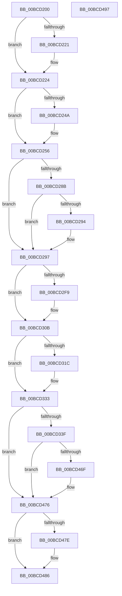

# KiSystemCall64Shadow

- RVA: `0x00BCD200`–`0x00BCD498` (길이 `664` bytes)
- VA: `0x0000000140BCD200`
- 실행 섹션: `KVASCODE`
- PDB 이름 있음: `예`; PDB Function 태그: `아니요`
- unwind 정보 RVA: `0x000C1A18`
- 디코드: `136`개 명령, `664/664` bytes 표시
- 미해석 바이트: `0` (있으면 어셈블리에 `.byte`로 보존)

> 이 문서는 커널 이미지의 기계어와 PDB 기호를 분석해 생성했습니다. 4번과 5번은 함수 원형과 자료형을 바이너리 사용 방식에서 추정한 C 해석이며 원본 소스 복구 결과는 아닙니다.

## 1. Dependencies

- 직접 호출 지점: **33**; 고유 호출 대상: **33**
- 직접 호출자로 확인된 함수: **1**
- RIP 상대 이미지 참조: **1**

### Outgoing calls
- `0x00BCD33F` → [KiSystemCall64Shadow + 0x252](KiSystemCall64Shadow_function_00BCD200.md) (inside-function, `0x00BCD452`)
- `0x00BCD348` → [KiSystemCall64Shadow + 0x25B](KiSystemCall64Shadow_function_00BCD200.md) (inside-function, `0x00BCD45B`)
- `0x00BCD351` → [KiSystemCall64Shadow + 0x144](KiSystemCall64Shadow_function_00BCD200.md) (inside-function, `0x00BCD344`)
- `0x00BCD35A` → [KiSystemCall64Shadow + 0x14D](KiSystemCall64Shadow_function_00BCD200.md) (inside-function, `0x00BCD34D`)
- `0x00BCD363` → [KiSystemCall64Shadow + 0x156](KiSystemCall64Shadow_function_00BCD200.md) (inside-function, `0x00BCD356`)
- `0x00BCD36C` → [KiSystemCall64Shadow + 0x15F](KiSystemCall64Shadow_function_00BCD200.md) (inside-function, `0x00BCD35F`)
- `0x00BCD375` → [KiSystemCall64Shadow + 0x168](KiSystemCall64Shadow_function_00BCD200.md) (inside-function, `0x00BCD368`)
- `0x00BCD37E` → [KiSystemCall64Shadow + 0x171](KiSystemCall64Shadow_function_00BCD200.md) (inside-function, `0x00BCD371`)
- `0x00BCD387` → [KiSystemCall64Shadow + 0x17A](KiSystemCall64Shadow_function_00BCD200.md) (inside-function, `0x00BCD37A`)
- `0x00BCD390` → [KiSystemCall64Shadow + 0x183](KiSystemCall64Shadow_function_00BCD200.md) (inside-function, `0x00BCD383`)
- `0x00BCD399` → [KiSystemCall64Shadow + 0x18C](KiSystemCall64Shadow_function_00BCD200.md) (inside-function, `0x00BCD38C`)
- `0x00BCD3A2` → [KiSystemCall64Shadow + 0x195](KiSystemCall64Shadow_function_00BCD200.md) (inside-function, `0x00BCD395`)
- `0x00BCD3AB` → [KiSystemCall64Shadow + 0x19E](KiSystemCall64Shadow_function_00BCD200.md) (inside-function, `0x00BCD39E`)
- `0x00BCD3B4` → [KiSystemCall64Shadow + 0x1A7](KiSystemCall64Shadow_function_00BCD200.md) (inside-function, `0x00BCD3A7`)
- `0x00BCD3BD` → [KiSystemCall64Shadow + 0x1B0](KiSystemCall64Shadow_function_00BCD200.md) (inside-function, `0x00BCD3B0`)
- `0x00BCD3C6` → [KiSystemCall64Shadow + 0x1B9](KiSystemCall64Shadow_function_00BCD200.md) (inside-function, `0x00BCD3B9`)
- `0x00BCD3CF` → [KiSystemCall64Shadow + 0x1C2](KiSystemCall64Shadow_function_00BCD200.md) (inside-function, `0x00BCD3C2`)
- `0x00BCD3D8` → [KiSystemCall64Shadow + 0x1CB](KiSystemCall64Shadow_function_00BCD200.md) (inside-function, `0x00BCD3CB`)
- `0x00BCD3E1` → [KiSystemCall64Shadow + 0x1D4](KiSystemCall64Shadow_function_00BCD200.md) (inside-function, `0x00BCD3D4`)
- `0x00BCD3EA` → [KiSystemCall64Shadow + 0x1DD](KiSystemCall64Shadow_function_00BCD200.md) (inside-function, `0x00BCD3DD`)
- `0x00BCD3F3` → [KiSystemCall64Shadow + 0x1E6](KiSystemCall64Shadow_function_00BCD200.md) (inside-function, `0x00BCD3E6`)
- `0x00BCD3FC` → [KiSystemCall64Shadow + 0x1EF](KiSystemCall64Shadow_function_00BCD200.md) (inside-function, `0x00BCD3EF`)
- `0x00BCD405` → [KiSystemCall64Shadow + 0x1F8](KiSystemCall64Shadow_function_00BCD200.md) (inside-function, `0x00BCD3F8`)
- `0x00BCD40E` → [KiSystemCall64Shadow + 0x201](KiSystemCall64Shadow_function_00BCD200.md) (inside-function, `0x00BCD401`)
- `0x00BCD417` → [KiSystemCall64Shadow + 0x20A](KiSystemCall64Shadow_function_00BCD200.md) (inside-function, `0x00BCD40A`)
- `0x00BCD420` → [KiSystemCall64Shadow + 0x213](KiSystemCall64Shadow_function_00BCD200.md) (inside-function, `0x00BCD413`)
- `0x00BCD429` → [KiSystemCall64Shadow + 0x21C](KiSystemCall64Shadow_function_00BCD200.md) (inside-function, `0x00BCD41C`)
- `0x00BCD432` → [KiSystemCall64Shadow + 0x225](KiSystemCall64Shadow_function_00BCD200.md) (inside-function, `0x00BCD425`)
- `0x00BCD43B` → [KiSystemCall64Shadow + 0x22E](KiSystemCall64Shadow_function_00BCD200.md) (inside-function, `0x00BCD42E`)
- `0x00BCD444` → [KiSystemCall64Shadow + 0x237](KiSystemCall64Shadow_function_00BCD200.md) (inside-function, `0x00BCD437`)
- `0x00BCD44D` → [KiSystemCall64Shadow + 0x240](KiSystemCall64Shadow_function_00BCD200.md) (inside-function, `0x00BCD440`)
- `0x00BCD456` → [KiSystemCall64Shadow + 0x249](KiSystemCall64Shadow_function_00BCD200.md) (inside-function, `0x00BCD449`)
- `0x00BCD481` → [KiFlushBhbDuringTrapEntryOrExit](../../text/6C/KiFlushBhbDuringTrapEntryOrExit_function_006C6340.md) (function, `0x006C6340`)

### Direct callers
- [KiSystemCall64Shadow](KiSystemCall64Shadow_function_00BCD200.md) at `0x00BCD33F`
- [KiSystemCall64Shadow](KiSystemCall64Shadow_function_00BCD200.md) at `0x00BCD348`
- [KiSystemCall64Shadow](KiSystemCall64Shadow_function_00BCD200.md) at `0x00BCD351`
- [KiSystemCall64Shadow](KiSystemCall64Shadow_function_00BCD200.md) at `0x00BCD35A`
- [KiSystemCall64Shadow](KiSystemCall64Shadow_function_00BCD200.md) at `0x00BCD363`
- [KiSystemCall64Shadow](KiSystemCall64Shadow_function_00BCD200.md) at `0x00BCD36C`
- [KiSystemCall64Shadow](KiSystemCall64Shadow_function_00BCD200.md) at `0x00BCD375`
- [KiSystemCall64Shadow](KiSystemCall64Shadow_function_00BCD200.md) at `0x00BCD37E`
- [KiSystemCall64Shadow](KiSystemCall64Shadow_function_00BCD200.md) at `0x00BCD387`
- [KiSystemCall64Shadow](KiSystemCall64Shadow_function_00BCD200.md) at `0x00BCD390`
- [KiSystemCall64Shadow](KiSystemCall64Shadow_function_00BCD200.md) at `0x00BCD399`
- [KiSystemCall64Shadow](KiSystemCall64Shadow_function_00BCD200.md) at `0x00BCD3A2`
- [KiSystemCall64Shadow](KiSystemCall64Shadow_function_00BCD200.md) at `0x00BCD3AB`
- [KiSystemCall64Shadow](KiSystemCall64Shadow_function_00BCD200.md) at `0x00BCD3B4`
- [KiSystemCall64Shadow](KiSystemCall64Shadow_function_00BCD200.md) at `0x00BCD3BD`
- [KiSystemCall64Shadow](KiSystemCall64Shadow_function_00BCD200.md) at `0x00BCD3C6`
- [KiSystemCall64Shadow](KiSystemCall64Shadow_function_00BCD200.md) at `0x00BCD3CF`
- [KiSystemCall64Shadow](KiSystemCall64Shadow_function_00BCD200.md) at `0x00BCD3D8`
- [KiSystemCall64Shadow](KiSystemCall64Shadow_function_00BCD200.md) at `0x00BCD3E1`
- [KiSystemCall64Shadow](KiSystemCall64Shadow_function_00BCD200.md) at `0x00BCD3EA`
- [KiSystemCall64Shadow](KiSystemCall64Shadow_function_00BCD200.md) at `0x00BCD3F3`
- [KiSystemCall64Shadow](KiSystemCall64Shadow_function_00BCD200.md) at `0x00BCD3FC`
- [KiSystemCall64Shadow](KiSystemCall64Shadow_function_00BCD200.md) at `0x00BCD405`
- [KiSystemCall64Shadow](KiSystemCall64Shadow_function_00BCD200.md) at `0x00BCD40E`
- [KiSystemCall64Shadow](KiSystemCall64Shadow_function_00BCD200.md) at `0x00BCD417`
- [KiSystemCall64Shadow](KiSystemCall64Shadow_function_00BCD200.md) at `0x00BCD420`
- [KiSystemCall64Shadow](KiSystemCall64Shadow_function_00BCD200.md) at `0x00BCD429`
- [KiSystemCall64Shadow](KiSystemCall64Shadow_function_00BCD200.md) at `0x00BCD432`
- [KiSystemCall64Shadow](KiSystemCall64Shadow_function_00BCD200.md) at `0x00BCD43B`
- [KiSystemCall64Shadow](KiSystemCall64Shadow_function_00BCD200.md) at `0x00BCD444`
- [KiSystemCall64Shadow](KiSystemCall64Shadow_function_00BCD200.md) at `0x00BCD44D`
- [KiSystemCall64Shadow](KiSystemCall64Shadow_function_00BCD200.md) at `0x00BCD456`

### Static image references
- `0x00BCD282` → RVA `0x00FC6BF0` (`ALMOSTRO`; read)

## 2. Other-region calls and transfers

- 다른 실행 섹션으로 향하는 call: **1**
  - `0x00BCD481` → [KiFlushBhbDuringTrapEntryOrExit](../../text/6C/KiFlushBhbDuringTrapEntryOrExit_function_006C6340.md) (`KVASCODE` → `.text`)
- call이 아닌 외부 분기/꼬리 이동: **1**
  - `0x00BCD492` → [KiSystemCall64 + 0x2A2](../../text/6C/KiSystemCall64_function_006C4A40.md) (`tail-transfer`)

## 3. Assembly (complete function range)

```asm
00BCD200  0F 01 F8                        swapgs
00BCD203  65 48 89 24 25 10 B0 00 00      mov qword ptr gs:[0xb010], rsp
00BCD20C  65 48 8B 24 25 00 B0 00 00      mov rsp, qword ptr gs:[0xb000]
00BCD215  65 0F BA 24 25 18 B0 00 00 01   bt dword ptr gs:[0xb018], 1
00BCD21F  72 03                           jb 0x140bcd224
00BCD221  0F 22 DC                        mov cr3, rsp
00BCD224  65 48 8B 24 25 08 B0 00 00      mov rsp, qword ptr gs:[0xb008]
00BCD22D  6A 2B                           push 0x2b
00BCD22F  65 FF 34 25 10 B0 00 00         push qword ptr gs:[0xb010]
00BCD237  41 53                           push r11
00BCD239  6A 33                           push 0x33
00BCD23B  51                              push rcx
00BCD23C  65 48 8B 0C 25 28 9D 00 00      mov rcx, qword ptr gs:[0x9d28]
00BCD245  48 85 C9                        test rcx, rcx
00BCD248  74 0C                           je 0x140bcd256
00BCD24A  F3 0F 01 E8                     setssbsy
00BCD24E  F3 0F 01 29                     rstorssp dword ptr [rcx]
00BCD252  F3 0F 01 EA                     saveprevssp
00BCD256  49 8B CA                        mov rcx, r10
00BCD259  48 83 EC 08                     sub rsp, 8
00BCD25D  55                              push rbp
00BCD25E  48 81 EC 58 01 00 00            sub rsp, 0x158
00BCD265  48 8D AC 24 80 00 00 00         lea rbp, [rsp + 0x80]
00BCD26D  48 89 9D C0 00 00 00            mov qword ptr [rbp + 0xc0], rbx
00BCD274  48 89 BD C8 00 00 00            mov qword ptr [rbp + 0xc8], rdi
00BCD27B  48 89 B5 D0 00 00 00            mov qword ptr [rbp + 0xd0], rsi
00BCD282  F6 05 67 99 3F 00 FF            test byte ptr [rip + 0x3f9967], 0xff
00BCD289  74 0C                           je 0x140bcd297
00BCD28B  F6 85 F0 00 00 00 01            test byte ptr [rbp + 0xf0], 1
00BCD292  74 03                           je 0x140bcd297
00BCD294  0F 01 CB                        stac
00BCD297  48 89 45 B0                     mov qword ptr [rbp - 0x50], rax
00BCD29B  48 89 4D B8                     mov qword ptr [rbp - 0x48], rcx
00BCD29F  48 89 55 C0                     mov qword ptr [rbp - 0x40], rdx
00BCD2A3  65 48 8B 0C 25 88 01 00 00      mov rcx, qword ptr gs:[0x188]
00BCD2AC  48 8B 89 20 02 00 00            mov rcx, qword ptr [rcx + 0x220]
00BCD2B3  48 8B 89 60 07 00 00            mov rcx, qword ptr [rcx + 0x760]
00BCD2BA  65 48 89 0C 25 50 08 00 00      mov qword ptr gs:[0x850], rcx
00BCD2C3  66 65 8B 0C 25 62 08 00 00      mov cx, word ptr gs:[0x862]
00BCD2CC  66 65 89 0C 25 64 08 00 00      mov word ptr gs:[0x864], cx
00BCD2D5  65 8A 0C 25 58 08 00 00         mov cl, byte ptr gs:[0x858]
00BCD2DD  65 88 0C 25 5A 08 00 00         mov byte ptr gs:[0x85a], cl
00BCD2E5  65 0F B7 04 25 68 08 00 00      movzx eax, word ptr gs:[0x868]
00BCD2EE  66 65 39 04 25 66 08 00 00      cmp word ptr gs:[0x866], ax
00BCD2F7  74 12                           je 0x140bcd30b
00BCD2F9  66 65 89 04 25 66 08 00 00      mov word ptr gs:[0x866], ax
00BCD302  B9 48 00 00 00                  mov ecx, 0x48
00BCD307  33 D2                           xor edx, edx
00BCD309  0F 30                           wrmsr
00BCD30B  65 0F B6 14 25 58 08 00 00      movzx edx, byte ptr gs:[0x858]
00BCD314  F7 C2 08 00 00 00               test edx, 8
00BCD31A  74 17                           je 0x140bcd333
00BCD31C  B8 01 00 00 00                  mov eax, 1
00BCD321  33 D2                           xor edx, edx
00BCD323  B9 49 00 00 00                  mov ecx, 0x49
00BCD328  0F 30                           wrmsr
00BCD32A  65 0F B6 14 25 58 08 00 00      movzx edx, byte ptr gs:[0x858]
00BCD333  F7 C2 02 00 00 00               test edx, 2
00BCD339  0F 84 37 01 00 00               je 0x140bcd476
00BCD33F  E8 0E 01 00 00                  call 0x140bcd452
00BCD344  48 83 C4 08                     add rsp, 8
00BCD348  E8 0E 01 00 00                  call 0x140bcd45b
00BCD34D  48 83 C4 08                     add rsp, 8
00BCD351  E8 EE FF FF FF                  call 0x140bcd344
00BCD356  48 83 C4 08                     add rsp, 8
00BCD35A  E8 EE FF FF FF                  call 0x140bcd34d
00BCD35F  48 83 C4 08                     add rsp, 8
00BCD363  E8 EE FF FF FF                  call 0x140bcd356
00BCD368  48 83 C4 08                     add rsp, 8
00BCD36C  E8 EE FF FF FF                  call 0x140bcd35f
00BCD371  48 83 C4 08                     add rsp, 8
00BCD375  E8 EE FF FF FF                  call 0x140bcd368
00BCD37A  48 83 C4 08                     add rsp, 8
00BCD37E  E8 EE FF FF FF                  call 0x140bcd371
00BCD383  48 83 C4 08                     add rsp, 8
00BCD387  E8 EE FF FF FF                  call 0x140bcd37a
00BCD38C  48 83 C4 08                     add rsp, 8
00BCD390  E8 EE FF FF FF                  call 0x140bcd383
00BCD395  48 83 C4 08                     add rsp, 8
00BCD399  E8 EE FF FF FF                  call 0x140bcd38c
00BCD39E  48 83 C4 08                     add rsp, 8
00BCD3A2  E8 EE FF FF FF                  call 0x140bcd395
00BCD3A7  48 83 C4 08                     add rsp, 8
00BCD3AB  E8 EE FF FF FF                  call 0x140bcd39e
00BCD3B0  48 83 C4 08                     add rsp, 8
00BCD3B4  E8 EE FF FF FF                  call 0x140bcd3a7
00BCD3B9  48 83 C4 08                     add rsp, 8
00BCD3BD  E8 EE FF FF FF                  call 0x140bcd3b0
00BCD3C2  48 83 C4 08                     add rsp, 8
00BCD3C6  E8 EE FF FF FF                  call 0x140bcd3b9
00BCD3CB  48 83 C4 08                     add rsp, 8
00BCD3CF  E8 EE FF FF FF                  call 0x140bcd3c2
00BCD3D4  48 83 C4 08                     add rsp, 8
00BCD3D8  E8 EE FF FF FF                  call 0x140bcd3cb
00BCD3DD  48 83 C4 08                     add rsp, 8
00BCD3E1  E8 EE FF FF FF                  call 0x140bcd3d4
00BCD3E6  48 83 C4 08                     add rsp, 8
00BCD3EA  E8 EE FF FF FF                  call 0x140bcd3dd
00BCD3EF  48 83 C4 08                     add rsp, 8
00BCD3F3  E8 EE FF FF FF                  call 0x140bcd3e6
00BCD3F8  48 83 C4 08                     add rsp, 8
00BCD3FC  E8 EE FF FF FF                  call 0x140bcd3ef
00BCD401  48 83 C4 08                     add rsp, 8
00BCD405  E8 EE FF FF FF                  call 0x140bcd3f8
00BCD40A  48 83 C4 08                     add rsp, 8
00BCD40E  E8 EE FF FF FF                  call 0x140bcd401
00BCD413  48 83 C4 08                     add rsp, 8
00BCD417  E8 EE FF FF FF                  call 0x140bcd40a
00BCD41C  48 83 C4 08                     add rsp, 8
00BCD420  E8 EE FF FF FF                  call 0x140bcd413
00BCD425  48 83 C4 08                     add rsp, 8
00BCD429  E8 EE FF FF FF                  call 0x140bcd41c
00BCD42E  48 83 C4 08                     add rsp, 8
00BCD432  E8 EE FF FF FF                  call 0x140bcd425
00BCD437  48 83 C4 08                     add rsp, 8
00BCD43B  E8 EE FF FF FF                  call 0x140bcd42e
00BCD440  48 83 C4 08                     add rsp, 8
00BCD444  E8 EE FF FF FF                  call 0x140bcd437
00BCD449  48 83 C4 08                     add rsp, 8
00BCD44D  E8 EE FF FF FF                  call 0x140bcd440
00BCD452  48 83 C4 08                     add rsp, 8
00BCD456  E8 EE FF FF FF                  call 0x140bcd449
00BCD45B  48 83 C4 08                     add rsp, 8
00BCD45F  B8 DA DA 00 00                  mov eax, 0xdada
00BCD464  65 F6 04 25 5C 08 00 00 08      test byte ptr gs:[0x85c], 8
00BCD46D  74 07                           je 0x140bcd476
00BCD46F  B0 20                           mov al, 0x20
00BCD471  F3 48 0F AE E8                  incsspq rax
00BCD476  F7 C2 80 00 00 00               test edx, 0x80
00BCD47C  74 08                           je 0x140bcd486
00BCD47E  0F AE E8                        lfence
00BCD481  E8 BA 8E AF FF                  call 0x1406c6340
00BCD486  0F AE E8                        lfence
00BCD489  65 C6 04 25 5E 08 00 00 00      mov byte ptr gs:[0x85e], 0
00BCD492  E9 4B 78 AF FF                  jmp 0x1406c4ce2
00BCD497  C3                              ret
```

## 4. C-style interpretation (structured pseudocode)

```c
__int64 __fastcall KiSystemCall64Shadow(__int64 a1, __int64 a2)
{
    __int64 result;
    __int64 v_cr3;
    __int64 v_rsp;
    unsigned __int64 v_stack_m110;
    unsigned __int64 v_stack_m150;
    unsigned __int64 v_stack_m158;
    unsigned __int64 v_stack_m160;
    unsigned __int8 v_stack_m20;
    unsigned __int64 v_stack_m40;
    unsigned __int64 v_stack_m48;
    unsigned __int64 v_stack_m50;

    *(unsigned __int64 *)(gs_base + (0 + 45072)) = v_rsp;
    if (!(condition_is_below)) {
        v_cr3 = *(unsigned __int64 *)(gs_base + (0 + 45056));
    }
    if (*(unsigned __int64 *)(gs_base + (0 + 40232)) != 0) {
    }
    v_rsp = (*(unsigned __int64 *)(gs_base + (0 + 45064))) - (8);
    v_rsp = (v_rsp) - (344);
    v_stack_m50 = v_rbx;
    v_stack_m48 = v_rdi;
    v_stack_m40 = v_rsi;
    if (((*(unsigned __int8 *)(v_rip + 4168039)) & (255)) == 0) goto loc_00BCD297;
    if (((v_stack_m20) & (1)) != 0) {
    }
    v_stack_m160 = result;
    v_stack_m158 = v_r10;
    v_stack_m150 = a2;
    *(unsigned __int64 *)(gs_base + (0 + 2128)) = *(unsigned __int64 *)(*(unsigned __int64 *)(*(unsigned __int64 *)(gs_base + (0 + 392)) + 544) + 1888);
    *(unsigned __int16 *)(gs_base + (0 + 2148)) = (unsigned __int16)(*(unsigned __int16 *)(gs_base + (0 + 2146)));
    *(unsigned __int8 *)(gs_base + (0 + 2138)) = (unsigned __int8)(*(unsigned __int8 *)(gs_base + (0 + 2136)));
    if ((*(unsigned __int16 *)(gs_base + (0 + 2150))) != ((unsigned __int16)(*(unsigned __int16 *)(gs_base + (0 + 2152))))) {
        *(unsigned __int16 *)(gs_base + (0 + 2150)) = (unsigned __int16)(*(unsigned __int16 *)(gs_base + (0 + 2152)));
        a1 = 72;
        a2 = 0;
    }
    result = *(unsigned __int16 *)(gs_base + (0 + 2152));
    if ((((unsigned int)(*(unsigned __int8 *)(gs_base + (0 + 2136)))) & (8)) != 0) {
        result = 1;
        a2 = 0;
        a1 = 73;
        a2 = *(unsigned __int8 *)(gs_base + (0 + 2136));
    }
    if ((((unsigned int)(a2)) & (2)) == 0) goto loc_00BCD476;
    result = KiSystemCall64Shadow___0x252(a1, a2, a3, a4);
    v_rsp = (v_rsp) + (8);
    result = KiSystemCall64Shadow___0x25B(a1, a2, a3, a4);
    v_rsp = (v_rsp) + (8);
    result = KiSystemCall64Shadow___0x144(a1, a2, a3, a4);
    v_rsp = (v_rsp) + (8);
    result = KiSystemCall64Shadow___0x14D(a1, a2, a3, a4);
    v_rsp = (v_rsp) + (8);
    result = KiSystemCall64Shadow___0x156(a1, a2, a3, a4);
    v_rsp = (v_rsp) + (8);
    result = KiSystemCall64Shadow___0x15F(a1, a2, a3, a4);
    v_rsp = (v_rsp) + (8);
    result = KiSystemCall64Shadow___0x168(a1, a2, a3, a4);
    v_rsp = (v_rsp) + (8);
    result = KiSystemCall64Shadow___0x171(a1, a2, a3, a4);
    v_rsp = (v_rsp) + (8);
    result = KiSystemCall64Shadow___0x17A(a1, a2, a3, a4);
    v_rsp = (v_rsp) + (8);
    result = KiSystemCall64Shadow___0x183(a1, a2, a3, a4);
    v_rsp = (v_rsp) + (8);
    result = KiSystemCall64Shadow___0x18C(a1, a2, a3, a4);
    v_rsp = (v_rsp) + (8);
    result = KiSystemCall64Shadow___0x195(a1, a2, a3, a4);
    v_rsp = (v_rsp) + (8);
    result = KiSystemCall64Shadow___0x19E(a1, a2, a3, a4);
    v_rsp = (v_rsp) + (8);
    result = KiSystemCall64Shadow___0x1A7(a1, a2, a3, a4);
    v_rsp = (v_rsp) + (8);
    result = KiSystemCall64Shadow___0x1B0(a1, a2, a3, a4);
    v_rsp = (v_rsp) + (8);
    result = KiSystemCall64Shadow___0x1B9(a1, a2, a3, a4);
    v_rsp = (v_rsp) + (8);
    result = KiSystemCall64Shadow___0x1C2(a1, a2, a3, a4);
    v_rsp = (v_rsp) + (8);
    result = KiSystemCall64Shadow___0x1CB(a1, a2, a3, a4);
    v_rsp = (v_rsp) + (8);
    result = KiSystemCall64Shadow___0x1D4(a1, a2, a3, a4);
    v_rsp = (v_rsp) + (8);
    result = KiSystemCall64Shadow___0x1DD(a1, a2, a3, a4);
    v_rsp = (v_rsp) + (8);
    result = KiSystemCall64Shadow___0x1E6(a1, a2, a3, a4);
    v_rsp = (v_rsp) + (8);
    result = KiSystemCall64Shadow___0x1EF(a1, a2, a3, a4);
    v_rsp = (v_rsp) + (8);
    result = KiSystemCall64Shadow___0x1F8(a1, a2, a3, a4);
    v_rsp = (v_rsp) + (8);
    result = KiSystemCall64Shadow___0x201(a1, a2, a3, a4);
    v_rsp = (v_rsp) + (8);
    result = KiSystemCall64Shadow___0x20A(a1, a2, a3, a4);
    v_rsp = (v_rsp) + (8);
    result = KiSystemCall64Shadow___0x213(a1, a2, a3, a4);
    v_rsp = (v_rsp) + (8);
    result = KiSystemCall64Shadow___0x21C(a1, a2, a3, a4);
    v_rsp = (v_rsp) + (8);
    result = KiSystemCall64Shadow___0x225(a1, a2, a3, a4);
    v_rsp = (v_rsp) + (8);
    result = KiSystemCall64Shadow___0x22E(a1, a2, a3, a4);
    v_rsp = (v_rsp) + (8);
    result = KiSystemCall64Shadow___0x237(a1, a2, a3, a4);
    v_rsp = (v_rsp) + (8);
    result = KiSystemCall64Shadow___0x240(a1, a2, a3, a4);
    v_rsp = (v_rsp) + (8);
    result = KiSystemCall64Shadow___0x249(a1, a2, a3, a4);
    v_rsp = (v_rsp) + (8);
    result = (unsigned int)(0xDADAULL);
    if (((*(unsigned __int8 *)(gs_base + (0 + 2140))) & (8)) != 0) {
        result = 32;
    }
    if ((((unsigned int)(a2)) & (128)) != 0) {
        result = KiFlushBhbDuringTrapEntryOrExit(a1, a2, a3, a4);
    }
    *(unsigned __int8 *)(gs_base + (0 + 2142)) = 0;
}
```

## 5. (Beta) C Style

```c
int64_t KiSystemCall64Shadow(int64_t Arg1, int64_t Arg2)
{
    int64_t result;
    int64_t v_cr3;
    int64_t local_rsp;
    uint64_t v_stack_m110;
    uint64_t v_stack_m150;
    uint64_t v_stack_m158;
    uint64_t v_stack_m160;
    uint8_t v_stack_m20;
    uint64_t v_stack_m40;
    uint64_t v_stack_m48;
    uint64_t v_stack_m50;

    *(uint64_t *)(gs_base + (0 + 0xB010)) = local_rsp;
    if (!(condition_is_below)) {
        v_cr3 = *(uint64_t *)(gs_base + (0 + 0xB000));
    }
    if (*(uint64_t *)(gs_base + (0 + 0x9D28)) != 0) {
    }
    local_rsp = (*(uint64_t *)(gs_base + (0 + 0xB008))) - (8);
    local_rsp = (local_rsp) - (344);
    v_stack_m50 = local_rbx;
    v_stack_m48 = local_rdi;
    v_stack_m40 = local_rsi;
    if (((*(uint8_t *)(v_rip + 0x3F9967)) & (255)) == 0) goto loc_00BCD297;
    if (((v_stack_m20) & (1)) != 0) {
    }
    v_stack_m160 = result;
    v_stack_m158 = local_r10;
    v_stack_m150 = Arg2;
    *(uint64_t *)(gs_base + (0 + 0x850)) = *(uint64_t *)(*(uint64_t *)(*(uint64_t *)(gs_base + (0 + 0x188)) + 0x220) + 0x760);
    *(uint16_t *)(gs_base + (0 + 0x864)) = (uint16_t)(*(uint16_t *)(gs_base + (0 + 0x862)));
    *(uint8_t *)(gs_base + (0 + 0x85A)) = (uint8_t)(*(uint8_t *)(gs_base + (0 + 0x858)));
    if ((*(uint16_t *)(gs_base + (0 + 0x866))) != ((uint16_t)(*(uint16_t *)(gs_base + (0 + 0x868))))) {
        *(uint16_t *)(gs_base + (0 + 0x866)) = (uint16_t)(*(uint16_t *)(gs_base + (0 + 0x868)));
        Arg1 = 72;
        Arg2 = 0;
    }
    result = *(uint16_t *)(gs_base + (0 + 0x868));
    if ((((uint32_t)(*(uint8_t *)(gs_base + (0 + 0x858)))) & (8)) != 0) {
        result = 1;
        Arg2 = 0;
        Arg1 = 73;
        Arg2 = *(uint8_t *)(gs_base + (0 + 0x858));
    }
    if ((((uint32_t)(Arg2)) & (2)) == 0) goto loc_00BCD476;
    result = KiSystemCall64Shadow___0x252(Arg1, Arg2, a3, a4);
    local_rsp = (local_rsp) + (8);
    result = KiSystemCall64Shadow___0x25B(Arg1, Arg2, a3, a4);
    local_rsp = (local_rsp) + (8);
    result = KiSystemCall64Shadow___0x144(Arg1, Arg2, a3, a4);
    local_rsp = (local_rsp) + (8);
    result = KiSystemCall64Shadow___0x14D(Arg1, Arg2, a3, a4);
    local_rsp = (local_rsp) + (8);
    result = KiSystemCall64Shadow___0x156(Arg1, Arg2, a3, a4);
    local_rsp = (local_rsp) + (8);
    result = KiSystemCall64Shadow___0x15F(Arg1, Arg2, a3, a4);
    local_rsp = (local_rsp) + (8);
    result = KiSystemCall64Shadow___0x168(Arg1, Arg2, a3, a4);
    local_rsp = (local_rsp) + (8);
    result = KiSystemCall64Shadow___0x171(Arg1, Arg2, a3, a4);
    local_rsp = (local_rsp) + (8);
    result = KiSystemCall64Shadow___0x17A(Arg1, Arg2, a3, a4);
    local_rsp = (local_rsp) + (8);
    result = KiSystemCall64Shadow___0x183(Arg1, Arg2, a3, a4);
    local_rsp = (local_rsp) + (8);
    result = KiSystemCall64Shadow___0x18C(Arg1, Arg2, a3, a4);
    local_rsp = (local_rsp) + (8);
    result = KiSystemCall64Shadow___0x195(Arg1, Arg2, a3, a4);
    local_rsp = (local_rsp) + (8);
    result = KiSystemCall64Shadow___0x19E(Arg1, Arg2, a3, a4);
    local_rsp = (local_rsp) + (8);
    result = KiSystemCall64Shadow___0x1A7(Arg1, Arg2, a3, a4);
    local_rsp = (local_rsp) + (8);
    result = KiSystemCall64Shadow___0x1B0(Arg1, Arg2, a3, a4);
    local_rsp = (local_rsp) + (8);
    result = KiSystemCall64Shadow___0x1B9(Arg1, Arg2, a3, a4);
    local_rsp = (local_rsp) + (8);
    result = KiSystemCall64Shadow___0x1C2(Arg1, Arg2, a3, a4);
    local_rsp = (local_rsp) + (8);
    result = KiSystemCall64Shadow___0x1CB(Arg1, Arg2, a3, a4);
    local_rsp = (local_rsp) + (8);
    result = KiSystemCall64Shadow___0x1D4(Arg1, Arg2, a3, a4);
    local_rsp = (local_rsp) + (8);
    result = KiSystemCall64Shadow___0x1DD(Arg1, Arg2, a3, a4);
    local_rsp = (local_rsp) + (8);
    result = KiSystemCall64Shadow___0x1E6(Arg1, Arg2, a3, a4);
    local_rsp = (local_rsp) + (8);
    result = KiSystemCall64Shadow___0x1EF(Arg1, Arg2, a3, a4);
    local_rsp = (local_rsp) + (8);
    result = KiSystemCall64Shadow___0x1F8(Arg1, Arg2, a3, a4);
    local_rsp = (local_rsp) + (8);
    result = KiSystemCall64Shadow___0x201(Arg1, Arg2, a3, a4);
    local_rsp = (local_rsp) + (8);
    result = KiSystemCall64Shadow___0x20A(Arg1, Arg2, a3, a4);
    local_rsp = (local_rsp) + (8);
    result = KiSystemCall64Shadow___0x213(Arg1, Arg2, a3, a4);
    local_rsp = (local_rsp) + (8);
    result = KiSystemCall64Shadow___0x21C(Arg1, Arg2, a3, a4);
    local_rsp = (local_rsp) + (8);
    result = KiSystemCall64Shadow___0x225(Arg1, Arg2, a3, a4);
    local_rsp = (local_rsp) + (8);
    result = KiSystemCall64Shadow___0x22E(Arg1, Arg2, a3, a4);
    local_rsp = (local_rsp) + (8);
    result = KiSystemCall64Shadow___0x237(Arg1, Arg2, a3, a4);
    local_rsp = (local_rsp) + (8);
    result = KiSystemCall64Shadow___0x240(Arg1, Arg2, a3, a4);
    local_rsp = (local_rsp) + (8);
    result = KiSystemCall64Shadow___0x249(Arg1, Arg2, a3, a4);
    local_rsp = (local_rsp) + (8);
    result = (uint32_t)(0xDADAULL);
    if (((*(uint8_t *)(gs_base + (0 + 0x85C))) & (8)) != 0) {
        result = 32;
    }
    if ((((uint32_t)(Arg2)) & (128)) != 0) {
        result = KiFlushBhbDuringTrapEntryOrExit(Arg1, Arg2, a3, a4);
    }
    *(uint8_t *)(gs_base + (0 + 0x85E)) = 0;
}
```

## 6. Execution-region graph

[열기: 2D/3D 그래프와 함수 탐색 컨트롤 패널](../../../control-panel.html?section=kvascode&rva=0x00BCD200&view=graph)

- 2D 그래프는 위에서 아래로 흐르고, 3D 그래프는 빈 공간을 드래그해 회전합니다. Shift+드래그는 이동, 휠은 확대·축소, 함수 노드 선택은 대상 보고서 이동입니다.

### Static fallback


