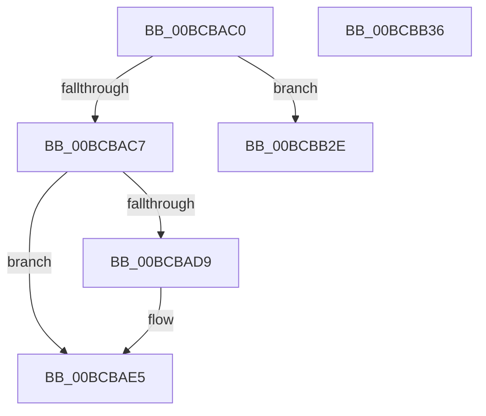

# KiXmmExceptionShadow

- RVA: `0x00BCBAC0`–`0x00BCBB37` (길이 `119` bytes)
- VA: `0x0000000140BCBAC0`
- 실행 섹션: `KVASCODE`
- PDB 이름 있음: `예`; PDB Function 태그: `아니요`
- unwind 정보 RVA: `0x000C1900`
- 디코드: `23`개 명령, `119/119` bytes 표시
- 미해석 바이트: `0` (있으면 어셈블리에 `.byte`로 보존)

> 이 문서는 커널 이미지의 기계어와 PDB 기호를 분석해 생성했습니다. 4번과 5번은 함수 원형과 자료형을 바이너리 사용 방식에서 추정한 C 해석이며 원본 소스 복구 결과는 아닙니다.

## 1. Dependencies

- 직접 호출 지점: **0**; 고유 호출 대상: **0**
- 직접 호출자로 확인된 함수: **0**
- RIP 상대 이미지 참조: **0**

### Outgoing calls
- 직접 디코드된 call 명령이 없습니다.

### Direct callers
- 이 함수 시작 RVA로 연결되는 직접 call은 확인되지 않았습니다. 간접 호출은 완전히 역산할 수 없습니다.

### Static image references
- 디코드된 RIP-relative 메모리 참조가 없습니다.

## 2. Other-region calls and transfers

- 다른 실행 섹션으로 향하는 call: **0**
- call이 아닌 외부 분기/꼬리 이동: **2**
  - `0x00BCBB29` → [KiXmmException](../../text/6C/KiXmmException_function_006C2500.md) (`tail-transfer`)
  - `0x00BCBB31` → [KiXmmException](../../text/6C/KiXmmException_function_006C2500.md) (`tail-transfer`)

## 3. Assembly (complete function range)

```asm
00BCBAC0  F6 44 24 08 01                  test byte ptr [rsp + 8], 1
00BCBAC5  74 67                           je 0x140bcbb2e
00BCBAC7  0F 01 F8                        swapgs
00BCBACA  0F AE E8                        lfence
00BCBACD  65 0F BA 24 25 18 B0 00 00 01   bt dword ptr gs:[0xb018], 1
00BCBAD7  72 0C                           jb 0x140bcbae5
00BCBAD9  65 48 8B 24 25 00 B0 00 00      mov rsp, qword ptr gs:[0xb000]
00BCBAE2  0F 22 DC                        mov cr3, rsp
00BCBAE5  65 48 8B 24 25 08 B0 00 00      mov rsp, qword ptr gs:[0xb008]
00BCBAEE  65 48 89 34 25 10 00 00 00      mov qword ptr gs:[0x10], rsi
00BCBAF7  65 48 8B 34 25 38 00 00 00      mov rsi, qword ptr gs:[0x38]
00BCBB00  48 81 C6 00 42 00 00            add rsi, 0x4200
00BCBB07  FF 76 F8                        push qword ptr [rsi - 8]
00BCBB0A  FF 76 F0                        push qword ptr [rsi - 0x10]
00BCBB0D  FF 76 E8                        push qword ptr [rsi - 0x18]
00BCBB10  FF 76 E0                        push qword ptr [rsi - 0x20]
00BCBB13  FF 76 D8                        push qword ptr [rsi - 0x28]
00BCBB16  65 48 8B 34 25 10 00 00 00      mov rsi, qword ptr gs:[0x10]
00BCBB1F  65 48 83 24 25 10 00 00 00 00   and qword ptr gs:[0x10], 0
00BCBB29  E9 D2 69 AF FF                  jmp 0x1406c2500
00BCBB2E  0F AE E8                        lfence
00BCBB31  E9 CA 69 AF FF                  jmp 0x1406c2500
00BCBB36  C3                              ret
```

## 4. C-style interpretation (structured pseudocode)

```c
void __fastcall KiXmmExceptionShadow(void)
{
    __int64 v_cr3;
    __int64 v_rsi;
    __int64 v_rsp;
    unsigned __int8 v_stack_p8;

    if (((v_stack_p8) & (1)) == 0) goto loc_00BCBB2E;
    if (!(condition_is_below)) {
        v_rsp = *(unsigned __int64 *)(gs_base + (0 + 45056));
        v_cr3 = v_rsp;
    }
    *(unsigned __int64 *)(gs_base + (0 + 16)) = v_rsi;
    v_rsi = (*(unsigned __int64 *)(gs_base + (0 + 56))) + (0x4200ULL);
loc_00BCBB2E:
}
```

## 5. (Beta) C Style

```c
void KiXmmExceptionShadow(void)
{
    int64_t v_cr3;
    int64_t local_rsi;
    int64_t local_rsp;
    uint8_t v_stack_p8;

    if (((v_stack_p8) & (1)) == 0) goto loc_00BCBB2E;
    if (!(condition_is_below)) {
        local_rsp = *(uint64_t *)(gs_base + (0 + 0xB000));
        v_cr3 = local_rsp;
    }
    *(uint64_t *)(gs_base + (0 + 0x10)) = local_rsi;
    local_rsi = (*(uint64_t *)(gs_base + (0 + 0x38))) + (0x4200ULL);
loc_00BCBB2E:
}
```

## 6. Execution-region graph

[열기: 2D/3D 그래프와 함수 탐색 컨트롤 패널](../../../control-panel.html?section=kvascode&rva=0x00BCBAC0&view=graph)

- 2D 그래프는 위에서 아래로 흐르고, 3D 그래프는 빈 공간을 드래그해 회전합니다. Shift+드래그는 이동, 휠은 확대·축소, 함수 노드 선택은 대상 보고서 이동입니다.

### Static fallback


