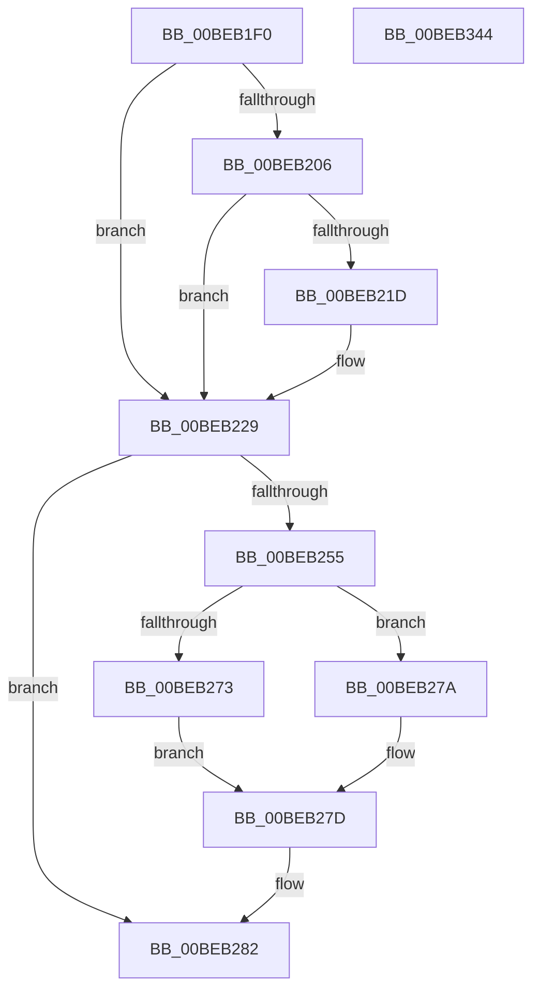

# HalpBlkApicInitializeLocalUnit

- RVA: `0x00BEB1F0`–`0x00BEB345` (길이 `341` bytes)
- VA: `0x0000000140BEB1F0`
- 실행 섹션: `MINIEX`
- PDB 이름 있음: `예`; PDB Function 태그: `아니요`
- unwind 정보 RVA: `0x0005C788`
- 디코드: `82`개 명령, `341/341` bytes 표시
- 미해석 바이트: `0` (있으면 어셈블리에 `.byte`로 보존)

> 이 문서는 커널 이미지의 기계어와 PDB 기호를 분석해 생성했습니다. 4번과 5번은 함수 원형과 자료형을 바이너리 사용 방식에서 추정한 C 해석이며 원본 소스 복구 결과는 아닙니다.

## 1. Dependencies

- 직접 호출 지점: **15**; 고유 호출 대상: **2**
- 직접 호출자로 확인된 함수: **1**
- RIP 상대 이미지 참조: **0**

### Outgoing calls
- `0x00BEB239` → [HalpBlkApicWrite](HalpBlkApicWrite_function_00BEB390.md) (function, `0x00BEB390`)
- `0x00BEB241` → [HalpBlkApicRead](HalpBlkApicRead_function_00BEB34C.md) (function, `0x00BEB34C`)
- `0x00BEB25B` → [HalpBlkApicWrite](HalpBlkApicWrite_function_00BEB390.md) (function, `0x00BEB390`)
- `0x00BEB27D` → [HalpBlkApicWrite](HalpBlkApicWrite_function_00BEB390.md) (function, `0x00BEB390`)
- `0x00BEB28A` → [HalpBlkApicWrite](HalpBlkApicWrite_function_00BEB390.md) (function, `0x00BEB390`)
- `0x00BEB299` → [HalpBlkApicWrite](HalpBlkApicWrite_function_00BEB390.md) (function, `0x00BEB390`)
- `0x00BEB2A8` → [HalpBlkApicWrite](HalpBlkApicWrite_function_00BEB390.md) (function, `0x00BEB390`)
- `0x00BEB2B7` → [HalpBlkApicWrite](HalpBlkApicWrite_function_00BEB390.md) (function, `0x00BEB390`)
- `0x00BEB2CA` → [HalpBlkApicWrite](HalpBlkApicWrite_function_00BEB390.md) (function, `0x00BEB390`)
- `0x00BEB2D8` → [HalpBlkApicRead](HalpBlkApicRead_function_00BEB34C.md) (function, `0x00BEB34C`)
- `0x00BEB2E6` → [HalpBlkApicWrite](HalpBlkApicWrite_function_00BEB390.md) (function, `0x00BEB390`)
- `0x00BEB2F1` → [HalpBlkApicWrite](HalpBlkApicWrite_function_00BEB390.md) (function, `0x00BEB390`)
- `0x00BEB2FF` → [HalpBlkApicWrite](HalpBlkApicWrite_function_00BEB390.md) (function, `0x00BEB390`)
- `0x00BEB312` → [HalpBlkApicRead](HalpBlkApicRead_function_00BEB34C.md) (function, `0x00BEB34C`)
- `0x00BEB33A` → [HalpBlkApicWrite](HalpBlkApicWrite_function_00BEB390.md) (function, `0x00BEB390`)

### Direct callers
- [HalpBlkProcessorStartup](HalpBlkProcessorStartup_function_00BEB860.md) at `0x00BEB884`

### Static image references
- 디코드된 RIP-relative 메모리 참조가 없습니다.

## 2. Other-region calls and transfers

- 다른 실행 섹션으로 향하는 call: **0**
- 별도 외부 분기/꼬리 이동을 확인하지 못했습니다.

## 3. Assembly (complete function range)

```asm
00BEB1F0  48 83 EC 28                     sub rsp, 0x28
00BEB1F4  65 48 8B 04 25 00 00 00 00      mov rax, qword ptr gs:[0]
00BEB1FD  45 33 D2                        xor r10d, r10d
00BEB200  44 38 50 29                     cmp byte ptr [rax + 0x29], r10b
00BEB204  74 23                           je 0x140beb229
00BEB206  41 8D 4A 1B                     lea ecx, [r10 + 0x1b]
00BEB20A  0F 32                           rdmsr
00BEB20C  48 C1 E2 20                     shl rdx, 0x20
00BEB210  48 0B C2                        or rax, rdx
00BEB213  BA 00 04 00 00                  mov edx, 0x400
00BEB218  48 85 C2                        test rdx, rax
00BEB21B  75 0C                           jne 0x140beb229
00BEB21D  48 0B C2                        or rax, rdx
00BEB220  48 8B D0                        mov rdx, rax
00BEB223  48 C1 EA 20                     shr rdx, 0x20
00BEB227  0F 30                           wrmsr
00BEB229  41 B9 F0 00 00 00               mov r9d, 0xf0
00BEB22F  41 8B D1                        mov edx, r9d
00BEB232  45 8D 59 90                     lea r11d, [r9 - 0x70]
00BEB236  41 8B CB                        mov ecx, r11d
00BEB239  E8 52 01 00 00                  call 0x140beb390
00BEB23E  41 8B CB                        mov ecx, r11d
00BEB241  E8 06 01 00 00                  call 0x140beb34c
00BEB246  65 4C 8B 04 25 00 00 00 00      mov r8, qword ptr gs:[0]
00BEB24F  45 38 50 29                     cmp byte ptr [r8 + 0x29], r10b
00BEB253  75 2D                           jne 0x140beb282
00BEB255  33 D2                           xor edx, edx
00BEB257  41 8D 49 E0                     lea ecx, [r9 - 0x20]
00BEB25B  E8 30 01 00 00                  call 0x140beb390
00BEB260  65 4C 8B 04 25 00 00 00 00      mov r8, qword ptr gs:[0]
00BEB269  41 8D 49 F0                     lea ecx, [r9 - 0x10]
00BEB26D  45 38 50 2A                     cmp byte ptr [r8 + 0x2a], r10b
00BEB271  74 07                           je 0x140beb27a
00BEB273  BA FF FF FF 0F                  mov edx, 0xfffffff
00BEB278  EB 03                           jmp 0x140beb27d
00BEB27A  83 CA FF                        or edx, 0xffffffff
00BEB27D  E8 0E 01 00 00                  call 0x140beb390
00BEB282  BA DF 01 00 00                  mov edx, 0x1df
00BEB287  41 8B C9                        mov ecx, r9d
00BEB28A  E8 01 01 00 00                  call 0x140beb390
00BEB28F  BA D8 00 03 00                  mov edx, 0x300d8
00BEB294  B9 20 03 00 00                  mov ecx, 0x320
00BEB299  E8 F2 00 00 00                  call 0x140beb390
00BEB29E  BA 0B 00 00 00                  mov edx, 0xb
00BEB2A3  B9 E0 03 00 00                  mov ecx, 0x3e0
00BEB2A8  E8 E3 00 00 00                  call 0x140beb390
00BEB2AD  BA E2 00 00 00                  mov edx, 0xe2
00BEB2B2  B9 70 03 00 00                  mov ecx, 0x370
00BEB2B7  E8 D4 00 00 00                  call 0x140beb390
00BEB2BC  41 B9 D8 00 01 00               mov r9d, 0x100d8
00BEB2C2  B9 40 03 00 00                  mov ecx, 0x340
00BEB2C7  41 8B D1                        mov edx, r9d
00BEB2CA  E8 C1 00 00 00                  call 0x140beb390
00BEB2CF  41 B8 50 03 00 00               mov r8d, 0x350
00BEB2D5  41 8B C8                        mov ecx, r8d
00BEB2D8  E8 6F 00 00 00                  call 0x140beb34c
00BEB2DD  0F BA E8 10                     bts eax, 0x10
00BEB2E1  41 8B C8                        mov ecx, r8d
00BEB2E4  8B D0                           mov edx, eax
00BEB2E6  E8 A5 00 00 00                  call 0x140beb390
00BEB2EB  41 8B D1                        mov edx, r9d
00BEB2EE  41 8B C8                        mov ecx, r8d
00BEB2F1  E8 9A 00 00 00                  call 0x140beb390
00BEB2F6  BA D8 84 01 00                  mov edx, 0x184d8
00BEB2FB  41 8D 48 10                     lea ecx, [r8 + 0x10]
00BEB2FF  E8 8C 00 00 00                  call 0x140beb390
00BEB304  65 4C 8B 04 25 00 00 00 00      mov r8, qword ptr gs:[0]
00BEB30D  B9 20 00 00 00                  mov ecx, 0x20
00BEB312  E8 35 00 00 00                  call 0x140beb34c
00BEB317  41 8A 50 29                     mov dl, byte ptr [r8 + 0x29]
00BEB31B  41 8B CB                        mov ecx, r11d
00BEB31E  44 8B C0                        mov r8d, eax
00BEB321  41 C1 E8 18                     shr r8d, 0x18
00BEB325  84 D2                           test dl, dl
00BEB327  44 0F 45 C0                     cmovne r8d, eax
00BEB32B  65 48 8B 04 25 00 00 00 00      mov rax, qword ptr gs:[0]
00BEB334  33 D2                           xor edx, edx
00BEB336  44 89 40 14                     mov dword ptr [rax + 0x14], r8d
00BEB33A  E8 51 00 00 00                  call 0x140beb390
00BEB33F  48 83 C4 28                     add rsp, 0x28
00BEB343  C3                              ret
00BEB344  CC                              int3
```

## 4. C-style interpretation (structured pseudocode)

```c
__int64 __fastcall HalpBlkApicInitializeLocalUnit(__int64 a1, __int64 a2)
{
    __int64 result;
    __int64 v_r10;
    __int64 v_rsp;

    v_rsp = (v_rsp) - (40);
    v_r10 = 0;
    if ((*(unsigned __int8 *)(*(unsigned __int64 *)(gs_base + (0)) + 41)) == 0) goto loc_00BEB229;
    a2 = (a2) << (32);
    result = (*(unsigned __int64 *)(gs_base + (0))) | (a2);
    if ((((unsigned int)(0x400ULL)) & (result)) == 0) {
        result = (result) | ((unsigned int)(0x400ULL));
        a2 = result;
        a2 = (a2) >> (32);
    }
    result = HalpBlkApicWrite((unsigned int)((unsigned int)(240 - 112)), 240, a3, 240);
    result = HalpBlkApicRead((unsigned int)((unsigned int)(240 - 112)), 240, a3, 240);
    if ((*(unsigned __int8 *)(*(unsigned __int64 *)(gs_base + (0)) + 41)) != 0) goto loc_00BEB282;
    a2 = 0;
    result = HalpBlkApicWrite(240 - 32, a2, *(unsigned __int64 *)(gs_base + (0)), 240);
    if ((*(unsigned __int8 *)(*(unsigned __int64 *)(gs_base + (0)) + 42)) == 0) goto loc_00BEB27A;
    goto loc_00BEB27D;
loc_00BEB27A:
    a2 = (unsigned int)(((unsigned int)(0xFFFFFFFULL)) | (0xFFFFFFFFULL));
loc_00BEB27D:
    result = HalpBlkApicWrite(240 - 16, a2, *(unsigned __int64 *)(gs_base + (0)), 240);
loc_00BEB282:
    result = HalpBlkApicWrite(240, 479, *(unsigned __int64 *)(gs_base + (0)), 240);
    result = HalpBlkApicWrite(800, (unsigned int)(0x300D8ULL), *(unsigned __int64 *)(gs_base + (0)), 240);
    result = HalpBlkApicWrite(992, 11, *(unsigned __int64 *)(gs_base + (0)), 240);
    result = HalpBlkApicWrite(880, 226, *(unsigned __int64 *)(gs_base + (0)), 240);
    result = HalpBlkApicWrite(832, (unsigned int)((unsigned int)((unsigned int)(0x100D8ULL))), *(unsigned __int64 *)(gs_base + (0)), (unsigned int)(0x100D8ULL));
    result = HalpBlkApicRead(848, (unsigned int)((unsigned int)((unsigned int)(0x100D8ULL))), 848, (unsigned int)(0x100D8ULL));
    result = HalpBlkApicWrite(848, (unsigned int)((unsigned int)(result)), 848, (unsigned int)(0x100D8ULL));
    result = HalpBlkApicWrite(848, (unsigned int)((unsigned int)((unsigned int)(0x100D8ULL))), 848, (unsigned int)(0x100D8ULL));
    result = HalpBlkApicWrite(848 + 16, (unsigned int)(0x184D8ULL), 848, (unsigned int)(0x100D8ULL));
    result = HalpBlkApicRead(32, (unsigned int)(0x184D8ULL), *(unsigned __int64 *)(gs_base + (0)), (unsigned int)(0x100D8ULL));
    a3 = (unsigned int)(((unsigned int)((unsigned int)(result))) >> (24));
    if ((unsigned __int8)(*(unsigned __int8 *)(*(unsigned __int64 *)(gs_base + (0)) + 41)) != 0) { a3 = (unsigned int)(result); }
    a2 = 0;
    *(unsigned int *)(*(unsigned __int64 *)(gs_base + (0)) + 20) = (unsigned int)(a3);
    result = HalpBlkApicWrite((unsigned int)((unsigned int)(240 - 112)), a2, a3, (unsigned int)(0x100D8ULL));
    v_rsp = (v_rsp) + (40);
    return result;
}
```

## 5. (Beta) C Style

```c
int64_t HalpBlkApicInitializeLocalUnit(int64_t Arg1, int64_t Arg2)
{
    int64_t result;
    int64_t local_r10;
    int64_t local_rsp;

    local_rsp = (local_rsp) - (40);
    local_r10 = 0;
    if ((*(uint8_t *)(*(uint64_t *)(gs_base + (0)) + 0x29)) == 0) goto loc_00BEB229;
    Arg2 = (Arg2) << (32);
    result = (*(uint64_t *)(gs_base + (0))) | (Arg2);
    if ((((uint32_t)(0x400ULL)) & (result)) == 0) {
        result = (result) | ((uint32_t)(0x400ULL));
        Arg2 = result;
        Arg2 = (Arg2) >> (32);
    }
    result = HalpBlkApicWrite((uint32_t)((uint32_t)(240 - 112)), 240, a3, 240);
    result = HalpBlkApicRead((uint32_t)((uint32_t)(240 - 112)), 240, a3, 240);
    if ((*(uint8_t *)(*(uint64_t *)(gs_base + (0)) + 0x29)) != 0) goto loc_00BEB282;
    Arg2 = 0;
    result = HalpBlkApicWrite(240 - 32, Arg2, *(uint64_t *)(gs_base + (0)), 240);
    if ((*(uint8_t *)(*(uint64_t *)(gs_base + (0)) + 0x2A)) == 0) goto loc_00BEB27A;
    goto loc_00BEB27D;
loc_00BEB27A:
    Arg2 = (uint32_t)(((uint32_t)(0xFFFFFFFULL)) | (0xFFFFFFFFULL));
loc_00BEB27D:
    result = HalpBlkApicWrite(240 - 16, Arg2, *(uint64_t *)(gs_base + (0)), 240);
loc_00BEB282:
    result = HalpBlkApicWrite(240, 479, *(uint64_t *)(gs_base + (0)), 240);
    result = HalpBlkApicWrite(800, (uint32_t)(0x300D8ULL), *(uint64_t *)(gs_base + (0)), 240);
    result = HalpBlkApicWrite(992, 11, *(uint64_t *)(gs_base + (0)), 240);
    result = HalpBlkApicWrite(880, 226, *(uint64_t *)(gs_base + (0)), 240);
    result = HalpBlkApicWrite(832, (uint32_t)((uint32_t)((uint32_t)(0x100D8ULL))), *(uint64_t *)(gs_base + (0)), (uint32_t)(0x100D8ULL));
    result = HalpBlkApicRead(848, (uint32_t)((uint32_t)((uint32_t)(0x100D8ULL))), 848, (uint32_t)(0x100D8ULL));
    result = HalpBlkApicWrite(848, (uint32_t)((uint32_t)(result)), 848, (uint32_t)(0x100D8ULL));
    result = HalpBlkApicWrite(848, (uint32_t)((uint32_t)((uint32_t)(0x100D8ULL))), 848, (uint32_t)(0x100D8ULL));
    result = HalpBlkApicWrite(848 + 16, (uint32_t)(0x184D8ULL), 848, (uint32_t)(0x100D8ULL));
    result = HalpBlkApicRead(32, (uint32_t)(0x184D8ULL), *(uint64_t *)(gs_base + (0)), (uint32_t)(0x100D8ULL));
    a3 = (uint32_t)(((uint32_t)((uint32_t)(result))) >> (24));
    if ((uint8_t)(*(uint8_t *)(*(uint64_t *)(gs_base + (0)) + 0x29)) != 0) { a3 = (uint32_t)(result); }
    Arg2 = 0;
    *(uint32_t *)(*(uint64_t *)(gs_base + (0)) + 0x14) = (uint32_t)(a3);
    result = HalpBlkApicWrite((uint32_t)((uint32_t)(240 - 112)), Arg2, a3, (uint32_t)(0x100D8ULL));
    local_rsp = (local_rsp) + (40);
    return result;
}
```

## 6. Execution-region graph

[열기: 2D/3D 그래프와 함수 탐색 컨트롤 패널](../../../control-panel.html?section=miniex&rva=0x00BEB1F0&view=graph)

- 2D 그래프는 위에서 아래로 흐르고, 3D 그래프는 빈 공간을 드래그해 회전합니다. Shift+드래그는 이동, 휠은 확대·축소, 함수 노드 선택은 대상 보고서 이동입니다.

### Static fallback


