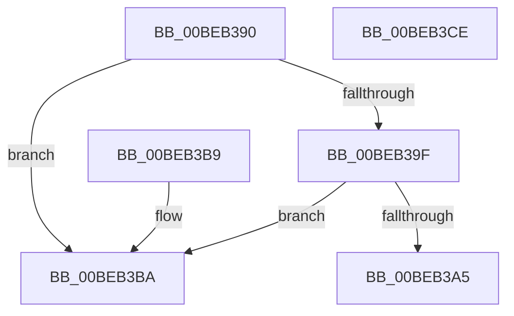

# HalpBlkApicWrite

- RVA: `0x00BEB390`–`0x00BEB3CF` (길이 `63` bytes)
- VA: `0x0000000140BEB390`
- 실행 섹션: `MINIEX`
- PDB 이름 있음: `예`; PDB Function 태그: `아니요`
- unwind 정보 RVA: `0x000DB714`
- 디코드: `19`개 명령, `63/63` bytes 표시
- 미해석 바이트: `0` (있으면 어셈블리에 `.byte`로 보존)

> 이 문서는 커널 이미지의 기계어와 PDB 기호를 분석해 생성했습니다. 4번과 5번은 함수 원형과 자료형을 바이너리 사용 방식에서 추정한 C 해석이며 원본 소스 복구 결과는 아닙니다.

## 1. Dependencies

- 직접 호출 지점: **0**; 고유 호출 대상: **0**
- 직접 호출자로 확인된 함수: **2**
- RIP 상대 이미지 참조: **0**

### Outgoing calls
- 직접 디코드된 call 명령이 없습니다.

### Direct callers
- [HalpBlkApicEndOfInterrupt](HalpBlkApicEndOfInterrupt_function_00BEB1D0.md) at `0x00BEB1DB`
- [HalpBlkApicInitializeLocalUnit](HalpBlkApicInitializeLocalUnit_function_00BEB1F0.md) at `0x00BEB239`
- [HalpBlkApicInitializeLocalUnit](HalpBlkApicInitializeLocalUnit_function_00BEB1F0.md) at `0x00BEB25B`
- [HalpBlkApicInitializeLocalUnit](HalpBlkApicInitializeLocalUnit_function_00BEB1F0.md) at `0x00BEB27D`
- [HalpBlkApicInitializeLocalUnit](HalpBlkApicInitializeLocalUnit_function_00BEB1F0.md) at `0x00BEB28A`
- [HalpBlkApicInitializeLocalUnit](HalpBlkApicInitializeLocalUnit_function_00BEB1F0.md) at `0x00BEB299`
- [HalpBlkApicInitializeLocalUnit](HalpBlkApicInitializeLocalUnit_function_00BEB1F0.md) at `0x00BEB2A8`
- [HalpBlkApicInitializeLocalUnit](HalpBlkApicInitializeLocalUnit_function_00BEB1F0.md) at `0x00BEB2B7`
- [HalpBlkApicInitializeLocalUnit](HalpBlkApicInitializeLocalUnit_function_00BEB1F0.md) at `0x00BEB2CA`
- [HalpBlkApicInitializeLocalUnit](HalpBlkApicInitializeLocalUnit_function_00BEB1F0.md) at `0x00BEB2E6`
- [HalpBlkApicInitializeLocalUnit](HalpBlkApicInitializeLocalUnit_function_00BEB1F0.md) at `0x00BEB2F1`
- [HalpBlkApicInitializeLocalUnit](HalpBlkApicInitializeLocalUnit_function_00BEB1F0.md) at `0x00BEB2FF`
- [HalpBlkApicInitializeLocalUnit](HalpBlkApicInitializeLocalUnit_function_00BEB1F0.md) at `0x00BEB33A`

### Static image references
- 디코드된 RIP-relative 메모리 참조가 없습니다.

## 2. Other-region calls and transfers

- 다른 실행 섹션으로 향하는 call: **0**
- 별도 외부 분기/꼬리 이동을 확인하지 못했습니다.

## 3. Assembly (complete function range)

```asm
00BEB390  65 48 8B 04 25 00 00 00 00      mov rax, qword ptr gs:[0]
00BEB399  80 78 29 00                     cmp byte ptr [rax + 0x29], 0
00BEB39D  75 1B                           jne 0x140beb3ba
00BEB39F  80 78 28 00                     cmp byte ptr [rax + 0x28], 0
00BEB3A3  75 15                           jne 0x140beb3ba
00BEB3A5  65 48 8B 04 25 00 00 00 00      mov rax, qword ptr gs:[0]
00BEB3AE  48 63 C9                        movsxd rcx, ecx
00BEB3B1  48 8B 40 20                     mov rax, qword ptr [rax + 0x20]
00BEB3B5  89 14 01                        mov dword ptr [rcx + rax], edx
00BEB3B8  C3                              ret
00BEB3B9  CC                              int3
00BEB3BA  C1 F9 04                        sar ecx, 4
00BEB3BD  8B D2                           mov edx, edx
00BEB3BF  81 C1 00 08 00 00               add ecx, 0x800
00BEB3C5  8B C2                           mov eax, edx
00BEB3C7  48 C1 EA 20                     shr rdx, 0x20
00BEB3CB  0F 30                           wrmsr
00BEB3CD  C3                              ret
00BEB3CE  CC                              int3
```

## 4. C-style interpretation (structured pseudocode)

```c
__int64 __fastcall HalpBlkApicWrite(int a1, int a2)
{
    if ((*(unsigned __int8 *)(*(unsigned __int64 *)(gs_base + (0)) + 41)) != 0) goto loc_00BEB3BA;
    if ((*(unsigned __int8 *)(*(unsigned __int64 *)(gs_base + (0)) + 40)) != 0) goto loc_00BEB3BA;
    *(unsigned int *)((int)(a1) + *(unsigned __int64 *)(*(unsigned __int64 *)(gs_base + (0)) + 32) * 1) = a2;
    return *(unsigned __int64 *)(*(unsigned __int64 *)(gs_base + (0)) + 32);
loc_00BEB3BA:
    a1 = (unsigned int)(((int)(a1)) >> (4));
    a1 = (unsigned int)((a1) + (0x800ULL));
    a2 = ((unsigned int)(a2)) >> (32);
    return (unsigned int)((unsigned int)((unsigned int)(a2)));
}
```

## 5. (Beta) C Style

```c
int64_t HalpBlkApicWrite(void *Arg1, int32_t Arg2)
{
    uint8_t *arg1 = (uint8_t *)Arg1;

    if ((*(uint8_t *)(*(uint64_t *)(gs_base + (0)) + 0x29)) != 0) goto loc_00BEB3BA;
    if ((*(uint8_t *)(*(uint64_t *)(gs_base + (0)) + 0x28)) != 0) goto loc_00BEB3BA;
    *(uint32_t *)((int32_t)(arg1) + *(uint64_t *)(*(uint64_t *)(gs_base + (0)) + 0x20) * 1) = Arg2;
    return *(uint64_t *)(*(uint64_t *)(gs_base + (0)) + 0x20);
loc_00BEB3BA:
    Arg1 = (uint32_t)(((int32_t)(Arg1)) >> (4));
    Arg1 = (uint32_t)((Arg1) + (0x800ULL));
    Arg2 = ((uint32_t)(Arg2)) >> (32);
    return (uint32_t)((uint32_t)((uint32_t)(Arg2)));
}
```

### 관측된 메모리 오프셋

구조체 형식이 확인되지 않은 접근은 인자 기준의 오프셋으로만 기록했습니다.

| 기준 인자 | 오프셋 표현 | 폭 (bit) | 접근 |
|---|---:|---:|---|
| `Arg1` | `+ 0x0 + rax*1` | `32` | `W` |

## 6. Execution-region graph

[열기: 2D/3D 그래프와 함수 탐색 컨트롤 패널](../../../control-panel.html?section=miniex&rva=0x00BEB390&view=graph)

- 2D 그래프는 위에서 아래로 흐르고, 3D 그래프는 빈 공간을 드래그해 회전합니다. Shift+드래그는 이동, 휠은 확대·축소, 함수 노드 선택은 대상 보고서 이동입니다.

### Static fallback


