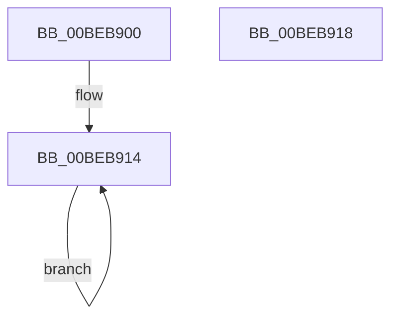

# HalpBlkFatalErrorHalt

- RVA: `0x00BEB900`–`0x00BEB919` (길이 `25` bytes)
- VA: `0x0000000140BEB900`
- 실행 섹션: `MINIEX`
- PDB 이름 있음: `예`; PDB Function 태그: `아니요`
- unwind 정보 RVA: `0x000BFB3C`
- 디코드: `7`개 명령, `25/25` bytes 표시
- 미해석 바이트: `0` (있으면 어셈블리에 `.byte`로 보존)

> 이 문서는 커널 이미지의 기계어와 PDB 기호를 분석해 생성했습니다. 4번과 5번은 함수 원형과 자료형을 바이너리 사용 방식에서 추정한 C 해석이며 원본 소스 복구 결과는 아닙니다.

## 1. Dependencies

- 직접 호출 지점: **0**; 고유 호출 대상: **0**
- 직접 호출자로 확인된 함수: **32**
- RIP 상대 이미지 참조: **0**

### Outgoing calls
- 직접 디코드된 call 명령이 없습니다.

### Direct callers
- [HalpBlkHandleMachineCheckAbort](HalpBlkHandleMachineCheckAbort_function_00BEB400.md) at `0x00BEB42F`
- [HalpBlkHandleMachineCheckAbort](HalpBlkHandleMachineCheckAbort_function_00BEB400.md) at `0x00BEB450`
- [HalpBlkHandleMachineCheckAbort](HalpBlkHandleMachineCheckAbort_function_00BEB400.md) at `0x00BEB46F`
- [HalpBlkHandleMachineCheckAbort](HalpBlkHandleMachineCheckAbort_function_00BEB400.md) at `0x00BEB4B8`
- [HalpBlkHandleMachineCheckAbort](HalpBlkHandleMachineCheckAbort_function_00BEB400.md) at `0x00BEB4D6`
- [HalpBlkMceFastForward](HalpBlkMceFastForward_function_00BEB510.md) at `0x00BEB64D`
- [HalpBlkMceFastForward](HalpBlkMceFastForward_function_00BEB510.md) at `0x00BEB77E`
- [HalpBlkDivideErrorFault](HalpBlkDivideErrorFault_function_00BEBA00.md) at `0x00BEBA73`
- [HalpBlkDebugExceptionTrap](HalpBlkDebugExceptionTrap_function_00BEBA80.md) at `0x00BEBAF3`
- [HalpBlkBreakpointTrap](HalpBlkBreakpointTrap_function_00BEBB00.md) at `0x00BEBB73`
- [HalpBlkOverflowTrap](HalpBlkOverflowTrap_function_00BEBB80.md) at `0x00BEBBF3`
- [HalpBlkBoundRangeExceededFault](HalpBlkBoundRangeExceededFault_function_00BEBC00.md) at `0x00BEBC73`
- [HalpBlkInvalidOpcodeFault](HalpBlkInvalidOpcodeFault_function_00BEBC80.md) at `0x00BEBCF3`
- [HalpBlkDeviceNotAvailableFault](HalpBlkDeviceNotAvailableFault_function_00BEBD00.md) at `0x00BEBD73`
- [HalpBlkDoubleFaultAbort](HalpBlkDoubleFaultAbort_function_00BEBD80.md) at `0x00BEBDEF`
- [HalpBlkCoprocessorSegmentOverrunFault](HalpBlkCoprocessorSegmentOverrunFault_function_00BEBE00.md) at `0x00BEBE73`
- [HalpBlkInvalidTssFault](HalpBlkInvalidTssFault_function_00BEBE80.md) at `0x00BEBEEF`
- [HalpBlkSegmentNotPresentFault](HalpBlkSegmentNotPresentFault_function_00BEBF00.md) at `0x00BEBF6F`
- [HalpBlkStackSegmentFault](HalpBlkStackSegmentFault_function_00BEBF80.md) at `0x00BEBFEF`
- [HalpBlkGeneralProtectionFault](HalpBlkGeneralProtectionFault_function_00BEC000.md) at `0x00BEC06F`
- [HalpBlkPageFault](HalpBlkPageFault_function_00BEC080.md) at `0x00BEC0EF`
- [HalpBlkFloatingPointErrorFault](HalpBlkFloatingPointErrorFault_function_00BEC100.md) at `0x00BEC173`
- [HalpBlkAlignmentFault](HalpBlkAlignmentFault_function_00BEC180.md) at `0x00BEC1EF`
- [HalpBlkFloatingPointFault](HalpBlkFloatingPointFault_function_00BEC200.md) at `0x00BEC273`
- [HalpBlkVirtualizationFault](HalpBlkVirtualizationFault_function_00BEC280.md) at `0x00BEC2F3`
- [HalpBlkReservedVector21](HalpBlkReservedVector21_function_00BEC300.md) at `0x00BEC36F`
- [HalpBlkReservedVector22](HalpBlkReservedVector22_function_00BEC380.md) at `0x00BEC3F3`
- [HalpBlkReservedVector23](HalpBlkReservedVector23_function_00BEC400.md) at `0x00BEC473`
- [HalpBlkReservedVector24](HalpBlkReservedVector24_function_00BEC480.md) at `0x00BEC4F3`
- [HalpBlkReservedVector25](HalpBlkReservedVector25_function_00BEC500.md) at `0x00BEC573`
- [HalpBlkReservedVector26](HalpBlkReservedVector26_function_00BEC580.md) at `0x00BEC5F3`
- [HalpBlkReservedVector27](HalpBlkReservedVector27_function_00BEC600.md) at `0x00BEC673`
- [HalpBlkReservedVector28](HalpBlkReservedVector28_function_00BEC680.md) at `0x00BEC6F3`
- [HalpBlkReservedVector29](HalpBlkReservedVector29_function_00BEC700.md) at `0x00BEC773`
- [HalpBlkReservedVector30](HalpBlkReservedVector30_function_00BEC780.md) at `0x00BEC7F3`
- [HalpBlkReservedVector31](HalpBlkReservedVector31_function_00BEC800.md) at `0x00BEC873`
- [HalpBlkNmiInterrupt](HalpBlkNmiInterrupt_function_00BECD00.md) at `0x00BECDA2`

### Static image references
- 디코드된 RIP-relative 메모리 참조가 없습니다.

## 2. Other-region calls and transfers

- 다른 실행 섹션으로 향하는 call: **0**
- 별도 외부 분기/꼬리 이동을 확인하지 못했습니다.

## 3. Assembly (complete function range)

```asm
00BEB900  65 88 0C 25 70 00 00 00         mov byte ptr gs:[0x70], cl
00BEB908  0F AE F8                        sfence
00BEB90B  65 48 89 14 25 78 00 00 00      mov qword ptr gs:[0x78], rdx
00BEB914  FA                              cli
00BEB915  F4                              hlt
00BEB916  EB FC                           jmp 0x140beb914
00BEB918  C3                              ret
```

## 4. C-style interpretation (structured pseudocode)

```c
void __fastcall HalpBlkFatalErrorHalt(unsigned __int8 a1, __int64 a2)
{
    *(unsigned __int8 *)(gs_base + (0 + 112)) = a1;
    *(unsigned __int64 *)(gs_base + (0 + 120)) = a2;
loc_00BEB914:
    goto loc_00BEB914;
}
```

## 5. (Beta) C Style

```c
void HalpBlkFatalErrorHalt(uint8_t Arg1, int64_t Arg2)
{
    *(uint8_t *)(gs_base + (0 + 0x70)) = Arg1;
    *(uint64_t *)(gs_base + (0 + 0x78)) = Arg2;
loc_00BEB914:
    goto loc_00BEB914;
}
```

## 6. Execution-region graph

[열기: 2D/3D 그래프와 함수 탐색 컨트롤 패널](../../../control-panel.html?section=miniex&rva=0x00BEB900&view=graph)

- 2D 그래프는 위에서 아래로 흐르고, 3D 그래프는 빈 공간을 드래그해 회전합니다. Shift+드래그는 이동, 휠은 확대·축소, 함수 노드 선택은 대상 보고서 이동입니다.

### Static fallback


