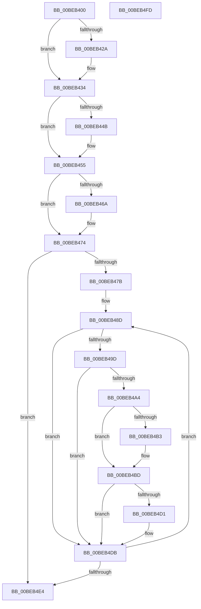

# HalpBlkHandleMachineCheckAbort

- RVA: `0x00BEB400`–`0x00BEB4FE` (길이 `254` bytes)
- VA: `0x0000000140BEB400`
- 실행 섹션: `MINIEX`
- PDB 이름 있음: `예`; PDB Function 태그: `아니요`
- unwind 정보 RVA: `0x00060300`
- 디코드: `76`개 명령, `254/254` bytes 표시
- 미해석 바이트: `0` (있으면 어셈블리에 `.byte`로 보존)

> 이 문서는 커널 이미지의 기계어와 PDB 기호를 분석해 생성했습니다. 4번과 5번은 함수 원형과 자료형을 바이너리 사용 방식에서 추정한 C 해석이며 원본 소스 복구 결과는 아닙니다.

## 1. Dependencies

- 직접 호출 지점: **5**; 고유 호출 대상: **1**
- 직접 호출자로 확인된 함수: **1**
- RIP 상대 이미지 참조: **0**

### Outgoing calls
- `0x00BEB42F` → [HalpBlkFatalErrorHalt](HalpBlkFatalErrorHalt_function_00BEB900.md) (function, `0x00BEB900`)
- `0x00BEB450` → [HalpBlkFatalErrorHalt](HalpBlkFatalErrorHalt_function_00BEB900.md) (function, `0x00BEB900`)
- `0x00BEB46F` → [HalpBlkFatalErrorHalt](HalpBlkFatalErrorHalt_function_00BEB900.md) (function, `0x00BEB900`)
- `0x00BEB4B8` → [HalpBlkFatalErrorHalt](HalpBlkFatalErrorHalt_function_00BEB900.md) (function, `0x00BEB900`)
- `0x00BEB4D6` → [HalpBlkFatalErrorHalt](HalpBlkFatalErrorHalt_function_00BEB900.md) (function, `0x00BEB900`)

### Direct callers
- [HalpBlkMachineCheckAbort](HalpBlkMachineCheckAbort_function_00BECB80.md) at `0x00BECC51`

### Static image references
- 디코드된 RIP-relative 메모리 참조가 없습니다.

## 2. Other-region calls and transfers

- 다른 실행 섹션으로 향하는 call: **0**
- 별도 외부 분기/꼬리 이동을 확인하지 못했습니다.

## 3. Assembly (complete function range)

```asm
00BEB400  48 89 5C 24 08                  mov qword ptr [rsp + 8], rbx
00BEB405  48 89 6C 24 10                  mov qword ptr [rsp + 0x10], rbp
00BEB40A  48 89 74 24 18                  mov qword ptr [rsp + 0x18], rsi
00BEB40F  57                              push rdi
00BEB410  41 56                           push r14
00BEB412  41 57                           push r15
00BEB414  48 83 EC 20                     sub rsp, 0x20
00BEB418  65 48 8B 04 25 00 00 00 00      mov rax, qword ptr gs:[0]
00BEB421  48 8B F1                        mov rsi, rcx
00BEB424  80 78 2B 02                     cmp byte ptr [rax + 0x2b], 2
00BEB428  74 0A                           je 0x140beb434
00BEB42A  48 8B D1                        mov rdx, rcx
00BEB42D  B1 12                           mov cl, 0x12
00BEB42F  E8 CC 04 00 00                  call 0x140beb900
00BEB434  B9 79 01 00 00                  mov ecx, 0x179
00BEB439  0F 32                           rdmsr
00BEB43B  48 C1 E2 20                     shl rdx, 0x20
00BEB43F  48 0B C2                        or rax, rdx
00BEB442  48 8B D8                        mov rbx, rax
00BEB445  0F BA E0 18                     bt eax, 0x18
00BEB449  72 0A                           jb 0x140beb455
00BEB44B  48 8B D6                        mov rdx, rsi
00BEB44E  B1 12                           mov cl, 0x12
00BEB450  E8 AB 04 00 00                  call 0x140beb900
00BEB455  B9 7A 01 00 00                  mov ecx, 0x17a
00BEB45A  0F 32                           rdmsr
00BEB45C  48 C1 E2 20                     shl rdx, 0x20
00BEB460  48 0B C2                        or rax, rdx
00BEB463  48 8B F8                        mov rdi, rax
00BEB466  A8 01                           test al, 1
00BEB468  75 0A                           jne 0x140beb474
00BEB46A  48 8B D6                        mov rdx, rsi
00BEB46D  B1 12                           mov cl, 0x12
00BEB46F  E8 8C 04 00 00                  call 0x140beb900
00BEB474  0F B6 C3                        movzx eax, bl
00BEB477  84 DB                           test bl, bl
00BEB479  74 69                           je 0x140beb4e4
00BEB47B  BD 01 04 00 00                  mov ebp, 0x401
00BEB480  44 8B F0                        mov r14d, eax
00BEB483  49 BF 00 00 00 00 00 00 80 01   movabs r15, 0x180000000000000
00BEB48D  8B CD                           mov ecx, ebp
00BEB48F  0F 32                           rdmsr
00BEB491  48 C1 E2 20                     shl rdx, 0x20
00BEB495  48 0B C2                        or rax, rdx
00BEB498  48 8B D8                        mov rbx, rax
00BEB49B  7D 3E                           jge 0x140beb4db
00BEB49D  48 0F BA E0 3D                  bt rax, 0x3d
00BEB4A2  73 37                           jae 0x140beb4db
00BEB4A4  48 B8 00 00 00 00 00 00 00 42   movabs rax, 0x4200000000000000
00BEB4AE  48 85 D8                        test rax, rbx
00BEB4B1  74 0A                           je 0x140beb4bd
00BEB4B3  48 8B D6                        mov rdx, rsi
00BEB4B6  B1 12                           mov cl, 0x12
00BEB4B8  E8 43 04 00 00                  call 0x140beb900
00BEB4BD  49 23 DF                        and rbx, r15
00BEB4C0  49 3B DF                        cmp rbx, r15
00BEB4C3  0F 94 C1                        sete cl
00BEB4C6  40 F6 C7 08                     test dil, 8
00BEB4CA  0F 95 C0                        setne al
00BEB4CD  84 C8                           test al, cl
00BEB4CF  74 0A                           je 0x140beb4db
00BEB4D1  48 8B D6                        mov rdx, rsi
00BEB4D4  B1 12                           mov cl, 0x12
00BEB4D6  E8 25 04 00 00                  call 0x140beb900
00BEB4DB  83 C5 04                        add ebp, 4
00BEB4DE  49 83 EE 01                     sub r14, 1
00BEB4E2  75 A9                           jne 0x140beb48d
00BEB4E4  48 8B 5C 24 40                  mov rbx, qword ptr [rsp + 0x40]
00BEB4E9  48 8B 6C 24 48                  mov rbp, qword ptr [rsp + 0x48]
00BEB4EE  48 8B 74 24 50                  mov rsi, qword ptr [rsp + 0x50]
00BEB4F3  48 83 C4 20                     add rsp, 0x20
00BEB4F7  41 5F                           pop r15
00BEB4F9  41 5E                           pop r14
00BEB4FB  5F                              pop rdi
00BEB4FC  C3                              ret
00BEB4FD  CC                              int3
```

## 4. C-style interpretation (structured pseudocode)

```c
__int64 __fastcall HalpBlkHandleMachineCheckAbort(__int64 a1)
{
    __int64 result;
    __int64 v_r14;
    __int64 v_rbp;
    __int64 v_rbx;
    __int64 v_rsp;
    unsigned __int64 v_stack_p10;
    unsigned __int64 v_stack_p18;
    unsigned __int64 v_stack_p8;

    v_stack_p8 = v_rbx;
    v_stack_p10 = v_rbp;
    v_stack_p18 = v_rsi;
    v_rsp = (v_rsp) - (32);
    result = *(unsigned __int64 *)(gs_base + (0));
    if ((*(unsigned __int8 *)(*(unsigned __int64 *)(gs_base + (0)) + 43)) != 2) {
        a2 = a1;
        a1 = 18;
        result = HalpBlkFatalErrorHalt(a1, a2, a3, a4);
    }
    a2 = (a2) << (32);
    result = (result) | (a2);
    if (!(condition_is_below)) {
        a2 = a1;
        a1 = 18;
        result = HalpBlkFatalErrorHalt(a1, a2, a3, a4);
    }
    a2 = (a2) << (32);
    result = (result) | (a2);
    if ((((unsigned __int8)(result)) & (1)) == 0) {
        a2 = a1;
        a1 = 18;
        result = HalpBlkFatalErrorHalt(a1, a2, a3, a4);
    }
    if ((unsigned __int8)(result) == 0) goto loc_00BEB4E4;
loc_00BEB48D:
    a2 = (a2) << (32);
    result = ((unsigned __int8)(result)) | (a2);
    if (condition_is_greater_or_equal) goto loc_00BEB4DB;
    if (condition_is_above_or_equal) goto loc_00BEB4DB;
    if (result != 0) {
        a2 = a1;
        a1 = 18;
        result = HalpBlkFatalErrorHalt(a1, a2, a3, a4);
    }
    v_rbx = (result) & (v_r15);
    a1 = (v_rbx == v_r15) ? 1 : 0;
    result = ((((unsigned __int8)(result)) & (8)) != 0) ? 1 : 0;
    if ((((unsigned __int8)(result)) & ((unsigned __int8)(a1))) != 0) {
        a2 = a1;
        a1 = 18;
        result = HalpBlkFatalErrorHalt(a1, a2, a3, a4);
    }
    v_rbp = (unsigned int)(((unsigned int)(0x401ULL)) + (4));
    v_r14 = ((unsigned int)((unsigned int)((unsigned __int8)(result)))) - (1);
    if (condition_is_not_equal) goto loc_00BEB48D;
loc_00BEB4E4:
    v_rsp = (v_rsp) + (32);
    return result;
}
```

## 5. (Beta) C Style

```c
int64_t HalpBlkHandleMachineCheckAbort(int64_t Arg1)
{
    int64_t result;
    int64_t local_r14;
    int64_t local_rbp;
    int64_t local_rbx;
    int64_t local_rsp;
    uint64_t v_stack_p10;
    uint64_t v_stack_p18;
    uint64_t v_stack_p8;

    v_stack_p8 = local_rbx;
    v_stack_p10 = local_rbp;
    v_stack_p18 = local_rsi;
    local_rsp = (local_rsp) - (32);
    result = *(uint64_t *)(gs_base + (0));
    if ((*(uint8_t *)(*(uint64_t *)(gs_base + (0)) + 0x2B)) != 2) {
        a2 = Arg1;
        Arg1 = 18;
        result = HalpBlkFatalErrorHalt(Arg1, a2, a3, a4);
    }
    a2 = (a2) << (32);
    result = (result) | (a2);
    if (!(condition_is_below)) {
        a2 = Arg1;
        Arg1 = 18;
        result = HalpBlkFatalErrorHalt(Arg1, a2, a3, a4);
    }
    a2 = (a2) << (32);
    result = (result) | (a2);
    if ((((uint8_t)(result)) & (1)) == 0) {
        a2 = Arg1;
        Arg1 = 18;
        result = HalpBlkFatalErrorHalt(Arg1, a2, a3, a4);
    }
    if ((uint8_t)(result) == 0) goto loc_00BEB4E4;
loc_00BEB48D:
    a2 = (a2) << (32);
    result = ((uint8_t)(result)) | (a2);
    if (condition_is_greater_or_equal) goto loc_00BEB4DB;
    if (condition_is_above_or_equal) goto loc_00BEB4DB;
    if (result != 0) {
        a2 = Arg1;
        Arg1 = 18;
        result = HalpBlkFatalErrorHalt(Arg1, a2, a3, a4);
    }
    local_rbx = (result) & (local_r15);
    Arg1 = (local_rbx == local_r15) ? 1 : 0;
    result = ((((uint8_t)(result)) & (8)) != 0) ? 1 : 0;
    if ((((uint8_t)(result)) & ((uint8_t)(Arg1))) != 0) {
        a2 = Arg1;
        Arg1 = 18;
        result = HalpBlkFatalErrorHalt(Arg1, a2, a3, a4);
    }
    local_rbp = (uint32_t)(((uint32_t)(0x401ULL)) + (4));
    local_r14 = ((uint32_t)((uint32_t)((uint8_t)(result)))) - (1);
    if (condition_is_not_equal) goto loc_00BEB48D;
loc_00BEB4E4:
    local_rsp = (local_rsp) + (32);
    return result;
}
```

## 6. Execution-region graph

[열기: 2D/3D 그래프와 함수 탐색 컨트롤 패널](../../../control-panel.html?section=miniex&rva=0x00BEB400&view=graph)

- 2D 그래프는 위에서 아래로 흐르고, 3D 그래프는 빈 공간을 드래그해 회전합니다. Shift+드래그는 이동, 휠은 확대·축소, 함수 노드 선택은 대상 보고서 이동입니다.

### Static fallback


