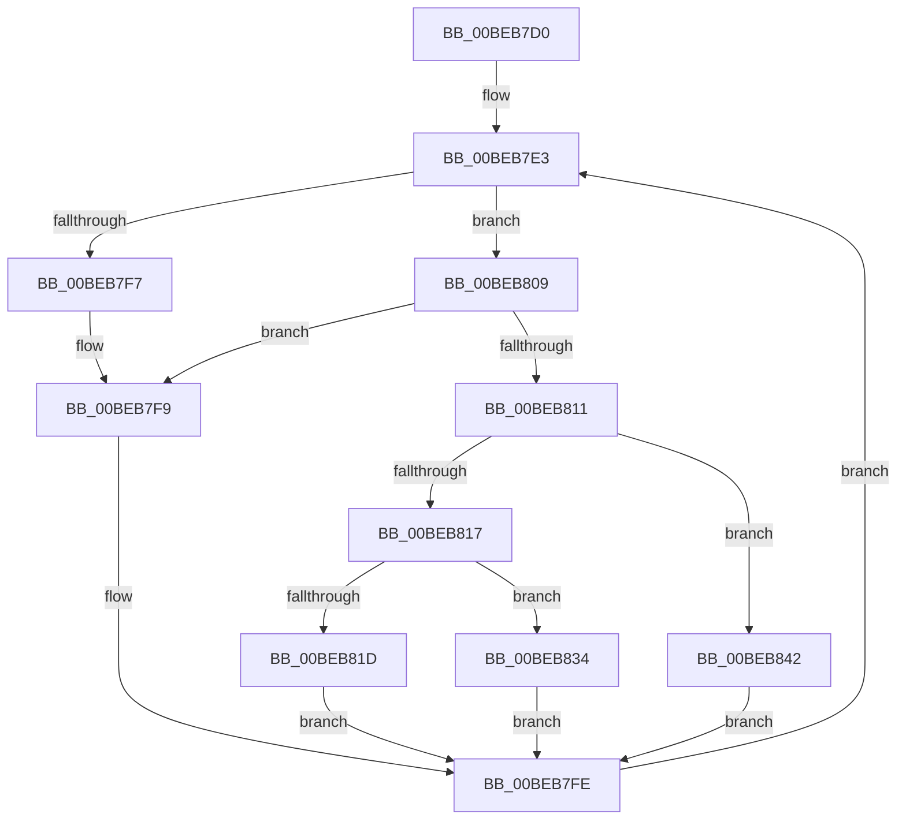

# HalpBlkIdleLoop

- RVA: `0x00BEB7D0`–`0x00BEB850` (길이 `128` bytes)
- VA: `0x0000000140BEB7D0`
- 실행 섹션: `MINIEX`
- PDB 이름 있음: `예`; PDB Function 태그: `아니요`
- unwind 정보 RVA: `0x000C5600`
- 디코드: `31`개 명령, `128/128` bytes 표시
- 미해석 바이트: `0` (있으면 어셈블리에 `.byte`로 보존)

> 이 문서는 커널 이미지의 기계어와 PDB 기호를 분석해 생성했습니다. 4번과 5번은 함수 원형과 자료형을 바이너리 사용 방식에서 추정한 C 해석이며 원본 소스 복구 결과는 아닙니다.

## 1. Dependencies

- 직접 호출 지점: **4**; 고유 호출 대상: **4**
- 직접 호출자로 확인된 함수: **1**
- RIP 상대 이미지 참조: **0**

### Outgoing calls
- `0x00BEB7F9` → [HalpBlkIdleHalt](HalpBlkIdleHalt_function_00BEB8B0.md) (function, `0x00BEB8B0`)
- `0x00BEB82D` → [HalpBlkIdleMonitorMWait](HalpBlkIdleMonitorMWait_function_00BEB8E0.md) (function, `0x00BEB8E0`)
- `0x00BEB83B` → [HalpBlkIdlePortRead](HalpBlkIdlePortRead_function_00BEB8D0.md) (function, `0x00BEB8D0`)
- `0x00BEB849` → [HalpBlkIdlePortReadHalt](HalpBlkIdlePortReadHalt_function_00BEB8C0.md) (function, `0x00BEB8C0`)

### Direct callers
- [HalpBlkProcessorStartup](HalpBlkProcessorStartup_function_00BEB860.md) at `0x00BEB898`

### Static image references
- 디코드된 RIP-relative 메모리 참조가 없습니다.

## 2. Other-region calls and transfers

- 다른 실행 섹션으로 향하는 call: **0**
- 별도 외부 분기/꼬리 이동을 확인하지 못했습니다.

## 3. Assembly (complete function range)

```asm
00BEB7D0  48 89 5C 24 08                  mov qword ptr [rsp + 8], rbx
00BEB7D5  57                              push rdi
00BEB7D6  48 83 EC 20                     sub rsp, 0x20
00BEB7DA  65 48 8B 3C 25 00 00 00 00      mov rdi, qword ptr gs:[0]
00BEB7E3  48 8B 9F D0 08 00 00            mov rbx, qword ptr [rdi + 0x8d0]
00BEB7EA  48 C1 EB 34                     shr rbx, 0x34
00BEB7EE  83 E3 0F                        and ebx, 0xf
00BEB7F1  48 83 FB 04                     cmp rbx, 4
00BEB7F5  72 12                           jb 0x140beb809
00BEB7F7  33 DB                           xor ebx, ebx
00BEB7F9  E8 B2 00 00 00                  call 0x140beb8b0
00BEB7FE  F0 48 FF 84 DF 88 00 00 00      lock inc qword ptr [rdi + rbx*8 + 0x88]
00BEB807  EB DA                           jmp 0x140beb7e3
00BEB809  48 8B C3                        mov rax, rbx
00BEB80C  48 85 DB                        test rbx, rbx
00BEB80F  74 E8                           je 0x140beb7f9
00BEB811  48 83 E8 01                     sub rax, 1
00BEB815  74 2B                           je 0x140beb842
00BEB817  48 83 F8 01                     cmp rax, 1
00BEB81B  74 17                           je 0x140beb834
00BEB81D  44 8B 87 D0 08 00 00            mov r8d, dword ptr [rdi + 0x8d0]
00BEB824  48 8D 8F 00 0A 00 00            lea rcx, [rdi + 0xa00]
00BEB82B  33 D2                           xor edx, edx
00BEB82D  E8 AE 00 00 00                  call 0x140beb8e0
00BEB832  EB CA                           jmp 0x140beb7fe
00BEB834  0F B7 8F D0 08 00 00            movzx ecx, word ptr [rdi + 0x8d0]
00BEB83B  E8 90 00 00 00                  call 0x140beb8d0
00BEB840  EB BC                           jmp 0x140beb7fe
00BEB842  0F B7 8F D0 08 00 00            movzx ecx, word ptr [rdi + 0x8d0]
00BEB849  E8 72 00 00 00                  call 0x140beb8c0
00BEB84E  EB AE                           jmp 0x140beb7fe
```

## 4. C-style interpretation (structured pseudocode)

```c
__int64 __fastcall HalpBlkIdleLoop(__int64 a1, int a2)
{
    __int64 result;
    __int64 v_rbx;
    __int64 v_rsp;
    unsigned __int64 v_stack_p8;

    v_stack_p8 = v_rbx;
    v_rsp = (v_rsp) - (32);
loc_00BEB7E3:
    v_rbx = (*(unsigned __int64 *)(*(unsigned __int64 *)(gs_base + (0)) + 2256)) >> (52);
    v_rbx = (unsigned int)((v_rbx) & (15));
    if (v_rbx < 4) goto loc_00BEB809;
    v_rbx = 0;
loc_00BEB7F9:
    result = HalpBlkIdleHalt(a1, a2, a3, a4);
loc_00BEB7FE:
    goto loc_00BEB7E3;
loc_00BEB809:
    if (0 == 0) goto loc_00BEB7F9;
    result = (0) - (1);
    if (condition_is_equal) goto loc_00BEB842;
    if (result == 1) goto loc_00BEB834;
    a2 = 0;
    result = HalpBlkIdleMonitorMWait(*(unsigned __int64 *)(gs_base + (0)) + 2560, a2, (unsigned int)(*(unsigned int *)(*(unsigned __int64 *)(gs_base + (0)) + 2256)), a4);
    goto loc_00BEB7FE;
loc_00BEB834:
    result = HalpBlkIdlePortRead(*(unsigned __int16 *)(*(unsigned __int64 *)(gs_base + (0)) + 2256), a2, (unsigned int)(*(unsigned int *)(*(unsigned __int64 *)(gs_base + (0)) + 2256)), a4);
    goto loc_00BEB7FE;
loc_00BEB842:
    result = HalpBlkIdlePortReadHalt(*(unsigned __int16 *)(*(unsigned __int64 *)(gs_base + (0)) + 2256), a2, (unsigned int)(*(unsigned int *)(*(unsigned __int64 *)(gs_base + (0)) + 2256)), a4);
    goto loc_00BEB7FE;
}
```

## 5. (Beta) C Style

```c
int64_t HalpBlkIdleLoop(int64_t Arg1, int32_t Arg2)
{
    int64_t result;
    int64_t local_rbx;
    int64_t local_rsp;
    uint64_t v_stack_p8;

    v_stack_p8 = local_rbx;
    local_rsp = (local_rsp) - (32);
loc_00BEB7E3:
    local_rbx = (*(uint64_t *)(*(uint64_t *)(gs_base + (0)) + 0x8D0)) >> (52);
    local_rbx = (uint32_t)((local_rbx) & (15));
    if (local_rbx < 4) goto loc_00BEB809;
    local_rbx = 0;
loc_00BEB7F9:
    result = HalpBlkIdleHalt(Arg1, Arg2, a3, a4);
loc_00BEB7FE:
    goto loc_00BEB7E3;
loc_00BEB809:
    if (0 == 0) goto loc_00BEB7F9;
    result = (0) - (1);
    if (condition_is_equal) goto loc_00BEB842;
    if (result == 1) goto loc_00BEB834;
    Arg2 = 0;
    result = HalpBlkIdleMonitorMWait(*(uint64_t *)(gs_base + (0)) + 2560, Arg2, (uint32_t)(*(uint32_t *)(*(uint64_t *)(gs_base + (0)) + 0x8D0)), a4);
    goto loc_00BEB7FE;
loc_00BEB834:
    result = HalpBlkIdlePortRead(*(uint16_t *)(*(uint64_t *)(gs_base + (0)) + 0x8D0), Arg2, (uint32_t)(*(uint32_t *)(*(uint64_t *)(gs_base + (0)) + 0x8D0)), a4);
    goto loc_00BEB7FE;
loc_00BEB842:
    result = HalpBlkIdlePortReadHalt(*(uint16_t *)(*(uint64_t *)(gs_base + (0)) + 0x8D0), Arg2, (uint32_t)(*(uint32_t *)(*(uint64_t *)(gs_base + (0)) + 0x8D0)), a4);
    goto loc_00BEB7FE;
}
```

## 6. Execution-region graph

[열기: 2D/3D 그래프와 함수 탐색 컨트롤 패널](../../../control-panel.html?section=miniex&rva=0x00BEB7D0&view=graph)

- 2D 그래프는 위에서 아래로 흐르고, 3D 그래프는 빈 공간을 드래그해 회전합니다. Shift+드래그는 이동, 휠은 확대·축소, 함수 노드 선택은 대상 보고서 이동입니다.

### Static fallback


