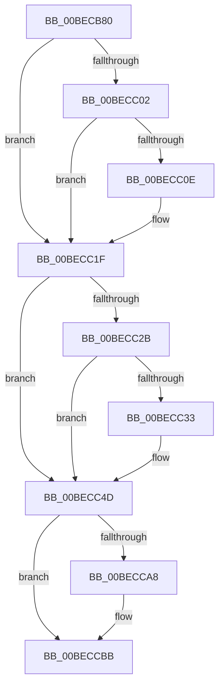

# HalpBlkMachineCheckAbort

- RVA: `0x00BECB80`–`0x00BECCE5` (길이 `357` bytes)
- VA: `0x0000000140BECB80`
- 실행 섹션: `MINIEX`
- PDB 이름 있음: `예`; PDB Function 태그: `아니요`
- unwind 정보 RVA: `0x000BFD60`
- 디코드: `96`개 명령, `357/357` bytes 표시
- 미해석 바이트: `0` (있으면 어셈블리에 `.byte`로 보존)

> 이 문서는 커널 이미지의 기계어와 PDB 기호를 분석해 생성했습니다. 4번과 5번은 함수 원형과 자료형을 바이너리 사용 방식에서 추정한 C 해석이며 원본 소스 복구 결과는 아닙니다.

## 1. Dependencies

- 직접 호출 지점: **2**; 고유 호출 대상: **2**
- 직접 호출자로 확인된 함수: **0**
- RIP 상대 이미지 참조: **0**

### Outgoing calls
- `0x00BECBE4` → [HalpBlkMceFastForward](HalpBlkMceFastForward_function_00BEB510.md) (function, `0x00BEB510`)
- `0x00BECC51` → [HalpBlkHandleMachineCheckAbort](HalpBlkHandleMachineCheckAbort_function_00BEB400.md) (function, `0x00BEB400`)

### Direct callers
- 이 함수 시작 RVA로 연결되는 직접 call은 확인되지 않았습니다. 간접 호출은 완전히 역산할 수 없습니다.

### Static image references
- 디코드된 RIP-relative 메모리 참조가 없습니다.

## 2. Other-region calls and transfers

- 다른 실행 섹션으로 향하는 call: **0**
- 별도 외부 분기/꼬리 이동을 확인하지 못했습니다.

## 3. Assembly (complete function range)

```asm
00BECB80  48 83 EC 08                     sub rsp, 8
00BECB84  55                              push rbp
00BECB85  48 81 EC 58 01 00 00            sub rsp, 0x158
00BECB8C  48 8D AC 24 80 00 00 00         lea rbp, [rsp + 0x80]
00BECB94  C6 45 AB 01                     mov byte ptr [rbp - 0x55], 1
00BECB98  48 89 45 B0                     mov qword ptr [rbp - 0x50], rax
00BECB9C  48 89 4D B8                     mov qword ptr [rbp - 0x48], rcx
00BECBA0  48 89 55 C0                     mov qword ptr [rbp - 0x40], rdx
00BECBA4  4C 89 45 C8                     mov qword ptr [rbp - 0x38], r8
00BECBA8  4C 89 4D D0                     mov qword ptr [rbp - 0x30], r9
00BECBAC  4C 89 55 D8                     mov qword ptr [rbp - 0x28], r10
00BECBB0  4C 89 5D E0                     mov qword ptr [rbp - 0x20], r11
00BECBB4  FC                              cld
00BECBB5  0F AE 5D AC                     stmxcsr dword ptr [rbp - 0x54]
00BECBB9  68 80 1F 00 00                  push 0x1f80
00BECBBE  0F AE 14 24                     ldmxcsr dword ptr [rsp]
00BECBC2  48 83 C4 08                     add rsp, 8
00BECBC6  0F 29 45 F0                     movaps xmmword ptr [rbp - 0x10], xmm0
00BECBCA  0F 29 4D 00                     movaps xmmword ptr [rbp], xmm1
00BECBCE  0F 29 55 10                     movaps xmmword ptr [rbp + 0x10], xmm2
00BECBD2  0F 29 5D 20                     movaps xmmword ptr [rbp + 0x20], xmm3
00BECBD6  0F 29 65 30                     movaps xmmword ptr [rbp + 0x30], xmm4
00BECBDA  0F 29 6D 40                     movaps xmmword ptr [rbp + 0x40], xmm5
00BECBDE  48 8D 4D 80                     lea rcx, [rbp - 0x80]
00BECBE2  33 D2                           xor edx, edx
00BECBE4  E8 27 E9 FF FF                  call 0x140beb510
00BECBE9  48 8B 85 00 01 00 00            mov rax, qword ptr [rbp + 0x100]
00BECBF0  65 48 8B 0C 25 40 00 00 00      mov rcx, qword ptr gs:[0x40]
00BECBF9  48 8B 49 34                     mov rcx, qword ptr [rcx + 0x34]
00BECBFD  48 3B C1                        cmp rax, rcx
00BECC00  77 1D                           ja 0x140becc1f
00BECC02  48 81 E9 00 20 00 00            sub rcx, 0x2000
00BECC09  48 3B C1                        cmp rax, rcx
00BECC0C  76 11                           jbe 0x140becc1f
00BECC0E  66 83 8D 08 01 00 00 04         or word ptr [rbp + 0x108], 4
00BECC16  F0 65 FF 04 25 94 09 00 00      lock inc dword ptr gs:[0x994]
00BECC1F  48 8B 85 E8 00 00 00            mov rax, qword ptr [rbp + 0xe8]
00BECC26  80 38 F4                        cmp byte ptr [rax], 0xf4
00BECC29  75 22                           jne 0x140becc4d
00BECC2B  48 FF C8                        dec rax
00BECC2E  80 38 FB                        cmp byte ptr [rax], 0xfb
00BECC31  75 1A                           jne 0x140becc4d
00BECC33  81 A5 F8 00 00 00 FF FD FF FF   and dword ptr [rbp + 0xf8], 0xfffffdff
00BECC3D  48 89 85 E8 00 00 00            mov qword ptr [rbp + 0xe8], rax
00BECC44  F0 65 FF 04 25 98 09 00 00      lock inc dword ptr gs:[0x998]
00BECC4D  48 8D 4D 80                     lea rcx, [rbp - 0x80]
00BECC51  E8 AA E7 FF FF                  call 0x140beb400
00BECC56  4C 8B 5D E0                     mov r11, qword ptr [rbp - 0x20]
00BECC5A  4C 8B 55 D8                     mov r10, qword ptr [rbp - 0x28]
00BECC5E  4C 8B 4D D0                     mov r9, qword ptr [rbp - 0x30]
00BECC62  4C 8B 45 C8                     mov r8, qword ptr [rbp - 0x38]
00BECC66  48 8B 55 C0                     mov rdx, qword ptr [rbp - 0x40]
00BECC6A  48 8B 4D B8                     mov rcx, qword ptr [rbp - 0x48]
00BECC6E  48 8B 45 B0                     mov rax, qword ptr [rbp - 0x50]
00BECC72  0F AE 55 AC                     ldmxcsr dword ptr [rbp - 0x54]
00BECC76  0F 28 45 F0                     movaps xmm0, xmmword ptr [rbp - 0x10]
00BECC7A  0F 28 4D 00                     movaps xmm1, xmmword ptr [rbp]
00BECC7E  0F 28 55 10                     movaps xmm2, xmmword ptr [rbp + 0x10]
00BECC82  0F 28 5D 20                     movaps xmm3, xmmword ptr [rbp + 0x20]
00BECC86  0F 28 65 30                     movaps xmm4, xmmword ptr [rbp + 0x30]
00BECC8A  0F 28 6D 40                     movaps xmm5, xmmword ptr [rbp + 0x40]
00BECC8E  48 8B E5                        mov rsp, rbp
00BECC91  48 8B AD D8 00 00 00            mov rbp, qword ptr [rbp + 0xd8]
00BECC98  48 81 C4 E8 00 00 00            add rsp, 0xe8
00BECC9F  66 F7 44 24 20 04 00            test word ptr [rsp + 0x20], 4
00BECCA6  75 13                           jne 0x140beccbb
00BECCA8  50                              push rax
00BECCA9  51                              push rcx
00BECCAA  52                              push rdx
00BECCAB  33 C0                           xor eax, eax
00BECCAD  33 D2                           xor edx, edx
00BECCAF  B9 7A 01 00 00                  mov ecx, 0x17a
00BECCB4  0F 30                           wrmsr
00BECCB6  5A                              pop rdx
00BECCB7  59                              pop rcx
00BECCB8  58                              pop rax
00BECCB9  48 CF                           iretq
00BECCBB  50                              push rax
00BECCBC  FF 74 24 18                     push qword ptr [rsp + 0x18]
00BECCC0  9D                              popfq
00BECCC1  48 8B C4                        mov rax, rsp
00BECCC4  48 8B 64 24 20                  mov rsp, qword ptr [rsp + 0x20]
00BECCC9  FF 70 10                        push qword ptr [rax + 0x10]
00BECCCC  FF 70 08                        push qword ptr [rax + 8]
00BECCCF  48 8B 00                        mov rax, qword ptr [rax]
00BECCD2  50                              push rax
00BECCD3  51                              push rcx
00BECCD4  52                              push rdx
00BECCD5  33 C0                           xor eax, eax
00BECCD7  33 D2                           xor edx, edx
00BECCD9  B9 7A 01 00 00                  mov ecx, 0x17a
00BECCDE  0F 30                           wrmsr
00BECCE0  5A                              pop rdx
00BECCE1  59                              pop rcx
00BECCE2  58                              pop rax
00BECCE3  48 CB                           retfq
```

## 4. C-style interpretation (structured pseudocode)

```c
__int64 __fastcall HalpBlkMachineCheckAbort(__int64 a1, __int64 a2, __int64 a3, __int64 a4)
{
    __int64 result;
    __int64 v_rsp;
    unsigned __int64 v_stack_m10;
    unsigned __int64 v_stack_m108;
    unsigned __int64 v_stack_m110;
    unsigned __int64 v_stack_m118;
    unsigned __int64 v_stack_m120;
    unsigned __int64 v_stack_m128;
    unsigned __int64 v_stack_m130;
    unsigned __int64 v_stack_m138;
    unsigned int v_stack_m13C;
    unsigned __int8 v_stack_m13D;
    unsigned __int64 v_stack_m168;
    unsigned int v_stack_m170;
    unsigned __int64 v_stack_mA8;
    unsigned __int64 v_stack_mB8;
    unsigned __int64 v_stack_mC8;
    unsigned __int64 v_stack_mD8;
    unsigned __int64 v_stack_mE8;
    unsigned __int64 v_stack_mF8;
    unsigned __int64 v_stack_p0;
    unsigned int v_stack_p10;
    unsigned __int64 v_stack_p18;
    unsigned __int16 v_stack_p20;

    v_rsp = (v_rsp) - (8);
    v_rsp = (v_rsp) - (344);
    v_stack_m13D = 1;
    v_stack_m138 = result;
    v_stack_m130 = a1;
    v_stack_m128 = a2;
    v_stack_m120 = a3;
    v_stack_m118 = a4;
    v_stack_m110 = v_r10;
    v_stack_m108 = v_r11;
    v_rsp = (v_rsp) + (8);
    v_stack_mF8 = v_xmm0;
    v_stack_mE8 = v_xmm1;
    v_stack_mD8 = v_xmm2;
    v_stack_mC8 = v_xmm3;
    v_stack_mB8 = v_xmm4;
    v_stack_mA8 = v_xmm5;
    a2 = 0;
    result = HalpBlkMceFastForward(v_stack_m168, a2, a3, a4);
    if (v_stack_p18 > (*(unsigned __int64 *)(*(unsigned __int64 *)(gs_base + (0 + 64)) + 52))) goto loc_00BECC1F;
    a1 = (*(unsigned __int64 *)(*(unsigned __int64 *)(gs_base + (0 + 64)) + 52)) - (0x2000ULL);
    if (v_stack_p18 >= = a1) {
    }
    if ((*(unsigned __int8 *)(v_stack_p0)) != 244) goto loc_00BECC4D;
    result = (v_stack_p0) - 1;
    if ((*(unsigned __int8 *)(result)) == 251) {
        v_stack_p0 = result;
    }
    result = HalpBlkHandleMachineCheckAbort(v_stack_m168, a2, a3, a4);
    v_rsp = (v_stack_mE8) + (232);
    result = v_stack_m138;
    if (((v_stack_p20) & (4)) == 0) {
        result = 0;
        a2 = 0;
        a1 = 378;
    }
    result = 0;
    a2 = 0;
    return result;
}
```

## 5. (Beta) C Style

```c
int64_t HalpBlkMachineCheckAbort(int64_t Arg1, int64_t Arg2, int64_t Arg3, int64_t Arg4)
{
    int64_t result;
    int64_t local_rsp;
    uint64_t v_stack_m10;
    uint64_t v_stack_m108;
    uint64_t v_stack_m110;
    uint64_t v_stack_m118;
    uint64_t v_stack_m120;
    uint64_t v_stack_m128;
    uint64_t v_stack_m130;
    uint64_t v_stack_m138;
    uint32_t v_stack_m13C;
    uint8_t v_stack_m13D;
    uint64_t v_stack_m168;
    uint32_t v_stack_m170;
    uint64_t v_stack_mA8;
    uint64_t v_stack_mB8;
    uint64_t v_stack_mC8;
    uint64_t v_stack_mD8;
    uint64_t v_stack_mE8;
    uint64_t v_stack_mF8;
    uint64_t v_stack_p0;
    uint32_t v_stack_p10;
    uint64_t v_stack_p18;
    uint16_t v_stack_p20;

    local_rsp = (local_rsp) - (8);
    local_rsp = (local_rsp) - (344);
    v_stack_m13D = 1;
    v_stack_m138 = result;
    v_stack_m130 = Arg1;
    v_stack_m128 = Arg2;
    v_stack_m120 = Arg3;
    v_stack_m118 = Arg4;
    v_stack_m110 = local_r10;
    v_stack_m108 = local_r11;
    local_rsp = (local_rsp) + (8);
    v_stack_mF8 = v_xmm0;
    v_stack_mE8 = v_xmm1;
    v_stack_mD8 = v_xmm2;
    v_stack_mC8 = v_xmm3;
    v_stack_mB8 = v_xmm4;
    v_stack_mA8 = v_xmm5;
    Arg2 = 0;
    result = HalpBlkMceFastForward(v_stack_m168, Arg2, Arg3, Arg4);
    if (v_stack_p18 > (*(uint64_t *)(*(uint64_t *)(gs_base + (0 + 0x40)) + 0x34))) goto loc_00BECC1F;
    Arg1 = (*(uint64_t *)(*(uint64_t *)(gs_base + (0 + 0x40)) + 0x34)) - (0x2000ULL);
    if (v_stack_p18 >= = Arg1) {
    }
    if ((*(uint8_t *)(v_stack_p0)) != 244) goto loc_00BECC4D;
    result = (v_stack_p0) - 1;
    if ((*(uint8_t *)(result)) == 251) {
        v_stack_p0 = result;
    }
    result = HalpBlkHandleMachineCheckAbort(v_stack_m168, Arg2, Arg3, Arg4);
    local_rsp = (v_stack_mE8) + (232);
    result = v_stack_m138;
    if (((v_stack_p20) & (4)) == 0) {
        result = 0;
        Arg2 = 0;
        Arg1 = 378;
    }
    result = 0;
    Arg2 = 0;
    return result;
}
```

## 6. Execution-region graph

[열기: 2D/3D 그래프와 함수 탐색 컨트롤 패널](../../../control-panel.html?section=miniex&rva=0x00BECB80&view=graph)

- 2D 그래프는 위에서 아래로 흐르고, 3D 그래프는 빈 공간을 드래그해 회전합니다. Shift+드래그는 이동, 휠은 확대·축소, 함수 노드 선택은 대상 보고서 이동입니다.

### Static fallback


