# HalpBlkMceFastForward

- RVA: `0x00BEB510`–`0x00BEB788` (길이 `632` bytes)
- VA: `0x0000000140BEB510`
- 실행 섹션: `MINIEX`
- PDB 이름 있음: `예`; PDB Function 태그: `아니요`
- unwind 정보 RVA: `0x00070788`
- 디코드: `140`개 명령, `632/632` bytes 표시
- 미해석 바이트: `0` (있으면 어셈블리에 `.byte`로 보존)

> 이 문서는 커널 이미지의 기계어와 PDB 기호를 분석해 생성했습니다. 4번과 5번은 함수 원형과 자료형을 바이너리 사용 방식에서 추정한 C 해석이며 원본 소스 복구 결과는 아닙니다.

## 1. Dependencies

- 직접 호출 지점: **2**; 고유 호출 대상: **1**
- 직접 호출자로 확인된 함수: **2**
- RIP 상대 이미지 참조: **4**

### Outgoing calls
- `0x00BEB64D` → [HalpBlkFatalErrorHalt](HalpBlkFatalErrorHalt_function_00BEB900.md) (function, `0x00BEB900`)
- `0x00BEB77E` → [HalpBlkFatalErrorHalt](HalpBlkFatalErrorHalt_function_00BEB900.md) (function, `0x00BEB900`)

### Direct callers
- [HalpBlkMachineCheckAbort](HalpBlkMachineCheckAbort_function_00BECB80.md) at `0x00BECBE4`
- [HalpBlkNmiInterrupt](HalpBlkNmiInterrupt_function_00BECD00.md) at `0x00BECD66`

### Static image references
- `0x00BEB5B6` → RVA `0x00BECCB6` (`HalpBlkMceExitMceTailMceBegin`; read)
- `0x00BEB5C7` → RVA `0x00BECCBB` (`HalpBlkMceExitMceTailMceEnd`; read)
- `0x00BEB5E4` → RVA `0x00BECCE0` (`HalpBlkMceExitMceTailNmiBegin`; read)
- `0x00BEB5F0` → RVA `0x00BECCE5` (`HalpBlkMceExitMceTailNmiEnd`; read)

## 2. Other-region calls and transfers

- 다른 실행 섹션으로 향하는 call: **0**
- 별도 외부 분기/꼬리 이동을 확인하지 못했습니다.

## 3. Assembly (complete function range)

```asm
00BEB510  48 8B C4                        mov rax, rsp
00BEB513  48 89 58 08                     mov qword ptr [rax + 8], rbx
00BEB517  48 89 68 10                     mov qword ptr [rax + 0x10], rbp
00BEB51B  48 89 70 18                     mov qword ptr [rax + 0x18], rsi
00BEB51F  48 89 78 20                     mov qword ptr [rax + 0x20], rdi
00BEB523  41 54                           push r12
00BEB525  41 56                           push r14
00BEB527  41 57                           push r15
00BEB529  48 83 EC 20                     sub rsp, 0x20
00BEB52D  65 48 8B 04 25 00 00 00 00      mov rax, qword ptr gs:[0]
00BEB536  45 33 E4                        xor r12d, r12d
00BEB539  4C 8B 89 80 01 00 00            mov r9, qword ptr [rcx + 0x180]
00BEB540  40 8A F2                        mov sil, dl
00BEB543  48 8B F9                        mov rdi, rcx
00BEB546  41 8B DC                        mov ebx, r12d
00BEB549  4C 8B 40 40                     mov r8, qword ptr [rax + 0x40]
00BEB54D  45 8D 7C 24 01                  lea r15d, [r12 + 1]
00BEB552  49 8B 40 34                     mov rax, qword ptr [r8 + 0x34]
00BEB556  4C 3B C8                        cmp r9, rax
00BEB559  77 1F                           ja 0x140beb57a
00BEB55B  48 05 00 E0 FF FF               add rax, -0x2000
00BEB561  4C 3B C8                        cmp r9, rax
00BEB564  72 14                           jb 0x140beb57a
00BEB566  65 48 8B 04 25 00 00 00 00      mov rax, qword ptr gs:[0]
00BEB56F  41 8B DF                        mov ebx, r15d
00BEB572  F0 44 01 B8 78 09 00 00         lock add dword ptr [rax + 0x978], r15d
00BEB57A  65 48 8B 04 25 00 00 00 00      mov rax, qword ptr gs:[0]
00BEB583  48 8B 48 40                     mov rcx, qword ptr [rax + 0x40]
00BEB587  48 8B 41 2C                     mov rax, qword ptr [rcx + 0x2c]
00BEB58B  4C 3B C8                        cmp r9, rax
00BEB58E  77 1F                           ja 0x140beb5af
00BEB590  48 05 00 E0 FF FF               add rax, -0x2000
00BEB596  4C 3B C8                        cmp r9, rax
00BEB599  72 14                           jb 0x140beb5af
00BEB59B  65 48 8B 04 25 00 00 00 00      mov rax, qword ptr gs:[0]
00BEB5A4  83 CB 02                        or ebx, 2
00BEB5A7  F0 44 01 B8 7C 09 00 00         lock add dword ptr [rax + 0x97c], r15d
00BEB5AF  48 8B 8F 68 01 00 00            mov rcx, qword ptr [rdi + 0x168]
00BEB5B6  48 8D 05 F9 16 00 00            lea rax, [rip + 0x16f9]
00BEB5BD  BA 80 09 00 00                  mov edx, 0x980
00BEB5C2  48 3B C8                        cmp rcx, rax
00BEB5C5  72 1D                           jb 0x140beb5e4
00BEB5C7  48 8D 05 ED 16 00 00            lea rax, [rip + 0x16ed]
00BEB5CE  48 3B C8                        cmp rcx, rax
00BEB5D1  73 11                           jae 0x140beb5e4
00BEB5D3  65 48 8B 04 25 00 00 00 00      mov rax, qword ptr gs:[0]
00BEB5DC  83 CB 04                        or ebx, 4
00BEB5DF  F0 44 01 3C 10                  lock add dword ptr [rax + rdx], r15d
00BEB5E4  48 8D 05 F5 16 00 00            lea rax, [rip + 0x16f5]
00BEB5EB  48 3B C8                        cmp rcx, rax
00BEB5EE  72 1D                           jb 0x140beb60d
00BEB5F0  48 8D 05 EE 16 00 00            lea rax, [rip + 0x16ee]
00BEB5F7  48 3B C8                        cmp rcx, rax
00BEB5FA  73 11                           jae 0x140beb60d
00BEB5FC  65 48 8B 04 25 00 00 00 00      mov rax, qword ptr gs:[0]
00BEB605  83 CB 04                        or ebx, 4
00BEB608  F0 44 01 3C 10                  lock add dword ptr [rax + rdx], r15d
00BEB60D  65 4C 8B 34 25 00 00 00 00      mov r14, qword ptr gs:[0]
00BEB616  8B CB                           mov ecx, ebx
00BEB618  41 23 CF                        and ecx, r15d
00BEB61B  40 84 F6                        test sil, sil
00BEB61E  0F 85 1B 01 00 00               jne 0x140beb73f
00BEB624  85 C9                           test ecx, ecx
00BEB626  0F 85 13 01 00 00               jne 0x140beb73f
00BEB62C  65 48 8B 04 25 00 00 00 00      mov rax, qword ptr gs:[0]
00BEB635  F0 44 01 B8 90 09 00 00         lock add dword ptr [rax + 0x990], r15d
00BEB63D  41 8B EC                        mov ebp, r12d
00BEB640  8B C3                           mov eax, ebx
00BEB642  24 06                           and al, 6
00BEB644  3C 02                           cmp al, 2
00BEB646  75 0A                           jne 0x140beb652
00BEB648  48 8B D7                        mov rdx, rdi
00BEB64B  B1 12                           mov cl, 0x12
00BEB64D  E8 AE 02 00 00                  call 0x140beb900
00BEB652  40 84 F6                        test sil, sil
00BEB655  75 0B                           jne 0x140beb662
00BEB657  49 8D 8E 28 09 00 00            lea rcx, [r14 + 0x928]
00BEB65E  85 ED                           test ebp, ebp
00BEB660  75 07                           jne 0x140beb669
00BEB662  49 8D 8E D8 08 00 00            lea rcx, [r14 + 0x8d8]
00BEB669  F6 C3 04                        test bl, 4
00BEB66C  74 61                           je 0x140beb6cf
00BEB66E  65 48 8B 04 25 00 00 00 00      mov rax, qword ptr gs:[0]
00BEB677  F0 44 01 B8 A0 09 00 00         lock add dword ptr [rax + 0x9a0], r15d
00BEB67F  0F 10 01                        movups xmm0, xmmword ptr [rcx]
00BEB682  0F 11 87 68 01 00 00            movups xmmword ptr [rdi + 0x168], xmm0
00BEB689  0F 10 49 10                     movups xmm1, xmmword ptr [rcx + 0x10]
00BEB68D  0F 11 8F 78 01 00 00            movups xmmword ptr [rdi + 0x178], xmm1
00BEB694  F2 0F 10 41 20                  movsd xmm0, qword ptr [rcx + 0x20]
00BEB699  F2 0F 11 87 88 01 00 00         movsd qword ptr [rdi + 0x188], xmm0
00BEB6A1  48 8B 41 28                     mov rax, qword ptr [rcx + 0x28]
00BEB6A5  48 89 47 30                     mov qword ptr [rdi + 0x30], rax
00BEB6A9  48 8B 41 30                     mov rax, qword ptr [rcx + 0x30]
00BEB6AD  48 89 47 38                     mov qword ptr [rdi + 0x38], rax
00BEB6B1  48 8B 41 38                     mov rax, qword ptr [rcx + 0x38]
00BEB6B5  48 89 47 40                     mov qword ptr [rdi + 0x40], rax
00BEB6B9  65 48 8B 04 25 00 00 00 00      mov rax, qword ptr gs:[0]
00BEB6C2  F0 44 01 B8 88 09 00 00         lock add dword ptr [rax + 0x988], r15d
00BEB6CA  66 44 89 61 08                  mov word ptr [rcx + 8], r12w
00BEB6CF  40 84 F6                        test sil, sil
00BEB6D2  75 4B                           jne 0x140beb71f
00BEB6D4  65 48 8B 04 25 00 00 00 00      mov rax, qword ptr gs:[0]
00BEB6DD  F0 44 01 B8 84 09 00 00         lock add dword ptr [rax + 0x984], r15d
00BEB6E5  0F 10 87 68 01 00 00            movups xmm0, xmmword ptr [rdi + 0x168]
00BEB6EC  0F 11 01                        movups xmmword ptr [rcx], xmm0
00BEB6EF  0F 10 8F 78 01 00 00            movups xmm1, xmmword ptr [rdi + 0x178]
00BEB6F6  0F 11 49 10                     movups xmmword ptr [rcx + 0x10], xmm1
00BEB6FA  F2 0F 10 87 88 01 00 00         movsd xmm0, qword ptr [rdi + 0x188]
00BEB702  F2 0F 11 41 20                  movsd qword ptr [rcx + 0x20], xmm0
00BEB707  48 8B 47 30                     mov rax, qword ptr [rdi + 0x30]
00BEB70B  48 89 41 28                     mov qword ptr [rcx + 0x28], rax
00BEB70F  48 8B 47 38                     mov rax, qword ptr [rdi + 0x38]
00BEB713  48 89 41 30                     mov qword ptr [rcx + 0x30], rax
00BEB717  48 8B 47 40                     mov rax, qword ptr [rdi + 0x40]
00BEB71B  48 89 41 38                     mov qword ptr [rcx + 0x38], rax
00BEB71F  48 8B 5C 24 40                  mov rbx, qword ptr [rsp + 0x40]
00BEB724  48 8B 6C 24 48                  mov rbp, qword ptr [rsp + 0x48]
00BEB729  48 8B 74 24 50                  mov rsi, qword ptr [rsp + 0x50]
00BEB72E  48 8B 7C 24 58                  mov rdi, qword ptr [rsp + 0x58]
00BEB733  48 83 C4 20                     add rsp, 0x20
00BEB737  41 5F                           pop r15
00BEB739  41 5E                           pop r14
00BEB73B  41 5C                           pop r12
00BEB73D  C3                              ret
00BEB73E  CC                              int3
00BEB73F  65 48 8B 04 25 00 00 00 00      mov rax, qword ptr gs:[0]
00BEB748  F0 44 01 B8 8C 09 00 00         lock add dword ptr [rax + 0x98c], r15d
00BEB750  85 C9                           test ecx, ecx
00BEB752  74 11                           je 0x140beb765
00BEB754  65 48 8B 04 25 00 00 00 00      mov rax, qword ptr gs:[0]
00BEB75D  F0 44 01 B8 9C 09 00 00         lock add dword ptr [rax + 0x99c], r15d
00BEB765  41 8B EF                        mov ebp, r15d
00BEB768  40 84 F6                        test sil, sil
00BEB76B  0F 84 CF FE FF FF               je 0x140beb640
00BEB771  85 C9                           test ecx, ecx
00BEB773  0F 84 E9 FE FF FF               je 0x140beb662
00BEB779  48 8B D7                        mov rdx, rdi
00BEB77C  B1 02                           mov cl, 2
00BEB77E  E8 7D 01 00 00                  call 0x140beb900
00BEB783  E9 DA FE FF FF                  jmp 0x140beb662
```

## 4. C-style interpretation (structured pseudocode)

```c
__int64 __fastcall HalpBlkMceFastForward(__int64 a1, unsigned __int8 a2)
{
    __int64 result;
    __int64 v_r12;
    __int64 v_rbx;
    __int64 v_rsp;
    unsigned __int64 v_stack_p10;
    unsigned __int64 v_stack_p18;
    unsigned __int64 v_stack_p20;
    unsigned __int64 v_stack_p8;

    *(unsigned __int64 *)(v_rsp + 8) = v_rbx;
    *(unsigned __int64 *)(v_rsp + 16) = v_rbp;
    *(unsigned __int64 *)(v_rsp + 24) = v_rsi;
    *(unsigned __int64 *)(v_rsp + 32) = v_rdi;
    v_rsp = (v_rsp) - (32);
    v_r12 = 0;
    if ((*(unsigned __int64 *)(a1 + 384)) > (*(unsigned __int64 *)(*(unsigned __int64 *)(*(unsigned __int64 *)(gs_base + (0)) + 64) + 52))) goto loc_00BEB57A;
    result = (*(unsigned __int64 *)(*(unsigned __int64 *)(*(unsigned __int64 *)(gs_base + (0)) + 64) + 52)) + (0xFFFFFFFFFFFFE000ULL);
    v_rbx = 0;
    if ((*(unsigned __int64 *)(a1 + 384)) >= result) {
        result = *(unsigned __int64 *)(gs_base + (0));
        v_rbx = (unsigned int)(v_r12 + 1);
    }
    if ((*(unsigned __int64 *)(a1 + 384)) > (*(unsigned __int64 *)(*(unsigned __int64 *)(*(unsigned __int64 *)(gs_base + (0)) + 64) + 44))) goto loc_00BEB5AF;
    result = (*(unsigned __int64 *)(*(unsigned __int64 *)(*(unsigned __int64 *)(gs_base + (0)) + 64) + 44)) + (0xFFFFFFFFFFFFE000ULL);
    if ((*(unsigned __int64 *)(a1 + 384)) >= result) {
        result = *(unsigned __int64 *)(gs_base + (0));
        v_rbx = (unsigned int)((v_rbx) | (2));
    }
    if ((*(unsigned __int64 *)(a1 + 360)) < (v_rip + 5881)) goto loc_00BEB5E4;
    result = v_rip + 5869;
    if ((*(unsigned __int64 *)(a1 + 360)) < (v_rip + 5869)) {
        result = *(unsigned __int64 *)(gs_base + (0));
        v_rbx = (unsigned int)((v_rbx) | (4));
    }
    if ((*(unsigned __int64 *)(a1 + 360)) < (v_rip + 5877)) goto loc_00BEB60D;
    result = v_rip + 5870;
    if ((*(unsigned __int64 *)(a1 + 360)) < (v_rip + 5870)) {
        result = *(unsigned __int64 *)(gs_base + (0));
        v_rbx = (unsigned int)((v_rbx) | (4));
    }
    a1 = (unsigned int)(((unsigned int)((unsigned int)(v_rbx))) & ((unsigned int)(v_r12 + 1)));
    if (a2 != 0) goto loc_00BEB73F;
    if ((unsigned int)(a1) != 0) goto loc_00BEB73F;
loc_00BEB640:
    result = (unsigned __int8)(((unsigned int)((unsigned int)(v_rbx))) & (6));
    if (((unsigned __int8)(result)) == 2) {
        a2 = a1;
        a1 = 18;
        result = HalpBlkFatalErrorHalt(a1, a2, *(unsigned __int64 *)(*(unsigned __int64 *)(gs_base + (0)) + 64), *(unsigned __int64 *)(a1 + 384));
    }
    if (a2 != 0) goto loc_00BEB662;
    if (0 == 0) {
        a1 = *(unsigned __int64 *)(gs_base + (0)) + 2264;
    }
    if ((((unsigned __int8)(v_rbx)) & (4)) != 0) {
        result = *(unsigned __int64 *)(gs_base + (0));
        *(unsigned __int64 *)(a1 + 360) = v_xmm0;
        *(unsigned __int64 *)(a1 + 376) = v_xmm1;
        *(unsigned __int64 *)(a1 + 392) = v_xmm0;
        result = *(unsigned __int64 *)(a1 + 40);
        *(unsigned __int64 *)(a1 + 48) = result;
        result = *(unsigned __int64 *)(a1 + 48);
        *(unsigned __int64 *)(a1 + 56) = result;
        result = *(unsigned __int64 *)(a1 + 56);
        *(unsigned __int64 *)(a1 + 64) = result;
        result = *(unsigned __int64 *)(gs_base + (0));
        *(unsigned __int16 *)(a1 + 8) = 0;
    }
    if (a2 == 0) {
        result = *(unsigned __int64 *)(gs_base + (0));
        *(unsigned __int64 *)(a1) = v_xmm0;
        *(unsigned __int64 *)(a1 + 16) = v_xmm1;
        *(unsigned __int64 *)(a1 + 32) = v_xmm0;
        result = *(unsigned __int64 *)(a1 + 48);
        *(unsigned __int64 *)(a1 + 40) = result;
        result = *(unsigned __int64 *)(a1 + 56);
        *(unsigned __int64 *)(a1 + 48) = result;
        result = *(unsigned __int64 *)(a1 + 64);
        *(unsigned __int64 *)(a1 + 56) = result;
    }
    v_rsp = (v_rsp) + (32);
    return result;
loc_00BEB73F:
    result = *(unsigned __int64 *)(gs_base + (0));
    if ((unsigned int)(a1) != 0) {
        result = *(unsigned __int64 *)(gs_base + (0));
    }
    if ((unsigned __int8)(v_stack_p18) == 0) goto loc_00BEB640;
    if ((unsigned int)(a1) == 0) goto loc_00BEB662;
    result = HalpBlkFatalErrorHalt(2, v_stack_p20, *(unsigned __int64 *)(*(unsigned __int64 *)(gs_base + (0)) + 64), *(unsigned __int64 *)(a1 + 384));
    goto loc_00BEB662;
}
```

## 5. (Beta) C Style

```c
int64_t HalpBlkMceFastForward(void *Arg1, uint8_t Arg2)
{
    uint8_t *arg1 = (uint8_t *)Arg1;

    int64_t result;
    int64_t local_r12;
    int64_t local_rbx;
    int64_t local_rsp;
    uint64_t v_stack_p10;
    uint64_t v_stack_p18;
    uint64_t v_stack_p20;
    uint64_t v_stack_p8;

    *(uint64_t *)(local_rsp + 0x8) = local_rbx;
    *(uint64_t *)(local_rsp + 0x10) = local_rbp;
    *(uint64_t *)(local_rsp + 0x18) = local_rsi;
    *(uint64_t *)(local_rsp + 0x20) = local_rdi;
    local_rsp = (local_rsp) - (32);
    local_r12 = 0;
    if ((*(uint64_t *)(arg1 + 0x180)) > (*(uint64_t *)(*(uint64_t *)(*(uint64_t *)(gs_base + (0)) + 0x40) + 0x34))) goto loc_00BEB57A;
    result = (*(uint64_t *)(*(uint64_t *)(*(uint64_t *)(gs_base + (0)) + 0x40) + 0x34)) + (0xFFFFFFFFFFFFE000ULL);
    local_rbx = 0;
    if ((*(uint64_t *)(arg1 + 0x180)) >= result) {
        result = *(uint64_t *)(gs_base + (0));
        local_rbx = (uint32_t)(local_r12 + 1);
    }
    if ((*(uint64_t *)(arg1 + 0x180)) > (*(uint64_t *)(*(uint64_t *)(*(uint64_t *)(gs_base + (0)) + 0x40) + 0x2C))) goto loc_00BEB5AF;
    result = (*(uint64_t *)(*(uint64_t *)(*(uint64_t *)(gs_base + (0)) + 0x40) + 0x2C)) + (0xFFFFFFFFFFFFE000ULL);
    if ((*(uint64_t *)(arg1 + 0x180)) >= result) {
        result = *(uint64_t *)(gs_base + (0));
        local_rbx = (uint32_t)((local_rbx) | (2));
    }
    if ((*(uint64_t *)(arg1 + 0x168)) < (v_rip + 5881)) goto loc_00BEB5E4;
    result = v_rip + 5869;
    if ((*(uint64_t *)(arg1 + 0x168)) < (v_rip + 5869)) {
        result = *(uint64_t *)(gs_base + (0));
        local_rbx = (uint32_t)((local_rbx) | (4));
    }
    if ((*(uint64_t *)(arg1 + 0x168)) < (v_rip + 5877)) goto loc_00BEB60D;
    result = v_rip + 5870;
    if ((*(uint64_t *)(arg1 + 0x168)) < (v_rip + 5870)) {
        result = *(uint64_t *)(gs_base + (0));
        local_rbx = (uint32_t)((local_rbx) | (4));
    }
    Arg1 = (uint32_t)(((uint32_t)((uint32_t)(local_rbx))) & ((uint32_t)(local_r12 + 1)));
    if (Arg2 != 0) goto loc_00BEB73F;
    if ((uint32_t)(Arg1) != 0) goto loc_00BEB73F;
loc_00BEB640:
    result = (uint8_t)(((uint32_t)((uint32_t)(local_rbx))) & (6));
    if (((uint8_t)(result)) == 2) {
        Arg2 = Arg1;
        Arg1 = 18;
        result = HalpBlkFatalErrorHalt(Arg1, Arg2, *(uint64_t *)(*(uint64_t *)(gs_base + (0)) + 0x40), *(uint64_t *)(arg1 + 0x180));
    }
    if (Arg2 != 0) goto loc_00BEB662;
    if (0 == 0) {
        Arg1 = *(uint64_t *)(gs_base + (0)) + 2264;
    }
    if ((((uint8_t)(local_rbx)) & (4)) != 0) {
        result = *(uint64_t *)(gs_base + (0));
        *(uint64_t *)(arg1 + 0x168) = v_xmm0;
        *(uint64_t *)(arg1 + 0x178) = v_xmm1;
        *(uint64_t *)(arg1 + 0x188) = v_xmm0;
        result = *(uint64_t *)(arg1 + 0x28);
        *(uint64_t *)(arg1 + 0x30) = result;
        result = *(uint64_t *)(arg1 + 0x30);
        *(uint64_t *)(arg1 + 0x38) = result;
        result = *(uint64_t *)(arg1 + 0x38);
        *(uint64_t *)(arg1 + 0x40) = result;
        result = *(uint64_t *)(gs_base + (0));
        *(uint16_t *)(arg1 + 0x8) = 0;
    }
    if (Arg2 == 0) {
        result = *(uint64_t *)(gs_base + (0));
        *(uint64_t *)(arg1) = v_xmm0;
        *(uint64_t *)(arg1 + 0x10) = v_xmm1;
        *(uint64_t *)(arg1 + 0x20) = v_xmm0;
        result = *(uint64_t *)(arg1 + 0x30);
        *(uint64_t *)(arg1 + 0x28) = result;
        result = *(uint64_t *)(arg1 + 0x38);
        *(uint64_t *)(arg1 + 0x30) = result;
        result = *(uint64_t *)(arg1 + 0x40);
        *(uint64_t *)(arg1 + 0x38) = result;
    }
    local_rsp = (local_rsp) + (32);
    return result;
loc_00BEB73F:
    result = *(uint64_t *)(gs_base + (0));
    if ((uint32_t)(Arg1) != 0) {
        result = *(uint64_t *)(gs_base + (0));
    }
    if ((uint8_t)(v_stack_p18) == 0) goto loc_00BEB640;
    if ((uint32_t)(Arg1) == 0) goto loc_00BEB662;
    result = HalpBlkFatalErrorHalt(2, v_stack_p20, *(uint64_t *)(*(uint64_t *)(gs_base + (0)) + 0x40), *(uint64_t *)(arg1 + 0x180));
    goto loc_00BEB662;
}
```

### 관측된 메모리 오프셋

구조체 형식이 확인되지 않은 접근은 인자 기준의 오프셋으로만 기록했습니다.

| 기준 인자 | 오프셋 표현 | 폭 (bit) | 접근 |
|---|---:|---:|---|
| `Arg1` | `+ 0x30` | `64` | `R` |
| `Arg1` | `+ 0x30` | `64` | `W` |
| `Arg1` | `+ 0x38` | `64` | `R` |
| `Arg1` | `+ 0x38` | `64` | `W` |
| `Arg1` | `+ 0x40` | `64` | `R` |
| `Arg1` | `+ 0x40` | `64` | `W` |
| `Arg1` | `+ 0x168` | `64` | `R` |
| `Arg1` | `+ 0x168` | `128` | `R` |
| `Arg1` | `+ 0x178` | `128` | `R` |
| `Arg1` | `+ 0x180` | `64` | `R` |
| `Arg1` | `+ 0x188` | `64` | `R` |
| `Arg1` | `+ 0x188` | `64` | `W` |

## 6. Execution-region graph

[열기: 2D/3D 그래프와 함수 탐색 컨트롤 패널](../../../control-panel.html?section=miniex&rva=0x00BEB510&view=graph)

- 2D 그래프는 위에서 아래로 흐르고, 3D 그래프는 빈 공간을 드래그해 회전합니다. Shift+드래그는 이동, 휠은 확대·축소, 함수 노드 선택은 대상 보고서 이동입니다.

### Static fallback

```mermaid
flowchart TD
  bb_00BEB510[BB_00BEB510]
  bb_00BEB55B[BB_00BEB55B]
  bb_00BEB566[BB_00BEB566]
  bb_00BEB57A[BB_00BEB57A]
  bb_00BEB590[BB_00BEB590]
  bb_00BEB59B[BB_00BEB59B]
  bb_00BEB5AF[BB_00BEB5AF]
  bb_00BEB5C7[BB_00BEB5C7]
  bb_00BEB5D3[BB_00BEB5D3]
  bb_00BEB5E4[BB_00BEB5E4]
  bb_00BEB5F0[BB_00BEB5F0]
  bb_00BEB5FC[BB_00BEB5FC]
  bb_00BEB60D[BB_00BEB60D]
  bb_00BEB624[BB_00BEB624]
  bb_00BEB62C[BB_00BEB62C]
  bb_00BEB640[BB_00BEB640]
  bb_00BEB648[BB_00BEB648]
  bb_00BEB652[BB_00BEB652]
  bb_00BEB657[BB_00BEB657]
  bb_00BEB662[BB_00BEB662]
  bb_00BEB669[BB_00BEB669]
  bb_00BEB66E[BB_00BEB66E]
  bb_00BEB6CF[BB_00BEB6CF]
  bb_00BEB6D4[BB_00BEB6D4]
  bb_00BEB71F[BB_00BEB71F]
  bb_00BEB73E[BB_00BEB73E]
  bb_00BEB73F[BB_00BEB73F]
  bb_00BEB754[BB_00BEB754]
  bb_00BEB765[BB_00BEB765]
  bb_00BEB771[BB_00BEB771]
  bb_00BEB779[BB_00BEB779]
  bb_00BEB510 -->|branch| bb_00BEB57A
  bb_00BEB510 -->|fallthrough| bb_00BEB55B
  bb_00BEB55B -->|branch| bb_00BEB57A
  bb_00BEB55B -->|fallthrough| bb_00BEB566
  bb_00BEB566 -->|flow| bb_00BEB57A
  bb_00BEB57A -->|branch| bb_00BEB5AF
  bb_00BEB57A -->|fallthrough| bb_00BEB590
  bb_00BEB590 -->|branch| bb_00BEB5AF
  bb_00BEB590 -->|fallthrough| bb_00BEB59B
  bb_00BEB59B -->|flow| bb_00BEB5AF
  bb_00BEB5AF -->|branch| bb_00BEB5E4
  bb_00BEB5AF -->|fallthrough| bb_00BEB5C7
  bb_00BEB5C7 -->|branch| bb_00BEB5E4
  bb_00BEB5C7 -->|fallthrough| bb_00BEB5D3
  bb_00BEB5D3 -->|flow| bb_00BEB5E4
  bb_00BEB5E4 -->|branch| bb_00BEB60D
  bb_00BEB5E4 -->|fallthrough| bb_00BEB5F0
  bb_00BEB5F0 -->|branch| bb_00BEB60D
  bb_00BEB5F0 -->|fallthrough| bb_00BEB5FC
  bb_00BEB5FC -->|flow| bb_00BEB60D
  bb_00BEB60D -->|branch| bb_00BEB73F
  bb_00BEB60D -->|fallthrough| bb_00BEB624
  bb_00BEB624 -->|branch| bb_00BEB73F
  bb_00BEB624 -->|fallthrough| bb_00BEB62C
  bb_00BEB62C -->|flow| bb_00BEB640
  bb_00BEB640 -->|branch| bb_00BEB652
  bb_00BEB640 -->|fallthrough| bb_00BEB648
  bb_00BEB648 -->|flow| bb_00BEB652
  bb_00BEB652 -->|branch| bb_00BEB662
  bb_00BEB652 -->|fallthrough| bb_00BEB657
  bb_00BEB657 -->|branch| bb_00BEB669
  bb_00BEB657 -->|fallthrough| bb_00BEB662
  bb_00BEB662 -->|flow| bb_00BEB669
  bb_00BEB669 -->|branch| bb_00BEB6CF
  bb_00BEB669 -->|fallthrough| bb_00BEB66E
  bb_00BEB66E -->|flow| bb_00BEB6CF
  bb_00BEB6CF -->|branch| bb_00BEB71F
  bb_00BEB6CF -->|fallthrough| bb_00BEB6D4
  bb_00BEB6D4 -->|flow| bb_00BEB71F
  bb_00BEB73E -->|flow| bb_00BEB73F
  bb_00BEB73F -->|branch| bb_00BEB765
  bb_00BEB73F -->|fallthrough| bb_00BEB754
  bb_00BEB754 -->|flow| bb_00BEB765
  bb_00BEB765 -->|branch| bb_00BEB640
  bb_00BEB765 -->|fallthrough| bb_00BEB771
  bb_00BEB771 -->|branch| bb_00BEB662
  bb_00BEB771 -->|fallthrough| bb_00BEB779
  bb_00BEB779 -->|branch| bb_00BEB662
```


