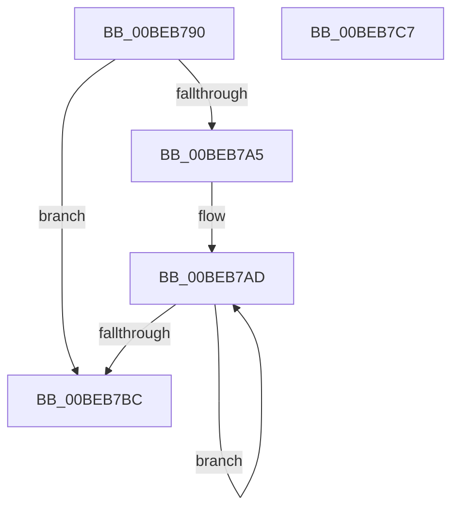

# HalpBlkMceInitialize

- RVA: `0x00BEB790`–`0x00BEB7C8` (길이 `56` bytes)
- VA: `0x0000000140BEB790`
- 실행 섹션: `MINIEX`
- PDB 이름 있음: `예`; PDB Function 태그: `아니요`
- unwind 정보 RVA: `0x000DB714`
- 디코드: `20`개 명령, `56/56` bytes 표시
- 미해석 바이트: `0` (있으면 어셈블리에 `.byte`로 보존)

> 이 문서는 커널 이미지의 기계어와 PDB 기호를 분석해 생성했습니다. 4번과 5번은 함수 원형과 자료형을 바이너리 사용 방식에서 추정한 C 해석이며 원본 소스 복구 결과는 아닙니다.

## 1. Dependencies

- 직접 호출 지점: **0**; 고유 호출 대상: **0**
- 직접 호출자로 확인된 함수: **1**
- RIP 상대 이미지 참조: **0**

### Outgoing calls
- 직접 디코드된 call 명령이 없습니다.

### Direct callers
- [HalpBlkProcessorStartup](HalpBlkProcessorStartup_function_00BEB860.md) at `0x00BEB889`

### Static image references
- 디코드된 RIP-relative 메모리 참조가 없습니다.

## 2. Other-region calls and transfers

- 다른 실행 섹션으로 향하는 call: **0**
- 별도 외부 분기/꼬리 이동을 확인하지 못했습니다.

## 3. Assembly (complete function range)

```asm
00BEB790  B9 79 01 00 00                  mov ecx, 0x179
00BEB795  0F 32                           rdmsr
00BEB797  48 C1 E2 20                     shl rdx, 0x20
00BEB79B  48 0B C2                        or rax, rdx
00BEB79E  0F B6 D0                        movzx edx, al
00BEB7A1  84 C0                           test al, al
00BEB7A3  74 17                           je 0x140beb7bc
00BEB7A5  B9 01 04 00 00                  mov ecx, 0x401
00BEB7AA  44 8B C2                        mov r8d, edx
00BEB7AD  33 C0                           xor eax, eax
00BEB7AF  33 D2                           xor edx, edx
00BEB7B1  0F 30                           wrmsr
00BEB7B3  83 C1 04                        add ecx, 4
00BEB7B6  49 83 E8 01                     sub r8, 1
00BEB7BA  75 F1                           jne 0x140beb7ad
00BEB7BC  0F 20 E0                        mov rax, cr4
00BEB7BF  48 83 C8 40                     or rax, 0x40
00BEB7C3  0F 22 E0                        mov cr4, rax
00BEB7C6  C3                              ret
00BEB7C7  CC                              int3
```

## 4. C-style interpretation (structured pseudocode)

```c
__int64 __fastcall HalpBlkMceInitialize(__int64 a1, __int64 a2)
{
    __int64 result;

    a2 = (a2) << (32);
    result = (result) | (a2);
    if ((unsigned __int8)(result) == 0) goto loc_00BEB7BC;
loc_00BEB7AD:
    result = 0;
    a2 = 0;
    a1 = (unsigned int)(((unsigned int)(0x401ULL)) + (4));
    a3 = ((unsigned int)((unsigned int)((unsigned __int8)(result)))) - (1);
    if (condition_is_not_equal) goto loc_00BEB7AD;
loc_00BEB7BC:
    result = (v_cr4) | (64);
    return result;
}
```

## 5. (Beta) C Style

```c
int64_t HalpBlkMceInitialize(int64_t Arg1, int64_t Arg2)
{
    int64_t result;

    Arg2 = (Arg2) << (32);
    result = (result) | (Arg2);
    if ((uint8_t)(result) == 0) goto loc_00BEB7BC;
loc_00BEB7AD:
    result = 0;
    Arg2 = 0;
    Arg1 = (uint32_t)(((uint32_t)(0x401ULL)) + (4));
    a3 = ((uint32_t)((uint32_t)((uint8_t)(result)))) - (1);
    if (condition_is_not_equal) goto loc_00BEB7AD;
loc_00BEB7BC:
    result = (v_cr4) | (64);
    return result;
}
```

## 6. Execution-region graph

[열기: 2D/3D 그래프와 함수 탐색 컨트롤 패널](../../../control-panel.html?section=miniex&rva=0x00BEB790&view=graph)

- 2D 그래프는 위에서 아래로 흐르고, 3D 그래프는 빈 공간을 드래그해 회전합니다. Shift+드래그는 이동, 휠은 확대·축소, 함수 노드 선택은 대상 보고서 이동입니다.

### Static fallback


