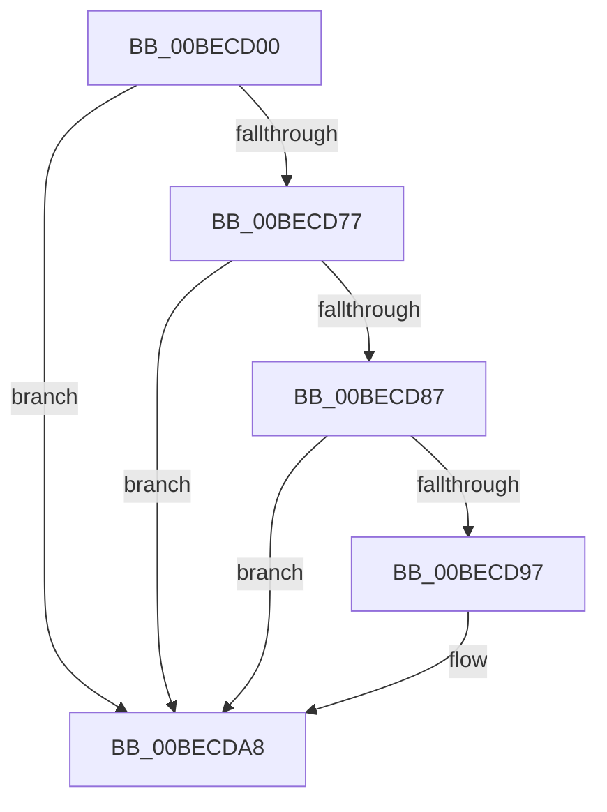

# HalpBlkNmiInterrupt

- RVA: `0x00BECD00`–`0x00BECDFC` (길이 `252` bytes)
- VA: `0x0000000140BECD00`
- 실행 섹션: `MINIEX`
- PDB 이름 있음: `예`; PDB Function 태그: `아니요`
- unwind 정보 RVA: `0x000BFD74`
- 디코드: `58`개 명령, `252/252` bytes 표시
- 미해석 바이트: `0` (있으면 어셈블리에 `.byte`로 보존)

> 이 문서는 커널 이미지의 기계어와 PDB 기호를 분석해 생성했습니다. 4번과 5번은 함수 원형과 자료형을 바이너리 사용 방식에서 추정한 C 해석이며 원본 소스 복구 결과는 아닙니다.

## 1. Dependencies

- 직접 호출 지점: **2**; 고유 호출 대상: **2**
- 직접 호출자로 확인된 함수: **0**
- RIP 상대 이미지 참조: **2**

### Outgoing calls
- `0x00BECD66` → [HalpBlkMceFastForward](HalpBlkMceFastForward_function_00BEB510.md) (function, `0x00BEB510`)
- `0x00BECDA2` → [HalpBlkFatalErrorHalt](HalpBlkFatalErrorHalt_function_00BEB900.md) (function, `0x00BEB900`)

### Direct callers
- 이 함수 시작 RVA로 연결되는 직접 call은 확인되지 않았습니다. 간접 호출은 완전히 역산할 수 없습니다.

### Static image references
- `0x00BECD77` → RVA `0x00BECD00` (`HalpBlkNmiInterrupt`; read)
- `0x00BECD87` → RVA `0x00BECDFC` (`HalpBlkNmiInterruptEnd`; read)

## 2. Other-region calls and transfers

- 다른 실행 섹션으로 향하는 call: **0**
- 별도 외부 분기/꼬리 이동을 확인하지 못했습니다.

## 3. Assembly (complete function range)

```asm
00BECD00  48 83 EC 08                     sub rsp, 8
00BECD04  55                              push rbp
00BECD05  48 81 EC 58 01 00 00            sub rsp, 0x158
00BECD0C  48 8D AC 24 80 00 00 00         lea rbp, [rsp + 0x80]
00BECD14  C6 45 AB 01                     mov byte ptr [rbp - 0x55], 1
00BECD18  48 89 45 B0                     mov qword ptr [rbp - 0x50], rax
00BECD1C  48 89 4D B8                     mov qword ptr [rbp - 0x48], rcx
00BECD20  48 89 55 C0                     mov qword ptr [rbp - 0x40], rdx
00BECD24  4C 89 45 C8                     mov qword ptr [rbp - 0x38], r8
00BECD28  4C 89 4D D0                     mov qword ptr [rbp - 0x30], r9
00BECD2C  4C 89 55 D8                     mov qword ptr [rbp - 0x28], r10
00BECD30  4C 89 5D E0                     mov qword ptr [rbp - 0x20], r11
00BECD34  FC                              cld
00BECD35  0F AE 5D AC                     stmxcsr dword ptr [rbp - 0x54]
00BECD39  68 80 1F 00 00                  push 0x1f80
00BECD3E  0F AE 14 24                     ldmxcsr dword ptr [rsp]
00BECD42  48 83 C4 08                     add rsp, 8
00BECD46  0F 29 45 F0                     movaps xmmword ptr [rbp - 0x10], xmm0
00BECD4A  0F 29 4D 00                     movaps xmmword ptr [rbp], xmm1
00BECD4E  0F 29 55 10                     movaps xmmword ptr [rbp + 0x10], xmm2
00BECD52  0F 29 5D 20                     movaps xmmword ptr [rbp + 0x20], xmm3
00BECD56  0F 29 65 30                     movaps xmmword ptr [rbp + 0x30], xmm4
00BECD5A  0F 29 6D 40                     movaps xmmword ptr [rbp + 0x40], xmm5
00BECD5E  48 8D 4D 80                     lea rcx, [rbp - 0x80]
00BECD62  33 D2                           xor edx, edx
00BECD64  FF C2                           inc edx
00BECD66  E8 A5 E7 FF FF                  call 0x140beb510
00BECD6B  65 0F BA 2C 25 A4 09 00 00 00   bts dword ptr gs:[0x9a4], 0
00BECD75  73 31                           jae 0x140becda8
00BECD77  48 8D 05 82 FF FF FF            lea rax, [rip - 0x7e]
00BECD7E  48 3B 85 E8 00 00 00            cmp rax, qword ptr [rbp + 0xe8]
00BECD85  77 21                           ja 0x140becda8
00BECD87  48 8D 05 6E 00 00 00            lea rax, [rip + 0x6e]
00BECD8E  48 3B 85 E8 00 00 00            cmp rax, qword ptr [rbp + 0xe8]
00BECD95  76 11                           jbe 0x140becda8
00BECD97  48 C7 C1 12 00 00 00            mov rcx, 0x12
00BECD9E  48 8D 55 80                     lea rdx, [rbp - 0x80]
00BECDA2  E8 59 EB FF FF                  call 0x140beb900
00BECDA7  90                              nop
00BECDA8  65 80 24 25 A4 09 00 00 00      and byte ptr gs:[0x9a4], 0
00BECDB1  4C 8B 5D E0                     mov r11, qword ptr [rbp - 0x20]
00BECDB5  4C 8B 55 D8                     mov r10, qword ptr [rbp - 0x28]
00BECDB9  4C 8B 4D D0                     mov r9, qword ptr [rbp - 0x30]
00BECDBD  4C 8B 45 C8                     mov r8, qword ptr [rbp - 0x38]
00BECDC1  48 8B 55 C0                     mov rdx, qword ptr [rbp - 0x40]
00BECDC5  48 8B 4D B8                     mov rcx, qword ptr [rbp - 0x48]
00BECDC9  48 8B 45 B0                     mov rax, qword ptr [rbp - 0x50]
00BECDCD  0F AE 55 AC                     ldmxcsr dword ptr [rbp - 0x54]
00BECDD1  0F 28 45 F0                     movaps xmm0, xmmword ptr [rbp - 0x10]
00BECDD5  0F 28 4D 00                     movaps xmm1, xmmword ptr [rbp]
00BECDD9  0F 28 55 10                     movaps xmm2, xmmword ptr [rbp + 0x10]
00BECDDD  0F 28 5D 20                     movaps xmm3, xmmword ptr [rbp + 0x20]
00BECDE1  0F 28 65 30                     movaps xmm4, xmmword ptr [rbp + 0x30]
00BECDE5  0F 28 6D 40                     movaps xmm5, xmmword ptr [rbp + 0x40]
00BECDE9  48 8B E5                        mov rsp, rbp
00BECDEC  48 8B AD D8 00 00 00            mov rbp, qword ptr [rbp + 0xd8]
00BECDF3  48 81 C4 E8 00 00 00            add rsp, 0xe8
00BECDFA  48 CF                           iretq
```

## 4. C-style interpretation (structured pseudocode)

```c
__int64 __fastcall HalpBlkNmiInterrupt(__int64 a1, __int64 a2, __int64 a3, __int64 a4)
{
    __int64 result;
    __int64 v_rsp;
    unsigned __int64 v_stack_m10;
    unsigned __int64 v_stack_m108;
    unsigned __int64 v_stack_m110;
    unsigned __int64 v_stack_m118;
    unsigned __int64 v_stack_m120;
    unsigned __int64 v_stack_m128;
    unsigned __int64 v_stack_m130;
    unsigned __int64 v_stack_m138;
    unsigned int v_stack_m13C;
    unsigned __int8 v_stack_m13D;
    unsigned __int64 v_stack_m168;
    unsigned int v_stack_m170;
    unsigned __int64 v_stack_mA8;
    unsigned __int64 v_stack_mB8;
    unsigned __int64 v_stack_mC8;
    unsigned __int64 v_stack_mD8;
    unsigned __int64 v_stack_mE8;
    unsigned __int64 v_stack_mF8;
    unsigned __int64 v_stack_p0;

    v_rsp = (v_rsp) - (8);
    v_rsp = (v_rsp) - (344);
    v_stack_m13D = 1;
    v_stack_m138 = result;
    v_stack_m130 = a1;
    v_stack_m128 = a2;
    v_stack_m120 = a3;
    v_stack_m118 = a4;
    v_stack_m110 = v_r10;
    v_stack_m108 = v_r11;
    v_rsp = (v_rsp) + (8);
    v_stack_mF8 = v_xmm0;
    v_stack_mE8 = v_xmm1;
    v_stack_mD8 = v_xmm2;
    v_stack_mC8 = v_xmm3;
    v_stack_mB8 = v_xmm4;
    v_stack_mA8 = v_xmm5;
    a2 = 0;
    a2 = (unsigned int)((a2) + 1);
    result = HalpBlkMceFastForward(v_stack_m168, a2, a3, a4);
    if (condition_is_above_or_equal) goto loc_00BECDA8;
    if ((v_rip - 126) > v_stack_p0) goto loc_00BECDA8;
    result = v_rip + 110;
    if ((v_rip + 110) >= = v_stack_p0) {
        a1 = 18;
        a2 = v_stack_m168;
        result = HalpBlkFatalErrorHalt(a1, a2, a3, a4);
    }
    v_rsp = (v_stack_mE8) + (232);
    return v_stack_m138;
}
```

## 5. (Beta) C Style

```c
int64_t HalpBlkNmiInterrupt(int64_t Arg1, int64_t Arg2, int64_t Arg3, int64_t Arg4)
{
    int64_t result;
    int64_t local_rsp;
    uint64_t v_stack_m10;
    uint64_t v_stack_m108;
    uint64_t v_stack_m110;
    uint64_t v_stack_m118;
    uint64_t v_stack_m120;
    uint64_t v_stack_m128;
    uint64_t v_stack_m130;
    uint64_t v_stack_m138;
    uint32_t v_stack_m13C;
    uint8_t v_stack_m13D;
    uint64_t v_stack_m168;
    uint32_t v_stack_m170;
    uint64_t v_stack_mA8;
    uint64_t v_stack_mB8;
    uint64_t v_stack_mC8;
    uint64_t v_stack_mD8;
    uint64_t v_stack_mE8;
    uint64_t v_stack_mF8;
    uint64_t v_stack_p0;

    local_rsp = (local_rsp) - (8);
    local_rsp = (local_rsp) - (344);
    v_stack_m13D = 1;
    v_stack_m138 = result;
    v_stack_m130 = Arg1;
    v_stack_m128 = Arg2;
    v_stack_m120 = Arg3;
    v_stack_m118 = Arg4;
    v_stack_m110 = local_r10;
    v_stack_m108 = local_r11;
    local_rsp = (local_rsp) + (8);
    v_stack_mF8 = v_xmm0;
    v_stack_mE8 = v_xmm1;
    v_stack_mD8 = v_xmm2;
    v_stack_mC8 = v_xmm3;
    v_stack_mB8 = v_xmm4;
    v_stack_mA8 = v_xmm5;
    Arg2 = 0;
    Arg2 = (uint32_t)((Arg2) + 1);
    result = HalpBlkMceFastForward(v_stack_m168, Arg2, Arg3, Arg4);
    if (condition_is_above_or_equal) goto loc_00BECDA8;
    if ((v_rip - 126) > v_stack_p0) goto loc_00BECDA8;
    result = v_rip + 110;
    if ((v_rip + 110) >= = v_stack_p0) {
        Arg1 = 18;
        Arg2 = v_stack_m168;
        result = HalpBlkFatalErrorHalt(Arg1, Arg2, Arg3, Arg4);
    }
    local_rsp = (v_stack_mE8) + (232);
    return v_stack_m138;
}
```

## 6. Execution-region graph

[열기: 2D/3D 그래프와 함수 탐색 컨트롤 패널](../../../control-panel.html?section=miniex&rva=0x00BECD00&view=graph)

- 2D 그래프는 위에서 아래로 흐르고, 3D 그래프는 빈 공간을 드래그해 회전합니다. Shift+드래그는 이동, 휠은 확대·축소, 함수 노드 선택은 대상 보고서 이동입니다.

### Static fallback


