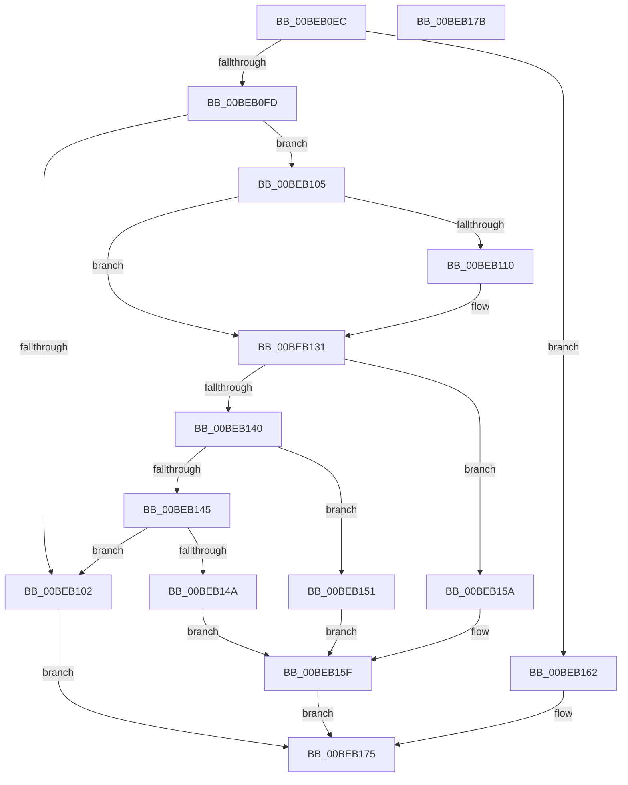

# HalpBlkPoPerformPpmOperationForIoPort

- RVA: `0x00BEB0EC`–`0x00BEB17C` (길이 `144` bytes)
- VA: `0x0000000140BEB0EC`
- 실행 섹션: `MINIEX`
- PDB 이름 있음: `예`; PDB Function 태그: `아니요`
- unwind 정보 RVA: `0x0005CF00`
- 디코드: `52`개 명령, `144/144` bytes 표시
- 미해석 바이트: `0` (있으면 어셈블리에 `.byte`로 보존)

> 이 문서는 커널 이미지의 기계어와 PDB 기호를 분석해 생성했습니다. 4번과 5번은 함수 원형과 자료형을 바이너리 사용 방식에서 추정한 C 해석이며 원본 소스 복구 결과는 아닙니다.

## 1. Dependencies

- 직접 호출 지점: **2**; 고유 호출 대상: **1**
- 직접 호출자로 확인된 함수: **1**
- RIP 상대 이미지 참조: **0**

### Outgoing calls
- `0x00BEB11A` → [HalpBlkPoReadPort](HalpBlkPoReadPort_function_00BEB184.md) (function, `0x00BEB184`)
- `0x00BEB16C` → [HalpBlkPoReadPort](HalpBlkPoReadPort_function_00BEB184.md) (function, `0x00BEB184`)

### Direct callers
- [HalpBlkPoPerformPpmOperation](HalpBlkPoPerformPpmOperation_function_00BEB008.md) at `0x00BEB0BD`

### Static image references
- 디코드된 RIP-relative 메모리 참조가 없습니다.

## 2. Other-region calls and transfers

- 다른 실행 섹션으로 향하는 call: **0**
- 별도 외부 분기/꼬리 이동을 확인하지 못했습니다.

## 3. Assembly (complete function range)

```asm
00BEB0EC  40 53                           push rbx
00BEB0EE  48 83 EC 20                     sub rsp, 0x20
00BEB0F2  4C 8B C9                        mov r9, rcx
00BEB0F5  8B 49 0C                        mov ecx, dword ptr [rcx + 0xc]
00BEB0F8  83 E9 01                        sub ecx, 1
00BEB0FB  74 65                           je 0x140beb162
00BEB0FD  83 F9 01                        cmp ecx, 1
00BEB100  74 03                           je 0x140beb105
00BEB102  CC                              int3
00BEB103  EB 70                           jmp 0x140beb175
00BEB105  41 83 79 18 00                  cmp dword ptr [r9 + 0x18], 0
00BEB10A  45 8B 51 1C                     mov r10d, dword ptr [r9 + 0x1c]
00BEB10E  74 21                           je 0x140beb131
00BEB110  41 0F B7 51 16                  movzx edx, word ptr [r9 + 0x16]
00BEB115  41 0F B7 49 14                  movzx ecx, word ptr [r9 + 0x14]
00BEB11A  E8 65 00 00 00                  call 0x140beb184
00BEB11F  41 8B 51 18                     mov edx, dword ptr [r9 + 0x18]
00BEB123  8B C8                           mov ecx, eax
00BEB125  8B C2                           mov eax, edx
00BEB127  23 D1                           and edx, ecx
00BEB129  F7 D0                           not eax
00BEB12B  44 23 D0                        and r10d, eax
00BEB12E  44 0B D2                        or r10d, edx
00BEB131  41 0F B7 49 16                  movzx ecx, word ptr [r9 + 0x16]
00BEB136  41 0F B7 51 14                  movzx edx, word ptr [r9 + 0x14]
00BEB13B  83 E9 01                        sub ecx, 1
00BEB13E  74 1A                           je 0x140beb15a
00BEB140  83 E9 01                        sub ecx, 1
00BEB143  74 0C                           je 0x140beb151
00BEB145  83 F9 02                        cmp ecx, 2
00BEB148  75 B8                           jne 0x140beb102
00BEB14A  41 8B C2                        mov eax, r10d
00BEB14D  90                              nop
00BEB14E  EF                              out dx, eax
00BEB14F  EB 0E                           jmp 0x140beb15f
00BEB151  41 0F B7 C2                     movzx eax, r10w
00BEB155  90                              nop
00BEB156  66 EF                           out dx, ax
00BEB158  EB 05                           jmp 0x140beb15f
00BEB15A  41 8A C2                        mov al, r10b
00BEB15D  90                              nop
00BEB15E  EE                              out dx, al
00BEB15F  90                              nop
00BEB160  EB 13                           jmp 0x140beb175
00BEB162  41 0F B7 51 16                  movzx edx, word ptr [r9 + 0x16]
00BEB167  41 0F B7 49 14                  movzx ecx, word ptr [r9 + 0x14]
00BEB16C  E8 13 00 00 00                  call 0x140beb184
00BEB171  41 89 41 18                     mov dword ptr [r9 + 0x18], eax
00BEB175  48 83 C4 20                     add rsp, 0x20
00BEB179  5B                              pop rbx
00BEB17A  C3                              ret
00BEB17B  CC                              int3
```

## 4. C-style interpretation (structured pseudocode)

```c
__int64 __fastcall HalpBlkPoPerformPpmOperationForIoPort(__int64 a1)
{
    __int64 result;
    __int64 v_r10;
    __int64 v_rsp;

    v_rsp = (v_rsp) - (32);
    a1 = (unsigned int)(((unsigned int)(*(unsigned int *)(a1 + 12))) - (1));
    if (condition_is_equal) goto loc_00BEB162;
    if (((unsigned int)(a1)) == 1) goto loc_00BEB105;
loc_00BEB102:
    goto loc_00BEB175;
loc_00BEB105:
    v_r10 = (unsigned int)(*(unsigned int *)(a1 + 28));
    if ((*(unsigned int *)(a1 + 24)) != 0) {
        a2 = *(unsigned __int16 *)(a1 + 22);
        a1 = *(unsigned __int16 *)(a1 + 20);
        result = HalpBlkPoReadPort(a1, a2, a3, a1);
        a2 = *(unsigned int *)(a1 + 24);
        a1 = (unsigned int)(result);
        result = (unsigned int)(a2);
        a2 = (unsigned int)((a2) & ((unsigned int)(a1)));
        result = (unsigned int)(~(result));
        v_r10 = (unsigned int)(((unsigned int)(*(unsigned int *)(a1 + 28))) & ((unsigned int)(result)));
        v_r10 = (unsigned int)((v_r10) | ((unsigned int)(a2)));
    }
    a1 = (unsigned int)((*(unsigned __int16 *)(a1 + 22)) - (1));
    if (condition_is_equal) goto loc_00BEB15A;
    a1 = (unsigned int)((a1) - (1));
    if (condition_is_equal) goto loc_00BEB151;
    if (((unsigned int)(a1)) != 2) goto loc_00BEB102;
    goto loc_00BEB15F;
loc_00BEB151:
    goto loc_00BEB15F;
loc_00BEB15A:
loc_00BEB15F:
    goto loc_00BEB175;
loc_00BEB162:
    result = HalpBlkPoReadPort(*(unsigned __int16 *)(a1 + 20), *(unsigned __int16 *)(a1 + 22), a3, a1);
    *(unsigned int *)(a1 + 24) = (unsigned int)(result);
loc_00BEB175:
    v_rsp = (v_rsp) + (32);
    return result;
}
```

## 5. (Beta) C Style

```c
int64_t HalpBlkPoPerformPpmOperationForIoPort(void *Arg1)
{
    uint8_t *arg1 = (uint8_t *)Arg1;

    int64_t result;
    int64_t local_r10;
    int64_t local_rsp;

    local_rsp = (local_rsp) - (32);
    Arg1 = (uint32_t)(((uint32_t)(*(uint32_t *)(arg1 + 0xC))) - (1));
    if (condition_is_equal) goto loc_00BEB162;
    if (((uint32_t)(Arg1)) == 1) goto loc_00BEB105;
loc_00BEB102:
    goto loc_00BEB175;
loc_00BEB105:
    local_r10 = (uint32_t)(*(uint32_t *)(arg1 + 0x1C));
    if ((*(uint32_t *)(arg1 + 0x18)) != 0) {
        a2 = *(uint16_t *)(arg1 + 0x16);
        Arg1 = *(uint16_t *)(arg1 + 0x14);
        result = HalpBlkPoReadPort(Arg1, a2, a3, Arg1);
        a2 = *(uint32_t *)(arg1 + 0x18);
        Arg1 = (uint32_t)(result);
        result = (uint32_t)(a2);
        a2 = (uint32_t)((a2) & ((uint32_t)(Arg1)));
        result = (uint32_t)(~(result));
        local_r10 = (uint32_t)(((uint32_t)(*(uint32_t *)(arg1 + 0x1C))) & ((uint32_t)(result)));
        local_r10 = (uint32_t)((local_r10) | ((uint32_t)(a2)));
    }
    Arg1 = (uint32_t)((*(uint16_t *)(arg1 + 0x16)) - (1));
    if (condition_is_equal) goto loc_00BEB15A;
    Arg1 = (uint32_t)((Arg1) - (1));
    if (condition_is_equal) goto loc_00BEB151;
    if (((uint32_t)(Arg1)) != 2) goto loc_00BEB102;
    goto loc_00BEB15F;
loc_00BEB151:
    goto loc_00BEB15F;
loc_00BEB15A:
loc_00BEB15F:
    goto loc_00BEB175;
loc_00BEB162:
    result = HalpBlkPoReadPort(*(uint16_t *)(arg1 + 0x14), *(uint16_t *)(arg1 + 0x16), a3, Arg1);
    *(uint32_t *)(arg1 + 0x18) = (uint32_t)(result);
loc_00BEB175:
    local_rsp = (local_rsp) + (32);
    return result;
}
```

### 관측된 메모리 오프셋

구조체 형식이 확인되지 않은 접근은 인자 기준의 오프셋으로만 기록했습니다.

| 기준 인자 | 오프셋 표현 | 폭 (bit) | 접근 |
|---|---:|---:|---|
| `Arg1` | `+ 0xC` | `32` | `R` |
| `Arg1` | `+ 0x14` | `16` | `R` |
| `Arg1` | `+ 0x16` | `16` | `R` |
| `Arg1` | `+ 0x18` | `32` | `R` |
| `Arg1` | `+ 0x1C` | `32` | `R` |

## 6. Execution-region graph

[열기: 2D/3D 그래프와 함수 탐색 컨트롤 패널](../../../control-panel.html?section=miniex&rva=0x00BEB0EC&view=graph)

- 2D 그래프는 위에서 아래로 흐르고, 3D 그래프는 빈 공간을 드래그해 회전합니다. Shift+드래그는 이동, 휠은 확대·축소, 함수 노드 선택은 대상 보고서 이동입니다.

### Static fallback


