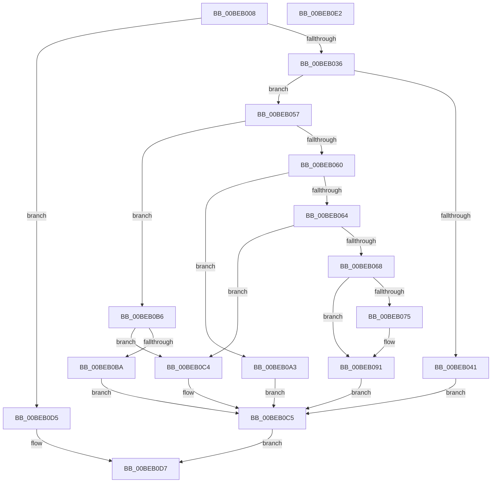

# HalpBlkPoPerformPpmOperation

- RVA: `0x00BEB008`–`0x00BEB0E3` (길이 `219` bytes)
- VA: `0x0000000140BEB008`
- 실행 섹션: `MINIEX`
- PDB 이름 있음: `예`; PDB Function 태그: `아니요`
- unwind 정보 RVA: `0x0005CAAC`
- 디코드: `65`개 명령, `219/219` bytes 표시
- 미해석 바이트: `0` (있으면 어셈블리에 `.byte`로 보존)

> 이 문서는 커널 이미지의 기계어와 PDB 기호를 분석해 생성했습니다. 4번과 5번은 함수 원형과 자료형을 바이너리 사용 방식에서 추정한 C 해석이며 원본 소스 복구 결과는 아닙니다.

## 1. Dependencies

- 직접 호출 지점: **1**; 고유 호출 대상: **1**
- 직접 호출자로 확인된 함수: **1**
- RIP 상대 이미지 참조: **0**

### Outgoing calls
- `0x00BEB0BD` → [HalpBlkPoPerformPpmOperationForIoPort](HalpBlkPoPerformPpmOperationForIoPort_function_00BEB0EC.md) (function, `0x00BEB0EC`)

### Direct callers
- [HalpBlkHandleIpi](HalpBlkHandleIpi_function_00BEB3E0.md) at `0x00BEB3E4`

### Static image references
- 디코드된 RIP-relative 메모리 참조가 없습니다.

## 2. Other-region calls and transfers

- 다른 실행 섹션으로 향하는 call: **0**
- 별도 외부 분기/꼬리 이동을 확인하지 못했습니다.

## 3. Assembly (complete function range)

```asm
00BEB008  48 89 5C 24 08                  mov qword ptr [rsp + 8], rbx
00BEB00D  57                              push rdi
00BEB00E  48 83 EC 20                     sub rsp, 0x20
00BEB012  65 48 8B 3C 25 00 00 00 00      mov rdi, qword ptr gs:[0]
00BEB01B  BA 02 00 00 00                  mov edx, 2
00BEB020  4C 8D 9F A8 08 00 00            lea r11, [rdi + 0x8a8]
00BEB027  8D 42 FF                        lea eax, [rdx - 1]
00BEB02A  F0 41 0F B1 53 08               lock cmpxchg dword ptr [r11 + 8], edx
00BEB030  0F 85 9F 00 00 00               jne 0x140beb0d5
00BEB036  41 8B 4B 0C                     mov ecx, dword ptr [r11 + 0xc]
00BEB03A  33 DB                           xor ebx, ebx
00BEB03C  83 F9 03                        cmp ecx, 3
00BEB03F  75 16                           jne 0x140beb057
00BEB041  65 48 8B 04 25 00 00 00 00      mov rax, qword ptr gs:[0]
00BEB04A  49 8B 4B 18                     mov rcx, qword ptr [r11 + 0x18]
00BEB04E  48 89 88 D0 08 00 00            mov qword ptr [rax + 0x8d0], rcx
00BEB055  EB 6E                           jmp 0x140beb0c5
00BEB057  41 8B 43 10                     mov eax, dword ptr [r11 + 0x10]
00BEB05B  83 F8 01                        cmp eax, 1
00BEB05E  75 56                           jne 0x140beb0b6
00BEB060  2B C8                           sub ecx, eax
00BEB062  74 3F                           je 0x140beb0a3
00BEB064  3B C8                           cmp ecx, eax
00BEB066  75 5C                           jne 0x140beb0c4
00BEB068  4D 8B 43 18                     mov r8, qword ptr [r11 + 0x18]
00BEB06C  4D 8B 4B 20                     mov r9, qword ptr [r11 + 0x20]
00BEB070  4D 85 C0                        test r8, r8
00BEB073  74 1C                           je 0x140beb091
00BEB075  41 8B 4B 14                     mov ecx, dword ptr [r11 + 0x14]
00BEB079  0F 32                           rdmsr
00BEB07B  48 C1 E2 20                     shl rdx, 0x20
00BEB07F  49 8B C8                        mov rcx, r8
00BEB082  48 0B C2                        or rax, rdx
00BEB085  48 F7 D1                        not rcx
00BEB088  4C 23 C9                        and r9, rcx
00BEB08B  4C 23 C0                        and r8, rax
00BEB08E  4D 0B C8                        or r9, r8
00BEB091  41 8B 4B 14                     mov ecx, dword ptr [r11 + 0x14]
00BEB095  49 8B D1                        mov rdx, r9
00BEB098  48 C1 EA 20                     shr rdx, 0x20
00BEB09C  49 8B C1                        mov rax, r9
00BEB09F  0F 30                           wrmsr
00BEB0A1  EB 22                           jmp 0x140beb0c5
00BEB0A3  41 8B 4B 14                     mov ecx, dword ptr [r11 + 0x14]
00BEB0A7  0F 32                           rdmsr
00BEB0A9  48 C1 E2 20                     shl rdx, 0x20
00BEB0AD  48 0B C2                        or rax, rdx
00BEB0B0  49 89 43 18                     mov qword ptr [r11 + 0x18], rax
00BEB0B4  EB 0F                           jmp 0x140beb0c5
00BEB0B6  3B C2                           cmp eax, edx
00BEB0B8  75 0A                           jne 0x140beb0c4
00BEB0BA  49 8B CB                        mov rcx, r11
00BEB0BD  E8 2A 00 00 00                  call 0x140beb0ec
00BEB0C2  EB 01                           jmp 0x140beb0c5
00BEB0C4  CC                              int3
00BEB0C5  F0 48 FF 87 80 00 00 00         lock inc qword ptr [rdi + 0x80]
00BEB0CD  41 87 5B 08                     xchg dword ptr [r11 + 8], ebx
00BEB0D1  B0 01                           mov al, 1
00BEB0D3  EB 02                           jmp 0x140beb0d7
00BEB0D5  32 C0                           xor al, al
00BEB0D7  48 8B 5C 24 30                  mov rbx, qword ptr [rsp + 0x30]
00BEB0DC  48 83 C4 20                     add rsp, 0x20
00BEB0E0  5F                              pop rdi
00BEB0E1  C3                              ret
00BEB0E2  CC                              int3
```

## 4. C-style interpretation (structured pseudocode)

```c
__int64 __fastcall HalpBlkPoPerformPpmOperation(void)
{
    __int64 result;
    __int64 v_rbx;
    __int64 v_rsp;
    unsigned __int64 v_stack_p8;

    v_stack_p8 = v_rbx;
    v_rsp = (v_rsp) - (32);
    if (condition_is_not_equal) goto loc_00BEB0D5;
    v_rbx = 0;
    if (((unsigned int)((unsigned int)(*(unsigned int *)(*(unsigned __int64 *)(gs_base + (0)) + 2216 + 12)))) != 3) goto loc_00BEB057;
    *(unsigned __int64 *)(*(unsigned __int64 *)(gs_base + (0)) + 2256) = *(unsigned __int64 *)(*(unsigned __int64 *)(gs_base + (0)) + 2216 + 24);
    goto loc_00BEB0C5;
loc_00BEB057:
    if (((unsigned int)((unsigned int)(*(unsigned int *)(*(unsigned __int64 *)(gs_base + (0)) + 2216 + 16)))) != 1) goto loc_00BEB0B6;
    a1 = (unsigned int)((*(unsigned __int64 *)(*(unsigned __int64 *)(gs_base + (0)) + 2216 + 24)) - ((unsigned int)((unsigned int)(*(unsigned int *)(*(unsigned __int64 *)(gs_base + (0)) + 2216 + 16)))));
    if (condition_is_equal) goto loc_00BEB0A3;
    if (((unsigned int)(a1)) != ((unsigned int)((unsigned int)(*(unsigned int *)(*(unsigned __int64 *)(gs_base + (0)) + 2216 + 16))))) goto loc_00BEB0C4;
    result = (unsigned int)(*(unsigned int *)(*(unsigned __int64 *)(gs_base + (0)) + 2216 + 16));
    if (*(unsigned __int64 *)(*(unsigned __int64 *)(gs_base + (0)) + 2216 + 24) != 0) {
        a1 = *(unsigned int *)(*(unsigned __int64 *)(gs_base + (0)) + 2216 + 20);
        a2 = (2) << (32);
        a1 = *(unsigned __int64 *)(*(unsigned __int64 *)(gs_base + (0)) + 2216 + 24);
        result = ((unsigned int)(*(unsigned int *)(*(unsigned __int64 *)(gs_base + (0)) + 2216 + 16))) | (a2);
        a1 = ~(a1);
        a4 = (*(unsigned __int64 *)(*(unsigned __int64 *)(gs_base + (0)) + 2216 + 32)) & (a1);
        a3 = (*(unsigned __int64 *)(*(unsigned __int64 *)(gs_base + (0)) + 2216 + 24)) & (result);
        a4 = (a4) | (a3);
    }
    a2 = (a4) >> (32);
    goto loc_00BEB0C5;
loc_00BEB0A3:
    a2 = (a2) << (32);
    result = (a4) | (a2);
    *(unsigned __int64 *)(*(unsigned __int64 *)(gs_base + (0)) + 2216 + 24) = result;
    goto loc_00BEB0C5;
loc_00BEB0B6:
    if (((unsigned int)(result)) != ((unsigned int)(a2))) goto loc_00BEB0C4;
    result = HalpBlkPoPerformPpmOperationForIoPort(*(unsigned __int64 *)(gs_base + (0)) + 2216, a2, a3, a4);
    goto loc_00BEB0C5;
loc_00BEB0C4:
loc_00BEB0C5:
    goto loc_00BEB0D7;
loc_00BEB0D5:
    result = 0;
loc_00BEB0D7:
    v_rsp = (v_rsp) + (32);
    return result;
}
```

## 5. (Beta) C Style

```c
void HalpBlkPoPerformPpmOperation(void)
{
    int64_t result;
    int64_t local_rbx;
    int64_t local_rsp;
    uint64_t v_stack_p8;

    v_stack_p8 = local_rbx;
    local_rsp = (local_rsp) - (32);
    if (condition_is_not_equal) goto loc_00BEB0D5;
    local_rbx = 0;
    if (((uint32_t)((uint32_t)(*(uint32_t *)(*(uint64_t *)(gs_base + (0)) + 0x8A8 + 0xC)))) != 3) goto loc_00BEB057;
    *(uint64_t *)(*(uint64_t *)(gs_base + (0)) + 0x8D0) = *(uint64_t *)(*(uint64_t *)(gs_base + (0)) + 0x8A8 + 0x18);
    goto loc_00BEB0C5;
loc_00BEB057:
    if (((uint32_t)((uint32_t)(*(uint32_t *)(*(uint64_t *)(gs_base + (0)) + 0x8A8 + 0x10)))) != 1) goto loc_00BEB0B6;
    a1 = (uint32_t)((*(uint64_t *)(*(uint64_t *)(gs_base + (0)) + 0x8A8 + 0x18)) - ((uint32_t)((uint32_t)(*(uint32_t *)(*(uint64_t *)(gs_base + (0)) + 0x8A8 + 0x10)))));
    if (condition_is_equal) goto loc_00BEB0A3;
    if (((uint32_t)(a1)) != ((uint32_t)((uint32_t)(*(uint32_t *)(*(uint64_t *)(gs_base + (0)) + 0x8A8 + 0x10))))) goto loc_00BEB0C4;
    result = (uint32_t)(*(uint32_t *)(*(uint64_t *)(gs_base + (0)) + 0x8A8 + 0x10));
    if (*(uint64_t *)(*(uint64_t *)(gs_base + (0)) + 0x8A8 + 0x18) != 0) {
        a1 = *(uint32_t *)(*(uint64_t *)(gs_base + (0)) + 0x8A8 + 0x14);
        a2 = (2) << (32);
        a1 = *(uint64_t *)(*(uint64_t *)(gs_base + (0)) + 0x8A8 + 0x18);
        result = ((uint32_t)(*(uint32_t *)(*(uint64_t *)(gs_base + (0)) + 0x8A8 + 0x10))) | (a2);
        a1 = ~(a1);
        a4 = (*(uint64_t *)(*(uint64_t *)(gs_base + (0)) + 0x8A8 + 0x20)) & (a1);
        a3 = (*(uint64_t *)(*(uint64_t *)(gs_base + (0)) + 0x8A8 + 0x18)) & (result);
        a4 = (a4) | (a3);
    }
    a2 = (a4) >> (32);
    goto loc_00BEB0C5;
loc_00BEB0A3:
    a2 = (a2) << (32);
    result = (a4) | (a2);
    *(uint64_t *)(*(uint64_t *)(gs_base + (0)) + 0x8A8 + 0x18) = result;
    goto loc_00BEB0C5;
loc_00BEB0B6:
    if (((uint32_t)(result)) != ((uint32_t)(a2))) goto loc_00BEB0C4;
    result = HalpBlkPoPerformPpmOperationForIoPort(*(uint64_t *)(gs_base + (0)) + 2216, a2, a3, a4);
    goto loc_00BEB0C5;
loc_00BEB0C4:
loc_00BEB0C5:
    goto loc_00BEB0D7;
loc_00BEB0D5:
    result = 0;
loc_00BEB0D7:
    local_rsp = (local_rsp) + (32);
    return result;
}
```

## 6. Execution-region graph

[열기: 2D/3D 그래프와 함수 탐색 컨트롤 패널](../../../control-panel.html?section=miniex&rva=0x00BEB008&view=graph)

- 2D 그래프는 위에서 아래로 흐르고, 3D 그래프는 빈 공간을 드래그해 회전합니다. Shift+드래그는 이동, 휠은 확대·축소, 함수 노드 선택은 대상 보고서 이동입니다.

### Static fallback


