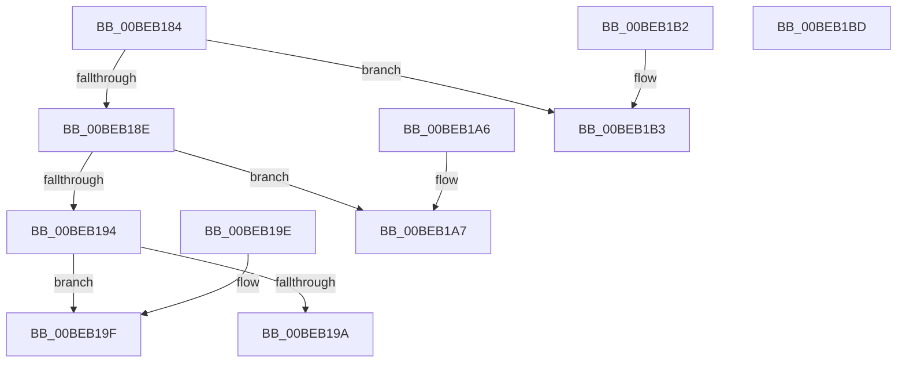

# HalpBlkPoReadPort

- RVA: `0x00BEB184`–`0x00BEB1BE` (길이 `58` bytes)
- VA: `0x0000000140BEB184`
- 실행 섹션: `MINIEX`
- PDB 이름 있음: `예`; PDB Function 태그: `아니요`
- unwind 정보 RVA: `0x000DB714`
- 디코드: `31`개 명령, `58/58` bytes 표시
- 미해석 바이트: `0` (있으면 어셈블리에 `.byte`로 보존)

> 이 문서는 커널 이미지의 기계어와 PDB 기호를 분석해 생성했습니다. 4번과 5번은 함수 원형과 자료형을 바이너리 사용 방식에서 추정한 C 해석이며 원본 소스 복구 결과는 아닙니다.

## 1. Dependencies

- 직접 호출 지점: **0**; 고유 호출 대상: **0**
- 직접 호출자로 확인된 함수: **1**
- RIP 상대 이미지 참조: **0**

### Outgoing calls
- 직접 디코드된 call 명령이 없습니다.

### Direct callers
- [HalpBlkPoPerformPpmOperationForIoPort](HalpBlkPoPerformPpmOperationForIoPort_function_00BEB0EC.md) at `0x00BEB11A`
- [HalpBlkPoPerformPpmOperationForIoPort](HalpBlkPoPerformPpmOperationForIoPort_function_00BEB0EC.md) at `0x00BEB16C`

### Static image references
- 디코드된 RIP-relative 메모리 참조가 없습니다.

## 2. Other-region calls and transfers

- 다른 실행 섹션으로 향하는 call: **0**
- 별도 외부 분기/꼬리 이동을 확인하지 못했습니다.

## 3. Assembly (complete function range)

```asm
00BEB184  44 0F B7 C2                     movzx r8d, dx
00BEB188  41 83 E8 01                     sub r8d, 1
00BEB18C  74 25                           je 0x140beb1b3
00BEB18E  41 83 E8 01                     sub r8d, 1
00BEB192  74 13                           je 0x140beb1a7
00BEB194  41 83 F8 02                     cmp r8d, 2
00BEB198  74 05                           je 0x140beb19f
00BEB19A  33 C0                           xor eax, eax
00BEB19C  CC                              int3
00BEB19D  C3                              ret
00BEB19E  CC                              int3
00BEB19F  90                              nop
00BEB1A0  0F B7 D1                        movzx edx, cx
00BEB1A3  ED                              in eax, dx
00BEB1A4  90                              nop
00BEB1A5  C3                              ret
00BEB1A6  CC                              int3
00BEB1A7  90                              nop
00BEB1A8  0F B7 D1                        movzx edx, cx
00BEB1AB  66 ED                           in ax, dx
00BEB1AD  0F B7 C0                        movzx eax, ax
00BEB1B0  90                              nop
00BEB1B1  C3                              ret
00BEB1B2  CC                              int3
00BEB1B3  90                              nop
00BEB1B4  0F B7 D1                        movzx edx, cx
00BEB1B7  EC                              in al, dx
00BEB1B8  0F B6 C0                        movzx eax, al
00BEB1BB  90                              nop
00BEB1BC  C3                              ret
00BEB1BD  CC                              int3
```

## 4. C-style interpretation (structured pseudocode)

```c
__int64 __fastcall HalpBlkPoReadPort(unsigned __int16 a1, unsigned __int16 a2)
{
    __int64 result;

    a3 = (unsigned int)((a2) - (1));
    if (condition_is_equal) goto loc_00BEB1B3;
    a3 = (unsigned int)((a3) - (1));
    if (condition_is_equal) goto loc_00BEB1A7;
    if (((unsigned int)(a3)) == 2) goto loc_00BEB19F;
    result = 0;
    return result;
loc_00BEB19F:
    return result;
loc_00BEB1A7:
    return 0;
loc_00BEB1B3:
    return 0;
}
```

## 5. (Beta) C Style

```c
int64_t HalpBlkPoReadPort(uint16_t Arg1, uint16_t Arg2)
{
    int64_t result;

    a3 = (uint32_t)((Arg2) - (1));
    if (condition_is_equal) goto loc_00BEB1B3;
    a3 = (uint32_t)((a3) - (1));
    if (condition_is_equal) goto loc_00BEB1A7;
    if (((uint32_t)(a3)) == 2) goto loc_00BEB19F;
    result = 0;
    return result;
loc_00BEB19F:
    return result;
loc_00BEB1A7:
    return 0;
loc_00BEB1B3:
    return 0;
}
```

## 6. Execution-region graph

[열기: 2D/3D 그래프와 함수 탐색 컨트롤 패널](../../../control-panel.html?section=miniex&rva=0x00BEB184&view=graph)

- 2D 그래프는 위에서 아래로 흐르고, 3D 그래프는 빈 공간을 드래그해 회전합니다. Shift+드래그는 이동, 휠은 확대·축소, 함수 노드 선택은 대상 보고서 이동입니다.

### Static fallback


