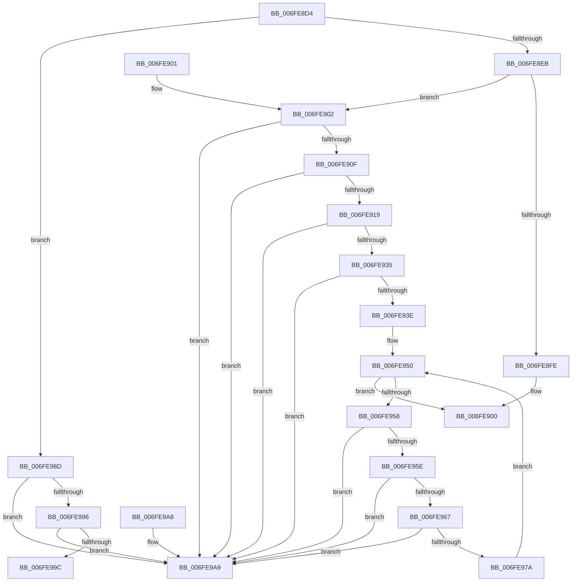

# AlpcpAllocateMessageLog

- RVA: `0x006FE8D4`–`0x006FE9B0` (길이 `220` bytes)
- VA: `0x00000001406FE8D4`
- 실행 섹션: `PAGE`
- PDB 이름 있음: `예`; PDB Function 태그: `아니요`
- unwind 정보 RVA: `0x000DB714`
- 디코드: `59`개 명령, `220/220` bytes 표시
- 미해석 바이트: `0` (있으면 어셈블리에 `.byte`로 보존)

> 이 문서는 커널 이미지의 기계어와 PDB 기호를 분석해 생성했습니다. 4번과 5번은 함수 원형과 자료형을 바이너리 사용 방식에서 추정한 C 해석이며 원본 소스 복구 결과는 아닙니다.

## 1. Dependencies

- 직접 호출 지점: **0**; 고유 호출 대상: **0**
- 직접 호출자로 확인된 함수: **1**
- RIP 상대 이미지 참조: **7**

### Outgoing calls
- 직접 디코드된 call 명령이 없습니다.

### Direct callers
- [AlpcpEnterAllocationEventMessageLog](../88/AlpcpEnterAllocationEventMessageLog_function_0088B840.md) at `0x0088B888`

### Static image references
- `0x006FE8D4` → RVA `0x00F100C0` (`.data`; read)
- `0x006FE8EB` → RVA `0x00F100B0` (`.data`; read)
- `0x006FE919` → RVA `0x00F100B0` (`.data`; write)
- `0x006FE941` → RVA `0x00F10090` (`.data`; read)
- `0x006FE96E` → RVA `0x00F10098` (`.data`; read)
- `0x006FE984` → RVA `0x00F10098` (`.data`; write)
- `0x006FE99C` → RVA `0x00F100C0` (`.data`; write)

## 2. Other-region calls and transfers

- 다른 실행 섹션으로 향하는 call: **0**
- 별도 외부 분기/꼬리 이동을 확인하지 못했습니다.

## 3. Assembly (complete function range)

```asm
006FE8D4  48 8B 05 E5 17 81 00            mov rax, qword ptr [rip + 0x8117e5]
006FE8DB  48 8D 15 DE 17 81 00            lea rdx, [rip + 0x8117de]
006FE8E2  48 3B C2                        cmp rax, rdx
006FE8E5  0F 85 A2 00 00 00               jne 0x1406fe98d
006FE8EB  48 8B 05 BE 17 81 00            mov rax, qword ptr [rip + 0x8117be]
006FE8F2  48 8D 15 B7 17 81 00            lea rdx, [rip + 0x8117b7]
006FE8F9  48 3B C2                        cmp rax, rdx
006FE8FC  75 04                           jne 0x1406fe902
006FE8FE  33 C0                           xor eax, eax
006FE900  C3                              ret
006FE901  CC                              int3
006FE902  48 8B 08                        mov rcx, qword ptr [rax]
006FE905  48 39 50 08                     cmp qword ptr [rax + 8], rdx
006FE909  0F 85 9A 00 00 00               jne 0x1406fe9a9
006FE90F  48 39 41 08                     cmp qword ptr [rcx + 8], rax
006FE913  0F 85 90 00 00 00               jne 0x1406fe9a9
006FE919  48 89 0D 90 17 81 00            mov qword ptr [rip + 0x811790], rcx
006FE920  48 89 51 08                     mov qword ptr [rcx + 8], rdx
006FE924  48 8D 48 10                     lea rcx, [rax + 0x10]
006FE928  83 60 2C 00                     and dword ptr [rax + 0x2c], 0
006FE92C  4C 8B 01                        mov r8, qword ptr [rcx]
006FE92F  49 39 48 08                     cmp qword ptr [r8 + 8], rcx
006FE933  75 74                           jne 0x1406fe9a9
006FE935  48 8B 51 08                     mov rdx, qword ptr [rcx + 8]
006FE939  48 39 0A                        cmp qword ptr [rdx], rcx
006FE93C  75 6B                           jne 0x1406fe9a9
006FE93E  4C 89 02                        mov qword ptr [rdx], r8
006FE941  4C 8D 0D 48 17 81 00            lea r9, [rip + 0x811748]
006FE948  49 89 50 08                     mov qword ptr [r8 + 8], rdx
006FE94C  48 8D 50 30                     lea rdx, [rax + 0x30]
006FE950  48 8B 0A                        mov rcx, qword ptr [rdx]
006FE953  48 3B CA                        cmp rcx, rdx
006FE956  74 A8                           je 0x1406fe900
006FE958  48 39 51 08                     cmp qword ptr [rcx + 8], rdx
006FE95C  75 4B                           jne 0x1406fe9a9
006FE95E  4C 8B 01                        mov r8, qword ptr [rcx]
006FE961  49 39 48 08                     cmp qword ptr [r8 + 8], rcx
006FE965  75 42                           jne 0x1406fe9a9
006FE967  4C 89 02                        mov qword ptr [rdx], r8
006FE96A  49 89 50 08                     mov qword ptr [r8 + 8], rdx
006FE96E  4C 8B 05 23 17 81 00            mov r8, qword ptr [rip + 0x811723]
006FE975  4D 39 08                        cmp qword ptr [r8], r9
006FE978  75 2F                           jne 0x1406fe9a9
006FE97A  4C 89 09                        mov qword ptr [rcx], r9
006FE97D  4C 89 41 08                     mov qword ptr [rcx + 8], r8
006FE981  49 89 08                        mov qword ptr [r8], rcx
006FE984  48 89 0D 0D 17 81 00            mov qword ptr [rip + 0x81170d], rcx
006FE98B  EB C3                           jmp 0x1406fe950
006FE98D  48 8B 08                        mov rcx, qword ptr [rax]
006FE990  48 39 50 08                     cmp qword ptr [rax + 8], rdx
006FE994  75 13                           jne 0x1406fe9a9
006FE996  48 39 41 08                     cmp qword ptr [rcx + 8], rax
006FE99A  75 0D                           jne 0x1406fe9a9
006FE99C  48 89 0D 1D 17 81 00            mov qword ptr [rip + 0x81171d], rcx
006FE9A3  48 89 51 08                     mov qword ptr [rcx + 8], rdx
006FE9A7  C3                              ret
006FE9A8  CC                              int3
006FE9A9  B9 03 00 00 00                  mov ecx, 3
006FE9AE  CD 29                           int 0x29
```

## 4. C-style interpretation (structured pseudocode)

```c
__int64 __fastcall AlpcpAllocateMessageLog(void)
{
    __int64 result;

    if ((*(unsigned __int64 *)(v_rip + 8460261)) != (v_rip + 8460254)) goto loc_006FE98D;
    if ((*(unsigned __int64 *)(v_rip + 8460222)) != (v_rip + 8460215)) goto loc_006FE902;
    result = 0;
loc_006FE900:
    return result;
loc_006FE902:
    if ((*(unsigned __int64 *)(result + 8)) != (v_rip + 8460215)) goto loc_006FE9A9;
    if ((*(unsigned __int64 *)(*(unsigned __int64 *)(result) + 8)) != 0) goto loc_006FE9A9;
    *(unsigned __int64 *)(v_rip + 8460176) = *(unsigned __int64 *)(result);
    *(unsigned __int64 *)(*(unsigned __int64 *)(result) + 8) = v_rip + 8460215;
    if ((*(unsigned __int64 *)(*(unsigned __int64 *)(result + 16) + 8)) != (result + 16)) goto loc_006FE9A9;
    if ((*(unsigned __int64 *)(*(unsigned __int64 *)(result + 16 + 8))) != (result + 16)) goto loc_006FE9A9;
    *(unsigned __int64 *)(*(unsigned __int64 *)(result + 16 + 8)) = *(unsigned __int64 *)(result + 16);
    *(unsigned __int64 *)(*(unsigned __int64 *)(result + 16) + 8) = *(unsigned __int64 *)(result + 16 + 8);
loc_006FE950:
    if ((*(unsigned __int64 *)(result + 48)) == (result + 48)) goto loc_006FE900;
    if ((*(unsigned __int64 *)(*(unsigned __int64 *)(result + 48) + 8)) != (result + 48)) goto loc_006FE9A9;
    if ((*(unsigned __int64 *)(*(unsigned __int64 *)(*(unsigned __int64 *)(result + 48)) + 8)) != (*(unsigned __int64 *)(result + 48))) goto loc_006FE9A9;
    *(unsigned __int64 *)(result + 48) = *(unsigned __int64 *)(*(unsigned __int64 *)(result + 48));
    *(unsigned __int64 *)(*(unsigned __int64 *)(*(unsigned __int64 *)(result + 48)) + 8) = result + 48;
    if ((*(unsigned __int64 *)(*(unsigned __int64 *)(v_rip + 8460067))) != (v_rip + 8460104)) goto loc_006FE9A9;
    *(unsigned __int64 *)(*(unsigned __int64 *)(result + 48)) = v_rip + 8460104;
    *(unsigned __int64 *)(*(unsigned __int64 *)(result + 48) + 8) = *(unsigned __int64 *)(v_rip + 8460067);
    *(unsigned __int64 *)(*(unsigned __int64 *)(v_rip + 8460067)) = *(unsigned __int64 *)(result + 48);
    *(unsigned __int64 *)(v_rip + 8460045) = *(unsigned __int64 *)(result + 48);
    goto loc_006FE950;
loc_006FE98D:
    if ((*(unsigned __int64 *)(result + 8)) != (result + 48)) goto loc_006FE9A9;
    if ((*(unsigned __int64 *)(*(unsigned __int64 *)(result) + 8)) != 0) goto loc_006FE9A9;
    *(unsigned __int64 *)(v_rip + 8460061) = *(unsigned __int64 *)(result);
    *(unsigned __int64 *)(*(unsigned __int64 *)(result) + 8) = result + 48;
    return result;
loc_006FE9A9:
    return result;
}
```

## 5. (Beta) C Style

```c
void AlpcpAllocateMessageLog(void)
{
    int64_t result;

    if ((*(uint64_t *)(v_rip + 0x8117E5)) != (v_rip + 8460254)) goto loc_006FE98D;
    if ((*(uint64_t *)(v_rip + 0x8117BE)) != (v_rip + 8460215)) goto loc_006FE902;
    result = 0;
loc_006FE900:
    return result;
loc_006FE902:
    if ((*(uint64_t *)(result + 0x8)) != (v_rip + 8460215)) goto loc_006FE9A9;
    if ((*(uint64_t *)(*(uint64_t *)(result) + 0x8)) != 0) goto loc_006FE9A9;
    *(uint64_t *)(v_rip + 0x811790) = *(uint64_t *)(result);
    *(uint64_t *)(*(uint64_t *)(result) + 0x8) = v_rip + 8460215;
    if ((*(uint64_t *)(*(uint64_t *)(result + 0x10) + 0x8)) != (result + 16)) goto loc_006FE9A9;
    if ((*(uint64_t *)(*(uint64_t *)(result + 0x10 + 0x8))) != (result + 16)) goto loc_006FE9A9;
    *(uint64_t *)(*(uint64_t *)(result + 0x10 + 0x8)) = *(uint64_t *)(result + 0x10);
    *(uint64_t *)(*(uint64_t *)(result + 0x10) + 0x8) = *(uint64_t *)(result + 0x10 + 0x8);
loc_006FE950:
    if ((*(uint64_t *)(result + 0x30)) == (result + 48)) goto loc_006FE900;
    if ((*(uint64_t *)(*(uint64_t *)(result + 0x30) + 0x8)) != (result + 48)) goto loc_006FE9A9;
    if ((*(uint64_t *)(*(uint64_t *)(*(uint64_t *)(result + 0x30)) + 0x8)) != (*(uint64_t *)(result + 0x30))) goto loc_006FE9A9;
    *(uint64_t *)(result + 0x30) = *(uint64_t *)(*(uint64_t *)(result + 0x30));
    *(uint64_t *)(*(uint64_t *)(*(uint64_t *)(result + 0x30)) + 0x8) = result + 48;
    if ((*(uint64_t *)(*(uint64_t *)(v_rip + 0x811723))) != (v_rip + 8460104)) goto loc_006FE9A9;
    *(uint64_t *)(*(uint64_t *)(result + 0x30)) = v_rip + 8460104;
    *(uint64_t *)(*(uint64_t *)(result + 0x30) + 0x8) = *(uint64_t *)(v_rip + 0x811723);
    *(uint64_t *)(*(uint64_t *)(v_rip + 0x811723)) = *(uint64_t *)(result + 0x30);
    *(uint64_t *)(v_rip + 0x81170D) = *(uint64_t *)(result + 0x30);
    goto loc_006FE950;
loc_006FE98D:
    if ((*(uint64_t *)(result + 0x8)) != (result + 48)) goto loc_006FE9A9;
    if ((*(uint64_t *)(*(uint64_t *)(result) + 0x8)) != 0) goto loc_006FE9A9;
    *(uint64_t *)(v_rip + 0x81171D) = *(uint64_t *)(result);
    *(uint64_t *)(*(uint64_t *)(result) + 0x8) = result + 48;
    return result;
loc_006FE9A9:
    return result;
}
```

## 6. Execution-region graph

[열기: 2D/3D 그래프와 함수 탐색 컨트롤 패널](../../../control-panel.html?section=page&rva=0x006FE8D4&view=graph)

- 2D 그래프는 위에서 아래로 흐르고, 3D 그래프는 빈 공간을 드래그해 회전합니다. Shift+드래그는 이동, 휠은 확대·축소, 함수 노드 선택은 대상 보고서 이동입니다.

### Static fallback


