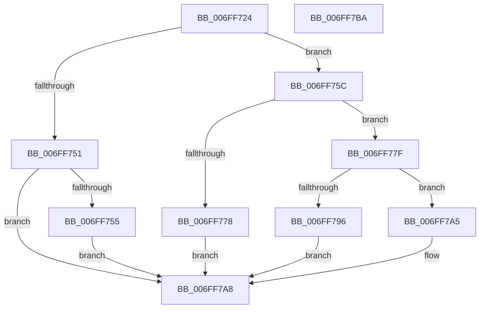

# BiGetSystemPartition

- RVA: `0x006FF724`–`0x006FF7BB` (길이 `151` bytes)
- VA: `0x00000001406FF724`
- 실행 섹션: `PAGE`
- PDB 이름 있음: `예`; PDB Function 태그: `아니요`
- unwind 정보 RVA: `0x000B6464`
- 디코드: `46`개 명령, `151/151` bytes 표시
- 미해석 바이트: `0` (있으면 어셈블리에 `.byte`로 보존)

> 이 문서는 커널 이미지의 기계어와 PDB 기호를 분석해 생성했습니다. 4번과 5번은 함수 원형과 자료형을 바이너리 사용 방식에서 추정한 C 해석이며 원본 소스 복구 결과는 아닙니다.

## 1. Dependencies

- 직접 호출 지점: **4**; 고유 호출 대상: **3**
- 직접 호출자로 확인된 함수: **1**
- RIP 상대 이미지 참조: **0**

### Outgoing calls
- `0x006FF743` → [SyspartGetFirmwarePartition](SyspartGetFirmwarePartition_function_006FF7C4.md) (function, `0x006FF7C4`)
- `0x006FF76B` → [ExAllocatePool2](../../poolcode/B8/ExAllocatePool2_function_00B820F0.md) (function, `0x00B820F0`)
- `0x006FF78B` → [SyspartGetFirmwarePartition](SyspartGetFirmwarePartition_function_006FF7C4.md) (function, `0x006FF7C4`)
- `0x006FF79E` → [ExFreePoolWithTag](../../poolcode/B8/ExFreePoolWithTag_function_00B82870.md) (function, `0x00B82870`)

### Direct callers
- [BcdGetSystemStorePath](../A3/BcdGetSystemStorePath_function_00A3C340.md) at `0x00A3C463`

### Static image references
- 디코드된 RIP-relative 메모리 참조가 없습니다.

## 2. Other-region calls and transfers

- 다른 실행 섹션으로 향하는 call: **2**
  - `0x006FF76B` → [ExAllocatePool2](../../poolcode/B8/ExAllocatePool2_function_00B820F0.md) (`PAGE` → `POOLCODE`)
  - `0x006FF79E` → [ExFreePoolWithTag](../../poolcode/B8/ExFreePoolWithTag_function_00B82870.md) (`PAGE` → `POOLCODE`)
- 별도 외부 분기/꼬리 이동을 확인하지 못했습니다.

## 3. Assembly (complete function range)

```asm
006FF724  48 8B C4                        mov rax, rsp
006FF727  48 89 58 08                     mov qword ptr [rax + 8], rbx
006FF72B  48 89 70 18                     mov qword ptr [rax + 0x18], rsi
006FF72F  57                              push rdi
006FF730  48 83 EC 20                     sub rsp, 0x20
006FF734  83 60 10 00                     and dword ptr [rax + 0x10], 0
006FF738  4C 8D 40 10                     lea r8, [rax + 0x10]
006FF73C  48 8B F1                        mov rsi, rcx
006FF73F  33 D2                           xor edx, edx
006FF741  33 C9                           xor ecx, ecx
006FF743  E8 7C 00 00 00                  call 0x1406ff7c4
006FF748  8B D8                           mov ebx, eax
006FF74A  3D 23 00 00 C0                  cmp eax, 0xc0000023
006FF74F  74 0B                           je 0x1406ff75c
006FF751  85 C0                           test eax, eax
006FF753  78 53                           js 0x1406ff7a8
006FF755  BB 01 00 00 C0                  mov ebx, 0xc0000001
006FF75A  EB 4C                           jmp 0x1406ff7a8
006FF75C  8B 54 24 38                     mov edx, dword ptr [rsp + 0x38]
006FF760  B9 02 01 00 00                  mov ecx, 0x102
006FF765  41 B8 42 43 44 4B               mov r8d, 0x4b444342
006FF76B  E8 80 29 48 00                  call 0x140b820f0
006FF770  48 8B F8                        mov rdi, rax
006FF773  48 85 C0                        test rax, rax
006FF776  75 07                           jne 0x1406ff77f
006FF778  BB 17 00 00 C0                  mov ebx, 0xc0000017
006FF77D  EB 29                           jmp 0x1406ff7a8
006FF77F  8B 54 24 38                     mov edx, dword ptr [rsp + 0x38]
006FF783  4C 8D 44 24 38                  lea r8, [rsp + 0x38]
006FF788  48 8B CF                        mov rcx, rdi
006FF78B  E8 34 00 00 00                  call 0x1406ff7c4
006FF790  8B D8                           mov ebx, eax
006FF792  85 C0                           test eax, eax
006FF794  79 0F                           jns 0x1406ff7a5
006FF796  BA 42 43 44 4B                  mov edx, 0x4b444342
006FF79B  48 8B CF                        mov rcx, rdi
006FF79E  E8 CD 30 48 00                  call 0x140b82870
006FF7A3  EB 03                           jmp 0x1406ff7a8
006FF7A5  48 89 3E                        mov qword ptr [rsi], rdi
006FF7A8  48 8B 74 24 40                  mov rsi, qword ptr [rsp + 0x40]
006FF7AD  8B C3                           mov eax, ebx
006FF7AF  48 8B 5C 24 30                  mov rbx, qword ptr [rsp + 0x30]
006FF7B4  48 83 C4 20                     add rsp, 0x20
006FF7B8  5F                              pop rdi
006FF7B9  C3                              ret
006FF7BA  CC                              int3
```

## 4. C-style interpretation (structured pseudocode)

```c
__int64 __fastcall BiGetSystemPartition(__int64 a1, int a2)
{
    __int64 result;
    __int64 v_rsp;
    unsigned int v_stack_p10;
    unsigned __int64 v_stack_p18;
    unsigned __int64 v_stack_p8;

    *(unsigned __int64 *)(v_rsp + 8) = v_rbx;
    *(unsigned __int64 *)(v_rsp + 24) = v_rsi;
    v_rsp = (v_rsp) - (32);
    a2 = 0;
    a1 = 0;
    result = SyspartGetFirmwarePartition(a1, a2, v_rsp + 16, a4);
    if (((unsigned int)(result)) == 0xC0000023ULL) goto loc_006FF75C;
    if (sign_flag) goto loc_006FF7A8;
    goto loc_006FF7A8;
loc_006FF75C:
    result = ExAllocatePool2(258, (unsigned int)(v_stack_p10), (unsigned int)(0x4B444342ULL), a4);
    if (result != 0) goto loc_006FF77F;
    goto loc_006FF7A8;
loc_006FF77F:
    result = SyspartGetFirmwarePartition(result, (unsigned int)(v_stack_p10), v_stack_p10, a4);
    if (!sign_flag) goto loc_006FF7A5;
    result = ExFreePoolWithTag(result, (unsigned int)(0x4B444342ULL), v_stack_p10, a4);
    goto loc_006FF7A8;
loc_006FF7A5:
    *(unsigned __int64 *)(a1) = result;
loc_006FF7A8:
    v_rsp = (v_rsp) + (32);
    return (unsigned int)((unsigned int)((unsigned int)((unsigned int)(result))));
}
```

## 5. (Beta) C Style

```c
int64_t BiGetSystemPartition(void *Arg1, int32_t Arg2)
{
    uint8_t *arg1 = (uint8_t *)Arg1;

    int64_t result;
    int64_t local_rsp;
    uint32_t v_stack_p10;
    uint64_t v_stack_p18;
    uint64_t v_stack_p8;

    *(uint64_t *)(local_rsp + 0x8) = local_rbx;
    *(uint64_t *)(local_rsp + 0x18) = local_rsi;
    local_rsp = (local_rsp) - (32);
    Arg2 = 0;
    Arg1 = 0;
    result = SyspartGetFirmwarePartition(Arg1, Arg2, local_rsp + 16, a4);
    if (((uint32_t)(result)) == 0xC0000023ULL) goto loc_006FF75C;
    if (sign_flag) goto loc_006FF7A8;
    goto loc_006FF7A8;
loc_006FF75C:
    result = ExAllocatePool2(258, (uint32_t)(v_stack_p10), (uint32_t)(0x4B444342ULL), a4);
    if (result != 0) goto loc_006FF77F;
    goto loc_006FF7A8;
loc_006FF77F:
    result = SyspartGetFirmwarePartition(result, (uint32_t)(v_stack_p10), v_stack_p10, a4);
    if (!sign_flag) goto loc_006FF7A5;
    result = ExFreePoolWithTag(result, (uint32_t)(0x4B444342ULL), v_stack_p10, a4);
    goto loc_006FF7A8;
loc_006FF7A5:
    *(uint64_t *)(arg1) = result;
loc_006FF7A8:
    local_rsp = (local_rsp) + (32);
    return (uint32_t)((uint32_t)((uint32_t)((uint32_t)(result))));
}
```

### 관측된 메모리 오프셋

구조체 형식이 확인되지 않은 접근은 인자 기준의 오프셋으로만 기록했습니다.

| 기준 인자 | 오프셋 표현 | 폭 (bit) | 접근 |
|---|---:|---:|---|
| `Arg1` | `+ 0x0` | `64` | `W` |

## 6. Execution-region graph

[열기: 2D/3D 그래프와 함수 탐색 컨트롤 패널](../../../control-panel.html?section=page&rva=0x006FF724&view=graph)

- 2D 그래프는 위에서 아래로 흐르고, 3D 그래프는 빈 공간을 드래그해 회전합니다. Shift+드래그는 이동, 휠은 확대·축소, 함수 노드 선택은 대상 보고서 이동입니다.

### Static fallback


