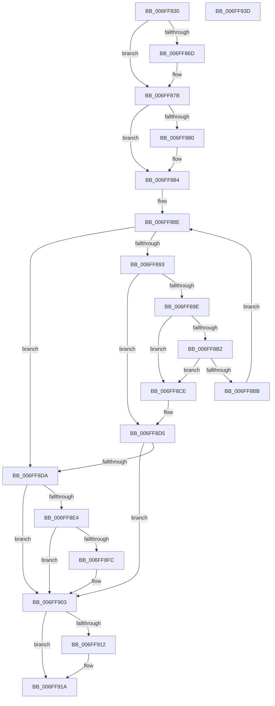

# CmFcpManagerOnFeatureUsageDataTransferComplete

- RVA: `0x006FF830`–`0x006FF93E` (길이 `270` bytes)
- VA: `0x00000001406FF830`
- 실행 섹션: `PAGE`
- PDB 이름 있음: `예`; PDB Function 태그: `아니요`
- unwind 정보 RVA: `0x0005E6B4`
- 디코드: `79`개 명령, `270/270` bytes 표시
- 미해석 바이트: `0` (있으면 어셈블리에 `.byte`로 보존)

> 이 문서는 커널 이미지의 기계어와 PDB 기호를 분석해 생성했습니다. 4번과 5번은 함수 원형과 자료형을 바이너리 사용 방식에서 추정한 C 해석이며 원본 소스 복구 결과는 아닙니다.

## 1. Dependencies

- 직접 호출 지점: **6**; 고유 호출 대상: **6**
- 직접 호출자로 확인된 함수: **1**
- RIP 상대 이미지 참조: **0**

### Outgoing calls
- `0x006FF85D` → [KeAbPreAcquire](../../text/21/KeAbPreAcquire_function_00210230.md) (function, `0x00210230`)
- `0x006FF876` → [ExfAcquirePushLockExclusiveEx](../../text/20/ExfAcquirePushLockExclusiveEx_function_0020FC90.md) (function, `0x0020FC90`)
- `0x006FF8C4` → [ExFreePoolWithTag](../../poolcode/B8/ExFreePoolWithTag_function_00B82870.md) (function, `0x00B82870`)
- `0x006FF8FE` → [ExfUnblockPushLock](../../text/2A/ExfUnblockPushLock_function_002A3FE0.md) (function, `0x002A3FE0`)
- `0x006FF915` → [ExfTryToWakePushLock](../../text/26/ExfTryToWakePushLock_function_00265DD0.md) (function, `0x00265DD0`)
- `0x006FF91D` → [KeAbPostRelease](../../text/2E/KeAbPostRelease_function_002E1600.md) (function, `0x002E1600`)

### Direct callers
- [CmFcpManagerPublishFeatureUsageDataBuffers](../A9/CmFcpManagerPublishFeatureUsageDataBuffers_function_00A9677C.md) at `0x00A96941`

### Static image references
- 디코드된 RIP-relative 메모리 참조가 없습니다.

## 2. Other-region calls and transfers

- 다른 실행 섹션으로 향하는 call: **6**
  - `0x006FF85D` → [KeAbPreAcquire](../../text/21/KeAbPreAcquire_function_00210230.md) (`PAGE` → `.text`)
  - `0x006FF876` → [ExfAcquirePushLockExclusiveEx](../../text/20/ExfAcquirePushLockExclusiveEx_function_0020FC90.md) (`PAGE` → `.text`)
  - `0x006FF8C4` → [ExFreePoolWithTag](../../poolcode/B8/ExFreePoolWithTag_function_00B82870.md) (`PAGE` → `POOLCODE`)
  - `0x006FF8FE` → [ExfUnblockPushLock](../../text/2A/ExfUnblockPushLock_function_002A3FE0.md) (`PAGE` → `.text`)
  - `0x006FF915` → [ExfTryToWakePushLock](../../text/26/ExfTryToWakePushLock_function_00265DD0.md) (`PAGE` → `.text`)
  - `0x006FF91D` → [KeAbPostRelease](../../text/2E/KeAbPostRelease_function_002E1600.md) (`PAGE` → `.text`)
- 별도 외부 분기/꼬리 이동을 확인하지 못했습니다.

## 3. Assembly (complete function range)

```asm
006FF830  48 8B C4                        mov rax, rsp
006FF833  48 89 58 08                     mov qword ptr [rax + 8], rbx
006FF837  48 89 68 10                     mov qword ptr [rax + 0x10], rbp
006FF83B  48 89 70 18                     mov qword ptr [rax + 0x18], rsi
006FF83F  48 89 78 20                     mov qword ptr [rax + 0x20], rdi
006FF843  41 56                           push r14
006FF845  48 83 EC 20                     sub rsp, 0x20
006FF849  48 8D 99 D8 05 00 00            lea rbx, [rcx + 0x5d8]
006FF850  48 8B F9                        mov rdi, rcx
006FF853  48 8B CB                        mov rcx, rbx
006FF856  45 33 C0                        xor r8d, r8d
006FF859  33 D2                           xor edx, edx
006FF85B  33 ED                           xor ebp, ebp
006FF85D  E8 CE 09 B1 FF                  call 0x140210230
006FF862  F0 48 0F BA 2B 00               lock bts qword ptr [rbx], 0
006FF868  48 8B F0                        mov rsi, rax
006FF86B  73 0E                           jae 0x1406ff87b
006FF86D  4C 8B C3                        mov r8, rbx
006FF870  48 8B D0                        mov rdx, rax
006FF873  48 8B CB                        mov rcx, rbx
006FF876  E8 15 04 B1 FF                  call 0x14020fc90
006FF87B  48 85 F6                        test rsi, rsi
006FF87E  74 04                           je 0x1406ff884
006FF880  C6 46 0A 01                     mov byte ptr [rsi + 0xa], 1
006FF884  48 8D B7 B0 05 00 00            lea rsi, [rdi + 0x5b0]
006FF88B  48 8B 0E                        mov rcx, qword ptr [rsi]
006FF88E  48 3B CE                        cmp rcx, rsi
006FF891  74 47                           je 0x1406ff8da
006FF893  8B 51 18                        mov edx, dword ptr [rcx + 0x18]
006FF896  8B C2                           mov eax, edx
006FF898  24 07                           and al, 7
006FF89A  3C 01                           cmp al, 1
006FF89C  74 37                           je 0x1406ff8d5
006FF89E  4C 8B 31                        mov r14, qword ptr [rcx]
006FF8A1  8B EA                           mov ebp, edx
006FF8A3  C1 ED 03                        shr ebp, 3
006FF8A6  81 E5 FE FF FF 1F               and ebp, 0x1ffffffe
006FF8AC  49 39 4E 08                     cmp qword ptr [r14 + 8], rcx
006FF8B0  75 1C                           jne 0x1406ff8ce
006FF8B2  48 8B 41 08                     mov rax, qword ptr [rcx + 8]
006FF8B6  48 39 08                        cmp qword ptr [rax], rcx
006FF8B9  75 13                           jne 0x1406ff8ce
006FF8BB  4C 89 30                        mov qword ptr [rax], r14
006FF8BE  33 D2                           xor edx, edx
006FF8C0  49 89 46 08                     mov qword ptr [r14 + 8], rax
006FF8C4  E8 A7 2F 48 00                  call 0x140b82870
006FF8C9  49 8B CE                        mov rcx, r14
006FF8CC  EB C0                           jmp 0x1406ff88e
006FF8CE  B9 03 00 00 00                  mov ecx, 3
006FF8D3  CD 29                           int 0x29
006FF8D5  48 3B 0E                        cmp rcx, qword ptr [rsi]
006FF8D8  74 29                           je 0x1406ff903
006FF8DA  8B 87 34 07 00 00               mov eax, dword ptr [rdi + 0x734]
006FF8E0  3B C5                           cmp eax, ebp
006FF8E2  74 1F                           je 0x1406ff903
006FF8E4  89 AF 34 07 00 00               mov dword ptr [rdi + 0x734], ebp
006FF8EA  48 8D 8F D0 05 00 00            lea rcx, [rdi + 0x5d0]
006FF8F1  F0 83 0C 24 00                  lock or dword ptr [rsp], 0
006FF8F6  48 83 39 00                     cmp qword ptr [rcx], 0
006FF8FA  74 07                           je 0x1406ff903
006FF8FC  33 D2                           xor edx, edx
006FF8FE  E8 DD 46 BA FF                  call 0x1402a3fe0
006FF903  48 83 C8 FF                     or rax, 0xffffffffffffffff
006FF907  F0 48 0F C1 03                  lock xadd qword ptr [rbx], rax
006FF90C  24 06                           and al, 6
006FF90E  3C 02                           cmp al, 2
006FF910  75 08                           jne 0x1406ff91a
006FF912  48 8B CB                        mov rcx, rbx
006FF915  E8 B6 64 B6 FF                  call 0x140265dd0
006FF91A  48 8B CB                        mov rcx, rbx
006FF91D  E8 DE 1C BE FF                  call 0x1402e1600
006FF922  48 8B 5C 24 30                  mov rbx, qword ptr [rsp + 0x30]
006FF927  48 8B 6C 24 38                  mov rbp, qword ptr [rsp + 0x38]
006FF92C  48 8B 74 24 40                  mov rsi, qword ptr [rsp + 0x40]
006FF931  48 8B 7C 24 48                  mov rdi, qword ptr [rsp + 0x48]
006FF936  48 83 C4 20                     add rsp, 0x20
006FF93A  41 5E                           pop r14
006FF93C  C3                              ret
006FF93D  CC                              int3
```

## 4. C-style interpretation (structured pseudocode)

```c
__int64 __fastcall CmFcpManagerOnFeatureUsageDataTransferComplete(__int64 a1, int a2, int a3)
{
    __int64 result;
    __int64 v_rbp;
    __int64 v_rsp;
    unsigned int v_stack_m28;
    unsigned __int64 v_stack_p10;
    unsigned __int64 v_stack_p18;
    unsigned __int64 v_stack_p20;
    unsigned __int64 v_stack_p8;

    *(unsigned __int64 *)(v_rsp + 8) = v_rbx;
    *(unsigned __int64 *)(v_rsp + 16) = v_rbp;
    *(unsigned __int64 *)(v_rsp + 24) = v_rsi;
    *(unsigned __int64 *)(v_rsp + 32) = v_rdi;
    v_rsp = (v_rsp) - (32);
    a3 = 0;
    a2 = 0;
    v_rbp = 0;
    result = KeAbPreAcquire(a1 + 1496, a2, a3, a4);
    if (!(condition_is_above_or_equal)) {
        a3 = a1 + 1496;
        a2 = result;
        a1 = a1 + 1496;
        result = ExfAcquirePushLockExclusiveEx(a1, a2, a3, a4);
    }
    if (result != 0) {
        *(unsigned __int8 *)(result + 10) = 1;
    }
loc_006FF88E:
    if ((*(unsigned __int64 *)(a1 + 1456)) == (a1 + 1456)) goto loc_006FF8DA;
    result = (unsigned __int8)(((unsigned int)((unsigned int)((unsigned int)(*(unsigned int *)(*(unsigned __int64 *)(a1 + 1456) + 24))))) & (7));
    if (((unsigned __int8)(result)) == 1) goto loc_006FF8D5;
    v_rbp = (unsigned int)(((unsigned int)((unsigned int)((unsigned int)(*(unsigned int *)(*(unsigned __int64 *)(a1 + 1456) + 24))))) >> (3));
    v_rbp = (unsigned int)((v_rbp) & (0x1FFFFFFEULL));
    if ((*(unsigned __int64 *)(*(unsigned __int64 *)(*(unsigned __int64 *)(a1 + 1456)) + 8)) != (*(unsigned __int64 *)(a1 + 1456))) goto loc_006FF8CE;
    if ((*(unsigned __int64 *)(*(unsigned __int64 *)(*(unsigned __int64 *)(a1 + 1456) + 8))) != (*(unsigned __int64 *)(a1 + 1456))) goto loc_006FF8CE;
    *(unsigned __int64 *)(*(unsigned __int64 *)(*(unsigned __int64 *)(a1 + 1456) + 8)) = *(unsigned __int64 *)(*(unsigned __int64 *)(a1 + 1456));
    a2 = 0;
    *(unsigned __int64 *)(*(unsigned __int64 *)(*(unsigned __int64 *)(a1 + 1456)) + 8) = *(unsigned __int64 *)(*(unsigned __int64 *)(a1 + 1456) + 8);
    result = ExFreePoolWithTag(*(unsigned __int64 *)(a1 + 1456), a2, a3, a4);
    goto loc_006FF88E;
loc_006FF8CE:
loc_006FF8D5:
    if (3 == (*(unsigned __int64 *)(a1 + 1456))) goto loc_006FF903;
loc_006FF8DA:
    if (((unsigned int)((unsigned int)(*(unsigned int *)(a1 + 1844)))) == ((unsigned int)(v_rbp))) goto loc_006FF903;
    *(unsigned int *)(a1 + 1844) = (unsigned int)(v_rbp);
    result = (unsigned int)(*(unsigned int *)(a1 + 1844));
    if ((*(unsigned __int64 *)(a1 + 1488)) != 0) {
        a2 = 0;
        result = ExfUnblockPushLock(a1 + 1488, a2, a3, a4);
    }
    result = (result) | (-1);
    result = (unsigned __int8)((result) & (6));
    if (((unsigned __int8)(result)) == 2) {
        a1 = a1 + 1496;
        result = ExfTryToWakePushLock(a1, a2, a3, a4);
    }
    result = KeAbPostRelease(a1 + 1496, a2, a3, a4);
    v_rsp = (v_rsp) + (32);
    return result;
}
```

## 5. (Beta) C Style

```c
int64_t CmFcpManagerOnFeatureUsageDataTransferComplete(void *Arg1, int32_t Arg2, int32_t Arg3)
{
    uint8_t *arg1 = (uint8_t *)Arg1;

    int64_t result;
    int64_t local_rbp;
    int64_t local_rsp;
    uint32_t v_stack_m28;
    uint64_t v_stack_p10;
    uint64_t v_stack_p18;
    uint64_t v_stack_p20;
    uint64_t v_stack_p8;

    *(uint64_t *)(local_rsp + 0x8) = local_rbx;
    *(uint64_t *)(local_rsp + 0x10) = local_rbp;
    *(uint64_t *)(local_rsp + 0x18) = local_rsi;
    *(uint64_t *)(local_rsp + 0x20) = local_rdi;
    local_rsp = (local_rsp) - (32);
    Arg3 = 0;
    Arg2 = 0;
    local_rbp = 0;
    result = KeAbPreAcquire(Arg1 + 1496, Arg2, Arg3, a4);
    if (!(condition_is_above_or_equal)) {
        Arg3 = Arg1 + 1496;
        Arg2 = result;
        Arg1 = Arg1 + 1496;
        result = ExfAcquirePushLockExclusiveEx(Arg1, Arg2, Arg3, a4);
    }
    if (result != 0) {
        *(uint8_t *)(result + 0xA) = 1;
    }
loc_006FF88E:
    if ((*(uint64_t *)(arg1 + 0x5B0)) == (Arg1 + 1456)) goto loc_006FF8DA;
    result = (uint8_t)(((uint32_t)((uint32_t)((uint32_t)(*(uint32_t *)(*(uint64_t *)(arg1 + 0x5B0) + 0x18))))) & (7));
    if (((uint8_t)(result)) == 1) goto loc_006FF8D5;
    local_rbp = (uint32_t)(((uint32_t)((uint32_t)((uint32_t)(*(uint32_t *)(*(uint64_t *)(arg1 + 0x5B0) + 0x18))))) >> (3));
    local_rbp = (uint32_t)((local_rbp) & (0x1FFFFFFEULL));
    if ((*(uint64_t *)(*(uint64_t *)(*(uint64_t *)(arg1 + 0x5B0)) + 0x8)) != (*(uint64_t *)(arg1 + 0x5B0))) goto loc_006FF8CE;
    if ((*(uint64_t *)(*(uint64_t *)(*(uint64_t *)(arg1 + 0x5B0) + 0x8))) != (*(uint64_t *)(arg1 + 0x5B0))) goto loc_006FF8CE;
    *(uint64_t *)(*(uint64_t *)(*(uint64_t *)(arg1 + 0x5B0) + 0x8)) = *(uint64_t *)(*(uint64_t *)(arg1 + 0x5B0));
    Arg2 = 0;
    *(uint64_t *)(*(uint64_t *)(*(uint64_t *)(arg1 + 0x5B0)) + 0x8) = *(uint64_t *)(*(uint64_t *)(arg1 + 0x5B0) + 0x8);
    result = ExFreePoolWithTag(*(uint64_t *)(arg1 + 0x5B0), Arg2, Arg3, a4);
    goto loc_006FF88E;
loc_006FF8CE:
loc_006FF8D5:
    if (3 == (*(uint64_t *)(arg1 + 0x5B0))) goto loc_006FF903;
loc_006FF8DA:
    if (((uint32_t)((uint32_t)(*(uint32_t *)(arg1 + 0x734)))) == ((uint32_t)(local_rbp))) goto loc_006FF903;
    *(uint32_t *)(arg1 + 0x734) = (uint32_t)(local_rbp);
    result = (uint32_t)(*(uint32_t *)(arg1 + 0x734));
    if ((*(uint64_t *)(arg1 + 0x5D0)) != 0) {
        Arg2 = 0;
        result = ExfUnblockPushLock(Arg1 + 1488, Arg2, Arg3, a4);
    }
    result = (result) | (-1);
    result = (uint8_t)((result) & (6));
    if (((uint8_t)(result)) == 2) {
        Arg1 = Arg1 + 1496;
        result = ExfTryToWakePushLock(Arg1, Arg2, Arg3, a4);
    }
    result = KeAbPostRelease(Arg1 + 1496, Arg2, Arg3, a4);
    local_rsp = (local_rsp) + (32);
    return result;
}
```

### 관측된 메모리 오프셋

구조체 형식이 확인되지 않은 접근은 인자 기준의 오프셋으로만 기록했습니다.

| 기준 인자 | 오프셋 표현 | 폭 (bit) | 접근 |
|---|---:|---:|---|
| `Arg1` | `+ 0x0` | `64` | `R` |
| `Arg1` | `+ 0x0` | `64` | `R/W` |
| `Arg1` | `+ 0x5B0` | `64` | `R` |
| `Arg1` | `+ 0x5D0` | `64` | `R` |
| `Arg1` | `+ 0x5D8` | `64` | `R` |
| `Arg1` | `+ 0x734` | `32` | `R` |
| `Arg1` | `+ 0x734` | `32` | `W` |

## 6. Execution-region graph

[열기: 2D/3D 그래프와 함수 탐색 컨트롤 패널](../../../control-panel.html?section=page&rva=0x006FF830&view=graph)

- 2D 그래프는 위에서 아래로 흐르고, 3D 그래프는 빈 공간을 드래그해 회전합니다. Shift+드래그는 이동, 휠은 확대·축소, 함수 노드 선택은 대상 보고서 이동입니다.

### Static fallback


