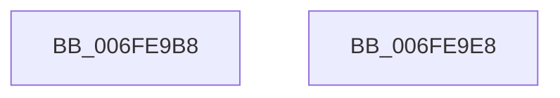

# CmFcpSwapSectionState

- RVA: `0x006FE9B8`–`0x006FE9E9` (길이 `49` bytes)
- VA: `0x00000001406FE9B8`
- 실행 섹션: `PAGE`
- PDB 이름 있음: `예`; PDB Function 태그: `아니요`
- unwind 정보 RVA: `0x000DB714`
- 디코드: `15`개 명령, `49/49` bytes 표시
- 미해석 바이트: `0` (있으면 어셈블리에 `.byte`로 보존)

> 이 문서는 커널 이미지의 기계어와 PDB 기호를 분석해 생성했습니다. 4번과 5번은 함수 원형과 자료형을 바이너리 사용 방식에서 추정한 C 해석이며 원본 소스 복구 결과는 아닙니다.

## 1. Dependencies

- 직접 호출 지점: **0**; 고유 호출 대상: **0**
- 직접 호출자로 확인된 함수: **1**
- RIP 상대 이미지 참조: **0**

### Outgoing calls
- 직접 디코드된 call 명령이 없습니다.

### Direct callers
- [CmFcManagerStartRuntimePhase](../../init/C5/CmFcManagerStartRuntimePhase_function_00C5DC70.md) at `0x00C5DE6E`

### Static image references
- 디코드된 RIP-relative 메모리 참조가 없습니다.

## 2. Other-region calls and transfers

- 다른 실행 섹션으로 향하는 call: **0**
- 별도 외부 분기/꼬리 이동을 확인하지 못했습니다.

## 3. Assembly (complete function range)

```asm
006FE9B8  48 8B 02                        mov rax, qword ptr [rdx]
006FE9BB  4C 8B CA                        mov r9, rdx
006FE9BE  4C 8B 01                        mov r8, qword ptr [rcx]
006FE9C1  48 89 01                        mov qword ptr [rcx], rax
006FE9C4  4C 89 02                        mov qword ptr [rdx], r8
006FE9C7  48 8B 42 08                     mov rax, qword ptr [rdx + 8]
006FE9CB  4C 8B 41 08                     mov r8, qword ptr [rcx + 8]
006FE9CF  48 89 41 08                     mov qword ptr [rcx + 8], rax
006FE9D3  4C 89 42 08                     mov qword ptr [rdx + 8], r8
006FE9D7  49 8B 41 10                     mov rax, qword ptr [r9 + 0x10]
006FE9DB  48 8B 51 10                     mov rdx, qword ptr [rcx + 0x10]
006FE9DF  48 89 41 10                     mov qword ptr [rcx + 0x10], rax
006FE9E3  49 89 51 10                     mov qword ptr [r9 + 0x10], rdx
006FE9E7  C3                              ret
006FE9E8  CC                              int3
```

## 4. C-style interpretation (structured pseudocode)

```c
__int64 __fastcall CmFcpSwapSectionState(__int64 a1, __int64 a2)
{
    *(unsigned __int64 *)(a1) = *(unsigned __int64 *)(a2);
    *(unsigned __int64 *)(a2) = *(unsigned __int64 *)(a1);
    *(unsigned __int64 *)(a1 + 8) = *(unsigned __int64 *)(a2 + 8);
    *(unsigned __int64 *)(a2 + 8) = *(unsigned __int64 *)(a1 + 8);
    *(unsigned __int64 *)(a1 + 16) = *(unsigned __int64 *)(a2 + 16);
    *(unsigned __int64 *)(a2 + 16) = *(unsigned __int64 *)(a1 + 16);
    return *(unsigned __int64 *)(a2 + 16);
}
```

## 5. (Beta) C Style

```c
int64_t CmFcpSwapSectionState(void *Arg1, void *Arg2)
{
    uint8_t *arg1 = (uint8_t *)Arg1;
    uint8_t *arg2 = (uint8_t *)Arg2;

    *(uint64_t *)(arg1) = *(uint64_t *)(arg2);
    *(uint64_t *)(arg2) = *(uint64_t *)(arg1);
    *(uint64_t *)(arg1 + 0x8) = *(uint64_t *)(arg2 + 0x8);
    *(uint64_t *)(arg2 + 0x8) = *(uint64_t *)(arg1 + 0x8);
    *(uint64_t *)(arg1 + 0x10) = *(uint64_t *)(arg2 + 0x10);
    *(uint64_t *)(arg2 + 0x10) = *(uint64_t *)(arg1 + 0x10);
    return *(uint64_t *)(arg2 + 0x10);
}
```

### 관측된 메모리 오프셋

구조체 형식이 확인되지 않은 접근은 인자 기준의 오프셋으로만 기록했습니다.

| 기준 인자 | 오프셋 표현 | 폭 (bit) | 접근 |
|---|---:|---:|---|
| `Arg1` | `+ 0x0` | `64` | `R` |
| `Arg1` | `+ 0x0` | `64` | `W` |
| `Arg1` | `+ 0x8` | `64` | `R` |
| `Arg1` | `+ 0x8` | `64` | `W` |
| `Arg1` | `+ 0x10` | `64` | `R` |
| `Arg1` | `+ 0x10` | `64` | `W` |
| `Arg2` | `+ 0x0` | `64` | `R` |
| `Arg2` | `+ 0x0` | `64` | `W` |
| `Arg2` | `+ 0x8` | `64` | `R` |
| `Arg2` | `+ 0x8` | `64` | `W` |
| `Arg2` | `+ 0x10` | `64` | `R` |
| `Arg2` | `+ 0x10` | `64` | `W` |

## 6. Execution-region graph

[열기: 2D/3D 그래프와 함수 탐색 컨트롤 패널](../../../control-panel.html?section=page&rva=0x006FE9B8&view=graph)

- 2D 그래프는 위에서 아래로 흐르고, 3D 그래프는 빈 공간을 드래그해 회전합니다. Shift+드래그는 이동, 휠은 확대·축소, 함수 노드 선택은 대상 보고서 이동입니다.

### Static fallback


