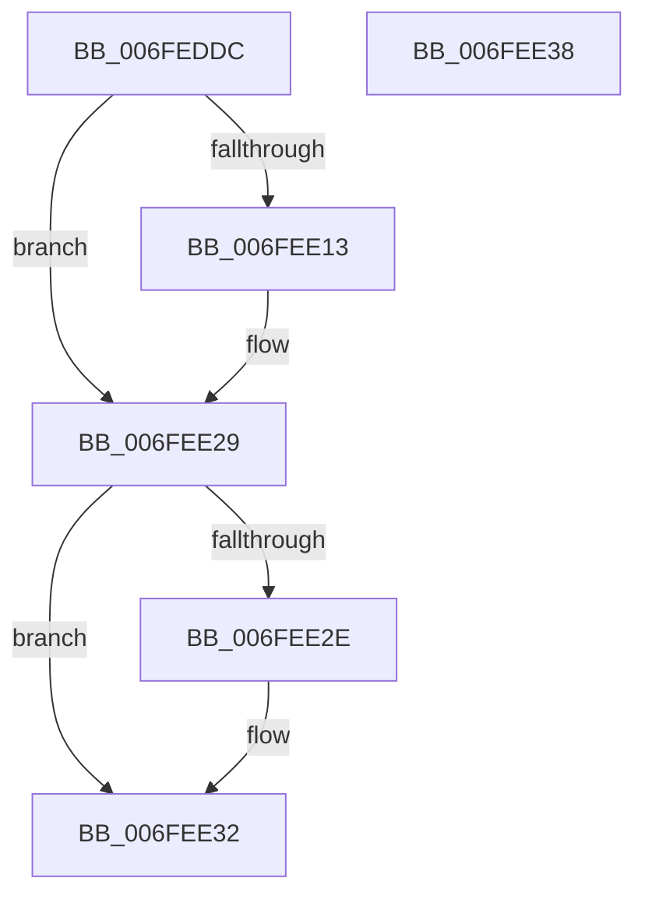

# CmpLockCallbackListExclusive

- RVA: `0x006FEDDC`–`0x006FEE39` (길이 `93` bytes)
- VA: `0x00000001406FEDDC`
- 실행 섹션: `PAGE`
- PDB 이름 있음: `예`; PDB Function 태그: `아니요`
- unwind 정보 RVA: `0x0005CF00`
- 디코드: `23`개 명령, `93/93` bytes 표시
- 미해석 바이트: `0` (있으면 어셈블리에 `.byte`로 보존)

> 이 문서는 커널 이미지의 기계어와 PDB 기호를 분석해 생성했습니다. 4번과 5번은 함수 원형과 자료형을 바이너리 사용 방식에서 추정한 C 해석이며 원본 소스 복구 결과는 아닙니다.

## 1. Dependencies

- 직접 호출 지점: **2**; 고유 호출 대상: **2**
- 직접 호출자로 확인된 함수: **2**
- RIP 상대 이미지 참조: **2**

### Outgoing calls
- `0x006FEDFF` → [KeAbPreAcquire](../../text/21/KeAbPreAcquire_function_00210230.md) (function, `0x00210230`)
- `0x006FEE24` → [ExfAcquirePushLockExclusiveEx](../../text/20/ExfAcquirePushLockExclusiveEx_function_0020FC90.md) (function, `0x0020FC90`)

### Direct callers
- [CmUnRegisterCallback](../7E/CmUnRegisterCallback_function_007E1510.md) at `0x007E155F`
- [CmUnRegisterCallback](../7E/CmUnRegisterCallback_function_007E1510.md) at `0x007E15E2`
- [CmpInsertCallbackInListByAltitude](../97/CmpInsertCallbackInListByAltitude_function_0097D684.md) at `0x0097D6A4`

### Static image references
- `0x006FEDEB` → RVA `0x00EF7BD0` (`.data`; read)
- `0x006FEE04` → RVA `0x00EF7BD0` (`.data`; read/write)

## 2. Other-region calls and transfers

- 다른 실행 섹션으로 향하는 call: **2**
  - `0x006FEDFF` → [KeAbPreAcquire](../../text/21/KeAbPreAcquire_function_00210230.md) (`PAGE` → `.text`)
  - `0x006FEE24` → [ExfAcquirePushLockExclusiveEx](../../text/20/ExfAcquirePushLockExclusiveEx_function_0020FC90.md) (`PAGE` → `.text`)
- 별도 외부 분기/꼬리 이동을 확인하지 못했습니다.

## 3. Assembly (complete function range)

```asm
006FEDDC  40 53                           push rbx
006FEDDE  48 83 EC 20                     sub rsp, 0x20
006FEDE2  65 48 8B 04 25 88 01 00 00      mov rax, qword ptr gs:[0x188]
006FEDEB  48 8D 0D DE 8D 7F 00            lea rcx, [rip + 0x7f8dde]
006FEDF2  45 33 C0                        xor r8d, r8d
006FEDF5  33 D2                           xor edx, edx
006FEDF7  66 FF 88 E4 01 00 00            dec word ptr [rax + 0x1e4]
006FEDFE  90                              nop
006FEDFF  E8 2C 14 B1 FF                  call 0x140210230
006FEE04  F0 48 0F BA 2D C2 8D 7F 00 00   lock bts qword ptr [rip + 0x7f8dc2], 0
006FEE0E  48 8B D8                        mov rbx, rax
006FEE11  73 16                           jae 0x1406fee29
006FEE13  4C 8D 05 B6 8D 7F 00            lea r8, [rip + 0x7f8db6]
006FEE1A  48 8B D0                        mov rdx, rax
006FEE1D  48 8D 0D AC 8D 7F 00            lea rcx, [rip + 0x7f8dac]
006FEE24  E8 67 0E B1 FF                  call 0x14020fc90
006FEE29  48 85 DB                        test rbx, rbx
006FEE2C  74 04                           je 0x1406fee32
006FEE2E  C6 43 0A 01                     mov byte ptr [rbx + 0xa], 1
006FEE32  48 83 C4 20                     add rsp, 0x20
006FEE36  5B                              pop rbx
006FEE37  C3                              ret
006FEE38  CC                              int3
```

## 4. C-style interpretation (structured pseudocode)

```c
__int64 __fastcall CmpLockCallbackListExclusive(__int64 a1, int a2, int a3)
{
    __int64 result;
    __int64 v_rsp;

    v_rsp = (v_rsp) - (32);
    a3 = 0;
    a2 = 0;
    result = KeAbPreAcquire(v_rip + 8359390, a2, a3, a4);
    if (!(condition_is_above_or_equal)) {
        a3 = v_rip + 8359350;
        a2 = result;
        a1 = v_rip + 8359340;
        result = ExfAcquirePushLockExclusiveEx(a1, a2, a3, a4);
    }
    if (result != 0) {
        *(unsigned __int8 *)(result + 10) = 1;
    }
    v_rsp = (v_rsp) + (32);
    return result;
}
```

## 5. (Beta) C Style

```c
int64_t CmpLockCallbackListExclusive(int64_t Arg1, int32_t Arg2, int32_t Arg3)
{
    int64_t result;
    int64_t local_rsp;

    local_rsp = (local_rsp) - (32);
    Arg3 = 0;
    Arg2 = 0;
    result = KeAbPreAcquire(v_rip + 8359390, Arg2, Arg3, a4);
    if (!(condition_is_above_or_equal)) {
        Arg3 = v_rip + 8359350;
        Arg2 = result;
        Arg1 = v_rip + 8359340;
        result = ExfAcquirePushLockExclusiveEx(Arg1, Arg2, Arg3, a4);
    }
    if (result != 0) {
        *(uint8_t *)(result + 0xA) = 1;
    }
    local_rsp = (local_rsp) + (32);
    return result;
}
```

## 6. Execution-region graph

[열기: 2D/3D 그래프와 함수 탐색 컨트롤 패널](../../../control-panel.html?section=page&rva=0x006FEDDC&view=graph)

- 2D 그래프는 위에서 아래로 흐르고, 3D 그래프는 빈 공간을 드래그해 회전합니다. Shift+드래그는 이동, 휠은 확대·축소, 함수 노드 선택은 대상 보고서 이동입니다.

### Static fallback


