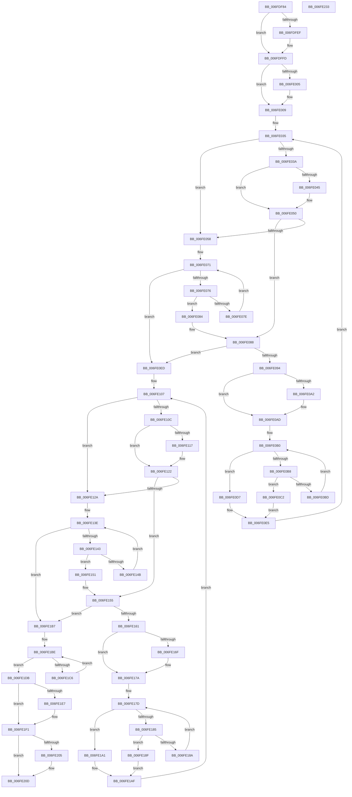

# EtwpCovSampContextCleanup

- RVA: `0x006FDF84`–`0x006FE234` (길이 `688` bytes)
- VA: `0x00000001406FDF84`
- 실행 섹션: `PAGE`
- PDB 이름 있음: `예`; PDB Function 태그: `아니요`
- unwind 정보 RVA: `0x000BD44C`
- 디코드: `195`개 명령, `688/688` bytes 표시
- 미해석 바이트: `0` (있으면 어셈블리에 `.byte`로 보존)

> 이 문서는 커널 이미지의 기계어와 PDB 기호를 분석해 생성했습니다. 4번과 5번은 함수 원형과 자료형을 바이너리 사용 방식에서 추정한 C 해석이며 원본 소스 복구 결과는 아닙니다.

## 1. Dependencies

- 직접 호출 지점: **8**; 고유 호출 대상: **8**
- 직접 호출자로 확인된 함수: **1**
- RIP 상대 이미지 참조: **0**

### Outgoing calls
- `0x006FDFB6` → [EtwpCovSampProcessCleanup](../8D/EtwpCovSampProcessCleanup_function_008D94A0.md) (function, `0x008D94A0`)
- `0x006FDFDF` → [KeAbPreAcquire](../../text/21/KeAbPreAcquire_function_00210230.md) (function, `0x00210230`)
- `0x006FDFF8` → [ExfAcquirePushLockExclusiveEx](../../text/20/ExfAcquirePushLockExclusiveEx_function_0020FC90.md) (function, `0x0020FC90`)
- `0x006FE1D4` → [EtwpCovSampContextRemoveAndFreeModule](../97/EtwpCovSampContextRemoveAndFreeModule_function_0097D870.md) (function, `0x0097D870`)
- `0x006FE1EC` → [ExFreePoolWithTag](../../poolcode/B8/ExFreePoolWithTag_function_00B82870.md) (function, `0x00B82870`)
- `0x006FE208` → [ExfTryToWakePushLock](../../text/26/ExfTryToWakePushLock_function_00265DD0.md) (function, `0x00265DD0`)
- `0x006FE210` → [KeAbPostRelease](../../text/2E/KeAbPostRelease_function_002E1600.md) (function, `0x002E1600`)
- `0x006FE215` → [KeLeaveCriticalRegion](../../text/25/KeLeaveCriticalRegion_function_0025D8B0.md) (function, `0x0025D8B0`)

### Direct callers
- [EtwpCoverageSamplerCleanup](../7C/EtwpCoverageSamplerCleanup_function_007C1E80.md) at `0x007C1E91`

### Static image references
- 디코드된 RIP-relative 메모리 참조가 없습니다.

## 2. Other-region calls and transfers

- 다른 실행 섹션으로 향하는 call: **6**
  - `0x006FDFDF` → [KeAbPreAcquire](../../text/21/KeAbPreAcquire_function_00210230.md) (`PAGE` → `.text`)
  - `0x006FDFF8` → [ExfAcquirePushLockExclusiveEx](../../text/20/ExfAcquirePushLockExclusiveEx_function_0020FC90.md) (`PAGE` → `.text`)
  - `0x006FE1EC` → [ExFreePoolWithTag](../../poolcode/B8/ExFreePoolWithTag_function_00B82870.md) (`PAGE` → `POOLCODE`)
  - `0x006FE208` → [ExfTryToWakePushLock](../../text/26/ExfTryToWakePushLock_function_00265DD0.md) (`PAGE` → `.text`)
  - `0x006FE210` → [KeAbPostRelease](../../text/2E/KeAbPostRelease_function_002E1600.md) (`PAGE` → `.text`)
  - `0x006FE215` → [KeLeaveCriticalRegion](../../text/25/KeLeaveCriticalRegion_function_0025D8B0.md) (`PAGE` → `.text`)
- 별도 외부 분기/꼬리 이동을 확인하지 못했습니다.

## 3. Assembly (complete function range)

```asm
006FDF84  48 89 5C 24 08                  mov qword ptr [rsp + 8], rbx
006FDF89  48 89 74 24 10                  mov qword ptr [rsp + 0x10], rsi
006FDF8E  48 89 7C 24 18                  mov qword ptr [rsp + 0x18], rdi
006FDF93  55                              push rbp
006FDF94  41 56                           push r14
006FDF96  41 57                           push r15
006FDF98  48 8B EC                        mov rbp, rsp
006FDF9B  48 83 EC 40                     sub rsp, 0x40
006FDF9F  48 8B F1                        mov rsi, rcx
006FDFA2  45 33 FF                        xor r15d, r15d
006FDFA5  48 81 C1 E0 04 00 00            add rcx, 0x4e0
006FDFAC  4C 89 7D E0                     mov qword ptr [rbp - 0x20], r15
006FDFB0  33 D2                           xor edx, edx
006FDFB2  4C 89 7D F0                     mov qword ptr [rbp - 0x10], r15
006FDFB6  E8 E5 B4 1D 00                  call 0x1408d94a0
006FDFBB  65 48 8B 04 25 88 01 00 00      mov rax, qword ptr gs:[0x188]
006FDFC4  4C 8D B6 98 04 00 00            lea r14, [rsi + 0x498]
006FDFCB  48 83 CB FF                     or rbx, 0xffffffffffffffff
006FDFCF  45 33 C0                        xor r8d, r8d
006FDFD2  33 D2                           xor edx, edx
006FDFD4  49 8B CE                        mov rcx, r14
006FDFD7  66 01 98 E4 01 00 00            add word ptr [rax + 0x1e4], bx
006FDFDE  90                              nop
006FDFDF  E8 4C 22 B1 FF                  call 0x140210230
006FDFE4  F0 49 0F BA 2E 00               lock bts qword ptr [r14], 0
006FDFEA  48 8B F8                        mov rdi, rax
006FDFED  73 0E                           jae 0x1406fdffd
006FDFEF  4D 8B C6                        mov r8, r14
006FDFF2  48 8B D0                        mov rdx, rax
006FDFF5  49 8B CE                        mov rcx, r14
006FDFF8  E8 93 1C B1 FF                  call 0x14020fc90
006FDFFD  41 B3 01                        mov r11b, 1
006FE000  48 85 FF                        test rdi, rdi
006FE003  74 04                           je 0x1406fe009
006FE005  44 88 5F 0A                     mov byte ptr [rdi + 0xa], r11b
006FE009  65 48 8B 04 25 88 01 00 00      mov rax, qword ptr gs:[0x188]
006FE012  48 BF 02 00 00 00 00 00 00 80   movabs rdi, 0x8000000000000002
006FE01C  48 89 86 A0 04 00 00            mov qword ptr [rsi + 0x4a0], rax
006FE023  48 8B 96 B0 04 00 00            mov rdx, qword ptr [rsi + 0x4b0]
006FE02A  48 89 55 F0                     mov qword ptr [rbp - 0x10], rdx
006FE02E  4C 8B C2                        mov r8, rdx
006FE031  48 89 55 E8                     mov qword ptr [rbp - 0x18], rdx
006FE035  4D 85 C0                        test r8, r8
006FE038  74 1E                           je 0x1406fe058
006FE03A  49 8B 00                        mov rax, qword ptr [r8]
006FE03D  48 23 C7                        and rax, rdi
006FE040  48 3B C7                        cmp rax, rdi
006FE043  75 0B                           jne 0x1406fe050
006FE045  49 8B 07                        mov rax, qword ptr [r15]
006FE048  48 8B 55 F0                     mov rdx, qword ptr [rbp - 0x10]
006FE04C  4C 8B 45 E8                     mov r8, qword ptr [rbp - 0x18]
006FE050  49 8B 08                        mov rcx, qword ptr [r8]
006FE053  41 84 CB                        test r11b, cl
006FE056  74 30                           je 0x1406fe088
006FE058  8B 8E AC 04 00 00               mov ecx, dword ptr [rsi + 0x4ac]
006FE05E  48 83 C2 08                     add rdx, 8
006FE062  48 8B 86 B0 04 00 00            mov rax, qword ptr [rsi + 0x4b0]
006FE069  48 C1 E9 05                     shr rcx, 5
006FE06D  4C 8D 04 C8                     lea r8, [rax + rcx*8]
006FE071  49 3B D0                        cmp rdx, r8
006FE074  73 77                           jae 0x1406fe0ed
006FE076  48 8B 0A                        mov rcx, qword ptr [rdx]
006FE079  41 84 CB                        test r11b, cl
006FE07C  74 06                           je 0x1406fe084
006FE07E  48 83 C2 08                     add rdx, 8
006FE082  EB ED                           jmp 0x1406fe071
006FE084  48 89 55 F0                     mov qword ptr [rbp - 0x10], rdx
006FE088  48 8B C1                        mov rax, rcx
006FE08B  48 89 4D E8                     mov qword ptr [rbp - 0x18], rcx
006FE08F  48 85 C0                        test rax, rax
006FE092  74 59                           je 0x1406fe0ed
006FE094  48 8B 01                        mov rax, qword ptr [rcx]
006FE097  4C 8B C9                        mov r9, rcx
006FE09A  48 23 C7                        and rax, rdi
006FE09D  48 3B C7                        cmp rax, rdi
006FE0A0  75 0B                           jne 0x1406fe0ad
006FE0A2  49 8B 07                        mov rax, qword ptr [r15]
006FE0A5  48 8B 55 F0                     mov rdx, qword ptr [rbp - 0x10]
006FE0A9  48 8B 4D E8                     mov rcx, qword ptr [rbp - 0x18]
006FE0AD  4C 8B C2                        mov r8, rdx
006FE0B0  49 8B 00                        mov rax, qword ptr [r8]
006FE0B3  41 84 C3                        test r11b, al
006FE0B6  75 1F                           jne 0x1406fe0d7
006FE0B8  48 3B C1                        cmp rax, rcx
006FE0BB  74 05                           je 0x1406fe0c2
006FE0BD  4C 8B C0                        mov r8, rax
006FE0C0  EB EE                           jmp 0x1406fe0b0
006FE0C2  48 8B 01                        mov rax, qword ptr [rcx]
006FE0C5  49 89 00                        mov qword ptr [r8], rax
006FE0C8  FF 8E A8 04 00 00               dec dword ptr [rsi + 0x4a8]
006FE0CE  48 09 39                        or qword ptr [rcx], rdi
006FE0D1  4C 89 45 E8                     mov qword ptr [rbp - 0x18], r8
006FE0D5  EB 0E                           jmp 0x1406fe0e5
006FE0D7  49 8B 07                        mov rax, qword ptr [r15]
006FE0DA  4D 8B CF                        mov r9, r15
006FE0DD  48 8B 55 F0                     mov rdx, qword ptr [rbp - 0x10]
006FE0E1  4C 8B 45 E8                     mov r8, qword ptr [rbp - 0x18]
006FE0E5  4D 89 39                        mov qword ptr [r9], r15
006FE0E8  E9 48 FF FF FF                  jmp 0x1406fe035
006FE0ED  4C 8D 8E B8 04 00 00            lea r9, [rsi + 0x4b8]
006FE0F4  49 8B 51 08                     mov rdx, qword ptr [r9 + 8]
006FE0F8  48 89 55 F0                     mov qword ptr [rbp - 0x10], rdx
006FE0FC  4C 8B C2                        mov r8, rdx
006FE0FF  48 89 55 E8                     mov qword ptr [rbp - 0x18], rdx
006FE103  4C 89 4D E0                     mov qword ptr [rbp - 0x20], r9
006FE107  4D 85 C0                        test r8, r8
006FE10A  74 1E                           je 0x1406fe12a
006FE10C  49 8B 00                        mov rax, qword ptr [r8]
006FE10F  48 23 C7                        and rax, rdi
006FE112  48 3B C7                        cmp rax, rdi
006FE115  75 0B                           jne 0x1406fe122
006FE117  49 8B 07                        mov rax, qword ptr [r15]
006FE11A  48 8B 55 F0                     mov rdx, qword ptr [rbp - 0x10]
006FE11E  4C 8B 45 E8                     mov r8, qword ptr [rbp - 0x18]
006FE122  49 8B 08                        mov rcx, qword ptr [r8]
006FE125  41 84 CB                        test r11b, cl
006FE128  74 2B                           je 0x1406fe155
006FE12A  41 8B 49 04                     mov ecx, dword ptr [r9 + 4]
006FE12E  48 83 C2 08                     add rdx, 8
006FE132  49 8B 41 08                     mov rax, qword ptr [r9 + 8]
006FE136  48 C1 E9 05                     shr rcx, 5
006FE13A  4C 8D 04 C8                     lea r8, [rax + rcx*8]
006FE13E  49 3B D0                        cmp rdx, r8
006FE141  73 74                           jae 0x1406fe1b7
006FE143  48 8B 0A                        mov rcx, qword ptr [rdx]
006FE146  41 84 CB                        test r11b, cl
006FE149  74 06                           je 0x1406fe151
006FE14B  48 83 C2 08                     add rdx, 8
006FE14F  EB ED                           jmp 0x1406fe13e
006FE151  48 89 55 F0                     mov qword ptr [rbp - 0x10], rdx
006FE155  48 8B C1                        mov rax, rcx
006FE158  48 89 4D E8                     mov qword ptr [rbp - 0x18], rcx
006FE15C  48 85 C0                        test rax, rax
006FE15F  74 56                           je 0x1406fe1b7
006FE161  48 8B 01                        mov rax, qword ptr [rcx]
006FE164  4C 8B D1                        mov r10, rcx
006FE167  48 23 C7                        and rax, rdi
006FE16A  48 3B C7                        cmp rax, rdi
006FE16D  75 0B                           jne 0x1406fe17a
006FE16F  49 8B 07                        mov rax, qword ptr [r15]
006FE172  48 8B 55 F0                     mov rdx, qword ptr [rbp - 0x10]
006FE176  48 8B 4D E8                     mov rcx, qword ptr [rbp - 0x18]
006FE17A  4C 8B C2                        mov r8, rdx
006FE17D  49 8B 00                        mov rax, qword ptr [r8]
006FE180  41 84 C3                        test r11b, al
006FE183  75 1C                           jne 0x1406fe1a1
006FE185  48 3B C1                        cmp rax, rcx
006FE188  74 05                           je 0x1406fe18f
006FE18A  4C 8B C0                        mov r8, rax
006FE18D  EB EE                           jmp 0x1406fe17d
006FE18F  48 8B 01                        mov rax, qword ptr [rcx]
006FE192  49 89 00                        mov qword ptr [r8], rax
006FE195  41 FF 09                        dec dword ptr [r9]
006FE198  48 09 39                        or qword ptr [rcx], rdi
006FE19B  4C 89 45 E8                     mov qword ptr [rbp - 0x18], r8
006FE19F  EB 0E                           jmp 0x1406fe1af
006FE1A1  49 8B 07                        mov rax, qword ptr [r15]
006FE1A4  4D 8B D7                        mov r10, r15
006FE1A7  48 8B 55 F0                     mov rdx, qword ptr [rbp - 0x10]
006FE1AB  4C 8B 45 E8                     mov r8, qword ptr [rbp - 0x18]
006FE1AF  4D 89 3A                        mov qword ptr [r10], r15
006FE1B2  E9 50 FF FF FF                  jmp 0x1406fe107
006FE1B7  48 8D BE C8 04 00 00            lea rdi, [rsi + 0x4c8]
006FE1BE  48 8B 17                        mov rdx, qword ptr [rdi]
006FE1C1  48 3B D7                        cmp rdx, rdi
006FE1C4  74 15                           je 0x1406fe1db
006FE1C6  48 83 C2 B8                     add rdx, -0x48
006FE1CA  48 8B CE                        mov rcx, rsi
006FE1CD  44 89 BA 84 00 00 00            mov dword ptr [rdx + 0x84], r15d
006FE1D4  E8 97 F6 27 00                  call 0x14097d870
006FE1D9  EB E3                           jmp 0x1406fe1be
006FE1DB  48 8B 8E B0 04 00 00            mov rcx, qword ptr [rsi + 0x4b0]
006FE1E2  48 85 C9                        test rcx, rcx
006FE1E5  74 0A                           je 0x1406fe1f1
006FE1E7  BA 45 74 77 56                  mov edx, 0x56777445
006FE1EC  E8 7F 46 48 00                  call 0x140b82870
006FE1F1  4C 89 BE A0 04 00 00            mov qword ptr [rsi + 0x4a0], r15
006FE1F8  F0 49 0F C1 1E                  lock xadd qword ptr [r14], rbx
006FE1FD  80 E3 06                        and bl, 6
006FE200  80 FB 02                        cmp bl, 2
006FE203  75 08                           jne 0x1406fe20d
006FE205  49 8B CE                        mov rcx, r14
006FE208  E8 C3 7B B6 FF                  call 0x140265dd0
006FE20D  49 8B CE                        mov rcx, r14
006FE210  E8 EB 33 BE FF                  call 0x1402e1600
006FE215  E8 96 F6 B5 FF                  call 0x14025d8b0
006FE21A  48 8B 5C 24 60                  mov rbx, qword ptr [rsp + 0x60]
006FE21F  48 8B 74 24 68                  mov rsi, qword ptr [rsp + 0x68]
006FE224  48 8B 7C 24 70                  mov rdi, qword ptr [rsp + 0x70]
006FE229  48 83 C4 40                     add rsp, 0x40
006FE22D  41 5F                           pop r15
006FE22F  41 5E                           pop r14
006FE231  5D                              pop rbp
006FE232  C3                              ret
006FE233  CC                              int3
```

## 4. C-style interpretation (structured pseudocode)

```c
__int64 __fastcall EtwpCovSampContextCleanup(__int64 a1, int a2, int a3)
{
    __int64 result;
    __int64 v_r15;
    __int64 v_rbx;
    __int64 v_rsp;
    unsigned __int64 v_stack_m28;
    unsigned __int64 v_stack_m30;
    unsigned __int64 v_stack_m38;
    unsigned __int64 v_stack_p10;
    unsigned __int64 v_stack_p18;
    unsigned __int64 v_stack_p8;

    v_stack_p8 = v_rbx;
    v_stack_p10 = v_rsi;
    v_stack_p18 = v_rdi;
    v_rsp = (v_rsp) - (64);
    v_r15 = 0;
    a1 = (a1) + (0x4E0ULL);
    v_stack_m38 = 0;
    a2 = 0;
    v_stack_m28 = 0;
    result = EtwpCovSampProcessCleanup(a1, a2, a3, a4);
    v_rbx = (v_rbx) | (-1);
    a3 = 0;
    a2 = 0;
    result = KeAbPreAcquire(a1 + 1176, a2, a3, a4);
    if (!(condition_is_above_or_equal)) {
        a3 = a1 + 1176;
        a2 = result;
        a1 = a1 + 1176;
        result = ExfAcquirePushLockExclusiveEx(a1, a2, a3, a4);
    }
    if (result != 0) {
        *(unsigned __int8 *)(result + 10) = 1;
    }
    *(unsigned __int64 *)(a1 + 1184) = *(unsigned __int64 *)(gs_base + (0 + 392));
    v_stack_m28 = *(unsigned __int64 *)(a1 + 1200);
    v_stack_m30 = *(unsigned __int64 *)(a1 + 1200);
loc_006FE035:
    if (*(unsigned __int64 *)(a1 + 1200) == 0) goto loc_006FE058;
    result = (*(unsigned __int64 *)(*(unsigned __int64 *)(a1 + 1200))) & (result);
    if (result == result) {
        result = *(unsigned __int64 *)(v_r15);
        a2 = v_stack_m28;
        a3 = v_stack_m30;
    }
    if (((1) & ((unsigned __int8)(*(unsigned __int64 *)(a3)))) == 0) goto loc_006FE088;
loc_006FE058:
    a2 = (a2) + (8);
    a1 = ((unsigned int)(*(unsigned int *)(a1 + 1196))) >> (5);
loc_006FE071:
    if (a2 >= (*(unsigned __int64 *)(a1 + 1200) + a1 * 8)) goto loc_006FE0ED;
    if (((1) & ((unsigned __int8)(*(unsigned __int64 *)(a2)))) == 0) goto loc_006FE084;
    a2 = (a2) + (8);
    goto loc_006FE071;
loc_006FE084:
    v_stack_m28 = a2;
loc_006FE088:
    v_stack_m30 = *(unsigned __int64 *)(a2);
    if (*(unsigned __int64 *)(a2) == 0) goto loc_006FE0ED;
    result = (*(unsigned __int64 *)(*(unsigned __int64 *)(a2))) & (result);
    if (result == result) {
        result = *(unsigned __int64 *)(v_r15);
        a2 = v_stack_m28;
        a1 = v_stack_m30;
    }
loc_006FE0B0:
    if (((1) & ((unsigned __int8)(*(unsigned __int64 *)(a2)))) != 0) goto loc_006FE0D7;
    if ((*(unsigned __int64 *)(a2)) == a1) goto loc_006FE0C2;
    goto loc_006FE0B0;
loc_006FE0C2:
    *(unsigned __int64 *)(*(unsigned __int64 *)(a2)) = *(unsigned __int64 *)(a1);
    v_stack_m30 = *(unsigned __int64 *)(a2);
    goto loc_006FE0E5;
loc_006FE0D7:
loc_006FE0E5:
    *(unsigned __int64 *)(0) = 0;
    goto loc_006FE035;
loc_006FE0ED:
    v_stack_m28 = *(unsigned __int64 *)(a1 + 1208 + 8);
    v_stack_m30 = *(unsigned __int64 *)(a1 + 1208 + 8);
    v_stack_m38 = a1 + 1208;
loc_006FE107:
    if (*(unsigned __int64 *)(a1 + 1208 + 8) == 0) goto loc_006FE12A;
    result = (*(unsigned __int64 *)(*(unsigned __int64 *)(a1 + 1208 + 8))) & (result);
    if (result == result) {
        result = *(unsigned __int64 *)(v_r15);
        a2 = v_stack_m28;
        a3 = v_stack_m30;
    }
    if (((1) & ((unsigned __int8)(*(unsigned __int64 *)(a3)))) == 0) goto loc_006FE155;
loc_006FE12A:
    a2 = (a2) + (8);
    a1 = ((unsigned int)(*(unsigned int *)(a1 + 1208 + 4))) >> (5);
loc_006FE13E:
    if (a2 >= (*(unsigned __int64 *)(a1 + 1208 + 8) + a1 * 8)) goto loc_006FE1B7;
    if (((1) & ((unsigned __int8)(*(unsigned __int64 *)(a2)))) == 0) goto loc_006FE151;
    a2 = (a2) + (8);
    goto loc_006FE13E;
loc_006FE151:
    v_stack_m28 = a2;
loc_006FE155:
    v_stack_m30 = *(unsigned __int64 *)(a2);
    if (*(unsigned __int64 *)(a2) == 0) goto loc_006FE1B7;
    result = (*(unsigned __int64 *)(*(unsigned __int64 *)(a2))) & (result);
    if (result == result) {
        result = *(unsigned __int64 *)(v_r15);
        a2 = v_stack_m28;
        a1 = v_stack_m30;
    }
loc_006FE17D:
    if (((1) & ((unsigned __int8)(*(unsigned __int64 *)(a2)))) != 0) goto loc_006FE1A1;
    if ((*(unsigned __int64 *)(a2)) == a1) goto loc_006FE18F;
    goto loc_006FE17D;
loc_006FE18F:
    *(unsigned __int64 *)(*(unsigned __int64 *)(a2)) = *(unsigned __int64 *)(a1);
    v_stack_m30 = *(unsigned __int64 *)(a2);
    goto loc_006FE1AF;
loc_006FE1A1:
loc_006FE1AF:
    *(unsigned __int64 *)(0) = 0;
    goto loc_006FE107;
loc_006FE1B7:
loc_006FE1BE:
    if ((*(unsigned __int64 *)(a1 + 1224)) == (a1 + 1224)) goto loc_006FE1DB;
    a2 = (*(unsigned __int64 *)(a1 + 1224)) + (-72);
    *(unsigned int *)(a2 + 132) = 0;
    result = EtwpCovSampContextRemoveAndFreeModule(a1, a2, v_stack_m30, a1 + 1208);
    goto loc_006FE1BE;
loc_006FE1DB:
    if (*(unsigned __int64 *)(a1 + 1200) != 0) {
        a2 = 0x56777445ULL;
        result = ExFreePoolWithTag(*(unsigned __int64 *)(a1 + 1200), a2, v_stack_m30, a1 + 1208);
    }
    *(unsigned __int64 *)(a1 + 1184) = 0;
    v_rbx = (unsigned __int8)((v_rbx) & (6));
    if (((unsigned __int8)(v_rbx)) == 2) {
        a1 = a1 + 1176;
        result = ExfTryToWakePushLock(a1, a2, v_stack_m30, a1 + 1208);
    }
    result = KeAbPostRelease(a1 + 1176, a2, v_stack_m30, a1 + 1208);
    result = KeLeaveCriticalRegion(a1 + 1176, a2, v_stack_m30, a1 + 1208);
    v_rsp = (v_rsp) + (64);
    return result;
}
```

## 5. (Beta) C Style

```c
int64_t EtwpCovSampContextCleanup(void *Arg1, int32_t Arg2, int32_t Arg3)
{
    uint8_t *arg1 = (uint8_t *)Arg1;

    int64_t result;
    int64_t local_r15;
    int64_t local_rbx;
    int64_t local_rsp;
    uint64_t v_stack_m28;
    uint64_t v_stack_m30;
    uint64_t v_stack_m38;
    uint64_t v_stack_p10;
    uint64_t v_stack_p18;
    uint64_t v_stack_p8;

    v_stack_p8 = local_rbx;
    v_stack_p10 = local_rsi;
    v_stack_p18 = local_rdi;
    local_rsp = (local_rsp) - (64);
    local_r15 = 0;
    Arg1 = (Arg1) + (0x4E0ULL);
    v_stack_m38 = 0;
    Arg2 = 0;
    v_stack_m28 = 0;
    result = EtwpCovSampProcessCleanup(Arg1, Arg2, Arg3, a4);
    local_rbx = (local_rbx) | (-1);
    Arg3 = 0;
    Arg2 = 0;
    result = KeAbPreAcquire(Arg1 + 1176, Arg2, Arg3, a4);
    if (!(condition_is_above_or_equal)) {
        Arg3 = Arg1 + 1176;
        Arg2 = result;
        Arg1 = Arg1 + 1176;
        result = ExfAcquirePushLockExclusiveEx(Arg1, Arg2, Arg3, a4);
    }
    if (result != 0) {
        *(uint8_t *)(result + 0xA) = 1;
    }
    *(uint64_t *)(arg1 + 0x4A0) = *(uint64_t *)(gs_base + (0 + 0x188));
    v_stack_m28 = *(uint64_t *)(arg1 + 0x4B0);
    v_stack_m30 = *(uint64_t *)(arg1 + 0x4B0);
loc_006FE035:
    if (*(uint64_t *)(arg1 + 0x4B0) == 0) goto loc_006FE058;
    result = (*(uint64_t *)(*(uint64_t *)(arg1 + 0x4B0))) & (result);
    if (result == result) {
        result = *(uint64_t *)(local_r15);
        Arg2 = v_stack_m28;
        Arg3 = v_stack_m30;
    }
    if (((1) & ((uint8_t)(*(uint64_t *)(Arg3)))) == 0) goto loc_006FE088;
loc_006FE058:
    Arg2 = (Arg2) + (8);
    Arg1 = ((uint32_t)(*(uint32_t *)(arg1 + 0x4AC))) >> (5);
loc_006FE071:
    if (Arg2 >= (*(uint64_t *)(arg1 + 0x4B0) + Arg1 * 8)) goto loc_006FE0ED;
    if (((1) & ((uint8_t)(*(uint64_t *)(Arg2)))) == 0) goto loc_006FE084;
    Arg2 = (Arg2) + (8);
    goto loc_006FE071;
loc_006FE084:
    v_stack_m28 = Arg2;
loc_006FE088:
    v_stack_m30 = *(uint64_t *)(Arg2);
    if (*(uint64_t *)(Arg2) == 0) goto loc_006FE0ED;
    result = (*(uint64_t *)(*(uint64_t *)(Arg2))) & (result);
    if (result == result) {
        result = *(uint64_t *)(local_r15);
        Arg2 = v_stack_m28;
        Arg1 = v_stack_m30;
    }
loc_006FE0B0:
    if (((1) & ((uint8_t)(*(uint64_t *)(Arg2)))) != 0) goto loc_006FE0D7;
    if ((*(uint64_t *)(Arg2)) == Arg1) goto loc_006FE0C2;
    goto loc_006FE0B0;
loc_006FE0C2:
    *(uint64_t *)(*(uint64_t *)(Arg2)) = *(uint64_t *)(arg1);
    v_stack_m30 = *(uint64_t *)(Arg2);
    goto loc_006FE0E5;
loc_006FE0D7:
loc_006FE0E5:
    *(uint64_t *)(0) = 0;
    goto loc_006FE035;
loc_006FE0ED:
    v_stack_m28 = *(uint64_t *)(arg1 + 0x4B8 + 0x8);
    v_stack_m30 = *(uint64_t *)(arg1 + 0x4B8 + 0x8);
    v_stack_m38 = Arg1 + 1208;
loc_006FE107:
    if (*(uint64_t *)(arg1 + 0x4B8 + 0x8) == 0) goto loc_006FE12A;
    result = (*(uint64_t *)(*(uint64_t *)(arg1 + 0x4B8 + 0x8))) & (result);
    if (result == result) {
        result = *(uint64_t *)(local_r15);
        Arg2 = v_stack_m28;
        Arg3 = v_stack_m30;
    }
    if (((1) & ((uint8_t)(*(uint64_t *)(Arg3)))) == 0) goto loc_006FE155;
loc_006FE12A:
    Arg2 = (Arg2) + (8);
    Arg1 = ((uint32_t)(*(uint32_t *)(arg1 + 0x4B8 + 0x4))) >> (5);
loc_006FE13E:
    if (Arg2 >= (*(uint64_t *)(arg1 + 0x4B8 + 0x8) + Arg1 * 8)) goto loc_006FE1B7;
    if (((1) & ((uint8_t)(*(uint64_t *)(Arg2)))) == 0) goto loc_006FE151;
    Arg2 = (Arg2) + (8);
    goto loc_006FE13E;
loc_006FE151:
    v_stack_m28 = Arg2;
loc_006FE155:
    v_stack_m30 = *(uint64_t *)(Arg2);
    if (*(uint64_t *)(Arg2) == 0) goto loc_006FE1B7;
    result = (*(uint64_t *)(*(uint64_t *)(Arg2))) & (result);
    if (result == result) {
        result = *(uint64_t *)(local_r15);
        Arg2 = v_stack_m28;
        Arg1 = v_stack_m30;
    }
loc_006FE17D:
    if (((1) & ((uint8_t)(*(uint64_t *)(Arg2)))) != 0) goto loc_006FE1A1;
    if ((*(uint64_t *)(Arg2)) == Arg1) goto loc_006FE18F;
    goto loc_006FE17D;
loc_006FE18F:
    *(uint64_t *)(*(uint64_t *)(Arg2)) = *(uint64_t *)(arg1);
    v_stack_m30 = *(uint64_t *)(Arg2);
    goto loc_006FE1AF;
loc_006FE1A1:
loc_006FE1AF:
    *(uint64_t *)(0) = 0;
    goto loc_006FE107;
loc_006FE1B7:
loc_006FE1BE:
    if ((*(uint64_t *)(arg1 + 0x4C8)) == (Arg1 + 1224)) goto loc_006FE1DB;
    Arg2 = (*(uint64_t *)(arg1 + 0x4C8)) + (-72);
    *(uint32_t *)(Arg2 + 0x84) = 0;
    result = EtwpCovSampContextRemoveAndFreeModule(Arg1, Arg2, v_stack_m30, Arg1 + 1208);
    goto loc_006FE1BE;
loc_006FE1DB:
    if (*(uint64_t *)(arg1 + 0x4B0) != 0) {
        Arg2 = 0x56777445ULL;
        result = ExFreePoolWithTag(*(uint64_t *)(arg1 + 0x4B0), Arg2, v_stack_m30, Arg1 + 1208);
    }
    *(uint64_t *)(arg1 + 0x4A0) = 0;
    local_rbx = (uint8_t)((local_rbx) & (6));
    if (((uint8_t)(local_rbx)) == 2) {
        Arg1 = Arg1 + 1176;
        result = ExfTryToWakePushLock(Arg1, Arg2, v_stack_m30, Arg1 + 1208);
    }
    result = KeAbPostRelease(Arg1 + 1176, Arg2, v_stack_m30, Arg1 + 1208);
    result = KeLeaveCriticalRegion(Arg1 + 1176, Arg2, v_stack_m30, Arg1 + 1208);
    local_rsp = (local_rsp) + (64);
    return result;
}
```

### 관측된 메모리 오프셋

구조체 형식이 확인되지 않은 접근은 인자 기준의 오프셋으로만 기록했습니다.

| 기준 인자 | 오프셋 표현 | 폭 (bit) | 접근 |
|---|---:|---:|---|
| `Arg1` | `+ 0x0` | `32` | `R/W` |
| `Arg1` | `+ 0x0` | `64` | `R` |
| `Arg1` | `+ 0x0` | `64` | `R/W` |
| `Arg1` | `+ 0x4` | `32` | `R` |
| `Arg1` | `+ 0x8` | `64` | `R` |
| `Arg1` | `+ 0x498` | `64` | `R` |
| `Arg1` | `+ 0x4A0` | `64` | `W` |
| `Arg1` | `+ 0x4A8` | `32` | `R/W` |
| `Arg1` | `+ 0x4AC` | `32` | `R` |
| `Arg1` | `+ 0x4B0` | `64` | `R` |
| `Arg1` | `+ 0x4B8` | `64` | `R` |
| `Arg1` | `+ 0x4C8` | `64` | `R` |

## 6. Execution-region graph

[열기: 2D/3D 그래프와 함수 탐색 컨트롤 패널](../../../control-panel.html?section=page&rva=0x006FDF84&view=graph)

- 2D 그래프는 위에서 아래로 흐르고, 3D 그래프는 빈 공간을 드래그해 회전합니다. Shift+드래그는 이동, 휠은 확대·축소, 함수 노드 선택은 대상 보고서 이동입니다.

### Static fallback


