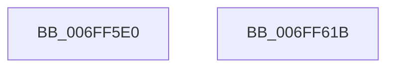

# EtwpTimeProfileStart

- RVA: `0x006FF5E0`–`0x006FF61C` (길이 `60` bytes)
- VA: `0x00000001406FF5E0`
- 실행 섹션: `PAGE`
- PDB 이름 있음: `예`; PDB Function 태그: `아니요`
- unwind 정보 RVA: `0x0005C788`
- 디코드: `14`개 명령, `60/60` bytes 표시
- 미해석 바이트: `0` (있으면 어셈블리에 `.byte`로 보존)

> 이 문서는 커널 이미지의 기계어와 PDB 기호를 분석해 생성했습니다. 4번과 5번은 함수 원형과 자료형을 바이너리 사용 방식에서 추정한 C 해석이며 원본 소스 복구 결과는 아닙니다.

## 1. Dependencies

- 직접 호출 지점: **3**; 고유 호출 대상: **3**
- 직접 호출자로 확인된 함수: **2**
- RIP 상대 이미지 참조: **3**

### Outgoing calls
- `0x006FF5EC` → [KeSetIntervalProfile](../AD/KeSetIntervalProfile_function_00ADB5A8.md) (function, `0x00ADB5A8`)
- `0x006FF605` → [KeInitializeProfileCallback](KeInitializeProfileCallback_function_006FF624.md) (function, `0x006FF624`)
- `0x006FF611` → [KeStartProfile](../../text/4E/KeStartProfile_function_004E1120.md) (function, `0x004E1120`)

### Direct callers
- [EtwTimeProfileReset](../7B/EtwTimeProfileReset_function_007B7E8C.md) at `0x007B7EA6`
- [EtwpEnableKernelTrace](../A4/EtwpEnableKernelTrace_function_00A4FBCC.md) at `0x00A4FF35`

### Static image references
- `0x006FF5E4` → RVA `0x00E0EB28` (`.data`; read)
- `0x006FF5F4` → RVA `0x00650A00` (`EtwpProfileInterrupt`; read)
- `0x006FF5FE` → RVA `0x00EFF520` (`.data`; read)

## 2. Other-region calls and transfers

- 다른 실행 섹션으로 향하는 call: **1**
  - `0x006FF611` → [KeStartProfile](../../text/4E/KeStartProfile_function_004E1120.md) (`PAGE` → `.text`)
- 별도 외부 분기/꼬리 이동을 확인하지 못했습니다.

## 3. Assembly (complete function range)

```asm
006FF5E0  48 83 EC 28                     sub rsp, 0x28
006FF5E4  8B 0D 3E F5 70 00               mov ecx, dword ptr [rip + 0x70f53e]
006FF5EA  33 D2                           xor edx, edx
006FF5EC  E8 B7 BF 3D 00                  call 0x140adb5a8
006FF5F1  45 33 C9                        xor r9d, r9d
006FF5F4  48 8D 15 05 14 F5 FF            lea rdx, [rip - 0xaebfb]
006FF5FB  45 33 C0                        xor r8d, r8d
006FF5FE  48 8D 0D 1B FF 7F 00            lea rcx, [rip + 0x7fff1b]
006FF605  E8 1A 00 00 00                  call 0x1406ff624
006FF60A  48 8D 0D 0F FF 7F 00            lea rcx, [rip + 0x7fff0f]
006FF611  E8 0A 1B DE FF                  call 0x1404e1120
006FF616  48 83 C4 28                     add rsp, 0x28
006FF61A  C3                              ret
006FF61B  CC                              int3
```

## 4. C-style interpretation (structured pseudocode)

```c
__int64 __fastcall EtwpTimeProfileStart(__int64 a1, int a2, int a3, int a4)
{
    __int64 result;
    __int64 v_rsp;

    v_rsp = (v_rsp) - (40);
    a2 = 0;
    result = KeSetIntervalProfile((unsigned int)(*(unsigned int *)(v_rip + 7402814)), a2, a3, a4);
    a4 = 0;
    a3 = 0;
    result = KeInitializeProfileCallback(v_rip + 8388379, v_rip - 715771, a3, a4);
    result = KeStartProfile(v_rip + 8388367, v_rip - 715771, a3, a4);
    v_rsp = (v_rsp) + (40);
    return result;
}
```

## 5. (Beta) C Style

```c
int64_t EtwpTimeProfileStart(int64_t Arg1, int32_t Arg2, int32_t Arg3, int32_t Arg4)
{
    int64_t result;
    int64_t local_rsp;

    local_rsp = (local_rsp) - (40);
    Arg2 = 0;
    result = KeSetIntervalProfile((uint32_t)(*(uint32_t *)(v_rip + 0x70F53E)), Arg2, Arg3, Arg4);
    Arg4 = 0;
    Arg3 = 0;
    result = KeInitializeProfileCallback(v_rip + 8388379, v_rip - 715771, Arg3, Arg4);
    result = KeStartProfile(v_rip + 8388367, v_rip - 715771, Arg3, Arg4);
    local_rsp = (local_rsp) + (40);
    return result;
}
```

## 6. Execution-region graph

[열기: 2D/3D 그래프와 함수 탐색 컨트롤 패널](../../../control-panel.html?section=page&rva=0x006FF5E0&view=graph)

- 2D 그래프는 위에서 아래로 흐르고, 3D 그래프는 빈 공간을 드래그해 회전합니다. Shift+드래그는 이동, 휠은 확대·축소, 함수 노드 선택은 대상 보고서 이동입니다.

### Static fallback


