# EtwpTrackProviderBinaryKm

- RVA: `0x006FD8E8`–`0x006FDB7A` (길이 `658` bytes)
- VA: `0x00000001406FD8E8`
- 실행 섹션: `PAGE`
- PDB 이름 있음: `예`; PDB Function 태그: `아니요`
- unwind 정보 RVA: `0x0005FEF8`
- 디코드: `167`개 명령, `658/658` bytes 표시
- 미해석 바이트: `0` (있으면 어셈블리에 `.byte`로 보존)

> 이 문서는 커널 이미지의 기계어와 PDB 기호를 분석해 생성했습니다. 4번과 5번은 함수 원형과 자료형을 바이너리 사용 방식에서 추정한 C 해석이며 원본 소스 복구 결과는 아닙니다.

## 1. Dependencies

- 직접 호출 지점: **16**; 고유 호출 대상: **8**
- 직접 호출자로 확인된 함수: **2**
- RIP 상대 이미지 참조: **0**

### Outgoing calls
- `0x006FD948` → [KeAbPreAcquire](../../text/21/KeAbPreAcquire_function_00210230.md) (function, `0x00210230`)
- `0x006FD961` → [ExfAcquirePushLockExclusiveEx](../../text/20/ExfAcquirePushLockExclusiveEx_function_0020FC90.md) (function, `0x0020FC90`)
- `0x006FD9AA` → [KeAbPreAcquire](../../text/21/KeAbPreAcquire_function_00210230.md) (function, `0x00210230`)
- `0x006FD9C3` → [ExfAcquirePushLockExclusiveEx](../../text/20/ExfAcquirePushLockExclusiveEx_function_0020FC90.md) (function, `0x0020FC90`)
- `0x006FDA2F` → [EtwpAcquireLoggerContextByLoggerId](../93/EtwpAcquireLoggerContextByLoggerId_function_00932920.md) (function, `0x00932920`)
- `0x006FDA44` → [EtwpProviderArrivalCallback](../A0/EtwpProviderArrivalCallback_function_00A03F94.md) (function, `0x00A03F94`)
- `0x006FDA4E` → [EtwpReleaseLoggerContext](../A0/EtwpReleaseLoggerContext_function_00A04160.md) (function, `0x00A04160`)
- `0x006FDA7F` → [EtwpAcquireLoggerContextByLoggerId](../93/EtwpAcquireLoggerContextByLoggerId_function_00932920.md) (function, `0x00932920`)
- `0x006FDA94` → [EtwpProviderArrivalCallback](../A0/EtwpProviderArrivalCallback_function_00A03F94.md) (function, `0x00A03F94`)
- `0x006FDA9E` → [EtwpReleaseLoggerContext](../A0/EtwpReleaseLoggerContext_function_00A04160.md) (function, `0x00A04160`)
- `0x006FDAE9` → [ExfReleasePushLock](../../text/26/ExfReleasePushLock_function_002638D0.md) (function, `0x002638D0`)
- `0x006FDAF1` → [KeAbPostRelease](../../text/2E/KeAbPostRelease_function_002E1600.md) (function, `0x002E1600`)
- `0x006FDAF6` → [KeLeaveCriticalRegion](../../text/25/KeLeaveCriticalRegion_function_0025D8B0.md) (function, `0x0025D8B0`)
- `0x006FDB46` → [ExfReleasePushLock](../../text/26/ExfReleasePushLock_function_002638D0.md) (function, `0x002638D0`)
- `0x006FDB4E` → [KeAbPostRelease](../../text/2E/KeAbPostRelease_function_002E1600.md) (function, `0x002E1600`)
- `0x006FDB53` → [KeLeaveCriticalRegion](../../text/25/KeLeaveCriticalRegion_function_0025D8B0.md) (function, `0x0025D8B0`)

### Direct callers
- [EtwSetInformation](../7B/EtwSetInformation_function_007B9070.md) at `0x007B9111`
- [EtwpTrackProviderBinary](../7B/EtwpTrackProviderBinary_function_007B9198.md) at `0x007B91E2`

### Static image references
- 디코드된 RIP-relative 메모리 참조가 없습니다.

## 2. Other-region calls and transfers

- 다른 실행 섹션으로 향하는 call: **10**
  - `0x006FD948` → [KeAbPreAcquire](../../text/21/KeAbPreAcquire_function_00210230.md) (`PAGE` → `.text`)
  - `0x006FD961` → [ExfAcquirePushLockExclusiveEx](../../text/20/ExfAcquirePushLockExclusiveEx_function_0020FC90.md) (`PAGE` → `.text`)
  - `0x006FD9AA` → [KeAbPreAcquire](../../text/21/KeAbPreAcquire_function_00210230.md) (`PAGE` → `.text`)
  - `0x006FD9C3` → [ExfAcquirePushLockExclusiveEx](../../text/20/ExfAcquirePushLockExclusiveEx_function_0020FC90.md) (`PAGE` → `.text`)
  - `0x006FDAE9` → [ExfReleasePushLock](../../text/26/ExfReleasePushLock_function_002638D0.md) (`PAGE` → `.text`)
  - `0x006FDAF1` → [KeAbPostRelease](../../text/2E/KeAbPostRelease_function_002E1600.md) (`PAGE` → `.text`)
  - `0x006FDAF6` → [KeLeaveCriticalRegion](../../text/25/KeLeaveCriticalRegion_function_0025D8B0.md) (`PAGE` → `.text`)
  - `0x006FDB46` → [ExfReleasePushLock](../../text/26/ExfReleasePushLock_function_002638D0.md) (`PAGE` → `.text`)
  - `0x006FDB4E` → [KeAbPostRelease](../../text/2E/KeAbPostRelease_function_002E1600.md) (`PAGE` → `.text`)
  - `0x006FDB53` → [KeLeaveCriticalRegion](../../text/25/KeLeaveCriticalRegion_function_0025D8B0.md) (`PAGE` → `.text`)
- 별도 외부 분기/꼬리 이동을 확인하지 못했습니다.

## 3. Assembly (complete function range)

```asm
006FD8E8  48 8B C4                        mov rax, rsp
006FD8EB  48 89 58 08                     mov qword ptr [rax + 8], rbx
006FD8EF  48 89 68 10                     mov qword ptr [rax + 0x10], rbp
006FD8F3  48 89 70 18                     mov qword ptr [rax + 0x18], rsi
006FD8F7  48 89 78 20                     mov qword ptr [rax + 0x20], rdi
006FD8FB  41 54                           push r12
006FD8FD  41 56                           push r14
006FD8FF  41 57                           push r15
006FD901  48 83 EC 20                     sub rsp, 0x20
006FD905  48 8B 41 20                     mov rax, qword ptr [rcx + 0x20]
006FD909  45 33 F6                        xor r14d, r14d
006FD90C  41 8A E8                        mov bpl, r8b
006FD90F  48 8B D9                        mov rbx, rcx
006FD912  41 BC 98 02 00 00               mov r12d, 0x298
006FD918  4C 39 B0 90 02 00 00            cmp qword ptr [rax + 0x290], r14
006FD91F  74 69                           je 0x1406fd98a
006FD921  65 48 8B 04 25 88 01 00 00      mov rax, qword ptr gs:[0x188]
006FD92A  45 33 C0                        xor r8d, r8d
006FD92D  33 D2                           xor edx, edx
006FD92F  66 FF 88 E4 01 00 00            dec word ptr [rax + 0x1e4]
006FD936  90                              nop
006FD937  48 8B 41 20                     mov rax, qword ptr [rcx + 0x20]
006FD93B  48 8B B8 90 02 00 00            mov rdi, qword ptr [rax + 0x290]
006FD942  49 03 FC                        add rdi, r12
006FD945  48 8B CF                        mov rcx, rdi
006FD948  E8 E3 28 B1 FF                  call 0x140210230
006FD94D  F0 48 0F BA 2F 00               lock bts qword ptr [rdi], 0
006FD953  48 8B F0                        mov rsi, rax
006FD956  73 0E                           jae 0x1406fd966
006FD958  4C 8B C7                        mov r8, rdi
006FD95B  48 8B D0                        mov rdx, rax
006FD95E  48 8B CF                        mov rcx, rdi
006FD961  E8 2A 23 B1 FF                  call 0x14020fc90
006FD966  48 85 F6                        test rsi, rsi
006FD969  74 04                           je 0x1406fd96f
006FD96B  C6 46 0A 01                     mov byte ptr [rsi + 0xa], 1
006FD96F  65 48 8B 14 25 88 01 00 00      mov rdx, qword ptr gs:[0x188]
006FD978  48 8B 43 20                     mov rax, qword ptr [rbx + 0x20]
006FD97C  48 8B 88 90 02 00 00            mov rcx, qword ptr [rax + 0x290]
006FD983  48 89 91 A0 02 00 00            mov qword ptr [rcx + 0x2a0], rdx
006FD98A  65 48 8B 04 25 88 01 00 00      mov rax, qword ptr gs:[0x188]
006FD993  45 33 C0                        xor r8d, r8d
006FD996  33 D2                           xor edx, edx
006FD998  66 FF 88 E4 01 00 00            dec word ptr [rax + 0x1e4]
006FD99F  90                              nop
006FD9A0  48 8B 7B 20                     mov rdi, qword ptr [rbx + 0x20]
006FD9A4  49 03 FC                        add rdi, r12
006FD9A7  48 8B CF                        mov rcx, rdi
006FD9AA  E8 81 28 B1 FF                  call 0x140210230
006FD9AF  F0 48 0F BA 2F 00               lock bts qword ptr [rdi], 0
006FD9B5  48 8B F0                        mov rsi, rax
006FD9B8  73 0E                           jae 0x1406fd9c8
006FD9BA  4C 8B C7                        mov r8, rdi
006FD9BD  48 8B D0                        mov rdx, rax
006FD9C0  48 8B CF                        mov rcx, rdi
006FD9C3  E8 C8 22 B1 FF                  call 0x14020fc90
006FD9C8  48 85 F6                        test rsi, rsi
006FD9CB  74 04                           je 0x1406fd9d1
006FD9CD  C6 46 0A 01                     mov byte ptr [rsi + 0xa], 1
006FD9D1  65 48 8B 0C 25 88 01 00 00      mov rcx, qword ptr gs:[0x188]
006FD9DA  40 F6 DD                        neg bpl
006FD9DD  48 8B 43 20                     mov rax, qword ptr [rbx + 0x20]
006FD9E1  41 BF 10 00 00 00               mov r15d, 0x10
006FD9E7  48 89 88 A0 02 00 00            mov qword ptr [rax + 0x2a0], rcx
006FD9EE  66 1B C9                        sbb cx, cx
006FD9F1  66 81 E1 F0 03                  and cx, 0x3f0
006FD9F6  66 41 03 CF                     add cx, r15w
006FD9FA  66 85 4B 62                     test word ptr [rbx + 0x62], cx
006FD9FE  0F 85 AD 00 00 00               jne 0x1406fdab1
006FDA04  66 F0 09 4B 62                  lock or word ptr [rbx + 0x62], cx
006FDA09  49 8B FE                        mov rdi, r14
006FDA0C  41 8B EF                        mov ebp, r15d
006FDA0F  48 8B 4B 20                     mov rcx, qword ptr [rbx + 0x20]
006FDA13  44 39 B4 0F 80 00 00 00         cmp dword ptr [rdi + rcx + 0x80], r14d
006FDA1B  74 36                           je 0x1406fda53
006FDA1D  0F B7 94 0F 86 00 00 00         movzx edx, word ptr [rdi + rcx + 0x86]
006FDA25  45 33 C0                        xor r8d, r8d
006FDA28  48 8B 89 88 02 00 00            mov rcx, qword ptr [rcx + 0x288]
006FDA2F  E8 EC 4E 23 00                  call 0x140932920
006FDA34  48 8B F0                        mov rsi, rax
006FDA37  48 85 C0                        test rax, rax
006FDA3A  74 17                           je 0x1406fda53
006FDA3C  4C 8B C3                        mov r8, rbx
006FDA3F  B2 01                           mov dl, 1
006FDA41  48 8B C8                        mov rcx, rax
006FDA44  E8 4B 65 30 00                  call 0x140a03f94
006FDA49  33 D2                           xor edx, edx
006FDA4B  48 8B CE                        mov rcx, rsi
006FDA4E  E8 0D 67 30 00                  call 0x140a04160
006FDA53  48 8B 4B 20                     mov rcx, qword ptr [rbx + 0x20]
006FDA57  48 8B 81 90 02 00 00            mov rax, qword ptr [rcx + 0x290]
006FDA5E  48 85 C0                        test rax, rax
006FDA61  74 40                           je 0x1406fdaa3
006FDA63  44 39 B4 38 80 00 00 00         cmp dword ptr [rax + rdi + 0x80], r14d
006FDA6B  74 36                           je 0x1406fdaa3
006FDA6D  0F B7 94 0F 86 00 00 00         movzx edx, word ptr [rdi + rcx + 0x86]
006FDA75  45 33 C0                        xor r8d, r8d
006FDA78  48 8B 89 88 02 00 00            mov rcx, qword ptr [rcx + 0x288]
006FDA7F  E8 9C 4E 23 00                  call 0x140932920
006FDA84  48 8B F0                        mov rsi, rax
006FDA87  48 85 C0                        test rax, rax
006FDA8A  74 17                           je 0x1406fdaa3
006FDA8C  4C 8B C3                        mov r8, rbx
006FDA8F  B2 01                           mov dl, 1
006FDA91  48 8B C8                        mov rcx, rax
006FDA94  E8 FB 64 30 00                  call 0x140a03f94
006FDA99  33 D2                           xor edx, edx
006FDA9B  48 8B CE                        mov rcx, rsi
006FDA9E  E8 BD 66 30 00                  call 0x140a04160
006FDAA3  48 83 C7 20                     add rdi, 0x20
006FDAA7  48 83 ED 01                     sub rbp, 1
006FDAAB  0F 85 5E FF FF FF               jne 0x1406fda0f
006FDAB1  48 8B 43 20                     mov rax, qword ptr [rbx + 0x20]
006FDAB5  4C 89 B0 A0 02 00 00            mov qword ptr [rax + 0x2a0], r14
006FDABC  48 8B 7B 20                     mov rdi, qword ptr [rbx + 0x20]
006FDAC0  49 03 FC                        add rdi, r12
006FDAC3  0F 0D 0F                        prefetchw byte ptr [rdi]
006FDAC6  48 8B 07                        mov rax, qword ptr [rdi]
006FDAC9  48 8B C8                        mov rcx, rax
006FDACC  48 83 E1 F0                     and rcx, 0xfffffffffffffff0
006FDAD0  49 3B CF                        cmp rcx, r15
006FDAD3  48 8D 50 F0                     lea rdx, [rax - 0x10]
006FDAD7  49 0F 46 D6                     cmovbe rdx, r14
006FDADB  A8 02                           test al, 2
006FDADD  75 07                           jne 0x1406fdae6
006FDADF  F0 48 0F B1 17                  lock cmpxchg qword ptr [rdi], rdx
006FDAE4  74 08                           je 0x1406fdaee
006FDAE6  48 8B CF                        mov rcx, rdi
006FDAE9  E8 E2 5D B6 FF                  call 0x1402638d0
006FDAEE  48 8B CF                        mov rcx, rdi
006FDAF1  E8 0A 3B BE FF                  call 0x1402e1600
006FDAF6  E8 B5 FD B5 FF                  call 0x14025d8b0
006FDAFB  48 8B 43 20                     mov rax, qword ptr [rbx + 0x20]
006FDAFF  48 8B 88 90 02 00 00            mov rcx, qword ptr [rax + 0x290]
006FDB06  48 85 C9                        test rcx, rcx
006FDB09  74 4D                           je 0x1406fdb58
006FDB0B  4C 89 B1 A0 02 00 00            mov qword ptr [rcx + 0x2a0], r14
006FDB12  48 8B 43 20                     mov rax, qword ptr [rbx + 0x20]
006FDB16  48 8B 98 90 02 00 00            mov rbx, qword ptr [rax + 0x290]
006FDB1D  49 03 DC                        add rbx, r12
006FDB20  0F 0D 0B                        prefetchw byte ptr [rbx]
006FDB23  48 8B 03                        mov rax, qword ptr [rbx]
006FDB26  48 8B C8                        mov rcx, rax
006FDB29  48 83 E1 F0                     and rcx, 0xfffffffffffffff0
006FDB2D  49 3B CF                        cmp rcx, r15
006FDB30  48 8D 50 F0                     lea rdx, [rax - 0x10]
006FDB34  49 0F 46 D6                     cmovbe rdx, r14
006FDB38  A8 02                           test al, 2
006FDB3A  75 07                           jne 0x1406fdb43
006FDB3C  F0 48 0F B1 13                  lock cmpxchg qword ptr [rbx], rdx
006FDB41  74 08                           je 0x1406fdb4b
006FDB43  48 8B CB                        mov rcx, rbx
006FDB46  E8 85 5D B6 FF                  call 0x1402638d0
006FDB4B  48 8B CB                        mov rcx, rbx
006FDB4E  E8 AD 3A BE FF                  call 0x1402e1600
006FDB53  E8 58 FD B5 FF                  call 0x14025d8b0
006FDB58  48 8B 5C 24 40                  mov rbx, qword ptr [rsp + 0x40]
006FDB5D  33 C0                           xor eax, eax
006FDB5F  48 8B 6C 24 48                  mov rbp, qword ptr [rsp + 0x48]
006FDB64  48 8B 74 24 50                  mov rsi, qword ptr [rsp + 0x50]
006FDB69  48 8B 7C 24 58                  mov rdi, qword ptr [rsp + 0x58]
006FDB6E  48 83 C4 20                     add rsp, 0x20
006FDB72  41 5F                           pop r15
006FDB74  41 5E                           pop r14
006FDB76  41 5C                           pop r12
006FDB78  C3                              ret
006FDB79  CC                              int3
```

## 4. C-style interpretation (structured pseudocode)

```c
__int64 __fastcall EtwpTrackProviderBinaryKm(__int64 a1, int a2, int a3)
{
    __int64 result;
    __int64 v_r14;
    __int64 v_rbp;
    __int64 v_rbx;
    __int64 v_rdi;
    __int64 v_rsp;
    unsigned __int64 v_stack_p10;
    unsigned __int64 v_stack_p18;
    unsigned __int64 v_stack_p20;
    unsigned __int64 v_stack_p8;

    *(unsigned __int64 *)(v_rsp + 8) = v_rbx;
    *(unsigned __int64 *)(v_rsp + 16) = v_rbp;
    *(unsigned __int64 *)(v_rsp + 24) = v_rsi;
    *(unsigned __int64 *)(v_rsp + 32) = v_rdi;
    v_rsp = (v_rsp) - (32);
    v_r14 = 0;
    if ((*(unsigned __int64 *)(*(unsigned __int64 *)(a1 + 32) + 656)) == 0) goto loc_006FD98A;
    a3 = 0;
    a2 = 0;
    v_rdi = (*(unsigned __int64 *)(*(unsigned __int64 *)(a1 + 32) + 656)) + (664);
    result = KeAbPreAcquire(v_rdi, a2, a3, a4);
    if (!(condition_is_above_or_equal)) {
        a3 = v_rdi;
        a2 = result;
        a1 = v_rdi;
        result = ExfAcquirePushLockExclusiveEx(a1, a2, a3, a4);
    }
    if (result != 0) {
        *(unsigned __int8 *)(result + 10) = 1;
    }
    *(unsigned __int64 *)(*(unsigned __int64 *)(*(unsigned __int64 *)(a1 + 32) + 656) + 672) = *(unsigned __int64 *)(gs_base + (0 + 392));
loc_006FD98A:
    a3 = 0;
    a2 = 0;
    v_rdi = (*(unsigned __int64 *)(a1 + 32)) + (664);
    result = KeAbPreAcquire(v_rdi, a2, a3, a4);
    if (!(condition_is_above_or_equal)) {
        a3 = v_rdi;
        a2 = result;
        a1 = v_rdi;
        result = ExfAcquirePushLockExclusiveEx(a1, a2, a3, a4);
    }
    if (result != 0) {
        *(unsigned __int8 *)(result + 10) = 1;
    }
    v_rbp = (unsigned __int8)(-((unsigned __int8)(a3)));
    *(unsigned __int64 *)(*(unsigned __int64 *)(a1 + 32) + 672) = *(unsigned __int64 *)(gs_base + (0 + 392));
    a1 = (unsigned __int16)((*(unsigned __int64 *)(gs_base + (0 + 392))) & (0x3F0ULL));
    a1 = (unsigned __int16)((a1) + (16));
    if (((*(unsigned __int16 *)(a1 + 98)) & ((unsigned __int16)(a1))) != 0) goto loc_006FDAB1;
loc_006FDA0F:
    if ((*(unsigned int *)(0 + *(unsigned __int64 *)(a1 + 32) * 1 + 128)) == 0) goto loc_006FDA53;
    a3 = 0;
    result = EtwpAcquireLoggerContextByLoggerId(*(unsigned __int64 *)(*(unsigned __int64 *)(a1 + 32) + 648), *(unsigned __int16 *)(0 + *(unsigned __int64 *)(a1 + 32) * 1 + 134), a3, a4);
    if (result != 0) {
        a3 = a1;
        a2 = 1;
        a1 = result;
        result = EtwpProviderArrivalCallback(a1, a2, a3, a4);
        a2 = 0;
        a1 = result;
        result = EtwpReleaseLoggerContext(a1, a2, a3, a4);
    }
    if (*(unsigned __int64 *)(*(unsigned __int64 *)(a1 + 32) + 656) == 0) goto loc_006FDAA3;
    if ((*(unsigned int *)(*(unsigned __int64 *)(*(unsigned __int64 *)(a1 + 32) + 656) + 0 * 1 + 128)) == 0) goto loc_006FDAA3;
    a3 = 0;
    result = EtwpAcquireLoggerContextByLoggerId(*(unsigned __int64 *)(*(unsigned __int64 *)(a1 + 32) + 648), *(unsigned __int16 *)(0 + *(unsigned __int64 *)(a1 + 32) * 1 + 134), a3, a4);
    if (result != 0) {
        a3 = a1;
        a2 = 1;
        a1 = result;
        result = EtwpProviderArrivalCallback(a1, a2, a3, a4);
        a2 = 0;
        a1 = result;
        result = EtwpReleaseLoggerContext(a1, a2, a3, a4);
    }
    v_rdi = (0) + (32);
    v_rbp = (16) - (1);
    if (condition_is_not_equal) goto loc_006FDA0F;
loc_006FDAB1:
    *(unsigned __int64 *)(*(unsigned __int64 *)(a1 + 32) + 672) = 0;
    v_rdi = (*(unsigned __int64 *)(a1 + 32)) + (664);
    a1 = (*(unsigned __int64 *)(v_rdi)) & (-16);
    a2 = *(unsigned __int64 *)(v_rdi) - 16;
    if (a1 <= 16) { a2 = 0; }
    if ((((unsigned __int8)(*(unsigned __int64 *)(v_rdi))) & (2)) != 0) goto loc_006FDAE6;
    result = *(unsigned __int64 *)(v_rdi);
    if ((((unsigned __int8)(*(unsigned __int64 *)(v_rdi))) & (2)) != 0) {
        a1 = v_rdi;
        result = ExfReleasePushLock(a1, a2, a3, a4);
    }
    result = KeAbPostRelease(v_rdi, a2, a3, a4);
    result = KeLeaveCriticalRegion(v_rdi, a2, a3, a4);
    if (*(unsigned __int64 *)(*(unsigned __int64 *)(a1 + 32) + 656) == 0) goto loc_006FDB58;
    *(unsigned __int64 *)(*(unsigned __int64 *)(*(unsigned __int64 *)(a1 + 32) + 656) + 672) = 0;
    v_rbx = (*(unsigned __int64 *)(*(unsigned __int64 *)(a1 + 32) + 656)) + (664);
    a1 = (*(unsigned __int64 *)(v_rbx)) & (-16);
    a2 = *(unsigned __int64 *)(v_rbx) - 16;
    if (a1 <= 16) { a2 = 0; }
    if ((((unsigned __int8)(*(unsigned __int64 *)(v_rbx))) & (2)) != 0) goto loc_006FDB43;
    result = *(unsigned __int64 *)(v_rbx);
    if ((((unsigned __int8)(*(unsigned __int64 *)(v_rbx))) & (2)) != 0) {
        a1 = v_rbx;
        result = ExfReleasePushLock(a1, a2, a3, a4);
    }
    result = KeAbPostRelease(v_rbx, a2, a3, a4);
    result = KeLeaveCriticalRegion(v_rbx, a2, a3, a4);
loc_006FDB58:
    result = 0;
    v_rsp = (v_rsp) + (32);
    return result;
}
```

## 5. (Beta) C Style

```c
int64_t EtwpTrackProviderBinaryKm(void *Arg1, int32_t Arg2, int32_t Arg3)
{
    uint8_t *arg1 = (uint8_t *)Arg1;

    int64_t result;
    int64_t local_r14;
    int64_t local_rbp;
    int64_t local_rbx;
    int64_t local_rdi;
    int64_t local_rsp;
    uint64_t v_stack_p10;
    uint64_t v_stack_p18;
    uint64_t v_stack_p20;
    uint64_t v_stack_p8;

    *(uint64_t *)(local_rsp + 0x8) = local_rbx;
    *(uint64_t *)(local_rsp + 0x10) = local_rbp;
    *(uint64_t *)(local_rsp + 0x18) = local_rsi;
    *(uint64_t *)(local_rsp + 0x20) = local_rdi;
    local_rsp = (local_rsp) - (32);
    local_r14 = 0;
    if ((*(uint64_t *)(*(uint64_t *)(arg1 + 0x20) + 0x290)) == 0) goto loc_006FD98A;
    Arg3 = 0;
    Arg2 = 0;
    local_rdi = (*(uint64_t *)(*(uint64_t *)(arg1 + 0x20) + 0x290)) + (664);
    result = KeAbPreAcquire(local_rdi, Arg2, Arg3, a4);
    if (!(condition_is_above_or_equal)) {
        Arg3 = local_rdi;
        Arg2 = result;
        Arg1 = local_rdi;
        result = ExfAcquirePushLockExclusiveEx(Arg1, Arg2, Arg3, a4);
    }
    if (result != 0) {
        *(uint8_t *)(result + 0xA) = 1;
    }
    *(uint64_t *)(*(uint64_t *)(*(uint64_t *)(arg1 + 0x20) + 0x290) + 0x2A0) = *(uint64_t *)(gs_base + (0 + 0x188));
loc_006FD98A:
    Arg3 = 0;
    Arg2 = 0;
    local_rdi = (*(uint64_t *)(arg1 + 0x20)) + (664);
    result = KeAbPreAcquire(local_rdi, Arg2, Arg3, a4);
    if (!(condition_is_above_or_equal)) {
        Arg3 = local_rdi;
        Arg2 = result;
        Arg1 = local_rdi;
        result = ExfAcquirePushLockExclusiveEx(Arg1, Arg2, Arg3, a4);
    }
    if (result != 0) {
        *(uint8_t *)(result + 0xA) = 1;
    }
    local_rbp = (uint8_t)(-((uint8_t)(Arg3)));
    *(uint64_t *)(*(uint64_t *)(arg1 + 0x20) + 0x2A0) = *(uint64_t *)(gs_base + (0 + 0x188));
    Arg1 = (uint16_t)((*(uint64_t *)(gs_base + (0 + 0x188))) & (0x3F0ULL));
    Arg1 = (uint16_t)((Arg1) + (16));
    if (((*(uint16_t *)(arg1 + 0x62)) & ((uint16_t)(Arg1))) != 0) goto loc_006FDAB1;
loc_006FDA0F:
    if ((*(uint32_t *)(0 + *(uint64_t *)(arg1 + 0x20) * 1 + 0x80)) == 0) goto loc_006FDA53;
    Arg3 = 0;
    result = EtwpAcquireLoggerContextByLoggerId(*(uint64_t *)(*(uint64_t *)(arg1 + 0x20) + 0x288), *(uint16_t *)(0 + *(uint64_t *)(arg1 + 0x20) * 1 + 0x86), Arg3, a4);
    if (result != 0) {
        Arg3 = Arg1;
        Arg2 = 1;
        Arg1 = result;
        result = EtwpProviderArrivalCallback(Arg1, Arg2, Arg3, a4);
        Arg2 = 0;
        Arg1 = result;
        result = EtwpReleaseLoggerContext(Arg1, Arg2, Arg3, a4);
    }
    if (*(uint64_t *)(*(uint64_t *)(arg1 + 0x20) + 0x290) == 0) goto loc_006FDAA3;
    if ((*(uint32_t *)(*(uint64_t *)(*(uint64_t *)(arg1 + 0x20) + 0x290) + 0x0 * 1 + 0x80)) == 0) goto loc_006FDAA3;
    Arg3 = 0;
    result = EtwpAcquireLoggerContextByLoggerId(*(uint64_t *)(*(uint64_t *)(arg1 + 0x20) + 0x288), *(uint16_t *)(0 + *(uint64_t *)(arg1 + 0x20) * 1 + 0x86), Arg3, a4);
    if (result != 0) {
        Arg3 = Arg1;
        Arg2 = 1;
        Arg1 = result;
        result = EtwpProviderArrivalCallback(Arg1, Arg2, Arg3, a4);
        Arg2 = 0;
        Arg1 = result;
        result = EtwpReleaseLoggerContext(Arg1, Arg2, Arg3, a4);
    }
    local_rdi = (0) + (32);
    local_rbp = (16) - (1);
    if (condition_is_not_equal) goto loc_006FDA0F;
loc_006FDAB1:
    *(uint64_t *)(*(uint64_t *)(arg1 + 0x20) + 0x2A0) = 0;
    local_rdi = (*(uint64_t *)(arg1 + 0x20)) + (664);
    Arg1 = (*(uint64_t *)(local_rdi)) & (-16);
    Arg2 = *(uint64_t *)(local_rdi) - 16;
    if (Arg1 <= 16) { Arg2 = 0; }
    if ((((uint8_t)(*(uint64_t *)(local_rdi))) & (2)) != 0) goto loc_006FDAE6;
    result = *(uint64_t *)(local_rdi);
    if ((((uint8_t)(*(uint64_t *)(local_rdi))) & (2)) != 0) {
        Arg1 = local_rdi;
        result = ExfReleasePushLock(Arg1, Arg2, Arg3, a4);
    }
    result = KeAbPostRelease(local_rdi, Arg2, Arg3, a4);
    result = KeLeaveCriticalRegion(local_rdi, Arg2, Arg3, a4);
    if (*(uint64_t *)(*(uint64_t *)(arg1 + 0x20) + 0x290) == 0) goto loc_006FDB58;
    *(uint64_t *)(*(uint64_t *)(*(uint64_t *)(arg1 + 0x20) + 0x290) + 0x2A0) = 0;
    local_rbx = (*(uint64_t *)(*(uint64_t *)(arg1 + 0x20) + 0x290)) + (664);
    Arg1 = (*(uint64_t *)(local_rbx)) & (-16);
    Arg2 = *(uint64_t *)(local_rbx) - 16;
    if (Arg1 <= 16) { Arg2 = 0; }
    if ((((uint8_t)(*(uint64_t *)(local_rbx))) & (2)) != 0) goto loc_006FDB43;
    result = *(uint64_t *)(local_rbx);
    if ((((uint8_t)(*(uint64_t *)(local_rbx))) & (2)) != 0) {
        Arg1 = local_rbx;
        result = ExfReleasePushLock(Arg1, Arg2, Arg3, a4);
    }
    result = KeAbPostRelease(local_rbx, Arg2, Arg3, a4);
    result = KeLeaveCriticalRegion(local_rbx, Arg2, Arg3, a4);
loc_006FDB58:
    result = 0;
    local_rsp = (local_rsp) + (32);
    return result;
}
```

### 관측된 메모리 오프셋

구조체 형식이 확인되지 않은 접근은 인자 기준의 오프셋으로만 기록했습니다.

| 기준 인자 | 오프셋 표현 | 폭 (bit) | 접근 |
|---|---:|---:|---|
| `Arg1` | `+ 0x20` | `64` | `R` |
| `Arg1` | `+ 0x62` | `16` | `R` |
| `Arg1` | `+ 0x62` | `16` | `R/W` |

## 6. Execution-region graph

[열기: 2D/3D 그래프와 함수 탐색 컨트롤 패널](../../../control-panel.html?section=page&rva=0x006FD8E8&view=graph)

- 2D 그래프는 위에서 아래로 흐르고, 3D 그래프는 빈 공간을 드래그해 회전합니다. Shift+드래그는 이동, 휠은 확대·축소, 함수 노드 선택은 대상 보고서 이동입니다.

### Static fallback

```mermaid
flowchart TD
  bb_006FD8E8[BB_006FD8E8]
  bb_006FD921[BB_006FD921]
  bb_006FD958[BB_006FD958]
  bb_006FD966[BB_006FD966]
  bb_006FD96B[BB_006FD96B]
  bb_006FD96F[BB_006FD96F]
  bb_006FD98A[BB_006FD98A]
  bb_006FD9BA[BB_006FD9BA]
  bb_006FD9C8[BB_006FD9C8]
  bb_006FD9CD[BB_006FD9CD]
  bb_006FD9D1[BB_006FD9D1]
  bb_006FDA04[BB_006FDA04]
  bb_006FDA0F[BB_006FDA0F]
  bb_006FDA1D[BB_006FDA1D]
  bb_006FDA3C[BB_006FDA3C]
  bb_006FDA53[BB_006FDA53]
  bb_006FDA63[BB_006FDA63]
  bb_006FDA6D[BB_006FDA6D]
  bb_006FDA8C[BB_006FDA8C]
  bb_006FDAA3[BB_006FDAA3]
  bb_006FDAB1[BB_006FDAB1]
  bb_006FDADF[BB_006FDADF]
  bb_006FDAE6[BB_006FDAE6]
  bb_006FDAEE[BB_006FDAEE]
  bb_006FDB0B[BB_006FDB0B]
  bb_006FDB3C[BB_006FDB3C]
  bb_006FDB43[BB_006FDB43]
  bb_006FDB4B[BB_006FDB4B]
  bb_006FDB58[BB_006FDB58]
  bb_006FDB79[BB_006FDB79]
  bb_006FD8E8 -->|branch| bb_006FD98A
  bb_006FD8E8 -->|fallthrough| bb_006FD921
  bb_006FD921 -->|branch| bb_006FD966
  bb_006FD921 -->|fallthrough| bb_006FD958
  bb_006FD958 -->|flow| bb_006FD966
  bb_006FD966 -->|branch| bb_006FD96F
  bb_006FD966 -->|fallthrough| bb_006FD96B
  bb_006FD96B -->|flow| bb_006FD96F
  bb_006FD96F -->|flow| bb_006FD98A
  bb_006FD98A -->|branch| bb_006FD9C8
  bb_006FD98A -->|fallthrough| bb_006FD9BA
  bb_006FD9BA -->|flow| bb_006FD9C8
  bb_006FD9C8 -->|branch| bb_006FD9D1
  bb_006FD9C8 -->|fallthrough| bb_006FD9CD
  bb_006FD9CD -->|flow| bb_006FD9D1
  bb_006FD9D1 -->|branch| bb_006FDAB1
  bb_006FD9D1 -->|fallthrough| bb_006FDA04
  bb_006FDA04 -->|flow| bb_006FDA0F
  bb_006FDA0F -->|branch| bb_006FDA53
  bb_006FDA0F -->|fallthrough| bb_006FDA1D
  bb_006FDA1D -->|branch| bb_006FDA53
  bb_006FDA1D -->|fallthrough| bb_006FDA3C
  bb_006FDA3C -->|flow| bb_006FDA53
  bb_006FDA53 -->|branch| bb_006FDAA3
  bb_006FDA53 -->|fallthrough| bb_006FDA63
  bb_006FDA63 -->|branch| bb_006FDAA3
  bb_006FDA63 -->|fallthrough| bb_006FDA6D
  bb_006FDA6D -->|branch| bb_006FDAA3
  bb_006FDA6D -->|fallthrough| bb_006FDA8C
  bb_006FDA8C -->|flow| bb_006FDAA3
  bb_006FDAA3 -->|branch| bb_006FDA0F
  bb_006FDAA3 -->|fallthrough| bb_006FDAB1
  bb_006FDAB1 -->|branch| bb_006FDAE6
  bb_006FDAB1 -->|fallthrough| bb_006FDADF
  bb_006FDADF -->|branch| bb_006FDAEE
  bb_006FDADF -->|fallthrough| bb_006FDAE6
  bb_006FDAE6 -->|flow| bb_006FDAEE
  bb_006FDAEE -->|branch| bb_006FDB58
  bb_006FDAEE -->|fallthrough| bb_006FDB0B
  bb_006FDB0B -->|branch| bb_006FDB43
  bb_006FDB0B -->|fallthrough| bb_006FDB3C
  bb_006FDB3C -->|branch| bb_006FDB4B
  bb_006FDB3C -->|fallthrough| bb_006FDB43
  bb_006FDB43 -->|flow| bb_006FDB4B
  bb_006FDB4B -->|flow| bb_006FDB58
```


