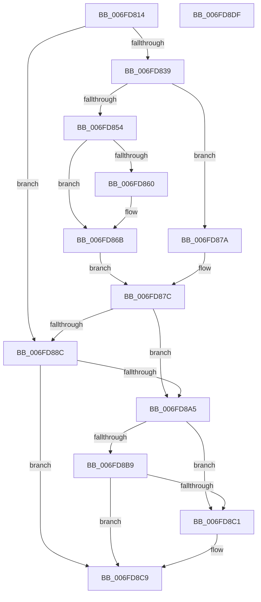

# FsRtlpOplockGetThreadIntegrityLevel

- RVA: `0x006FD814`–`0x006FD8E0` (길이 `204` bytes)
- VA: `0x00000001406FD814`
- 실행 섹션: `PAGE`
- PDB 이름 있음: `예`; PDB Function 태그: `아니요`
- unwind 정보 RVA: `0x000701D4`
- 디코드: `59`개 명령, `204/204` bytes 표시
- 미해석 바이트: `0` (있으면 어셈블리에 `.byte`로 보존)

> 이 문서는 커널 이미지의 기계어와 PDB 기호를 분석해 생성했습니다. 4번과 5번은 함수 원형과 자료형을 바이너리 사용 방식에서 추정한 C 해석이며 원본 소스 복구 결과는 아닙니다.

## 1. Dependencies

- 직접 호출 지점: **6**; 고유 호출 대상: **6**
- 직접 호출자로 확인된 함수: **2**
- RIP 상대 이미지 참조: **0**

### Outgoing calls
- `0x006FD845` → [PspLockThreadSecurityShared](../../text/3C/PspLockThreadSecurityShared_function_003C4720.md) (function, `0x003C4720`)
- `0x006FD873` → [ObfReferenceObjectWithTag](../../text/21/ObfReferenceObjectWithTag_function_00210710.md) (function, `0x00210710`)
- `0x006FD882` → [PspUnlockThreadSecurityShared](../../text/3C/PspUnlockThreadSecurityShared_function_003C2E40.md) (function, `0x003C2E40`)
- `0x006FD898` → [PsReferencePrimaryTokenWithTag](../../text/20/PsReferencePrimaryTokenWithTag_function_0020FF80.md) (function, `0x0020FF80`)
- `0x006FD8B0` → [SeQueryInformationToken](../8B/SeQueryInformationToken_function_008B5090.md) (function, `0x008B5090`)
- `0x006FD8C4` → [ObfDereferenceObject](../../text/2F/ObfDereferenceObject_function_002F9350.md) (function, `0x002F9350`)

### Direct callers
- [FsRtlpOplockTryPrepForAckTimeout](../71/FsRtlpOplockTryPrepForAckTimeout_function_007156C0.md) at `0x007157BF`
- [FsRtlpOplockTryStartBreakAckTimeout](../71/FsRtlpOplockTryStartBreakAckTimeout_function_007158B4.md) at `0x007158F8`

### Static image references
- 디코드된 RIP-relative 메모리 참조가 없습니다.

## 2. Other-region calls and transfers

- 다른 실행 섹션으로 향하는 call: **5**
  - `0x006FD845` → [PspLockThreadSecurityShared](../../text/3C/PspLockThreadSecurityShared_function_003C4720.md) (`PAGE` → `.text`)
  - `0x006FD873` → [ObfReferenceObjectWithTag](../../text/21/ObfReferenceObjectWithTag_function_00210710.md) (`PAGE` → `.text`)
  - `0x006FD882` → [PspUnlockThreadSecurityShared](../../text/3C/PspUnlockThreadSecurityShared_function_003C2E40.md) (`PAGE` → `.text`)
  - `0x006FD898` → [PsReferencePrimaryTokenWithTag](../../text/20/PsReferencePrimaryTokenWithTag_function_0020FF80.md) (`PAGE` → `.text`)
  - `0x006FD8C4` → [ObfDereferenceObject](../../text/2F/ObfDereferenceObject_function_002F9350.md) (`PAGE` → `.text`)
- 별도 외부 분기/꼬리 이동을 확인하지 못했습니다.

## 3. Assembly (complete function range)

```asm
006FD814  48 89 5C 24 10                  mov qword ptr [rsp + 0x10], rbx
006FD819  48 89 6C 24 18                  mov qword ptr [rsp + 0x18], rbp
006FD81E  56                              push rsi
006FD81F  57                              push rdi
006FD820  41 56                           push r14
006FD822  48 83 EC 20                     sub rsp, 0x20
006FD826  8B 81 A0 05 00 00               mov eax, dword ptr [rcx + 0x5a0]
006FD82C  40 32 F6                        xor sil, sil
006FD82F  4C 8B F2                        mov r14, rdx
006FD832  48 8B F9                        mov rdi, rcx
006FD835  A8 08                           test al, 8
006FD837  74 53                           je 0x1406fd88c
006FD839  65 48 8B 2C 25 88 01 00 00      mov rbp, qword ptr gs:[0x188]
006FD842  48 8B D5                        mov rdx, rbp
006FD845  E8 D6 6E CC FF                  call 0x1403c4720
006FD84A  8B 87 A0 05 00 00               mov eax, dword ptr [rdi + 0x5a0]
006FD850  A8 08                           test al, 8
006FD852  74 26                           je 0x1406fd87a
006FD854  48 8B 9F 48 06 00 00            mov rbx, qword ptr [rdi + 0x648]
006FD85B  48 85 DB                        test rbx, rbx
006FD85E  75 0B                           jne 0x1406fd86b
006FD860  48 8B 9F 38 05 00 00            mov rbx, qword ptr [rdi + 0x538]
006FD867  48 83 E3 F8                     and rbx, 0xfffffffffffffff8
006FD86B  BA 44 66 6C 74                  mov edx, 0x746c6644
006FD870  48 8B CB                        mov rcx, rbx
006FD873  E8 98 2E B1 FF                  call 0x140210710
006FD878  EB 02                           jmp 0x1406fd87c
006FD87A  33 DB                           xor ebx, ebx
006FD87C  48 8B D5                        mov rdx, rbp
006FD87F  48 8B CF                        mov rcx, rdi
006FD882  E8 B9 55 CC FF                  call 0x1403c2e40
006FD887  48 85 DB                        test rbx, rbx
006FD88A  75 19                           jne 0x1406fd8a5
006FD88C  48 8B 8F 20 02 00 00            mov rcx, qword ptr [rdi + 0x220]
006FD893  BA 44 66 6C 74                  mov edx, 0x746c6644
006FD898  E8 E3 26 B1 FF                  call 0x14020ff80
006FD89D  48 8B D8                        mov rbx, rax
006FD8A0  48 85 C0                        test rax, rax
006FD8A3  74 24                           je 0x1406fd8c9
006FD8A5  4D 8B C6                        mov r8, r14
006FD8A8  BA 19 00 00 00                  mov edx, 0x19
006FD8AD  48 8B CB                        mov rcx, rbx
006FD8B0  E8 DB 77 1B 00                  call 0x1408b5090
006FD8B5  85 C0                           test eax, eax
006FD8B7  78 08                           js 0x1406fd8c1
006FD8B9  40 B6 01                        mov sil, 1
006FD8BC  48 85 DB                        test rbx, rbx
006FD8BF  74 08                           je 0x1406fd8c9
006FD8C1  48 8B CB                        mov rcx, rbx
006FD8C4  E8 87 BA BF FF                  call 0x1402f9350
006FD8C9  48 8B 5C 24 48                  mov rbx, qword ptr [rsp + 0x48]
006FD8CE  40 8A C6                        mov al, sil
006FD8D1  48 8B 6C 24 50                  mov rbp, qword ptr [rsp + 0x50]
006FD8D6  48 83 C4 20                     add rsp, 0x20
006FD8DA  41 5E                           pop r14
006FD8DC  5F                              pop rdi
006FD8DD  5E                              pop rsi
006FD8DE  C3                              ret
006FD8DF  CC                              int3
```

## 4. C-style interpretation (structured pseudocode)

```c
__int64 __fastcall FsRtlpOplockGetThreadIntegrityLevel(__int64 a1, __int64 a2)
{
    __int64 result;
    __int64 v_rbx;
    __int64 v_rsi;
    __int64 v_rsp;
    unsigned __int64 v_stack_p10;
    unsigned __int64 v_stack_p18;

    v_stack_p10 = v_rbx;
    v_stack_p18 = v_rbp;
    v_rsp = (v_rsp) - (32);
    v_rsi = 0;
    if ((((unsigned __int8)((unsigned int)(*(unsigned int *)(a1 + 1440)))) & (8)) == 0) goto loc_006FD88C;
    result = PspLockThreadSecurityShared(a1, *(unsigned __int64 *)(gs_base + (0 + 392)), a3, a4);
    if ((((unsigned __int8)((unsigned int)(*(unsigned int *)(a1 + 1440)))) & (8)) == 0) goto loc_006FD87A;
    v_rbx = *(unsigned __int64 *)(a1 + 1608);
    if (*(unsigned __int64 *)(a1 + 1608) == 0) {
        v_rbx = *(unsigned __int64 *)(a1 + 1336);
        v_rbx = (v_rbx) & (-8);
    }
    result = ObfReferenceObjectWithTag(v_rbx, (unsigned int)(0x746C6644ULL), a3, a4);
    goto loc_006FD87C;
loc_006FD87A:
    v_rbx = 0;
loc_006FD87C:
    result = PspUnlockThreadSecurityShared(a1, *(unsigned __int64 *)(gs_base + (0 + 392)), a3, a4);
    if (0 != 0) goto loc_006FD8A5;
loc_006FD88C:
    result = PsReferencePrimaryTokenWithTag(*(unsigned __int64 *)(a1 + 544), (unsigned int)(0x746C6644ULL), a3, a4);
    if (result == 0) goto loc_006FD8C9;
loc_006FD8A5:
    result = SeQueryInformationToken(result, 25, a2, a4);
    if (sign_flag) goto loc_006FD8C1;
    if (result != 0) {
        a1 = result;
        result = ObfDereferenceObject(a1, 25, a2, a4);
    }
    v_rsp = (v_rsp) + (32);
    return 1;
}
```

## 5. (Beta) C Style

```c
int64_t FsRtlpOplockGetThreadIntegrityLevel(void *Arg1, int64_t Arg2)
{
    uint8_t *arg1 = (uint8_t *)Arg1;

    int64_t result;
    int64_t local_rbx;
    int64_t local_rsi;
    int64_t local_rsp;
    uint64_t v_stack_p10;
    uint64_t v_stack_p18;

    v_stack_p10 = local_rbx;
    v_stack_p18 = local_rbp;
    local_rsp = (local_rsp) - (32);
    local_rsi = 0;
    if ((((uint8_t)((uint32_t)(*(uint32_t *)(arg1 + 0x5A0)))) & (8)) == 0) goto loc_006FD88C;
    result = PspLockThreadSecurityShared(Arg1, *(uint64_t *)(gs_base + (0 + 0x188)), a3, a4);
    if ((((uint8_t)((uint32_t)(*(uint32_t *)(arg1 + 0x5A0)))) & (8)) == 0) goto loc_006FD87A;
    local_rbx = *(uint64_t *)(arg1 + 0x648);
    if (*(uint64_t *)(arg1 + 0x648) == 0) {
        local_rbx = *(uint64_t *)(arg1 + 0x538);
        local_rbx = (local_rbx) & (-8);
    }
    result = ObfReferenceObjectWithTag(local_rbx, (uint32_t)(0x746C6644ULL), a3, a4);
    goto loc_006FD87C;
loc_006FD87A:
    local_rbx = 0;
loc_006FD87C:
    result = PspUnlockThreadSecurityShared(Arg1, *(uint64_t *)(gs_base + (0 + 0x188)), a3, a4);
    if (0 != 0) goto loc_006FD8A5;
loc_006FD88C:
    result = PsReferencePrimaryTokenWithTag(*(uint64_t *)(arg1 + 0x220), (uint32_t)(0x746C6644ULL), a3, a4);
    if (result == 0) goto loc_006FD8C9;
loc_006FD8A5:
    result = SeQueryInformationToken(result, 25, Arg2, a4);
    if (sign_flag) goto loc_006FD8C1;
    if (result != 0) {
        Arg1 = result;
        result = ObfDereferenceObject(Arg1, 25, Arg2, a4);
    }
    local_rsp = (local_rsp) + (32);
    return 1;
}
```

### 관측된 메모리 오프셋

구조체 형식이 확인되지 않은 접근은 인자 기준의 오프셋으로만 기록했습니다.

| 기준 인자 | 오프셋 표현 | 폭 (bit) | 접근 |
|---|---:|---:|---|
| `Arg1` | `+ 0x220` | `64` | `R` |
| `Arg1` | `+ 0x538` | `64` | `R` |
| `Arg1` | `+ 0x5A0` | `32` | `R` |
| `Arg1` | `+ 0x648` | `64` | `R` |

## 6. Execution-region graph

[열기: 2D/3D 그래프와 함수 탐색 컨트롤 패널](../../../control-panel.html?section=page&rva=0x006FD814&view=graph)

- 2D 그래프는 위에서 아래로 흐르고, 3D 그래프는 빈 공간을 드래그해 회전합니다. Shift+드래그는 이동, 휠은 확대·축소, 함수 노드 선택은 대상 보고서 이동입니다.

### Static fallback


