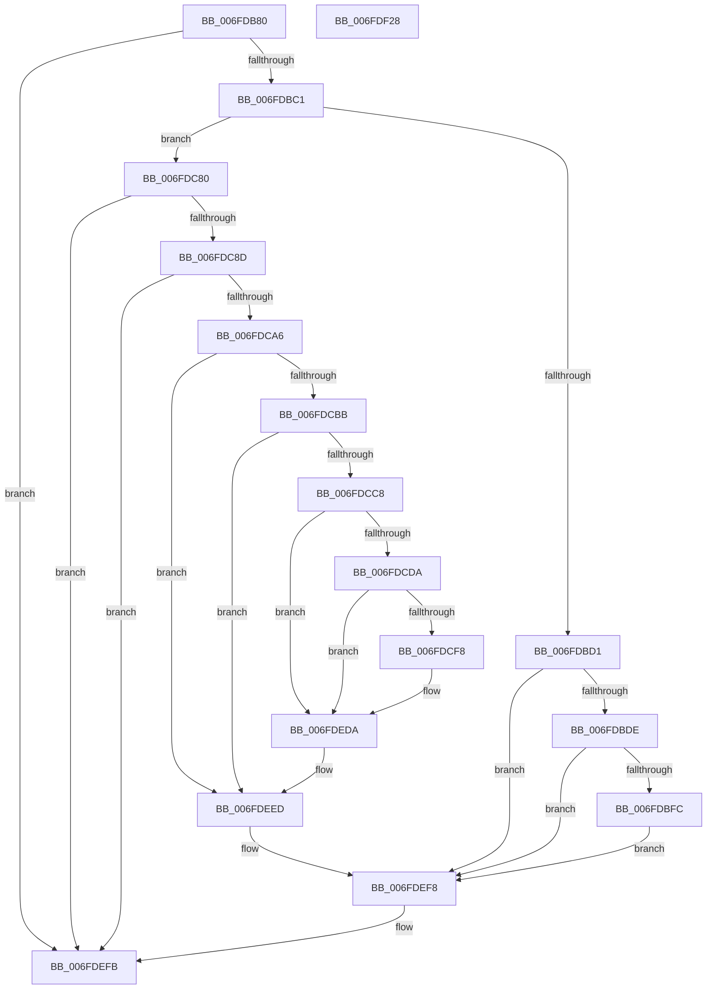

# FsRtlpOplockPerfSendData

- RVA: `0x006FDB80`–`0x006FDF29` (길이 `937` bytes)
- VA: `0x00000001406FDB80`
- 실행 섹션: `PAGE`
- PDB 이름 있음: `예`; PDB Function 태그: `아니요`
- unwind 정보 RVA: `0x000BCE1C`
- 디코드: `176`개 명령, `937/937` bytes 표시
- 미해석 바이트: `0` (있으면 어셈블리에 `.byte`로 보존)

> 이 문서는 커널 이미지의 기계어와 PDB 기호를 분석해 생성했습니다. 4번과 5번은 함수 원형과 자료형을 바이너리 사용 방식에서 추정한 C 해석이며 원본 소스 복구 결과는 아닙니다.

## 1. Dependencies

- 직접 호출 지점: **10**; 고유 호출 대상: **9**
- 직접 호출자로 확인된 함수: **8**
- RIP 상대 이미지 참조: **18**

### Outgoing calls
- `0x006FDBEF` → [tlgKeywordOn](../../text/42/tlgKeywordOn_function_0042EAA0.md) (function, `0x0042EAA0`)
- `0x006FDC76` → [tlgWriteAgg](../../text/2F/tlgWriteAgg_function_002F0F7C.md) (function, `0x002F0F7C`)
- `0x006FDC80` → [FsRtlpOplockIsSubjectToTimeout](../../text/4F/FsRtlpOplockIsSubjectToTimeout_function_004F5000.md) (function, `0x004F5000`)
- `0x006FDC8D` → [FsRtlpOplockPerfBucketize](../71/FsRtlpOplockPerfBucketize_function_00715120.md) (function, `0x00715120`)
- `0x006FDCBB` → [FsRtlpOplockPerfPrepareToSendData](../71/FsRtlpOplockPerfPrepareToSendData_function_0071532C.md) (function, `0x0071532C`)
- `0x006FDCC8` → [FsRtlpOplockPerfSummarizeData](../71/FsRtlpOplockPerfSummarizeData_function_007153DC.md) (function, `0x007153DC`)
- `0x006FDCEB` → [tlgKeywordOn](../../text/42/tlgKeywordOn_function_0042EAA0.md) (function, `0x0042EAA0`)
- `0x006FDED5` → [tlgWriteTransfer_EtwWriteTransfer](../../text/42/tlgWriteTransfer_EtwWriteTransfer_function_004260E0.md) (function, `0x004260E0`)
- `0x006FDEDA` → [FsRtlpOplockPerfCleanupData](../71/FsRtlpOplockPerfCleanupData_function_007151C4.md) (function, `0x007151C4`)
- `0x006FDF0A` → [_security_check_cookie](../../text/6A/_security_check_cookie_function_006AC640.md) (function, `0x006AC640`)

### Direct callers
- [FsRtlpAcknowledgeOplockBreakByCacheFlags](../../text/3F/FsRtlpAcknowledgeOplockBreakByCacheFlags_function_003F1988.md) at `0x003F2255`
- [FsRtlpOplockCleanup](../../text/42/FsRtlpOplockCleanup_function_00425030.md) at `0x00425467`
- [FsRtlpOplockCleanup](../../text/42/FsRtlpOplockCleanup_function_00425030.md) at `0x00425542`
- [FsRtlpOplockCleanup](../../text/42/FsRtlpOplockCleanup_function_00425030.md) at `0x00425690`
- [FsRtlpCancelOplockRHIrp](../../text/4A/FsRtlpCancelOplockRHIrp_function_004A55F0.md) at `0x004A572C`
- [FsRtlUninitializeOplock](../../text/4E/FsRtlUninitializeOplock_function_004E42C0.md) at `0x004E43FB`
- [FsRtlUninitializeOplock](../../text/4E/FsRtlUninitializeOplock_function_004E42C0.md) at `0x004E44CA`
- [FsRtlpCancelExclusiveIrp](../../text/4F/FsRtlpCancelExclusiveIrp_function_004F96CC.md) at `0x004F97A7`
- [FsRtlpAcknowledgeOplockBreak](../../text/58/FsRtlpAcknowledgeOplockBreak_function_00582144.md) at `0x0058233C`
- [FsRtlpGrantAnyOplockFromExclusive](../../text/58/FsRtlpGrantAnyOplockFromExclusive_function_00582540.md) at `0x00582746`
- [FsRtlpGrantAnyOplockFromExclusive](../../text/58/FsRtlpGrantAnyOplockFromExclusive_function_00582540.md) at `0x005827D6`
- [FsRtlpOpBatchBreakClosePending](../71/FsRtlpOpBatchBreakClosePending_function_00714CDC.md) at `0x00714DBB`

### Static image references
- `0x006FDB9E` → RVA `0x00E0A740` (`.data`; read)
- `0x006FDBD1` → RVA `0x00E06C50` (`.data`; read)
- `0x006FDC2C` → RVA `0x0004424D` (`.rdata`; read)
- `0x006FDC92` → RVA `0x00E65C08` (`.data`; read)
- `0x006FDCF8` → RVA `0x00E65C50` (`.data`; read)
- `0x006FDD1B` → RVA `0x00E65C98` (`.data`; read)
- `0x006FDD30` → RVA `0x00E65C58` (`.data`; read)
- `0x006FDD45` → RVA `0x00E65C60` (`.data`; read)
- `0x006FDD5A` → RVA `0x00E65C68` (`.data`; read)
- `0x006FDD6F` → RVA `0x00E65C80` (`.data`; read)
- `0x006FDD82` → RVA `0x00E65C88` (`.data`; read)
- `0x006FDD95` → RVA `0x00E65C70` (`.data`; read)
- `0x006FDDA8` → RVA `0x00E65C78` (`.data`; read)
- `0x006FDDCC` → RVA `0x00E65D20` (`.data`; read)
- `0x006FDDE3` → RVA `0x00E65C30` (`.data`; read)
- `0x006FDDF3` → RVA `0x00E65C52` (`.data`; read)
- `0x006FDE0F` → RVA `0x00E65C38` (`.data`; read)
- `0x006FDEC7` → RVA `0x000440F0` (`.rdata`; read)

## 2. Other-region calls and transfers

- 다른 실행 섹션으로 향하는 call: **6**
  - `0x006FDBEF` → [tlgKeywordOn](../../text/42/tlgKeywordOn_function_0042EAA0.md) (`PAGE` → `.text`)
  - `0x006FDC76` → [tlgWriteAgg](../../text/2F/tlgWriteAgg_function_002F0F7C.md) (`PAGE` → `.text`)
  - `0x006FDC80` → [FsRtlpOplockIsSubjectToTimeout](../../text/4F/FsRtlpOplockIsSubjectToTimeout_function_004F5000.md) (`PAGE` → `.text`)
  - `0x006FDCEB` → [tlgKeywordOn](../../text/42/tlgKeywordOn_function_0042EAA0.md) (`PAGE` → `.text`)
  - `0x006FDED5` → [tlgWriteTransfer_EtwWriteTransfer](../../text/42/tlgWriteTransfer_EtwWriteTransfer_function_004260E0.md) (`PAGE` → `.text`)
  - `0x006FDF0A` → [_security_check_cookie](../../text/6A/_security_check_cookie_function_006AC640.md) (`PAGE` → `.text`)
- 별도 외부 분기/꼬리 이동을 확인하지 못했습니다.

## 3. Assembly (complete function range)

```asm
006FDB80  48 8B C4                        mov rax, rsp
006FDB83  48 89 58 10                     mov qword ptr [rax + 0x10], rbx
006FDB87  48 89 70 18                     mov qword ptr [rax + 0x18], rsi
006FDB8B  48 89 78 20                     mov qword ptr [rax + 0x20], rdi
006FDB8F  55                              push rbp
006FDB90  48 8D A8 D8 FE FF FF            lea rbp, [rax - 0x128]
006FDB97  48 81 EC 20 02 00 00            sub rsp, 0x220
006FDB9E  48 8B 05 9B CB 70 00            mov rax, qword ptr [rip + 0x70cb9b]
006FDBA5  48 33 C4                        xor rax, rsp
006FDBA8  48 89 85 10 01 00 00            mov qword ptr [rbp + 0x110], rax
006FDBAF  33 F6                           xor esi, esi
006FDBB1  48 8D 51 08                     lea rdx, [rcx + 8]
006FDBB5  48 8B D9                        mov rbx, rcx
006FDBB8  48 39 31                        cmp qword ptr [rcx], rsi
006FDBBB  0F 84 3A 03 00 00               je 0x1406fdefb
006FDBC1  44 8B 02                        mov r8d, dword ptr [rdx]
006FDBC4  48 8B FA                        mov rdi, rdx
006FDBC7  41 F6 C0 01                     test r8b, 1
006FDBCB  0F 84 AF 00 00 00               je 0x1406fdc80
006FDBD1  83 3D 78 90 70 00 05            cmp dword ptr [rip + 0x709078], 5
006FDBD8  0F 86 1A 03 00 00               jbe 0x1406fdef8
006FDBDE  48 BA 00 00 00 00 00 40 00 00   movabs rdx, 0x400000000000
006FDBE8  48 8D 0D 61 90 70 00            lea rcx, [rip + 0x709061]
006FDBEF  E8 AC 0E D3 FF                  call 0x14042eaa0
006FDBF4  84 C0                           test al, al
006FDBF6  0F 84 FC 02 00 00               je 0x1406fdef8
006FDBFC  48 8D 44 24 48                  lea rax, [rsp + 0x48]
006FDC01  48 C7 44 24 48 01 00 00 00      mov qword ptr [rsp + 0x48], 1
006FDC0A  48 89 85 E0 00 00 00            mov qword ptr [rbp + 0xe0], rax
006FDC11  44 8D 4E 05                     lea r9d, [rsi + 5]
006FDC15  48 8D 44 24 3C                  lea rax, [rsp + 0x3c]
006FDC1A  48 C7 85 E8 00 00 00 08 00 00 00  mov qword ptr [rbp + 0xe8], 8
006FDC25  48 89 85 F0 00 00 00            mov qword ptr [rbp + 0xf0], rax
006FDC2C  48 8D 15 1A 66 94 FF            lea rdx, [rip - 0x6b99e6]
006FDC33  48 8D 44 24 50                  lea rax, [rsp + 0x50]
006FDC38  44 89 44 24 3C                  mov dword ptr [rsp + 0x3c], r8d
006FDC3D  48 89 85 00 01 00 00            mov qword ptr [rbp + 0x100], rax
006FDC44  48 8D 0D 05 90 70 00            lea rcx, [rip + 0x709005]
006FDC4B  48 8D 85 C0 00 00 00            lea rax, [rbp + 0xc0]
006FDC52  48 C7 85 F8 00 00 00 04 00 00 00  mov qword ptr [rbp + 0xf8], 4
006FDC5D  48 89 44 24 20                  mov qword ptr [rsp + 0x20], rax
006FDC62  48 C7 44 24 50 00 00 00 01      mov qword ptr [rsp + 0x50], 0x1000000
006FDC6B  48 C7 85 08 01 00 00 08 00 00 00  mov qword ptr [rbp + 0x108], 8
006FDC76  E8 01 33 BF FF                  call 0x1402f0f7c
006FDC7B  E9 78 02 00 00                  jmp 0x1406fdef8
006FDC80  E8 7B 73 DF FF                  call 0x1404f5000
006FDC85  84 C0                           test al, al
006FDC87  0F 84 6E 02 00 00               je 0x1406fdefb
006FDC8D  E8 8E 74 01 00                  call 0x140715120
006FDC92  48 8B 0D 6F 7F 76 00            mov rcx, qword ptr [rip + 0x767f6f]
006FDC99  48 8B D7                        mov rdx, rdi
006FDC9C  48 3B 41 18                     cmp rax, qword ptr [rcx + 0x18]
006FDCA0  0F 8C 55 02 00 00               jl 0x1406fdefb
006FDCA6  B8 01 00 00 00                  mov eax, 1
006FDCAB  F0 0F C1 41 20                  lock xadd dword ptr [rcx + 0x20], eax
006FDCB0  FF C0                           inc eax
006FDCB2  83 F8 01                        cmp eax, 1
006FDCB5  0F 85 32 02 00 00               jne 0x1406fdeed
006FDCBB  E8 6C 76 01 00                  call 0x14071532c
006FDCC0  84 C0                           test al, al
006FDCC2  0F 84 25 02 00 00               je 0x1406fdeed
006FDCC8  E8 0F 77 01 00                  call 0x1407153dc
006FDCCD  83 3D 7C 8F 70 00 05            cmp dword ptr [rip + 0x708f7c], 5
006FDCD4  0F 86 00 02 00 00               jbe 0x1406fdeda
006FDCDA  48 BA 00 00 00 00 00 20 00 00   movabs rdx, 0x200000000000
006FDCE4  48 8D 0D 65 8F 70 00            lea rcx, [rip + 0x708f65]
006FDCEB  E8 B0 0D D3 FF                  call 0x14042eaa0
006FDCF0  84 C0                           test al, al
006FDCF2  0F 84 E2 01 00 00               je 0x1406fdeda
006FDCF8  0F B7 0D 51 7F 76 00            movzx ecx, word ptr [rip + 0x767f51]
006FDCFF  48 8D 44 24 58                  lea rax, [rsp + 0x58]
006FDD04  48 89 45 C0                     mov qword ptr [rbp - 0x40], rax
006FDD08  BA 02 00 00 00                  mov edx, 2
006FDD0D  48 8D 44 24 40                  lea rax, [rsp + 0x40]
006FDD12  66 89 4C 24 34                  mov word ptr [rsp + 0x34], cx
006FDD17  48 89 45 D0                     mov qword ptr [rbp - 0x30], rax
006FDD1B  48 8B 05 76 7F 76 00            mov rax, qword ptr [rip + 0x767f76]
006FDD22  48 89 44 24 60                  mov qword ptr [rsp + 0x60], rax
006FDD27  48 8D 44 24 60                  lea rax, [rsp + 0x60]
006FDD2C  48 89 45 E0                     mov qword ptr [rbp - 0x20], rax
006FDD30  48 8B 05 21 7F 76 00            mov rax, qword ptr [rip + 0x767f21]
006FDD37  48 89 44 24 68                  mov qword ptr [rsp + 0x68], rax
006FDD3C  48 8D 44 24 68                  lea rax, [rsp + 0x68]
006FDD41  48 89 45 F0                     mov qword ptr [rbp - 0x10], rax
006FDD45  48 8B 05 14 7F 76 00            mov rax, qword ptr [rip + 0x767f14]
006FDD4C  48 89 44 24 70                  mov qword ptr [rsp + 0x70], rax
006FDD51  48 8D 44 24 70                  lea rax, [rsp + 0x70]
006FDD56  48 89 45 00                     mov qword ptr [rbp], rax
006FDD5A  48 8B 05 07 7F 76 00            mov rax, qword ptr [rip + 0x767f07]
006FDD61  48 89 44 24 78                  mov qword ptr [rsp + 0x78], rax
006FDD66  48 8D 44 24 78                  lea rax, [rsp + 0x78]
006FDD6B  48 89 45 10                     mov qword ptr [rbp + 0x10], rax
006FDD6F  48 8B 05 0A 7F 76 00            mov rax, qword ptr [rip + 0x767f0a]
006FDD76  48 89 45 80                     mov qword ptr [rbp - 0x80], rax
006FDD7A  48 8D 45 80                     lea rax, [rbp - 0x80]
006FDD7E  48 89 45 20                     mov qword ptr [rbp + 0x20], rax
006FDD82  48 8B 05 FF 7E 76 00            mov rax, qword ptr [rip + 0x767eff]
006FDD89  48 89 45 88                     mov qword ptr [rbp - 0x78], rax
006FDD8D  48 8D 45 88                     lea rax, [rbp - 0x78]
006FDD91  48 89 45 30                     mov qword ptr [rbp + 0x30], rax
006FDD95  48 8B 05 D4 7E 76 00            mov rax, qword ptr [rip + 0x767ed4]
006FDD9C  48 89 45 90                     mov qword ptr [rbp - 0x70], rax
006FDDA0  48 8D 45 90                     lea rax, [rbp - 0x70]
006FDDA4  48 89 45 40                     mov qword ptr [rbp + 0x40], rax
006FDDA8  48 8B 05 C9 7E 76 00            mov rax, qword ptr [rip + 0x767ec9]
006FDDAF  48 89 45 98                     mov qword ptr [rbp - 0x68], rax
006FDDB3  48 8D 45 98                     lea rax, [rbp - 0x68]
006FDDB7  48 89 45 50                     mov qword ptr [rbp + 0x50], rax
006FDDBB  8D 42 0E                        lea eax, [rdx + 0xe]
006FDDBE  66 89 44 24 30                  mov word ptr [rsp + 0x30], ax
006FDDC3  48 8D 44 24 30                  lea rax, [rsp + 0x30]
006FDDC8  48 89 45 60                     mov qword ptr [rbp + 0x60], rax
006FDDCC  48 8D 05 4D 7F 76 00            lea rax, [rip + 0x767f4d]
006FDDD3  48 89 45 70                     mov qword ptr [rbp + 0x70], rax
006FDDD7  48 8D 44 24 34                  lea rax, [rsp + 0x34]
006FDDDC  48 89 85 80 00 00 00            mov qword ptr [rbp + 0x80], rax
006FDDE3  48 8B 05 46 7E 76 00            mov rax, qword ptr [rip + 0x767e46]
006FDDEA  48 89 85 90 00 00 00            mov qword ptr [rbp + 0x90], rax
006FDDF1  8B C1                           mov eax, ecx
006FDDF3  0F B7 0D 58 7E 76 00            movzx ecx, word ptr [rip + 0x767e58]
006FDDFA  C1 E0 03                        shl eax, 3
006FDDFD  89 85 98 00 00 00               mov dword ptr [rbp + 0x98], eax
006FDE03  48 8D 44 24 38                  lea rax, [rsp + 0x38]
006FDE08  48 89 85 A0 00 00 00            mov qword ptr [rbp + 0xa0], rax
006FDE0F  48 8B 05 22 7E 76 00            mov rax, qword ptr [rip + 0x767e22]
006FDE16  48 89 85 B0 00 00 00            mov qword ptr [rbp + 0xb0], rax
006FDE1D  8B C1                           mov eax, ecx
006FDE1F  C1 E0 03                        shl eax, 3
006FDE22  89 85 B8 00 00 00               mov dword ptr [rbp + 0xb8], eax
006FDE28  48 8D 45 A0                     lea rax, [rbp - 0x60]
006FDE2C  48 89 44 24 28                  mov qword ptr [rsp + 0x28], rax
006FDE31  48 C7 44 24 58 00 00 00 01      mov qword ptr [rsp + 0x58], 0x1000000
006FDE3A  48 C7 45 C8 08 00 00 00         mov qword ptr [rbp - 0x38], 8
006FDE42  89 54 24 40                     mov dword ptr [rsp + 0x40], edx
006FDE46  48 C7 45 D8 04 00 00 00         mov qword ptr [rbp - 0x28], 4
006FDE4E  48 C7 45 E8 08 00 00 00         mov qword ptr [rbp - 0x18], 8
006FDE56  48 C7 45 F8 08 00 00 00         mov qword ptr [rbp - 8], 8
006FDE5E  48 C7 45 08 08 00 00 00         mov qword ptr [rbp + 8], 8
006FDE66  48 C7 45 18 08 00 00 00         mov qword ptr [rbp + 0x18], 8
006FDE6E  48 C7 45 28 08 00 00 00         mov qword ptr [rbp + 0x28], 8
006FDE76  48 C7 45 38 08 00 00 00         mov qword ptr [rbp + 0x38], 8
006FDE7E  48 C7 45 48 08 00 00 00         mov qword ptr [rbp + 0x48], 8
006FDE86  48 C7 45 58 08 00 00 00         mov qword ptr [rbp + 0x58], 8
006FDE8E  48 89 55 68                     mov qword ptr [rbp + 0x68], rdx
006FDE92  48 C7 45 78 80 00 00 00         mov qword ptr [rbp + 0x78], 0x80
006FDE9A  48 89 95 88 00 00 00            mov qword ptr [rbp + 0x88], rdx
006FDEA1  89 B5 9C 00 00 00               mov dword ptr [rbp + 0x9c], esi
006FDEA7  66 89 4C 24 38                  mov word ptr [rsp + 0x38], cx
006FDEAC  48 89 95 A8 00 00 00            mov qword ptr [rbp + 0xa8], rdx
006FDEB3  89 B5 BC 00 00 00               mov dword ptr [rbp + 0xbc], esi
006FDEB9  45 33 C9                        xor r9d, r9d
006FDEBC  C7 44 24 20 12 00 00 00         mov dword ptr [rsp + 0x20], 0x12
006FDEC4  45 33 C0                        xor r8d, r8d
006FDEC7  48 8D 15 22 62 94 FF            lea rdx, [rip - 0x6b9dde]
006FDECE  48 8D 0D 7B 8D 70 00            lea rcx, [rip + 0x708d7b]
006FDED5  E8 06 82 D2 FF                  call 0x1404260e0
006FDEDA  E8 E5 72 01 00                  call 0x1407151c4
006FDEDF  48 8B 0D 22 7D 76 00            mov rcx, qword ptr [rip + 0x767d22]
006FDEE6  48 8B C6                        mov rax, rsi
006FDEE9  48 87 41 10                     xchg qword ptr [rcx + 0x10], rax
006FDEED  48 8B 05 14 7D 76 00            mov rax, qword ptr [rip + 0x767d14]
006FDEF4  F0 FF 48 20                     lock dec dword ptr [rax + 0x20]
006FDEF8  48 8B D7                        mov rdx, rdi
006FDEFB  48 89 33                        mov qword ptr [rbx], rsi
006FDEFE  89 32                           mov dword ptr [rdx], esi
006FDF00  48 8B 8D 10 01 00 00            mov rcx, qword ptr [rbp + 0x110]
006FDF07  48 33 CC                        xor rcx, rsp
006FDF0A  E8 31 E7 FA FF                  call 0x1406ac640
006FDF0F  4C 8D 9C 24 20 02 00 00         lea r11, [rsp + 0x220]
006FDF17  49 8B 5B 18                     mov rbx, qword ptr [r11 + 0x18]
006FDF1B  49 8B 73 20                     mov rsi, qword ptr [r11 + 0x20]
006FDF1F  49 8B 7B 28                     mov rdi, qword ptr [r11 + 0x28]
006FDF23  49 8B E3                        mov rsp, r11
006FDF26  5D                              pop rbp
006FDF27  C3                              ret
006FDF28  CC                              int3
```

## 4. C-style interpretation (structured pseudocode)

```c
__int64 __fastcall FsRtlpOplockPerfSendData(__int64 a1)
{
    __int64 result;
    __int64 v_rsi;
    __int64 v_rsp;
    unsigned __int64 v_stack_m1B0;
    unsigned __int64 v_stack_m1B8;
    unsigned __int64 v_stack_m1C0;
    unsigned __int64 v_stack_m1C8;
    unsigned __int64 v_stack_m1D0;
    unsigned __int64 v_stack_m1D8;
    unsigned __int64 v_stack_m1E0;
    unsigned __int64 v_stack_m1E8;
    unsigned __int64 v_stack_m1EC;
    unsigned __int64 v_stack_m1F0;
    unsigned __int16 v_stack_m1F4;
    unsigned __int16 v_stack_m1F8;
    unsigned __int64 v_stack_m200;
    unsigned __int64 v_stack_m208;
    unsigned __int64 v_stack_m8;

    *(unsigned __int64 *)(v_rsp + 16) = v_rbx;
    *(unsigned __int64 *)(v_rsp + 24) = v_rsi;
    *(unsigned __int64 *)(v_rsp + 32) = v_rdi;
    v_rsp = (v_rsp) - (544);
    result = (*(unsigned __int64 *)(v_rip + 7392155)) ^ (v_rsp);
    *(unsigned __int64 *)(v_rsp - 296 + 272) = result;
    v_rsi = 0;
    if ((*(unsigned __int64 *)(a1)) == 0) goto loc_006FDEFB;
    if ((((unsigned __int8)((unsigned int)(*(unsigned int *)(a1 + 8)))) & (1)) == 0) goto loc_006FDC80;
    if ((*(unsigned int *)(v_rip + 7377016)) <= 5) goto loc_006FDEF8;
    result = tlgKeywordOn(v_rip + 7376993, a1 + 8, (unsigned int)(*(unsigned int *)(a1 + 8)), a4);
    if ((unsigned __int8)(result) == 0) goto loc_006FDEF8;
    v_stack_m1E0 = 1;
    *(unsigned __int64 *)(v_rsp - 296 + 224) = v_stack_m1E0;
    *(unsigned __int64 *)(v_rsp - 296 + 232) = 8;
    *(unsigned __int64 *)(v_rsp - 296 + 240) = v_stack_m1EC;
    v_stack_m1EC = (unsigned int)((unsigned int)(*(unsigned int *)(a1 + 8)));
    *(unsigned __int64 *)(v_rsp - 296 + 256) = v_stack_m1D8;
    *(unsigned __int64 *)(v_rsp - 296 + 248) = 4;
    v_stack_m208 = v_rsp - 296 + 192;
    v_stack_m1D8 = 0x1000000ULL;
    *(unsigned __int64 *)(v_rsp - 296 + 264) = 8;
    result = tlgWriteAgg(v_rip + 7376901, v_rip - 7051750, (unsigned int)(*(unsigned int *)(a1 + 8)), v_rsi + 5);
    goto loc_006FDEF8;
loc_006FDC80:
    result = FsRtlpOplockIsSubjectToTimeout(v_rip + 7376901, v_rip - 7051750, (unsigned int)(*(unsigned int *)(a1 + 8)), v_rsi + 5);
    if ((unsigned __int8)(result) == 0) goto loc_006FDEFB;
    result = FsRtlpOplockPerfBucketize(v_rip + 7376901, v_rip - 7051750, (unsigned int)(*(unsigned int *)(a1 + 8)), v_rsi + 5);
    if (result < (*(unsigned __int64 *)(*(unsigned __int64 *)(v_rip + 7765871) + 24))) goto loc_006FDEFB;
    result = (unsigned int)((1) + 1);
    if (((unsigned int)(result)) != 1) goto loc_006FDEED;
    result = FsRtlpOplockPerfPrepareToSendData(*(unsigned __int64 *)(v_rip + 7765871), a1 + 8, (unsigned int)(*(unsigned int *)(a1 + 8)), v_rsi + 5);
    if ((unsigned __int8)(result) == 0) goto loc_006FDEED;
    result = FsRtlpOplockPerfSummarizeData(*(unsigned __int64 *)(v_rip + 7765871), a1 + 8, (unsigned int)(*(unsigned int *)(a1 + 8)), v_rsi + 5);
    if ((*(unsigned int *)(v_rip + 7376764)) <= 5) goto loc_006FDEDA;
    result = tlgKeywordOn(v_rip + 7376741, a1 + 8, (unsigned int)(*(unsigned int *)(a1 + 8)), v_rsi + 5);
    if ((unsigned __int8)(result) != 0) {
        a1 = *(unsigned __int16 *)(v_rip + 7765841);
        result = v_stack_m1D0;
        *(unsigned __int64 *)(v_rsp - 296 - 64) = result;
        a2 = 2;
        result = v_stack_m1E8;
        v_stack_m1F4 = (unsigned __int16)(a1);
        *(unsigned __int64 *)(v_rsp - 296 - 48) = result;
        result = *(unsigned __int64 *)(v_rip + 7765878);
        v_stack_m1C8 = result;
        result = v_stack_m1C8;
        *(unsigned __int64 *)(v_rsp - 296 - 32) = result;
        result = *(unsigned __int64 *)(v_rip + 7765793);
        v_stack_m1C0 = result;
        result = v_stack_m1C0;
        *(unsigned __int64 *)(v_rsp - 296 - 16) = result;
        result = *(unsigned __int64 *)(v_rip + 7765780);
        v_stack_m1B8 = result;
        result = v_stack_m1B8;
        *(unsigned __int64 *)(v_rsp - 296) = result;
        result = *(unsigned __int64 *)(v_rip + 7765767);
        v_stack_m1B0 = result;
        result = v_stack_m1B0;
        *(unsigned __int64 *)(v_rsp - 296 + 16) = result;
        result = *(unsigned __int64 *)(v_rip + 7765770);
        *(unsigned __int64 *)(v_rsp - 296 - 128) = result;
        result = v_rsp - 296 - 128;
        *(unsigned __int64 *)(v_rsp - 296 + 32) = result;
        result = *(unsigned __int64 *)(v_rip + 7765759);
        *(unsigned __int64 *)(v_rsp - 296 - 120) = result;
        result = v_rsp - 296 - 120;
        *(unsigned __int64 *)(v_rsp - 296 + 48) = result;
        result = *(unsigned __int64 *)(v_rip + 7765716);
        *(unsigned __int64 *)(v_rsp - 296 - 112) = result;
        result = v_rsp - 296 - 112;
        *(unsigned __int64 *)(v_rsp - 296 + 64) = result;
        result = *(unsigned __int64 *)(v_rip + 7765705);
        *(unsigned __int64 *)(v_rsp - 296 - 104) = result;
        result = v_rsp - 296 - 104;
        *(unsigned __int64 *)(v_rsp - 296 + 80) = result;
        result = a2 + 14;
        v_stack_m1F8 = (unsigned __int16)(result);
        result = v_stack_m1F8;
        *(unsigned __int64 *)(v_rsp - 296 + 96) = result;
        result = v_rip + 7765837;
        *(unsigned __int64 *)(v_rsp - 296 + 112) = result;
        result = v_stack_m1F4;
        *(unsigned __int64 *)(v_rsp - 296 + 128) = result;
        result = *(unsigned __int64 *)(v_rip + 7765574);
        *(unsigned __int64 *)(v_rsp - 296 + 144) = result;
        result = (unsigned int)(a1);
        a1 = *(unsigned __int16 *)(v_rip + 7765592);
        result = (unsigned int)((result) << (3));
        *(unsigned int *)(v_rsp - 296 + 152) = (unsigned int)(result);
        result = v_stack_m1F0;
        *(unsigned __int64 *)(v_rsp - 296 + 160) = result;
        result = *(unsigned __int64 *)(v_rip + 7765538);
        *(unsigned __int64 *)(v_rsp - 296 + 176) = result;
        result = (unsigned int)(a1);
        result = (unsigned int)((result) << (3));
        *(unsigned int *)(v_rsp - 296 + 184) = (unsigned int)(result);
        result = v_rsp - 296 - 96;
        v_stack_m200 = result;
        v_stack_m1D0 = 0x1000000ULL;
        *(unsigned __int64 *)(v_rsp - 296 - 56) = 8;
        v_stack_m1E8 = (unsigned int)(a2);
        *(unsigned __int64 *)(v_rsp - 296 - 40) = 4;
        *(unsigned __int64 *)(v_rsp - 296 - 24) = 8;
        *(unsigned __int64 *)(v_rsp - 296 - 8) = 8;
        *(unsigned __int64 *)(v_rsp - 296 + 8) = 8;
        *(unsigned __int64 *)(v_rsp - 296 + 24) = 8;
        *(unsigned __int64 *)(v_rsp - 296 + 40) = 8;
        *(unsigned __int64 *)(v_rsp - 296 + 56) = 8;
        *(unsigned __int64 *)(v_rsp - 296 + 72) = 8;
        *(unsigned __int64 *)(v_rsp - 296 + 88) = 8;
        *(unsigned __int64 *)(v_rsp - 296 + 104) = a2;
        *(unsigned __int64 *)(v_rsp - 296 + 120) = 128;
        *(unsigned __int64 *)(v_rsp - 296 + 136) = a2;
        *(unsigned int *)(v_rsp - 296 + 156) = 0;
        v_stack_m1F0 = (unsigned __int16)(a1);
        *(unsigned __int64 *)(v_rsp - 296 + 168) = a2;
        *(unsigned int *)(v_rsp - 296 + 188) = 0;
        a4 = 0;
        v_stack_m208 = 18;
        a3 = 0;
        a2 = v_rip - 7052766;
        a1 = v_rip + 7376251;
        result = tlgWriteTransfer_EtwWriteTransfer(a1, a2, a3, a4);
    }
    result = FsRtlpOplockPerfCleanupData(a1, a2, a3, a4);
loc_006FDEED:
loc_006FDEF8:
loc_006FDEFB:
    *(unsigned __int64 *)(a1) = 0;
    *(unsigned int *)(a1 + 8) = 0;
    a1 = (*(unsigned __int64 *)(v_rsp - 296 + 272)) ^ (v_rsp);
    result = _security_check_cookie(a1, a1 + 8, a3, a4);
    return result;
}
```

## 5. (Beta) C Style

```c
int64_t FsRtlpOplockPerfSendData(void *Arg1)
{
    uint8_t *arg1 = (uint8_t *)Arg1;

    int64_t result;
    int64_t local_rsi;
    int64_t local_rsp;
    uint64_t v_stack_m1B0;
    uint64_t v_stack_m1B8;
    uint64_t v_stack_m1C0;
    uint64_t v_stack_m1C8;
    uint64_t v_stack_m1D0;
    uint64_t v_stack_m1D8;
    uint64_t v_stack_m1E0;
    uint64_t v_stack_m1E8;
    uint64_t v_stack_m1EC;
    uint64_t v_stack_m1F0;
    uint16_t v_stack_m1F4;
    uint16_t v_stack_m1F8;
    uint64_t v_stack_m200;
    uint64_t v_stack_m208;
    uint64_t v_stack_m8;

    *(uint64_t *)(local_rsp + 0x10) = local_rbx;
    *(uint64_t *)(local_rsp + 0x18) = local_rsi;
    *(uint64_t *)(local_rsp + 0x20) = local_rdi;
    local_rsp = (local_rsp) - (544);
    result = (*(uint64_t *)(v_rip + 0x70CB9B)) ^ (local_rsp);
    *(uint64_t *)(local_rsp - 0x128 + 0x110) = result;
    local_rsi = 0;
    if ((*(uint64_t *)(arg1)) == 0) goto loc_006FDEFB;
    if ((((uint8_t)((uint32_t)(*(uint32_t *)(arg1 + 0x8)))) & (1)) == 0) goto loc_006FDC80;
    if ((*(uint32_t *)(v_rip + 0x709078)) <= 5) goto loc_006FDEF8;
    result = tlgKeywordOn(v_rip + 7376993, Arg1 + 8, (uint32_t)(*(uint32_t *)(arg1 + 0x8)), a4);
    if ((uint8_t)(result) == 0) goto loc_006FDEF8;
    v_stack_m1E0 = 1;
    *(uint64_t *)(local_rsp - 0x128 + 0xE0) = v_stack_m1E0;
    *(uint64_t *)(local_rsp - 0x128 + 0xE8) = 8;
    *(uint64_t *)(local_rsp - 0x128 + 0xF0) = v_stack_m1EC;
    v_stack_m1EC = (uint32_t)((uint32_t)(*(uint32_t *)(arg1 + 0x8)));
    *(uint64_t *)(local_rsp - 0x128 + 0x100) = v_stack_m1D8;
    *(uint64_t *)(local_rsp - 0x128 + 0xF8) = 4;
    v_stack_m208 = local_rsp - 296 + 192;
    v_stack_m1D8 = 0x1000000ULL;
    *(uint64_t *)(local_rsp - 0x128 + 0x108) = 8;
    result = tlgWriteAgg(v_rip + 7376901, v_rip - 7051750, (uint32_t)(*(uint32_t *)(arg1 + 0x8)), local_rsi + 5);
    goto loc_006FDEF8;
loc_006FDC80:
    result = FsRtlpOplockIsSubjectToTimeout(v_rip + 7376901, v_rip - 7051750, (uint32_t)(*(uint32_t *)(arg1 + 0x8)), local_rsi + 5);
    if ((uint8_t)(result) == 0) goto loc_006FDEFB;
    result = FsRtlpOplockPerfBucketize(v_rip + 7376901, v_rip - 7051750, (uint32_t)(*(uint32_t *)(arg1 + 0x8)), local_rsi + 5);
    if (result < (*(uint64_t *)(*(uint64_t *)(v_rip + 0x767F6F) + 0x18))) goto loc_006FDEFB;
    result = (uint32_t)((1) + 1);
    if (((uint32_t)(result)) != 1) goto loc_006FDEED;
    result = FsRtlpOplockPerfPrepareToSendData(*(uint64_t *)(v_rip + 0x767F6F), Arg1 + 8, (uint32_t)(*(uint32_t *)(arg1 + 0x8)), local_rsi + 5);
    if ((uint8_t)(result) == 0) goto loc_006FDEED;
    result = FsRtlpOplockPerfSummarizeData(*(uint64_t *)(v_rip + 0x767F6F), Arg1 + 8, (uint32_t)(*(uint32_t *)(arg1 + 0x8)), local_rsi + 5);
    if ((*(uint32_t *)(v_rip + 0x708F7C)) <= 5) goto loc_006FDEDA;
    result = tlgKeywordOn(v_rip + 7376741, Arg1 + 8, (uint32_t)(*(uint32_t *)(arg1 + 0x8)), local_rsi + 5);
    if ((uint8_t)(result) != 0) {
        Arg1 = *(uint16_t *)(v_rip + 0x767F51);
        result = v_stack_m1D0;
        *(uint64_t *)(local_rsp - 0x128 - 0x40) = result;
        a2 = 2;
        result = v_stack_m1E8;
        v_stack_m1F4 = (uint16_t)(Arg1);
        *(uint64_t *)(local_rsp - 0x128 - 0x30) = result;
        result = *(uint64_t *)(v_rip + 0x767F76);
        v_stack_m1C8 = result;
        result = v_stack_m1C8;
        *(uint64_t *)(local_rsp - 0x128 - 0x20) = result;
        result = *(uint64_t *)(v_rip + 0x767F21);
        v_stack_m1C0 = result;
        result = v_stack_m1C0;
        *(uint64_t *)(local_rsp - 0x128 - 0x10) = result;
        result = *(uint64_t *)(v_rip + 0x767F14);
        v_stack_m1B8 = result;
        result = v_stack_m1B8;
        *(uint64_t *)(local_rsp - 0x128) = result;
        result = *(uint64_t *)(v_rip + 0x767F07);
        v_stack_m1B0 = result;
        result = v_stack_m1B0;
        *(uint64_t *)(local_rsp - 0x128 + 0x10) = result;
        result = *(uint64_t *)(v_rip + 0x767F0A);
        *(uint64_t *)(local_rsp - 0x128 - 0x80) = result;
        result = local_rsp - 296 - 128;
        *(uint64_t *)(local_rsp - 0x128 + 0x20) = result;
        result = *(uint64_t *)(v_rip + 0x767EFF);
        *(uint64_t *)(local_rsp - 0x128 - 0x78) = result;
        result = local_rsp - 296 - 120;
        *(uint64_t *)(local_rsp - 0x128 + 0x30) = result;
        result = *(uint64_t *)(v_rip + 0x767ED4);
        *(uint64_t *)(local_rsp - 0x128 - 0x70) = result;
        result = local_rsp - 296 - 112;
        *(uint64_t *)(local_rsp - 0x128 + 0x40) = result;
        result = *(uint64_t *)(v_rip + 0x767EC9);
        *(uint64_t *)(local_rsp - 0x128 - 0x68) = result;
        result = local_rsp - 296 - 104;
        *(uint64_t *)(local_rsp - 0x128 + 0x50) = result;
        result = a2 + 14;
        v_stack_m1F8 = (uint16_t)(result);
        result = v_stack_m1F8;
        *(uint64_t *)(local_rsp - 0x128 + 0x60) = result;
        result = v_rip + 7765837;
        *(uint64_t *)(local_rsp - 0x128 + 0x70) = result;
        result = v_stack_m1F4;
        *(uint64_t *)(local_rsp - 0x128 + 0x80) = result;
        result = *(uint64_t *)(v_rip + 0x767E46);
        *(uint64_t *)(local_rsp - 0x128 + 0x90) = result;
        result = (uint32_t)(Arg1);
        Arg1 = *(uint16_t *)(v_rip + 0x767E58);
        result = (uint32_t)((result) << (3));
        *(uint32_t *)(local_rsp - 0x128 + 0x98) = (uint32_t)(result);
        result = v_stack_m1F0;
        *(uint64_t *)(local_rsp - 0x128 + 0xA0) = result;
        result = *(uint64_t *)(v_rip + 0x767E22);
        *(uint64_t *)(local_rsp - 0x128 + 0xB0) = result;
        result = (uint32_t)(Arg1);
        result = (uint32_t)((result) << (3));
        *(uint32_t *)(local_rsp - 0x128 + 0xB8) = (uint32_t)(result);
        result = local_rsp - 296 - 96;
        v_stack_m200 = result;
        v_stack_m1D0 = 0x1000000ULL;
        *(uint64_t *)(local_rsp - 0x128 - 0x38) = 8;
        v_stack_m1E8 = (uint32_t)(a2);
        *(uint64_t *)(local_rsp - 0x128 - 0x28) = 4;
        *(uint64_t *)(local_rsp - 0x128 - 0x18) = 8;
        *(uint64_t *)(local_rsp - 0x128 - 0x8) = 8;
        *(uint64_t *)(local_rsp - 0x128 + 0x8) = 8;
        *(uint64_t *)(local_rsp - 0x128 + 0x18) = 8;
        *(uint64_t *)(local_rsp - 0x128 + 0x28) = 8;
        *(uint64_t *)(local_rsp - 0x128 + 0x38) = 8;
        *(uint64_t *)(local_rsp - 0x128 + 0x48) = 8;
        *(uint64_t *)(local_rsp - 0x128 + 0x58) = 8;
        *(uint64_t *)(local_rsp - 0x128 + 0x68) = a2;
        *(uint64_t *)(local_rsp - 0x128 + 0x78) = 128;
        *(uint64_t *)(local_rsp - 0x128 + 0x88) = a2;
        *(uint32_t *)(local_rsp - 0x128 + 0x9C) = 0;
        v_stack_m1F0 = (uint16_t)(Arg1);
        *(uint64_t *)(local_rsp - 0x128 + 0xA8) = a2;
        *(uint32_t *)(local_rsp - 0x128 + 0xBC) = 0;
        a4 = 0;
        v_stack_m208 = 18;
        a3 = 0;
        a2 = v_rip - 7052766;
        Arg1 = v_rip + 7376251;
        result = tlgWriteTransfer_EtwWriteTransfer(Arg1, a2, a3, a4);
    }
    result = FsRtlpOplockPerfCleanupData(Arg1, a2, a3, a4);
loc_006FDEED:
loc_006FDEF8:
loc_006FDEFB:
    *(uint64_t *)(arg1) = 0;
    *(uint32_t *)(arg1 + 0x8) = 0;
    Arg1 = (*(uint64_t *)(local_rsp - 0x128 + 0x110)) ^ (local_rsp);
    result = _security_check_cookie(Arg1, Arg1 + 8, a3, a4);
    return result;
}
```

### 관측된 메모리 오프셋

구조체 형식이 확인되지 않은 접근은 인자 기준의 오프셋으로만 기록했습니다.

| 기준 인자 | 오프셋 표현 | 폭 (bit) | 접근 |
|---|---:|---:|---|
| `Arg1` | `+ 0x0` | `32` | `R` |
| `Arg1` | `+ 0x0` | `64` | `R` |
| `Arg1` | `+ 0x0` | `64` | `W` |
| `Arg1` | `+ 0x8` | `64` | `R` |

## 6. Execution-region graph

[열기: 2D/3D 그래프와 함수 탐색 컨트롤 패널](../../../control-panel.html?section=page&rva=0x006FDB80&view=graph)

- 2D 그래프는 위에서 아래로 흐르고, 3D 그래프는 빈 공간을 드래그해 회전합니다. Shift+드래그는 이동, 휠은 확대·축소, 함수 노드 선택은 대상 보고서 이동입니다.

### Static fallback


