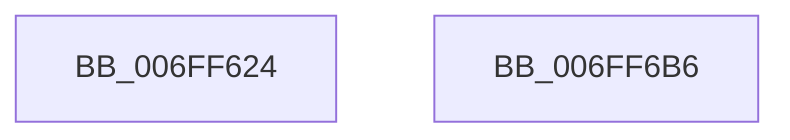

# KeInitializeProfileCallback

- RVA: `0x006FF624`–`0x006FF6B7` (길이 `147` bytes)
- VA: `0x00000001406FF624`
- 실행 섹션: `PAGE`
- PDB 이름 있음: `예`; PDB Function 태그: `아니요`
- unwind 정보 RVA: `0x0005E6B4`
- 디코드: `36`개 명령, `147/147` bytes 표시
- 미해석 바이트: `0` (있으면 어셈블리에 `.byte`로 보존)

> 이 문서는 커널 이미지의 기계어와 PDB 기호를 분석해 생성했습니다. 4번과 5번은 함수 원형과 자료형을 바이너리 사용 방식에서 추정한 C 해석이며 원본 소스 복구 결과는 아닙니다.

## 1. Dependencies

- 직접 호출 지점: **3**; 고유 호출 대상: **2**
- 직접 호출자로 확인된 함수: **4**
- RIP 상대 이미지 참조: **1**

### Outgoing calls
- `0x006FF651` → [memset](../../text/6C/memset_function_006C6C40.md) (function, `0x006C6C40`)
- `0x006FF682` → [memset](../../text/6C/memset_function_006C6C40.md) (function, `0x006C6C40`)
- `0x006FF696` → [KiCopyAffinityEx](../../text/2C/KiCopyAffinityEx_function_002CE860.md) (function, `0x002CE860`)

### Direct callers
- [EtwpTimeProfileStart](EtwpTimeProfileStart_function_006FF5E0.md) at `0x006FF605`
- [EtwpSetPmcProfileSource](../7B/EtwpSetPmcProfileSource_function_007B8900.md) at `0x007B89CE`
- [EtwpCoverageSamplerStart](../7C/EtwpCoverageSamplerStart_function_007C2248.md) at `0x007C24C5`
- [KiInitializeCacheErrataSupport](../../init/C3/KiInitializeCacheErrataSupport_function_00C3A0D0.md) at `0x00C3A166`

### Static image references
- `0x006FF68B` → RVA `0x00FC7120` (`ALMOSTRO`; read)

## 2. Other-region calls and transfers

- 다른 실행 섹션으로 향하는 call: **3**
  - `0x006FF651` → [memset](../../text/6C/memset_function_006C6C40.md) (`PAGE` → `.text`)
  - `0x006FF682` → [memset](../../text/6C/memset_function_006C6C40.md) (`PAGE` → `.text`)
  - `0x006FF696` → [KiCopyAffinityEx](../../text/2C/KiCopyAffinityEx_function_002CE860.md) (`PAGE` → `.text`)
- 별도 외부 분기/꼬리 이동을 확인하지 못했습니다.

## 3. Assembly (complete function range)

```asm
006FF624  48 8B C4                        mov rax, rsp
006FF627  48 89 58 08                     mov qword ptr [rax + 8], rbx
006FF62B  48 89 68 10                     mov qword ptr [rax + 0x10], rbp
006FF62F  48 89 70 18                     mov qword ptr [rax + 0x18], rsi
006FF633  48 89 78 20                     mov qword ptr [rax + 0x20], rdi
006FF637  41 56                           push r14
006FF639  48 83 EC 20                     sub rsp, 0x20
006FF63D  49 8B F8                        mov rdi, r8
006FF640  48 8B DA                        mov rbx, rdx
006FF643  33 D2                           xor edx, edx
006FF645  41 B8 68 02 00 00               mov r8d, 0x268
006FF64B  41 8B E9                        mov ebp, r9d
006FF64E  48 8B F1                        mov rsi, rcx
006FF651  E8 EA 75 FC FF                  call 0x1406c6c40
006FF656  C7 06 11 00 68 02               mov dword ptr [rsi], 0x2680011
006FF65C  48 8D 4E 50                     lea rcx, [rsi + 0x50]
006FF660  48 89 5E 20                     mov qword ptr [rsi + 0x20], rbx
006FF664  33 D2                           xor edx, edx
006FF666  48 89 7E 28                     mov qword ptr [rsi + 0x28], rdi
006FF66A  41 B8 00 01 00 00               mov r8d, 0x100
006FF670  66 89 AE 60 02 00 00            mov word ptr [rsi + 0x260], bp
006FF677  83 66 4C 00                     and dword ptr [rsi + 0x4c], 0
006FF67B  C7 46 48 01 00 20 00            mov dword ptr [rsi + 0x48], 0x200001
006FF682  E8 B9 75 FC FF                  call 0x1406c6c40
006FF687  0F B7 56 4A                     movzx edx, word ptr [rsi + 0x4a]
006FF68B  4C 8D 05 8E 7A 8C 00            lea r8, [rip + 0x8c7a8e]
006FF692  48 8D 4E 48                     lea rcx, [rsi + 0x48]
006FF696  E8 C5 F1 BC FF                  call 0x1402ce860
006FF69B  48 8B 5C 24 30                  mov rbx, qword ptr [rsp + 0x30]
006FF6A0  48 8B 6C 24 38                  mov rbp, qword ptr [rsp + 0x38]
006FF6A5  48 8B 74 24 40                  mov rsi, qword ptr [rsp + 0x40]
006FF6AA  48 8B 7C 24 48                  mov rdi, qword ptr [rsp + 0x48]
006FF6AF  48 83 C4 20                     add rsp, 0x20
006FF6B3  41 5E                           pop r14
006FF6B5  C3                              ret
006FF6B6  CC                              int3
```

## 4. C-style interpretation (structured pseudocode)

```c
__int64 __fastcall KeInitializeProfileCallback(__int64 a1, __int64 a2, __int64 a3, int a4)
{
    __int64 result;
    __int64 v_rsp;
    unsigned __int64 v_stack_p10;
    unsigned __int64 v_stack_p18;
    unsigned __int64 v_stack_p20;
    unsigned __int64 v_stack_p8;

    *(unsigned __int64 *)(v_rsp + 8) = v_rbx;
    *(unsigned __int64 *)(v_rsp + 16) = v_rbp;
    *(unsigned __int64 *)(v_rsp + 24) = v_rsi;
    *(unsigned __int64 *)(v_rsp + 32) = v_rdi;
    v_rsp = (v_rsp) - (32);
    a2 = 0;
    result = memset(a1, a2, 616, a4);
    *(unsigned int *)(a1) = 0x2680011ULL;
    *(unsigned __int64 *)(a1 + 32) = 0;
    a2 = 0;
    *(unsigned __int64 *)(a1 + 40) = a3;
    *(unsigned __int16 *)(a1 + 608) = (unsigned __int16)((unsigned int)(a4));
    *(unsigned int *)(a1 + 72) = 0x200001ULL;
    result = memset(a1 + 80, a2, 256, a4);
    result = KiCopyAffinityEx(a1 + 72, *(unsigned __int16 *)(a1 + 74), v_rip + 9206414, a4);
    v_rsp = (v_rsp) + (32);
    return result;
}
```

## 5. (Beta) C Style

```c
int64_t KeInitializeProfileCallback(void *ProfileCallback, int64_t Arg2, int64_t Arg3, int32_t Arg4)
{
    uint8_t *profileCallback = (uint8_t *)ProfileCallback;

    int64_t result;
    int64_t local_rsp;
    uint64_t v_stack_p10;
    uint64_t v_stack_p18;
    uint64_t v_stack_p20;
    uint64_t v_stack_p8;

    *(uint64_t *)(local_rsp + 0x8) = local_rbx;
    *(uint64_t *)(local_rsp + 0x10) = local_rbp;
    *(uint64_t *)(local_rsp + 0x18) = local_rsi;
    *(uint64_t *)(local_rsp + 0x20) = local_rdi;
    local_rsp = (local_rsp) - (32);
    Arg2 = 0;
    result = memset(ProfileCallback, Arg2, 616, Arg4);
    *(uint32_t *)(profileCallback) = 0x2680011ULL;
    *(uint64_t *)(profileCallback + 0x20) = 0;
    Arg2 = 0;
    *(uint64_t *)(profileCallback + 0x28) = Arg3;
    *(uint16_t *)(profileCallback + 0x260) = (uint16_t)((uint32_t)(Arg4));
    *(uint32_t *)(profileCallback + 0x48) = 0x200001ULL;
    result = memset(ProfileCallback + 80, Arg2, 256, Arg4);
    result = KiCopyAffinityEx(ProfileCallback + 72, *(uint16_t *)(profileCallback + 0x4A), v_rip + 9206414, Arg4);
    local_rsp = (local_rsp) + (32);
    return result;
}
```

### 관측된 메모리 오프셋

구조체 형식이 확인되지 않은 접근은 인자 기준의 오프셋으로만 기록했습니다.

| 기준 인자 | 오프셋 표현 | 폭 (bit) | 접근 |
|---|---:|---:|---|
| `ProfileCallback` | `+ 0x0` | `32` | `W` |
| `ProfileCallback` | `+ 0x20` | `64` | `W` |
| `ProfileCallback` | `+ 0x28` | `64` | `W` |
| `ProfileCallback` | `+ 0x48` | `32` | `W` |
| `ProfileCallback` | `+ 0x48` | `64` | `R` |
| `ProfileCallback` | `+ 0x4A` | `16` | `R` |
| `ProfileCallback` | `+ 0x4C` | `32` | `R/W` |
| `ProfileCallback` | `+ 0x50` | `64` | `R` |
| `ProfileCallback` | `+ 0x260` | `16` | `W` |

## 6. Execution-region graph

[열기: 2D/3D 그래프와 함수 탐색 컨트롤 패널](../../../control-panel.html?section=page&rva=0x006FF624&view=graph)

- 2D 그래프는 위에서 아래로 흐르고, 3D 그래프는 빈 공간을 드래그해 회전합니다. Shift+드래그는 이동, 휠은 확대·축소, 함수 노드 선택은 대상 보고서 이동입니다.

### Static fallback


