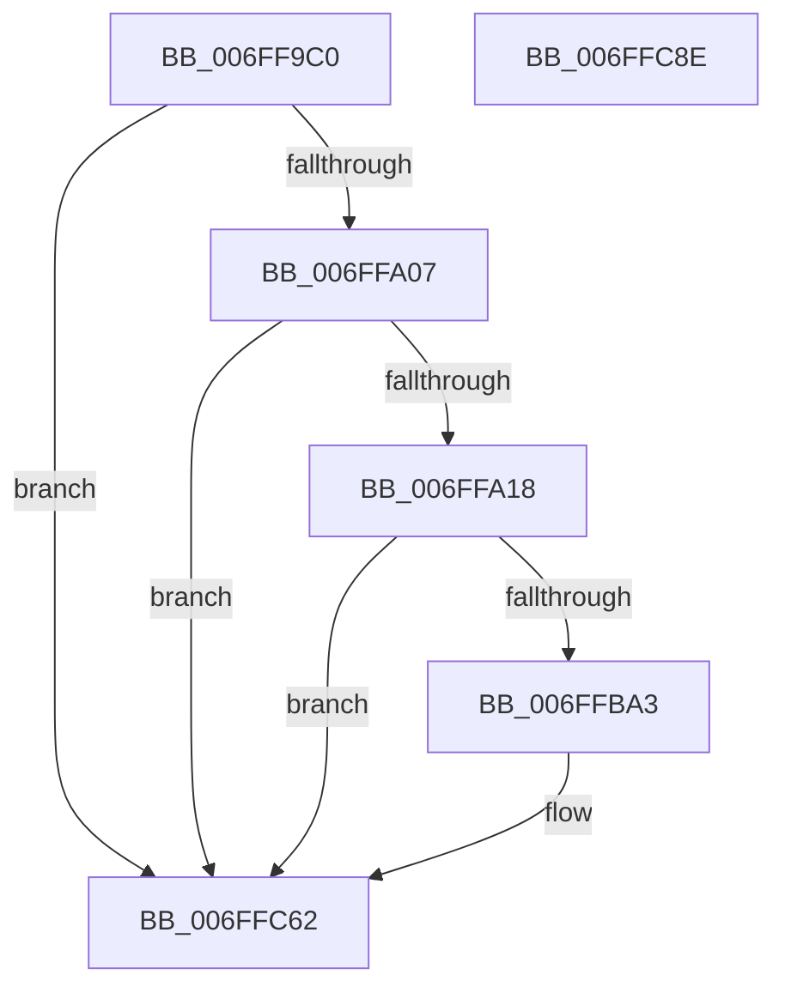

# KiTraceLogControlCallback

- RVA: `0x006FF9C0`–`0x006FFC8F` (길이 `719` bytes)
- VA: `0x00000001406FF9C0`
- 실행 섹션: `PAGE`
- PDB 이름 있음: `예`; PDB Function 태그: `아니요`
- unwind 정보 RVA: `0x000BF214`
- 디코드: `139`개 명령, `719/719` bytes 표시
- 미해석 바이트: `0` (있으면 어셈블리에 `.byte`로 보존)

> 이 문서는 커널 이미지의 기계어와 PDB 기호를 분석해 생성했습니다. 4번과 5번은 함수 원형과 자료형을 바이너리 사용 방식에서 추정한 C 해석이며 원본 소스 복구 결과는 아닙니다.

## 1. Dependencies

- 직접 호출 지점: **4**; 고유 호출 대상: **3**
- 직접 호출자로 확인된 함수: **0**
- RIP 상대 이미지 참조: **21**

### Outgoing calls
- `0x006FFA0A` → [KiTraceLogHeteroRundown](../../text/42/KiTraceLogHeteroRundown_function_004269B4.md) (function, `0x004269B4`)
- `0x006FFB95` → [tlgWriteTransfer_EtwWriteTransfer](../../text/42/tlgWriteTransfer_EtwWriteTransfer_function_004260E0.md) (function, `0x004260E0`)
- `0x006FFC5D` → [tlgWriteTransfer_EtwWriteTransfer](../../text/42/tlgWriteTransfer_EtwWriteTransfer_function_004260E0.md) (function, `0x004260E0`)
- `0x006FFC6C` → [_security_check_cookie](../../text/6A/_security_check_cookie_function_006AC640.md) (function, `0x006AC640`)

### Direct callers
- 이 함수 시작 RVA로 연결되는 직접 call은 확인되지 않았습니다. 간접 호출은 완전히 역산할 수 없습니다.

### Static image references
- `0x006FF9E2` → RVA `0x00E0A740` (`.data`; read)
- `0x006FFA18` → RVA `0x00FC53E0` (`ALMOSTRO`; read)
- `0x006FFA1E` → RVA `0x00047E48` (`.rdata`; read)
- `0x006FFA40` → RVA `0x00FC53E4` (`ALMOSTRO`; read)
- `0x006FFA56` → RVA `0x00FC53E8` (`ALMOSTRO`; read)
- `0x006FFA6B` → RVA `0x00FC53F0` (`ALMOSTRO`; read)
- `0x006FFA7E` → RVA `0x00FC53F8` (`ALMOSTRO`; read)
- `0x006FFA93` → RVA `0x00FC5400` (`ALMOSTRO`; read)
- `0x006FFAA6` → RVA `0x00FC5404` (`ALMOSTRO`; read)
- `0x006FFAB9` → RVA `0x00FC5408` (`ALMOSTRO`; read)
- `0x006FFACC` → RVA `0x00FC544C` (`ALMOSTRO`; read)
- `0x006FFADF` → RVA `0x00FC540C` (`ALMOSTRO`; read)
- `0x006FFAF2` → RVA `0x00FC5410` (`ALMOSTRO`; read)
- `0x006FFB05` → RVA `0x00FC5414` (`ALMOSTRO`; read)
- `0x006FFB18` → RVA `0x00FC5418` (`ALMOSTRO`; read)
- `0x006FFBA3` → RVA `0x00FC52E0` (`ALMOSTRO`; read)
- `0x006FFBA9` → RVA `0x00047FFC` (`.rdata`; read)
- `0x006FFBCD` → RVA `0x00FC52E4` (`ALMOSTRO`; read)
- `0x006FFBE6` → RVA `0x00FC52E8` (`ALMOSTRO`; read)
- `0x006FFBFC` → RVA `0x00FC52EC` (`ALMOSTRO`; read)
- `0x006FFC12` → RVA `0x00FC52F0` (`ALMOSTRO`; read)

## 2. Other-region calls and transfers

- 다른 실행 섹션으로 향하는 call: **4**
  - `0x006FFA0A` → [KiTraceLogHeteroRundown](../../text/42/KiTraceLogHeteroRundown_function_004269B4.md) (`PAGE` → `.text`)
  - `0x006FFB95` → [tlgWriteTransfer_EtwWriteTransfer](../../text/42/tlgWriteTransfer_EtwWriteTransfer_function_004260E0.md) (`PAGE` → `.text`)
  - `0x006FFC5D` → [tlgWriteTransfer_EtwWriteTransfer](../../text/42/tlgWriteTransfer_EtwWriteTransfer_function_004260E0.md) (`PAGE` → `.text`)
  - `0x006FFC6C` → [_security_check_cookie](../../text/6A/_security_check_cookie_function_006AC640.md) (`PAGE` → `.text`)
- 별도 외부 분기/꼬리 이동을 확인하지 못했습니다.

## 3. Assembly (complete function range)

```asm
006FF9C0  48 8B C4                        mov rax, rsp
006FF9C3  48 89 58 08                     mov qword ptr [rax + 8], rbx
006FF9C7  48 89 70 10                     mov qword ptr [rax + 0x10], rsi
006FF9CB  48 89 78 18                     mov qword ptr [rax + 0x18], rdi
006FF9CF  4C 89 70 20                     mov qword ptr [rax + 0x20], r14
006FF9D3  55                              push rbp
006FF9D4  48 8D A8 18 FF FF FF            lea rbp, [rax - 0xe8]
006FF9DB  48 81 EC E0 01 00 00            sub rsp, 0x1e0
006FF9E2  48 8B 05 57 AD 70 00            mov rax, qword ptr [rip + 0x70ad57]
006FF9E9  48 33 C4                        xor rax, rsp
006FF9EC  48 89 85 D0 00 00 00            mov qword ptr [rbp + 0xd0], rax
006FF9F3  48 8B 9D 20 01 00 00            mov rbx, qword ptr [rbp + 0x120]
006FF9FA  BE 01 00 00 00                  mov esi, 1
006FF9FF  3B D6                           cmp edx, esi
006FFA01  0F 85 5B 02 00 00               jne 0x1406ffc62
006FFA07  48 8B CB                        mov rcx, rbx
006FFA0A  E8 A5 6F D2 FF                  call 0x1404269b4
006FFA0F  83 3B 05                        cmp dword ptr [rbx], 5
006FFA12  0F 86 4A 02 00 00               jbe 0x1406ffc62
006FFA18  8B 05 C2 59 8C 00               mov eax, dword ptr [rip + 0x8c59c2]
006FFA1E  48 8D 15 23 84 94 FF            lea rdx, [rip - 0x6b7bdd]
006FFA25  89 44 24 3C                     mov dword ptr [rsp + 0x3c], eax
006FFA29  45 33 C9                        xor r9d, r9d
006FFA2C  48 8D 44 24 3C                  lea rax, [rsp + 0x3c]
006FFA31  48 C7 45 98 04 00 00 00         mov qword ptr [rbp - 0x68], 4
006FFA39  48 89 45 90                     mov qword ptr [rbp - 0x70], rax
006FFA3D  45 33 C0                        xor r8d, r8d
006FFA40  8B 05 9E 59 8C 00               mov eax, dword ptr [rip + 0x8c599e]
006FFA46  48 8B CB                        mov rcx, rbx
006FFA49  89 44 24 40                     mov dword ptr [rsp + 0x40], eax
006FFA4D  48 8D 44 24 40                  lea rax, [rsp + 0x40]
006FFA52  48 89 45 A0                     mov qword ptr [rbp - 0x60], rax
006FFA56  48 8B 05 8B 59 8C 00            mov rax, qword ptr [rip + 0x8c598b]
006FFA5D  48 89 44 24 58                  mov qword ptr [rsp + 0x58], rax
006FFA62  48 8D 44 24 58                  lea rax, [rsp + 0x58]
006FFA67  48 89 45 B0                     mov qword ptr [rbp - 0x50], rax
006FFA6B  8B 05 7F 59 8C 00               mov eax, dword ptr [rip + 0x8c597f]
006FFA71  89 44 24 44                     mov dword ptr [rsp + 0x44], eax
006FFA75  48 8D 44 24 44                  lea rax, [rsp + 0x44]
006FFA7A  48 89 45 C0                     mov qword ptr [rbp - 0x40], rax
006FFA7E  48 8B 05 73 59 8C 00            mov rax, qword ptr [rip + 0x8c5973]
006FFA85  48 89 44 24 60                  mov qword ptr [rsp + 0x60], rax
006FFA8A  48 8D 44 24 60                  lea rax, [rsp + 0x60]
006FFA8F  48 89 45 D0                     mov qword ptr [rbp - 0x30], rax
006FFA93  8B 05 67 59 8C 00               mov eax, dword ptr [rip + 0x8c5967]
006FFA99  89 44 24 48                     mov dword ptr [rsp + 0x48], eax
006FFA9D  48 8D 44 24 48                  lea rax, [rsp + 0x48]
006FFAA2  48 89 45 E0                     mov qword ptr [rbp - 0x20], rax
006FFAA6  8B 05 58 59 8C 00               mov eax, dword ptr [rip + 0x8c5958]
006FFAAC  89 44 24 4C                     mov dword ptr [rsp + 0x4c], eax
006FFAB0  48 8D 44 24 4C                  lea rax, [rsp + 0x4c]
006FFAB5  48 89 45 F0                     mov qword ptr [rbp - 0x10], rax
006FFAB9  8A 05 49 59 8C 00               mov al, byte ptr [rip + 0x8c5949]
006FFABF  88 44 24 30                     mov byte ptr [rsp + 0x30], al
006FFAC3  48 8D 44 24 30                  lea rax, [rsp + 0x30]
006FFAC8  48 89 45 00                     mov qword ptr [rbp], rax
006FFACC  8A 05 7A 59 8C 00               mov al, byte ptr [rip + 0x8c597a]
006FFAD2  88 44 24 31                     mov byte ptr [rsp + 0x31], al
006FFAD6  48 8D 44 24 31                  lea rax, [rsp + 0x31]
006FFADB  48 89 45 10                     mov qword ptr [rbp + 0x10], rax
006FFADF  8B 05 27 59 8C 00               mov eax, dword ptr [rip + 0x8c5927]
006FFAE5  89 44 24 50                     mov dword ptr [rsp + 0x50], eax
006FFAE9  48 8D 44 24 50                  lea rax, [rsp + 0x50]
006FFAEE  48 89 45 20                     mov qword ptr [rbp + 0x20], rax
006FFAF2  8B 05 18 59 8C 00               mov eax, dword ptr [rip + 0x8c5918]
006FFAF8  89 44 24 54                     mov dword ptr [rsp + 0x54], eax
006FFAFC  48 8D 44 24 54                  lea rax, [rsp + 0x54]
006FFB01  48 89 45 30                     mov qword ptr [rbp + 0x30], rax
006FFB05  8B 05 09 59 8C 00               mov eax, dword ptr [rip + 0x8c5909]
006FFB0B  89 44 24 34                     mov dword ptr [rsp + 0x34], eax
006FFB0F  48 8D 44 24 34                  lea rax, [rsp + 0x34]
006FFB14  48 89 45 40                     mov qword ptr [rbp + 0x40], rax
006FFB18  8B 05 FA 58 8C 00               mov eax, dword ptr [rip + 0x8c58fa]
006FFB1E  89 44 24 38                     mov dword ptr [rsp + 0x38], eax
006FFB22  48 8D 44 24 38                  lea rax, [rsp + 0x38]
006FFB27  48 89 45 50                     mov qword ptr [rbp + 0x50], rax
006FFB2B  48 8D 44 24 70                  lea rax, [rsp + 0x70]
006FFB30  48 89 44 24 28                  mov qword ptr [rsp + 0x28], rax
006FFB35  C7 44 24 20 0F 00 00 00         mov dword ptr [rsp + 0x20], 0xf
006FFB3D  48 C7 45 A8 04 00 00 00         mov qword ptr [rbp - 0x58], 4
006FFB45  48 C7 45 B8 08 00 00 00         mov qword ptr [rbp - 0x48], 8
006FFB4D  48 C7 45 C8 04 00 00 00         mov qword ptr [rbp - 0x38], 4
006FFB55  48 C7 45 D8 08 00 00 00         mov qword ptr [rbp - 0x28], 8
006FFB5D  48 C7 45 E8 04 00 00 00         mov qword ptr [rbp - 0x18], 4
006FFB65  48 C7 45 F8 04 00 00 00         mov qword ptr [rbp - 8], 4
006FFB6D  48 89 75 08                     mov qword ptr [rbp + 8], rsi
006FFB71  48 89 75 18                     mov qword ptr [rbp + 0x18], rsi
006FFB75  48 C7 45 28 04 00 00 00         mov qword ptr [rbp + 0x28], 4
006FFB7D  48 C7 45 38 04 00 00 00         mov qword ptr [rbp + 0x38], 4
006FFB85  48 C7 45 48 04 00 00 00         mov qword ptr [rbp + 0x48], 4
006FFB8D  48 C7 45 58 04 00 00 00         mov qword ptr [rbp + 0x58], 4
006FFB95  E8 46 65 D2 FF                  call 0x1404260e0
006FFB9A  83 3B 05                        cmp dword ptr [rbx], 5
006FFB9D  0F 86 BF 00 00 00               jbe 0x1406ffc62
006FFBA3  8A 05 37 57 8C 00               mov al, byte ptr [rip + 0x8c5737]
006FFBA9  48 8D 15 4C 84 94 FF            lea rdx, [rip - 0x6b7bb4]
006FFBB0  88 44 24 31                     mov byte ptr [rsp + 0x31], al
006FFBB4  45 33 C9                        xor r9d, r9d
006FFBB7  48 8D 44 24 31                  lea rax, [rsp + 0x31]
006FFBBC  48 89 B5 88 00 00 00            mov qword ptr [rbp + 0x88], rsi
006FFBC3  48 89 85 80 00 00 00            mov qword ptr [rbp + 0x80], rax
006FFBCA  45 33 C0                        xor r8d, r8d
006FFBCD  8A 05 11 57 8C 00               mov al, byte ptr [rip + 0x8c5711]
006FFBD3  48 8B CB                        mov rcx, rbx
006FFBD6  88 44 24 30                     mov byte ptr [rsp + 0x30], al
006FFBDA  48 8D 44 24 30                  lea rax, [rsp + 0x30]
006FFBDF  48 89 85 90 00 00 00            mov qword ptr [rbp + 0x90], rax
006FFBE6  8A 05 FC 56 8C 00               mov al, byte ptr [rip + 0x8c56fc]
006FFBEC  88 44 24 32                     mov byte ptr [rsp + 0x32], al
006FFBF0  48 8D 44 24 32                  lea rax, [rsp + 0x32]
006FFBF5  48 89 85 A0 00 00 00            mov qword ptr [rbp + 0xa0], rax
006FFBFC  8B 05 EA 56 8C 00               mov eax, dword ptr [rip + 0x8c56ea]
006FFC02  89 44 24 38                     mov dword ptr [rsp + 0x38], eax
006FFC06  48 8D 44 24 38                  lea rax, [rsp + 0x38]
006FFC0B  48 89 85 B0 00 00 00            mov qword ptr [rbp + 0xb0], rax
006FFC12  8B 05 D8 56 8C 00               mov eax, dword ptr [rip + 0x8c56d8]
006FFC18  89 44 24 34                     mov dword ptr [rsp + 0x34], eax
006FFC1C  48 8D 44 24 34                  lea rax, [rsp + 0x34]
006FFC21  48 89 85 C0 00 00 00            mov qword ptr [rbp + 0xc0], rax
006FFC28  48 8D 45 60                     lea rax, [rbp + 0x60]
006FFC2C  48 89 44 24 28                  mov qword ptr [rsp + 0x28], rax
006FFC31  C7 44 24 20 07 00 00 00         mov dword ptr [rsp + 0x20], 7
006FFC39  48 89 B5 98 00 00 00            mov qword ptr [rbp + 0x98], rsi
006FFC40  48 89 B5 A8 00 00 00            mov qword ptr [rbp + 0xa8], rsi
006FFC47  48 C7 85 B8 00 00 00 04 00 00 00  mov qword ptr [rbp + 0xb8], 4
006FFC52  48 C7 85 C8 00 00 00 04 00 00 00  mov qword ptr [rbp + 0xc8], 4
006FFC5D  E8 7E 64 D2 FF                  call 0x1404260e0
006FFC62  48 8B 8D D0 00 00 00            mov rcx, qword ptr [rbp + 0xd0]
006FFC69  48 33 CC                        xor rcx, rsp
006FFC6C  E8 CF C9 FA FF                  call 0x1406ac640
006FFC71  4C 8D 9C 24 E0 01 00 00         lea r11, [rsp + 0x1e0]
006FFC79  49 8B 5B 10                     mov rbx, qword ptr [r11 + 0x10]
006FFC7D  49 8B 73 18                     mov rsi, qword ptr [r11 + 0x18]
006FFC81  49 8B 7B 20                     mov rdi, qword ptr [r11 + 0x20]
006FFC85  4D 8B 73 28                     mov r14, qword ptr [r11 + 0x28]
006FFC89  49 8B E3                        mov rsp, r11
006FFC8C  5D                              pop rbp
006FFC8D  C3                              ret
006FFC8E  CC                              int3
```

## 4. C-style interpretation (structured pseudocode)

```c
__int64 __fastcall KiTraceLogControlCallback(__int64 a1, int a2, int a3, int a4)
{
    __int64 result;
    __int64 v_rsp;
    unsigned __int64 v_stack_m178;
    unsigned __int64 v_stack_m188;
    unsigned __int64 v_stack_m190;
    unsigned int v_stack_m194;
    unsigned int v_stack_m198;
    unsigned int v_stack_m19C;
    unsigned int v_stack_m1A0;
    unsigned int v_stack_m1A4;
    unsigned int v_stack_m1A8;
    unsigned int v_stack_m1AC;
    unsigned int v_stack_m1B0;
    unsigned int v_stack_m1B4;
    unsigned __int8 v_stack_m1B6;
    unsigned __int8 v_stack_m1B7;
    unsigned __int8 v_stack_m1B8;
    unsigned __int64 v_stack_m1C0;
    unsigned int v_stack_m1C8;
    unsigned __int64 v_stack_m8;

    *(unsigned __int64 *)(v_rsp + 8) = v_rbx;
    *(unsigned __int64 *)(v_rsp + 16) = v_rsi;
    *(unsigned __int64 *)(v_rsp + 24) = v_rdi;
    *(unsigned __int64 *)(v_rsp + 32) = v_r14;
    v_rsp = (v_rsp) - (480);
    result = (*(unsigned __int64 *)(v_rip + 7384407)) ^ (v_rsp);
    *(unsigned __int64 *)(v_rsp - 232 + 208) = result;
    if (a2 != 1) goto loc_006FFC62;
    result = KiTraceLogHeteroRundown(*(unsigned __int64 *)(v_rsp - 232 + 288), a2, a3, a4);
    if ((*(unsigned int *)(*(unsigned __int64 *)(v_rsp - 232 + 288))) <= 5) goto loc_006FFC62;
    v_stack_m1AC = (unsigned int)((unsigned int)(*(unsigned int *)(v_rip + 9198018)));
    a4 = 0;
    *(unsigned __int64 *)(v_rsp - 232 - 104) = 4;
    *(unsigned __int64 *)(v_rsp - 232 - 112) = v_stack_m1AC;
    a3 = 0;
    v_stack_m1A8 = (unsigned int)((unsigned int)(*(unsigned int *)(v_rip + 9197982)));
    *(unsigned __int64 *)(v_rsp - 232 - 96) = v_stack_m1A8;
    v_stack_m190 = *(unsigned __int64 *)(v_rip + 9197963);
    *(unsigned __int64 *)(v_rsp - 232 - 80) = v_stack_m190;
    v_stack_m1A4 = (unsigned int)((unsigned int)(*(unsigned int *)(v_rip + 9197951)));
    *(unsigned __int64 *)(v_rsp - 232 - 64) = v_stack_m1A4;
    v_stack_m188 = *(unsigned __int64 *)(v_rip + 9197939);
    *(unsigned __int64 *)(v_rsp - 232 - 48) = v_stack_m188;
    v_stack_m1A0 = (unsigned int)((unsigned int)(*(unsigned int *)(v_rip + 9197927)));
    *(unsigned __int64 *)(v_rsp - 232 - 32) = v_stack_m1A0;
    v_stack_m19C = (unsigned int)((unsigned int)(*(unsigned int *)(v_rip + 9197912)));
    *(unsigned __int64 *)(v_rsp - 232 - 16) = v_stack_m19C;
    v_stack_m1B8 = (unsigned __int8)(*(unsigned __int8 *)(v_rip + 9197897));
    *(unsigned __int64 *)(v_rsp - 232) = v_stack_m1B8;
    v_stack_m1B7 = (unsigned __int8)(*(unsigned __int8 *)(v_rip + 9197946));
    *(unsigned __int64 *)(v_rsp - 232 + 16) = v_stack_m1B7;
    v_stack_m198 = (unsigned int)((unsigned int)(*(unsigned int *)(v_rip + 9197863)));
    *(unsigned __int64 *)(v_rsp - 232 + 32) = v_stack_m198;
    v_stack_m194 = (unsigned int)((unsigned int)(*(unsigned int *)(v_rip + 9197848)));
    *(unsigned __int64 *)(v_rsp - 232 + 48) = v_stack_m194;
    v_stack_m1B4 = (unsigned int)((unsigned int)(*(unsigned int *)(v_rip + 9197833)));
    *(unsigned __int64 *)(v_rsp - 232 + 64) = v_stack_m1B4;
    v_stack_m1B0 = (unsigned int)((unsigned int)(*(unsigned int *)(v_rip + 9197818)));
    *(unsigned __int64 *)(v_rsp - 232 + 80) = v_stack_m1B0;
    v_stack_m1C0 = v_stack_m178;
    v_stack_m1C8 = 15;
    *(unsigned __int64 *)(v_rsp - 232 - 88) = 4;
    *(unsigned __int64 *)(v_rsp - 232 - 72) = 8;
    *(unsigned __int64 *)(v_rsp - 232 - 56) = 4;
    *(unsigned __int64 *)(v_rsp - 232 - 40) = 8;
    *(unsigned __int64 *)(v_rsp - 232 - 24) = 4;
    *(unsigned __int64 *)(v_rsp - 232 - 8) = 4;
    *(unsigned __int64 *)(v_rsp - 232 + 8) = 1;
    *(unsigned __int64 *)(v_rsp - 232 + 24) = 1;
    *(unsigned __int64 *)(v_rsp - 232 + 40) = 4;
    *(unsigned __int64 *)(v_rsp - 232 + 56) = 4;
    *(unsigned __int64 *)(v_rsp - 232 + 72) = 4;
    *(unsigned __int64 *)(v_rsp - 232 + 88) = 4;
    result = tlgWriteTransfer_EtwWriteTransfer(*(unsigned __int64 *)(v_rsp - 232 + 288), v_rip - 7044061, a3, a4);
    if ((*(unsigned int *)(*(unsigned __int64 *)(v_rsp - 232 + 288))) >= = 5) {
        result = *(unsigned __int8 *)(v_rip + 9197367);
        a2 = v_rip - 7044020;
        v_stack_m1B7 = (unsigned __int8)(result);
        a4 = 0;
        result = v_stack_m1B7;
        *(unsigned __int64 *)(v_rsp - 232 + 136) = 1;
        *(unsigned __int64 *)(v_rsp - 232 + 128) = result;
        a3 = 0;
        result = *(unsigned __int8 *)(v_rip + 9197329);
        a1 = *(unsigned __int64 *)(v_rsp - 232 + 288);
        v_stack_m1B8 = (unsigned __int8)(result);
        result = v_stack_m1B8;
        *(unsigned __int64 *)(v_rsp - 232 + 144) = result;
        result = *(unsigned __int8 *)(v_rip + 9197308);
        v_stack_m1B6 = (unsigned __int8)(result);
        result = v_stack_m1B6;
        *(unsigned __int64 *)(v_rsp - 232 + 160) = result;
        result = *(unsigned int *)(v_rip + 9197290);
        v_stack_m1B0 = (unsigned int)(result);
        result = v_stack_m1B0;
        *(unsigned __int64 *)(v_rsp - 232 + 176) = result;
        result = *(unsigned int *)(v_rip + 9197272);
        v_stack_m1B4 = (unsigned int)(result);
        result = v_stack_m1B4;
        *(unsigned __int64 *)(v_rsp - 232 + 192) = result;
        result = v_rsp - 232 + 96;
        v_stack_m1C0 = result;
        v_stack_m1C8 = 7;
        *(unsigned __int64 *)(v_rsp - 232 + 152) = 1;
        *(unsigned __int64 *)(v_rsp - 232 + 168) = 1;
        *(unsigned __int64 *)(v_rsp - 232 + 184) = 4;
        *(unsigned __int64 *)(v_rsp - 232 + 200) = 4;
        result = tlgWriteTransfer_EtwWriteTransfer(a1, a2, a3, a4);
    }
    a1 = (*(unsigned __int64 *)(v_rsp - 232 + 208)) ^ (v_rsp);
    result = _security_check_cookie(a1, a2, a3, a4);
    return result;
}
```

## 5. (Beta) C Style

```c
int64_t KiTraceLogControlCallback(int64_t Arg1, int32_t Arg2, int32_t Arg3, int32_t Arg4)
{
    int64_t result;
    int64_t local_rsp;
    uint64_t v_stack_m178;
    uint64_t v_stack_m188;
    uint64_t v_stack_m190;
    uint32_t v_stack_m194;
    uint32_t v_stack_m198;
    uint32_t v_stack_m19C;
    uint32_t v_stack_m1A0;
    uint32_t v_stack_m1A4;
    uint32_t v_stack_m1A8;
    uint32_t v_stack_m1AC;
    uint32_t v_stack_m1B0;
    uint32_t v_stack_m1B4;
    uint8_t v_stack_m1B6;
    uint8_t v_stack_m1B7;
    uint8_t v_stack_m1B8;
    uint64_t v_stack_m1C0;
    uint32_t v_stack_m1C8;
    uint64_t v_stack_m8;

    *(uint64_t *)(local_rsp + 0x8) = local_rbx;
    *(uint64_t *)(local_rsp + 0x10) = local_rsi;
    *(uint64_t *)(local_rsp + 0x18) = local_rdi;
    *(uint64_t *)(local_rsp + 0x20) = local_r14;
    local_rsp = (local_rsp) - (480);
    result = (*(uint64_t *)(v_rip + 0x70AD57)) ^ (local_rsp);
    *(uint64_t *)(local_rsp - 0xE8 + 0xD0) = result;
    if (Arg2 != 1) goto loc_006FFC62;
    result = KiTraceLogHeteroRundown(*(uint64_t *)(local_rsp - 0xE8 + 0x120), Arg2, Arg3, Arg4);
    if ((*(uint32_t *)(*(uint64_t *)(local_rsp - 0xE8 + 0x120))) <= 5) goto loc_006FFC62;
    v_stack_m1AC = (uint32_t)((uint32_t)(*(uint32_t *)(v_rip + 0x8C59C2)));
    Arg4 = 0;
    *(uint64_t *)(local_rsp - 0xE8 - 0x68) = 4;
    *(uint64_t *)(local_rsp - 0xE8 - 0x70) = v_stack_m1AC;
    Arg3 = 0;
    v_stack_m1A8 = (uint32_t)((uint32_t)(*(uint32_t *)(v_rip + 0x8C599E)));
    *(uint64_t *)(local_rsp - 0xE8 - 0x60) = v_stack_m1A8;
    v_stack_m190 = *(uint64_t *)(v_rip + 0x8C598B);
    *(uint64_t *)(local_rsp - 0xE8 - 0x50) = v_stack_m190;
    v_stack_m1A4 = (uint32_t)((uint32_t)(*(uint32_t *)(v_rip + 0x8C597F)));
    *(uint64_t *)(local_rsp - 0xE8 - 0x40) = v_stack_m1A4;
    v_stack_m188 = *(uint64_t *)(v_rip + 0x8C5973);
    *(uint64_t *)(local_rsp - 0xE8 - 0x30) = v_stack_m188;
    v_stack_m1A0 = (uint32_t)((uint32_t)(*(uint32_t *)(v_rip + 0x8C5967)));
    *(uint64_t *)(local_rsp - 0xE8 - 0x20) = v_stack_m1A0;
    v_stack_m19C = (uint32_t)((uint32_t)(*(uint32_t *)(v_rip + 0x8C5958)));
    *(uint64_t *)(local_rsp - 0xE8 - 0x10) = v_stack_m19C;
    v_stack_m1B8 = (uint8_t)(*(uint8_t *)(v_rip + 0x8C5949));
    *(uint64_t *)(local_rsp - 0xE8) = v_stack_m1B8;
    v_stack_m1B7 = (uint8_t)(*(uint8_t *)(v_rip + 0x8C597A));
    *(uint64_t *)(local_rsp - 0xE8 + 0x10) = v_stack_m1B7;
    v_stack_m198 = (uint32_t)((uint32_t)(*(uint32_t *)(v_rip + 0x8C5927)));
    *(uint64_t *)(local_rsp - 0xE8 + 0x20) = v_stack_m198;
    v_stack_m194 = (uint32_t)((uint32_t)(*(uint32_t *)(v_rip + 0x8C5918)));
    *(uint64_t *)(local_rsp - 0xE8 + 0x30) = v_stack_m194;
    v_stack_m1B4 = (uint32_t)((uint32_t)(*(uint32_t *)(v_rip + 0x8C5909)));
    *(uint64_t *)(local_rsp - 0xE8 + 0x40) = v_stack_m1B4;
    v_stack_m1B0 = (uint32_t)((uint32_t)(*(uint32_t *)(v_rip + 0x8C58FA)));
    *(uint64_t *)(local_rsp - 0xE8 + 0x50) = v_stack_m1B0;
    v_stack_m1C0 = v_stack_m178;
    v_stack_m1C8 = 15;
    *(uint64_t *)(local_rsp - 0xE8 - 0x58) = 4;
    *(uint64_t *)(local_rsp - 0xE8 - 0x48) = 8;
    *(uint64_t *)(local_rsp - 0xE8 - 0x38) = 4;
    *(uint64_t *)(local_rsp - 0xE8 - 0x28) = 8;
    *(uint64_t *)(local_rsp - 0xE8 - 0x18) = 4;
    *(uint64_t *)(local_rsp - 0xE8 - 0x8) = 4;
    *(uint64_t *)(local_rsp - 0xE8 + 0x8) = 1;
    *(uint64_t *)(local_rsp - 0xE8 + 0x18) = 1;
    *(uint64_t *)(local_rsp - 0xE8 + 0x28) = 4;
    *(uint64_t *)(local_rsp - 0xE8 + 0x38) = 4;
    *(uint64_t *)(local_rsp - 0xE8 + 0x48) = 4;
    *(uint64_t *)(local_rsp - 0xE8 + 0x58) = 4;
    result = tlgWriteTransfer_EtwWriteTransfer(*(uint64_t *)(local_rsp - 0xE8 + 0x120), v_rip - 7044061, Arg3, Arg4);
    if ((*(uint32_t *)(*(uint64_t *)(local_rsp - 0xE8 + 0x120))) >= = 5) {
        result = *(uint8_t *)(v_rip + 0x8C5737);
        Arg2 = v_rip - 7044020;
        v_stack_m1B7 = (uint8_t)(result);
        Arg4 = 0;
        result = v_stack_m1B7;
        *(uint64_t *)(local_rsp - 0xE8 + 0x88) = 1;
        *(uint64_t *)(local_rsp - 0xE8 + 0x80) = result;
        Arg3 = 0;
        result = *(uint8_t *)(v_rip + 0x8C5711);
        Arg1 = *(uint64_t *)(local_rsp - 0xE8 + 0x120);
        v_stack_m1B8 = (uint8_t)(result);
        result = v_stack_m1B8;
        *(uint64_t *)(local_rsp - 0xE8 + 0x90) = result;
        result = *(uint8_t *)(v_rip + 0x8C56FC);
        v_stack_m1B6 = (uint8_t)(result);
        result = v_stack_m1B6;
        *(uint64_t *)(local_rsp - 0xE8 + 0xA0) = result;
        result = *(uint32_t *)(v_rip + 0x8C56EA);
        v_stack_m1B0 = (uint32_t)(result);
        result = v_stack_m1B0;
        *(uint64_t *)(local_rsp - 0xE8 + 0xB0) = result;
        result = *(uint32_t *)(v_rip + 0x8C56D8);
        v_stack_m1B4 = (uint32_t)(result);
        result = v_stack_m1B4;
        *(uint64_t *)(local_rsp - 0xE8 + 0xC0) = result;
        result = local_rsp - 232 + 96;
        v_stack_m1C0 = result;
        v_stack_m1C8 = 7;
        *(uint64_t *)(local_rsp - 0xE8 + 0x98) = 1;
        *(uint64_t *)(local_rsp - 0xE8 + 0xA8) = 1;
        *(uint64_t *)(local_rsp - 0xE8 + 0xB8) = 4;
        *(uint64_t *)(local_rsp - 0xE8 + 0xC8) = 4;
        result = tlgWriteTransfer_EtwWriteTransfer(Arg1, Arg2, Arg3, Arg4);
    }
    Arg1 = (*(uint64_t *)(local_rsp - 0xE8 + 0xD0)) ^ (local_rsp);
    result = _security_check_cookie(Arg1, Arg2, Arg3, Arg4);
    return result;
}
```

## 6. Execution-region graph

[열기: 2D/3D 그래프와 함수 탐색 컨트롤 패널](../../../control-panel.html?section=page&rva=0x006FF9C0&view=graph)

- 2D 그래프는 위에서 아래로 흐르고, 3D 그래프는 빈 공간을 드래그해 회전합니다. Shift+드래그는 이동, 휠은 확대·축소, 함수 노드 선택은 대상 보고서 이동입니다.

### Static fallback


