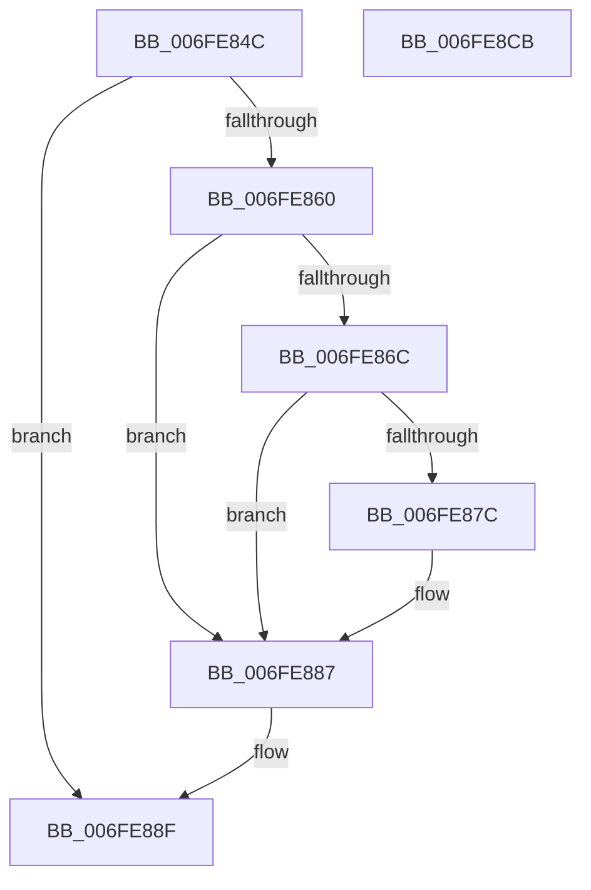

# MiComputeAweCharges

- RVA: `0x006FE84C`–`0x006FE8CC` (길이 `128` bytes)
- VA: `0x00000001406FE84C`
- 실행 섹션: `PAGE`
- PDB 이름 있음: `예`; PDB Function 태그: `아니요`
- unwind 정보 RVA: `0x0005C788`
- 디코드: `36`개 명령, `128/128` bytes 표시
- 미해석 바이트: `0` (있으면 어셈블리에 `.byte`로 보존)

> 이 문서는 커널 이미지의 기계어와 PDB 기호를 분석해 생성했습니다. 4번과 5번은 함수 원형과 자료형을 바이너리 사용 방식에서 추정한 C 해석이며 원본 소스 복구 결과는 아닙니다.

## 1. Dependencies

- 직접 호출 지점: **4**; 고유 호출 대상: **4**
- 직접 호출자로 확인된 함수: **2**
- RIP 상대 이미지 참조: **0**

### Outgoing calls
- `0x006FE86F` → [MiGetAweViewPageSize](../../text/4C/MiGetAweViewPageSize_function_004C51AC.md) (function, `0x004C51AC`)
- `0x006FE87F` → [MiGetAwePageSize](../../text/46/MiGetAwePageSize_function_0046CFA8.md) (function, `0x0046CFA8`)
- `0x006FE887` → [MiPageSizeToPteLevel](../../text/41/MiPageSizeToPteLevel_function_0041F57C.md) (function, `0x0041F57C`)
- `0x006FE8C1` → [MiResidentPagesForSpan](../9B/MiResidentPagesForSpan_function_009BB300.md) (function, `0x009BB300`)

### Direct callers
- [sub_006DC410](../../text/6D/Unknown_function_006DC410.md) at `0x006DC416`
- [MiFreeAweView](MiFreeAweView_function_006FE7A4.md) at `0x006FE7D6`

### Static image references
- 디코드된 RIP-relative 메모리 참조가 없습니다.

## 2. Other-region calls and transfers

- 다른 실행 섹션으로 향하는 call: **3**
  - `0x006FE86F` → [MiGetAweViewPageSize](../../text/4C/MiGetAweViewPageSize_function_004C51AC.md) (`PAGE` → `.text`)
  - `0x006FE87F` → [MiGetAwePageSize](../../text/46/MiGetAwePageSize_function_0046CFA8.md) (`PAGE` → `.text`)
  - `0x006FE887` → [MiPageSizeToPteLevel](../../text/41/MiPageSizeToPteLevel_function_0041F57C.md) (`PAGE` → `.text`)
- 별도 외부 분기/꼬리 이동을 확인하지 못했습니다.

## 3. Assembly (complete function range)

```asm
006FE84C  48 83 EC 28                     sub rsp, 0x28
006FE850  45 33 C9                        xor r9d, r9d
006FE853  4C 8B D1                        mov r10, rcx
006FE856  B9 01 00 00 00                  mov ecx, 1
006FE85B  48 85 D2                        test rdx, rdx
006FE85E  74 2F                           je 0x1406fe88f
006FE860  4C 8B 42 20                     mov r8, qword ptr [rdx + 0x20]
006FE864  41 8B 40 08                     mov eax, dword ptr [r8 + 8]
006FE868  84 C1                           test cl, al
006FE86A  75 1B                           jne 0x1406fe887
006FE86C  48 8B CA                        mov rcx, rdx
006FE86F  E8 38 69 DC FF                  call 0x1404c51ac
006FE874  48 8B C8                        mov rcx, rax
006FE877  48 85 C0                        test rax, rax
006FE87A  75 0B                           jne 0x1406fe887
006FE87C  49 8B C8                        mov rcx, r8
006FE87F  E8 24 E7 D6 FF                  call 0x14046cfa8
006FE884  48 8B C8                        mov rcx, rax
006FE887  E8 F0 0C D2 FF                  call 0x14041f57c
006FE88C  44 8B C8                        mov r9d, eax
006FE88F  41 8B 4A 1C                     mov ecx, dword ptr [r10 + 0x1c]
006FE893  45 8B 42 18                     mov r8d, dword ptr [r10 + 0x18]
006FE897  41 0F B6 52 21                  movzx edx, byte ptr [r10 + 0x21]
006FE89C  48 C1 E2 20                     shl rdx, 0x20
006FE8A0  48 0B D1                        or rdx, rcx
006FE8A3  41 0F B6 4A 20                  movzx ecx, byte ptr [r10 + 0x20]
006FE8A8  48 C1 E1 20                     shl rcx, 0x20
006FE8AC  49 0B C8                        or rcx, r8
006FE8AF  48 C1 E2 0C                     shl rdx, 0xc
006FE8B3  48 C1 E1 0C                     shl rcx, 0xc
006FE8B7  48 81 CA FF 0F 00 00            or rdx, 0xfff
006FE8BE  45 8B C1                        mov r8d, r9d
006FE8C1  E8 3A CA 2B 00                  call 0x1409bb300
006FE8C6  48 83 C4 28                     add rsp, 0x28
006FE8CA  C3                              ret
006FE8CB  CC                              int3
```

## 4. C-style interpretation (structured pseudocode)

```c
__int64 __fastcall MiComputeAweCharges(__int64 a1, __int64 a2, __int64 a3, int a4)
{
    __int64 result;
    __int64 v_rsp;

    v_rsp = (v_rsp) - (40);
    a4 = 0;
    if (a2 == 0) goto loc_006FE88F;
    if (((1) & ((unsigned __int8)((unsigned int)(*(unsigned int *)(*(unsigned __int64 *)(a2 + 32) + 8))))) != 0) goto loc_006FE887;
    result = MiGetAweViewPageSize(a2, a2, *(unsigned __int64 *)(a2 + 32), a4);
    if (result == 0) {
        a1 = *(unsigned __int64 *)(a2 + 32);
        result = MiGetAwePageSize(a1, a2, *(unsigned __int64 *)(a2 + 32), a4);
        a1 = result;
    }
    result = MiPageSizeToPteLevel(a1, a2, *(unsigned __int64 *)(a2 + 32), a4);
loc_006FE88F:
    a2 = (*(unsigned __int8 *)(a1 + 33)) << (32);
    a2 = (a2) | ((unsigned int)(*(unsigned int *)(a1 + 28)));
    a1 = (*(unsigned __int8 *)(a1 + 32)) << (32);
    a1 = (a1) | ((unsigned int)(*(unsigned int *)(a1 + 24)));
    a2 = (a2) << (12);
    a1 = (a1) << (12);
    a2 = (a2) | (0xFFFULL);
    result = MiResidentPagesForSpan(a1, a2, (unsigned int)((unsigned int)((unsigned int)((unsigned int)(result)))), (unsigned int)((unsigned int)(result)));
    v_rsp = (v_rsp) + (40);
    return result;
}
```

## 5. (Beta) C Style

```c
int64_t MiComputeAweCharges(int64_t Arg1, int64_t Arg2, int64_t Arg3, int32_t Arg4)
{
    int64_t result;
    int64_t local_rsp;

    local_rsp = (local_rsp) - (40);
    Arg4 = 0;
    if (Arg2 == 0) goto loc_006FE88F;
    if (((1) & ((uint8_t)((uint32_t)(*(uint32_t *)(*(uint64_t *)(Arg2 + 0x20) + 0x8))))) != 0) goto loc_006FE887;
    result = MiGetAweViewPageSize(Arg2, Arg2, *(uint64_t *)(Arg2 + 0x20), Arg4);
    if (result == 0) {
        Arg1 = *(uint64_t *)(Arg2 + 0x20);
        result = MiGetAwePageSize(Arg1, Arg2, *(uint64_t *)(Arg2 + 0x20), Arg4);
        Arg1 = result;
    }
    result = MiPageSizeToPteLevel(Arg1, Arg2, *(uint64_t *)(Arg2 + 0x20), Arg4);
loc_006FE88F:
    Arg2 = (*(uint8_t *)(Arg1 + 0x21)) << (32);
    Arg2 = (Arg2) | ((uint32_t)(*(uint32_t *)(Arg1 + 0x1C)));
    Arg1 = (*(uint8_t *)(Arg1 + 0x20)) << (32);
    Arg1 = (Arg1) | ((uint32_t)(*(uint32_t *)(Arg1 + 0x18)));
    Arg2 = (Arg2) << (12);
    Arg1 = (Arg1) << (12);
    Arg2 = (Arg2) | (0xFFFULL);
    result = MiResidentPagesForSpan(Arg1, Arg2, (uint32_t)((uint32_t)((uint32_t)((uint32_t)(result)))), (uint32_t)((uint32_t)(result)));
    local_rsp = (local_rsp) + (40);
    return result;
}
```

## 6. Execution-region graph

[열기: 2D/3D 그래프와 함수 탐색 컨트롤 패널](../../../control-panel.html?section=page&rva=0x006FE84C&view=graph)

- 2D 그래프는 위에서 아래로 흐르고, 3D 그래프는 빈 공간을 드래그해 회전합니다. Shift+드래그는 이동, 휠은 확대·축소, 함수 노드 선택은 대상 보고서 이동입니다.

### Static fallback


