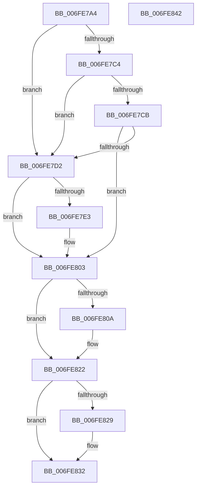

# MiFreeAweView

- RVA: `0x006FE7A4`–`0x006FE843` (길이 `159` bytes)
- VA: `0x00000001406FE7A4`
- 실행 섹션: `PAGE`
- PDB 이름 있음: `예`; PDB Function 태그: `아니요`
- unwind 정보 RVA: `0x00060BC4`
- 디코드: `41`개 명령, `159/159` bytes 표시
- 미해석 바이트: `0` (있으면 어셈블리에 `.byte`로 보존)

> 이 문서는 커널 이미지의 기계어와 PDB 기호를 분석해 생성했습니다. 4번과 5번은 함수 원형과 자료형을 바이너리 사용 방식에서 추정한 C 해석이며 원본 소스 복구 결과는 아닙니다.

## 1. Dependencies

- 직접 호출 지점: **5**; 고유 호출 대상: **5**
- 직접 호출자로 확인된 함수: **1**
- RIP 상대 이미지 참조: **0**

### Outgoing calls
- `0x006FE7D6` → [MiComputeAweCharges](MiComputeAweCharges_function_006FE84C.md) (function, `0x006FE84C`)
- `0x006FE7F3` → [MiGetProcessPartition](../../text/44/MiGetProcessPartition_function_00443B10.md) (function, `0x00443B10`)
- `0x006FE7FE` → [MiReturnResident](../../text/28/MiReturnResident_function_00286890.md) (function, `0x00286890`)
- `0x006FE81D` → [MiFreeVadEventBitmapCharges](../70/MiFreeVadEventBitmapCharges_function_00704944.md) (function, `0x00704944`)
- `0x006FE82D` → [MiDereferenceControlArea](../../text/47/MiDereferenceControlArea_function_00479A20.md) (function, `0x00479A20`)

### Direct callers
- [sub_009BB189](../9B/Unknown_function_009BB189.md) at `0x009BB238`

### Static image references
- 디코드된 RIP-relative 메모리 참조가 없습니다.

## 2. Other-region calls and transfers

- 다른 실행 섹션으로 향하는 call: **3**
  - `0x006FE7F3` → [MiGetProcessPartition](../../text/44/MiGetProcessPartition_function_00443B10.md) (`PAGE` → `.text`)
  - `0x006FE7FE` → [MiReturnResident](../../text/28/MiReturnResident_function_00286890.md) (`PAGE` → `.text`)
  - `0x006FE82D` → [MiDereferenceControlArea](../../text/47/MiDereferenceControlArea_function_00479A20.md) (`PAGE` → `.text`)
- 별도 외부 분기/꼬리 이동을 확인하지 못했습니다.

## 3. Assembly (complete function range)

```asm
006FE7A4  48 89 5C 24 08                  mov qword ptr [rsp + 8], rbx
006FE7A9  48 89 74 24 10                  mov qword ptr [rsp + 0x10], rsi
006FE7AE  57                              push rdi
006FE7AF  48 83 EC 20                     sub rsp, 0x20
006FE7B3  48 8B 79 28                     mov rdi, qword ptr [rcx + 0x28]
006FE7B7  48 8B F1                        mov rsi, rcx
006FE7BA  48 8B 49 20                     mov rcx, qword ptr [rcx + 0x20]
006FE7BE  48 83 39 FE                     cmp qword ptr [rcx], -2
006FE7C2  75 0E                           jne 0x1406fe7d2
006FE7C4  48 83 79 08 FE                  cmp qword ptr [rcx + 8], -2
006FE7C9  75 07                           jne 0x1406fe7d2
006FE7CB  48 83 79 10 FE                  cmp qword ptr [rcx + 0x10], -2
006FE7D0  74 31                           je 0x1406fe803
006FE7D2  48 8D 56 08                     lea rdx, [rsi + 8]
006FE7D6  E8 71 00 00 00                  call 0x1406fe84c
006FE7DB  4C 8B C0                        mov r8, rax
006FE7DE  48 85 C0                        test rax, rax
006FE7E1  74 20                           je 0x1406fe803
006FE7E3  65 48 8B 0C 25 88 01 00 00      mov rcx, qword ptr gs:[0x188]
006FE7EC  48 8B 89 B8 00 00 00            mov rcx, qword ptr [rcx + 0xb8]
006FE7F3  E8 18 53 D4 FF                  call 0x140443b10
006FE7F8  49 8B D0                        mov rdx, r8
006FE7FB  48 8B C8                        mov rcx, rax
006FE7FE  E8 8D 80 B8 FF                  call 0x140286890
006FE803  48 83 7E 38 00                  cmp qword ptr [rsi + 0x38], 0
006FE808  74 18                           je 0x1406fe822
006FE80A  65 48 8B 0C 25 88 01 00 00      mov rcx, qword ptr gs:[0x188]
006FE813  48 8B D6                        mov rdx, rsi
006FE816  48 8B 89 B8 00 00 00            mov rcx, qword ptr [rcx + 0xb8]
006FE81D  E8 22 61 00 00                  call 0x140704944
006FE822  8B 47 08                        mov eax, dword ptr [rdi + 8]
006FE825  A8 01                           test al, 1
006FE827  75 09                           jne 0x1406fe832
006FE829  48 8B 4F 28                     mov rcx, qword ptr [rdi + 0x28]
006FE82D  E8 EE B1 D7 FF                  call 0x140479a20
006FE832  48 8B 5C 24 30                  mov rbx, qword ptr [rsp + 0x30]
006FE837  48 8B 74 24 38                  mov rsi, qword ptr [rsp + 0x38]
006FE83C  48 83 C4 20                     add rsp, 0x20
006FE840  5F                              pop rdi
006FE841  C3                              ret
006FE842  CC                              int3
```

## 4. C-style interpretation (structured pseudocode)

```c
__int64 __fastcall MiFreeAweView(__int64 a1)
{
    __int64 result;
    __int64 v_rsp;
    unsigned __int64 v_stack_p10;
    unsigned __int64 v_stack_p8;

    v_stack_p8 = v_rbx;
    v_stack_p10 = v_rsi;
    v_rsp = (v_rsp) - (32);
    if ((*(unsigned __int64 *)(*(unsigned __int64 *)(a1 + 32))) != -2) goto loc_006FE7D2;
    if ((*(unsigned __int64 *)(*(unsigned __int64 *)(a1 + 32) + 8)) != -2) goto loc_006FE7D2;
    if ((*(unsigned __int64 *)(*(unsigned __int64 *)(a1 + 32) + 16)) == -2) goto loc_006FE803;
loc_006FE7D2:
    result = MiComputeAweCharges(*(unsigned __int64 *)(a1 + 32), a1 + 8, a3, a4);
    if (result != 0) {
        a1 = *(unsigned __int64 *)(gs_base + (0 + 392));
        a1 = *(unsigned __int64 *)(a1 + 184);
        result = MiGetProcessPartition(a1, a1 + 8, result, a4);
        a2 = result;
        a1 = result;
        result = MiReturnResident(a1, a2, result, a4);
    }
    if ((*(unsigned __int64 *)(a1 + 56)) != 0) {
        a1 = *(unsigned __int64 *)(gs_base + (0 + 392));
        a2 = a1;
        a1 = *(unsigned __int64 *)(a1 + 184);
        result = MiFreeVadEventBitmapCharges(a1, a2, result, a4);
    }
    result = (unsigned int)(*(unsigned int *)(*(unsigned __int64 *)(a1 + 40) + 8));
    if ((((unsigned __int8)((unsigned int)(*(unsigned int *)(*(unsigned __int64 *)(a1 + 40) + 8)))) & (1)) == 0) {
        a1 = *(unsigned __int64 *)(*(unsigned __int64 *)(a1 + 40) + 40);
        result = MiDereferenceControlArea(a1, a2, result, a4);
    }
    v_rsp = (v_rsp) + (32);
    return result;
}
```

## 5. (Beta) C Style

```c
int64_t MiFreeAweView(void *Arg1)
{
    uint8_t *arg1 = (uint8_t *)Arg1;

    int64_t result;
    int64_t local_rsp;
    uint64_t v_stack_p10;
    uint64_t v_stack_p8;

    v_stack_p8 = local_rbx;
    v_stack_p10 = local_rsi;
    local_rsp = (local_rsp) - (32);
    if ((*(uint64_t *)(*(uint64_t *)(arg1 + 0x20))) != -2) goto loc_006FE7D2;
    if ((*(uint64_t *)(*(uint64_t *)(arg1 + 0x20) + 0x8)) != -2) goto loc_006FE7D2;
    if ((*(uint64_t *)(*(uint64_t *)(arg1 + 0x20) + 0x10)) == -2) goto loc_006FE803;
loc_006FE7D2:
    result = MiComputeAweCharges(*(uint64_t *)(arg1 + 0x20), Arg1 + 8, a3, a4);
    if (result != 0) {
        Arg1 = *(uint64_t *)(gs_base + (0 + 0x188));
        Arg1 = *(uint64_t *)(arg1 + 0xB8);
        result = MiGetProcessPartition(Arg1, Arg1 + 8, result, a4);
        a2 = result;
        Arg1 = result;
        result = MiReturnResident(Arg1, a2, result, a4);
    }
    if ((*(uint64_t *)(arg1 + 0x38)) != 0) {
        Arg1 = *(uint64_t *)(gs_base + (0 + 0x188));
        a2 = Arg1;
        Arg1 = *(uint64_t *)(arg1 + 0xB8);
        result = MiFreeVadEventBitmapCharges(Arg1, a2, result, a4);
    }
    result = (uint32_t)(*(uint32_t *)(*(uint64_t *)(arg1 + 0x28) + 0x8));
    if ((((uint8_t)((uint32_t)(*(uint32_t *)(*(uint64_t *)(arg1 + 0x28) + 0x8)))) & (1)) == 0) {
        Arg1 = *(uint64_t *)(*(uint64_t *)(arg1 + 0x28) + 0x28);
        result = MiDereferenceControlArea(Arg1, a2, result, a4);
    }
    local_rsp = (local_rsp) + (32);
    return result;
}
```

### 관측된 메모리 오프셋

구조체 형식이 확인되지 않은 접근은 인자 기준의 오프셋으로만 기록했습니다.

| 기준 인자 | 오프셋 표현 | 폭 (bit) | 접근 |
|---|---:|---:|---|
| `Arg1` | `+ 0x8` | `64` | `R` |
| `Arg1` | `+ 0x20` | `64` | `R` |
| `Arg1` | `+ 0x28` | `64` | `R` |
| `Arg1` | `+ 0x38` | `64` | `R` |

## 6. Execution-region graph

[열기: 2D/3D 그래프와 함수 탐색 컨트롤 패널](../../../control-panel.html?section=page&rva=0x006FE7A4&view=graph)

- 2D 그래프는 위에서 아래로 흐르고, 3D 그래프는 빈 공간을 드래그해 회전합니다. Shift+드래그는 이동, 휠은 확대·축소, 함수 노드 선택은 대상 보고서 이동입니다.

### Static fallback


